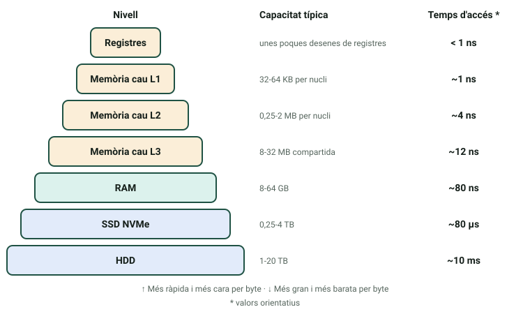

La RAM i la CPU decidixen com de ràpid «se sent» un equip. Si saps llegir «DDR5-6000 CL30» o «6 nuclis, 12 fils, 65 W», podràs comparar components amb números en compte de fiar-te del màrqueting, i entendràs per què comprar més GHz no sempre és comprar més rendiment.

:::tip[Com treballar esta pàgina]
**Temps orientatiu:** uns 75 minuts de lectura i 45 de pràctica.

1. Llig primer les seccions 1 i 2 (memòria i RAM) i després les 3, 4 i 5 (CPU).
2. Les fórmules de latència i d'ample de banda (secció 2) es practiquen: no et fies de llegir-les, fes els càlculs.
3. Practica amb el [laboratori «Dins de la CPU»](/docencia/dam/sistemas-informaticos/ud01-hardware/laboratorios/dins-la-cpu/) (pestanyes «Registres pas a pas», «On és la dada?», «Calculadora de RAM» i «Nuclis, fils i IPC») i fes les activitats 2 i 3.
:::

## 1. Tipus de memòria d'un ordinador

Un ordinador no té una sola memòria, sinó diversos nivells. Com més prop de la CPU, més ràpida, més cara i més xicoteta.

| Memòria | Tecnologia | Volàtil | On és | Per a què servix |
|---|---|---|---|---|
| Registres | Circuits de la CPU | Sí | Dins de la CPU | Dades amb què la CPU opera ara mateix |
| Memòria cau (L1, L2, L3) | SRAM | Sí | Dins de la CPU | Còpies de dades i instruccions usades fa poc |
| RAM (memòria principal) | DRAM | Sí | Mòduls DIMM o SO-DIMM | Programes i dades en ús |
| Microprogramari (UEFI/BIOS) | Memòria flash | No | Xip de la placa | Arrancar el sistema |
| Emmagatzematge | Flash NAND o plats magnètics | No | SSD o HDD | Guardar la informació de forma permanent |

Una memòria és **volàtil** si perd el contingut quan se li talla el corrent. Quan la RAM s'omple, el sistema operatiu mou dades al disc (la *memòria virtual*, el fitxer de paginació o *swap*): l'equip continua funcionant, però molt més lent, perquè el disc és molt més lent que la RAM.

## 2. La memòria RAM

### 2.1 Què és

La RAM (*Random Access Memory*) és la memòria de treball: guarda de forma temporal les dades i les instruccions dels programes que la CPU fa servir. S'anomena «d'accés aleatori» perquè llegir o escriure qualsevol posició tarda el mateix, estiga on estiga dins del xip (en un disc dur mecànic, en canvi, les dades disperses tarden més que les contigües).

És **volàtil**: cada bit es guarda carregant un diminut condensador que es descarrega, per això la RAM es *refresca* constantment (cada pocs mil·lisegons) i, quan se'n va el corrent, tot es perd. Una analogia: l'emmagatzematge és l'arxivador de l'oficina, on els documents es guarden per sempre; la RAM és la taula de treball: només hi caben els documents que fas servir ara i, en acabar el dia (en apagar l'ordinador), queda buida.

### 2.2 Generacions DDR

Els mòduls evolucionen en generacions **DDR** (*Double Data Rate*), cada una més ràpida i eficient que l'anterior, però **incompatibles entre si**: l'osca del mòdul està en una posició diferent perquè no pugues instal·lar un DDR5 en una placa DDR4.

| Generació | Al mercat des de | Velocitats habituals (MT/s) | Voltatge típic |
|---|---|---|---|
| DDR3 (en desús) | 2007 | 1333-2133 | 1,5 V |
| DDR4 | 2014 | 2133-3600 | 1,2 V |
| DDR5 | 2021 | 4800-8000 | 1,1 V |

Els mòduls **DIMM** (llargs) s'usen en equips de sobretaula i els **SO-DIMM** (més curts) en portàtils i miniPC. En servidors i estacions de treball és habitual la memòria **ECC**, que detecta i corregix errors d'un bit.

### 2.3 Les quatre característiques

- **Capacitat:** quantitat de dades que guarda, en GB. Valors habituals: 8, 16 o 32 GB per mòdul.
- **Velocitat:** es mesura en **MT/s** (milions de transferències per segon). DDR4-3200 fa 3200 MT/s; en el màrqueting se sol dir «3200 MHz», encara que la freqüència real del rellotge és la meitat.
- **Latència (CL, *CAS latency*):** cicles de rellotge que tarda la memòria a respondre. Un CL més baix és millor, però cal passar-lo a temps real: **latència (ns) = CL × 2000 ÷ velocitat (MT/s)**.
- **Canals (*dual* o *quad channel*):** si instal·les 2 o 4 mòduls (idealment idèntics) en les ranures corresponents, la placa els llig en paral·lel i multiplica l'**ample de banda** sense canviar la latència. Ample de banda per canal: **velocitat (MT/s) × 8 bytes**.

:::note[Exemple resolt]
Un mòdul **DDR4-3200 CL16**:

- Latència: 16 × 2000 ÷ 3200 = **10 ns**.
- Ample de banda per canal: 3200 × 8 = 25.600 MB/s = **25,6 GB/s**.
- En *dual channel*, dos mòduls iguals donen **51,2 GB/s** i la latència continua sent de 10 ns.

Compara-ho amb un **DDR5-4800 CL40**: 40 × 2000 ÷ 4800 ≈ **16,7 ns** i 4800 × 8 = **38,4 GB/s** per canal. Més ample de banda, però una latència una mica pitjor: la DDR5 no és «més ràpida» en tot.
:::

:::caution[Perfils XMP i EXPO]
Un kit anunciat com «DDR4-3600» pot arrancar a una velocitat base inferior fins que actives el seu perfil (XMP en Intel, EXPO en AMD) a la UEFI. I si barreges mòduls diferents, tot el conjunt treballa a la velocitat del més lent.
:::

La pestanya «Calculadora de RAM» del [laboratori](/docencia/dam/sistemas-informaticos/ud01-hardware/laboratorios/dins-la-cpu/#ram) fa estos càlculs per tu i et deixa comparar dos mòduls.

## 3. La CPU: parts internes

La CPU (*Central Processing Unit*) executa les instruccions dels programes: cada càlcul, comparació o moviment de dades acaba convertit en instruccions que processa una darrere d'una altra. Té quatre parts principals:

- **ALU (unitat aritmeticològica):** fa les operacions aritmètiques (suma, resta, multiplicació) i lògiques (comparacions, AND, OR, NOT).
- **Unitat de control:** dirigix l'orquestra. No calcula res, però decidix en cada cicle quina instrucció cal buscar, com interpretar-la i què activar per a executar-la.
- **Registres:** unes poques desenes de memòries internes de la CPU, molt més ràpides que la RAM (centenars de vegades) però de pocs bytes cada una. Guarden les dades amb què la CPU opera en eixe instant.
- **Memòria cau (L1, L2, L3):** una memòria intermèdia, més ràpida que la RAM i més lenta que els registres, que guarda còpies del que s'ha usat fa poc per a no haver d'anar a buscar-ho a la RAM cada vegada.

| Nivell | Mida típica | Velocitat | On és |
|---|---|---|---|
| L1 | 32-64 KB per nucli | La més ràpida | Dins de cada nucli |
| L2 | 0,25-2 MB per nucli | Ràpida | Dins de cada nucli |
| L3 | 8-32 MB | Més lenta que L1 i L2, però molt més ràpida que la RAM | Compartida entre tots els nuclis |

Recorda el model de Von Neumann: la CPU i la memòria compartixen un únic camí, i això limita la velocitat (el «coll d'ampolla de Von Neumann»). La memòria cau l'alleugerix, i les CPU actuals tenen a més caus L1 separades per a instruccions i per a dades (*arquitectura Harvard modificada*).

:::note[Arquitectura i microarquitectura]
El **repertori d'instruccions** (ISA) és el «contracte» entre el programari i la CPU: x86-64 (Intel i AMD), ARM (mòbils, Apple Silicon) o RISC-V. La **microarquitectura** és com cada fabricant construïx la CPU per dins. Un programa compilat per a x86-64 no s'executa directament en una CPU ARM; cal recompilar-lo o traduir-lo.
:::

## 4. El cicle d'instrucció

Cada instrucció, per senzilla que siga, passa per quatre fases que es repetixen sense parar mentre l'equip està encés:

| Fase | Què passa |
|---|---|
| **Fetch** (busca) | La unitat de control porta de la memòria la propera instrucció i la deixa en un registre de la CPU. |
| **Decode** (descodificació) | La unitat de control interpreta el codi binari: quina operació és i amb quines dades. |
| **Execute** (execució) | L'ALU (o un altre circuit) fa l'operació. |
| **Writeback** (escriptura) | El resultat es guarda en un registre o, si cal, es torna a la memòria. |

Un processador a 3 GHz completa 3.000 milions de cicles de rellotge per segon. Una instrucció pot necessitar més d'un cicle, però una CPU real solapa les fases de diverses instruccions (*pipeline*) i pot acabar-ne més d'una per cicle.

:::note[Exemple: la instrucció «sumar 2 + 3»]
**Fetch:** la unitat de control busca en memòria `ADD R1, R2` i la porta a la CPU. **Decode:** interpreta que és una suma i que els operands són els registres R1 (que val 2) i R2 (que val 3). **Execute:** l'ALU calcula 2 + 3 = 5. **Writeback:** el 5 es guarda en el registre de destí.
:::

### L'ordinador senzill

En el laboratori treballaràs amb un model didàctic que usa cinc registres:

| Registre | Nom | Què guarda |
|---|---|---|
| CP | Comptador de programa | L'adreça de la propera instrucció |
| RDM | Registre d'adreça de memòria | L'adreça de memòria que es va a llegir o escriure |
| RIM | Registre d'intercanvi de memòria | La dada que va a la memòria o ve d'ella |
| RI | Registre d'instrucció | La instrucció que s'està executant |
| AC | Acumulador | El resultat de les operacions de l'ALU |

Així s'executa `LOAD 10` (porta a l'acumulador el contingut de l'adreça 10, on hi ha un 2), amb el programa a partir de l'adreça 0:

| Pas | Què fa | CP | RDM | RIM | RI | AC |
|---|---|---|---|---|---|---|
| 1 | RDM ← CP | 0 | 0 | | | 0 |
| 2 | RIM ← M[RDM] | 0 | 0 | 110 | | 0 |
| 3 | RI ← RIM; CP ← CP + 1 | 1 | 0 | 110 | LOAD 10 | 0 |
| 4 | RDM ← 10 | 1 | 10 | 110 | LOAD 10 | 0 |
| 5 | RIM ← M[RDM] | 1 | 10 | 2 | LOAD 10 | 0 |
| 6 | AC ← RIM | 1 | 10 | 2 | LOAD 10 | 2 |

Els passos 1 a 3 són el *fetch* (la instrucció, 110, és tan sols un número guardat en memòria); el 4 i el 5 són l'accés a la dada; el 6 és el *writeback*. La pestanya «Registres pas a pas» executa programes complets i corregix les teues prediccions.

## 5. Nuclis, fils i rendiment

Una CPU actual integra diversos **nuclis** (*cores*): cada un és, a la pràctica, una CPU completa que executa el seu propi flux d'instruccions. El sistema operatiu repartix el treball entre ells. Moltes CPU actuals mesclen nuclis de *rendiment* i d'*eficiència*.

Amb **Hyper-Threading** (Intel) o **SMT** (AMD), un nucli físic gestiona dos **fils** d'execució a la vegada i aprofita els moments en què un espera una dada. Això **no duplica** el rendiment: el nucli és el mateix, i el guany és moderat i depén de la càrrega.

**El GHz no ho és tot.** El rendiment d'un fil depén de dos factors: la **freqüència** (cicles per segon) i l'**IPC** (*Instructions Per Cycle*, instruccions útils que s'acaben per cicle, segons el disseny de la CPU): **rendiment ≈ freqüència × IPC**. Per això una CPU moderna a 3,5 GHz pot superar una antiga a 4 GHz.

Tampoc més nuclis vol dir proporcionalment més velocitat: la part del programa que no es pot repartir limita el guany. Amb 4 nuclis i un programa que es pot repartir en un 80 %, el temps es reduïx a 0,2 + 0,8 ÷ 4 = 0,4 del original: una acceleració de **2,5**, no de 4.

**TDP i refrigeració.** El TDP (*Thermal Design Power*) indica, en vats, la calor que el processador es dissenya per a dissipar en càrrega normal, i per tant la refrigeració que necessita; en mode turbo pot consumir molt més. Un dissipador d'aire senzill val per a CPU de 65 W; en gammes altes (125-150 W o més) convé un dissipador gran o refrigeració líquida. Si no s'evacua la calor, la CPU baixa la freqüència per a protegir-se (*thermal throttling*) i el rendiment cau.

| Família (exemple) | Fabricant | Nuclis habituals (gamma mitjana) | Sòcol |
|---|---|---|---|
| Core i5 / i7 (14a gen.) | Intel | 10 a 20 (de rendiment + d'eficiència) | LGA1700 |
| Ryzen 5 / 7 (sèrie 7000) | AMD | 6 a 8 | AM5 |

## Comprova el que has après

1. Calcula la latència real, en nanosegons, d'un mòdul DDR5-6000 CL30.

   

   
Resposta

   30 × 2000 ÷ 6000 = **10 ns**. La mateixa latència real que un DDR4-3200 CL16, encara que el DDR5 té molt més ample de banda.

   

2. Quin és l'ample de banda teòric de dos mòduls DDR4-2666 en *dual channel*?

   

   
Resposta

   2666 MT/s × 8 bytes = 21.328 MB/s per canal; per dos canals, 42.656 MB/s, és a dir, uns **42,7 GB/s**.

   

3. Per a un programa d'un sol fil, què és més ràpid: una CPU a 4,2 GHz amb IPC 1,0 o una a 3,6 GHz amb IPC 1,4?

   

   
Resposta

   Rendiment ≈ freqüència × IPC: 4,2 × 1,0 = 4,2 i 3,6 × 1,4 = 5,04. La segona és uns **20 % més ràpida**, malgrat tindre menys GHz.

   

4. En quina fase del cicle d'instrucció es guarda el resultat en un registre? Què conté el comptador de programa (CP)?

   

   
Resposta

   En el **writeback**. El CP conté l'**adreça de la propera instrucció** que s'ha de buscar.

   

5. Per què hi ha memòria cau si ja existix la RAM?

   

   
Resposta

   Perquè la RAM és molt lenta comparada amb la CPU. La cau guarda còpies de les dades i instruccions usades fa poc (els programes sovint les tornen a necessitar), de manera que la CPU espera molt menys.

   

## Glossari

| Valencià | Castellano |
|---|---|
| memòria volàtil | memoria volátil |
| memòria cau | memoria caché |
| registre | registro |
| latència | latencia |
| ample de banda | ancho de banda |
| canal doble (*dual channel*) | doble canal |
| unitat de control | unidad de control |
| unitat aritmeticològica (ALU) | unidad aritmético-lógica (ALU) |
| nucli | núcleo |
| fil | hilo |
| comptador de programa | contador de programa |
| dissipador | disipador |
| rendiment | rendimiento |
