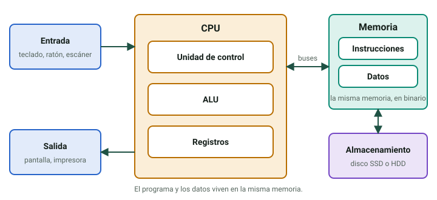
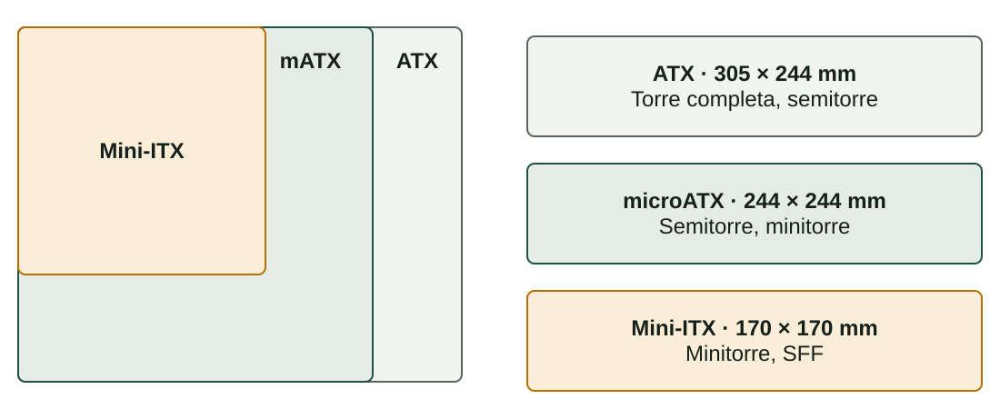
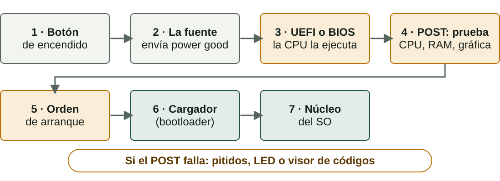

## Qué aprenderás

:::pasos
- Cómo se organiza un **ordenador** según **Von Neumann**
- Qué **chasis** y qué **placa base** hay que elegir
- Qué **componentes** hay en una placa base
- Qué pasa **desde el encendido** hasta el sistema operativo
:::

---

## ¿Qué es un ordenador?

Una máquina que recibe datos, los procesa, muestra el resultado y lo guarda.

| Fase | Componentes |
|---|---|
| **Entrada** | Teclado, ratón, escáner |
| **Proceso** | CPU y memoria RAM |
| **Salida** | Monitor, impresora, altavoces |
| **Almacenamiento** | Disco SSD o HDD |

---

## Programa y datos, en la misma memoria

::::columnas

:::pasos
- **1945**: John von Neumann
- Programa y datos, en la **misma memoria**
- Mismo formato **binario**
- Cambiar de programa es **cargar otro archivo**
:::
::::

---

## Hardware, software y ordenadores «ocultos»

:::pasos
- **Hardware**: la parte física, todo lo que puedes tocar
- **Software**: el sistema operativo y las aplicaciones
- **Sistemas embebidos**: cajero, router, lavadora…
- Ejecutan software concreto; no instalas nada nuevo
:::

---

## El chasis: no es solo estética

:::pasos
- Aloja y **protege** los componentes
- Determina **qué placa base** cabe
- Condiciona el **flujo de aire** y la temperatura
- Limita **unidades**, ventiladores y tarjetas
:::

---

## Chasis para equipos de sobremesa

| Tipo | Uso típico | Inconveniente |
|---|---|---|
| **Torre completa** | Servidores, gama alta | Ocupa mucho espacio |
| **Semitorre** | Casa y oficina | Expansión más limitada |
| **Minitorre** | Equipos compactos | Menos ranuras y refrigeración |

---

## Chasis compactos y especiales

| Tipo | Uso típico | Inconveniente |
|---|---|---|
| **SFF o *slim*** | Oficinas con poco espacio | Casi sin ampliación |
| ***All-in-one*** | Ofimática | Ampliación casi nula |
| **Portátil** | Movilidad | Componentes soldados |
| **Servidor en *rack*** | Centros de datos | Necesita armario *rack* |

---

## ¿Qué chasis para un servidor de archivos?

:::note[Ejemplo resuelto]
Servidor del departamento: **4 discos duros**, funcionando 24 horas al día.
:::

:::pasos
- La clave no es el nombre, sino lo que **ofrece**
- Como mínimo **4 bahías de 3,5"** y buen flujo de aire
- **Torre completa** (o semitorre con suficientes bahías)
- Un **SFF** no tendría espacio ni refrigeración
:::

---

## La placa base

:::pasos
- El **circuito impreso principal** del ordenador
- Fibra de vidrio con **4 a 8 capas** de pistas de cobre
- Conecta los componentes y lleva **energía y datos**
- Convierte piezas sueltas en un **sistema informático**
:::

---

## El chipset: quién habla con quién

:::pasos
- Gestiona la comunicación entre **CPU, memoria y dispositivos**
- Determina los **procesadores** que admite la placa
- También los **puertos USB y SATA** y el *overclocking*
- Antes: **northbridge** y **southbridge**
- Ahora el controlador de memoria **está dentro de la CPU**
:::

---

## Gamas de chipset

| Fabricante | Alta | Media | Entrada |
|---|---|---|---|
| **Intel** | Z790 | B760 | H610 |
| **AMD** | X670 | B650 | A620 |

:::pasos
- Se diferencian por las **funciones** que activan
- No por las CPU que admiten
- Los nombres cambian; **la escala** se mantiene
:::

---

## El socket de la CPU

| Fabricante | Socket | Contactos | Familias |
|---|---|---|---|
| **Intel** | LGA1700 | Pines en la placa | Core 12.ª–14.ª gen. |
| **AMD** | AM5 | Pines en la placa | Ryzen 7000 y posteriores |
| **AMD** (anterior) | AM4 | Pines en la CPU | Ryzen 1000 a 5000 |

:::caution[No es cuestión de rendimiento]
La CPU debe tener el **socket** de la placa. Comprueba también que la **UEFI** la admite.
:::

---

## Ranuras de RAM: dual channel

:::pasos
- Las placas domésticas: **2 a 4 ranuras DIMM**
- Colores por parejas: **no es decoración**
- Indican cuáles usar juntas
- Activan el **dual channel**: dos módulos en paralelo
- Duplica el **ancho de banda**
:::

---

## Ranuras PCIe: líneas y generación

| Generación | Por línea (x1) | Ranura x16 |
|---|---|---|
| **PCIe 3.0** | ≈ 1 GB/s | ≈ 16 GB/s |
| **PCIe 4.0** | ≈ 2 GB/s | ≈ 32 GB/s |
| **PCIe 5.0** | ≈ 4 GB/s | ≈ 63 GB/s |

:::pasos
- Ranuras **x1, x4, x8 y x16**: más líneas, más datos
- Cada generación **duplica** la velocidad
- Compatibles **hacia atrás**
- Una x16 puede tener conectadas solo **4 u 8 líneas**
:::

---

## SATA y M.2

| | SATA 2,5" | M.2 SATA | M.2 NVMe |
|---|---|---|---|
| **Conexión** | Cable SATA | Ranura M.2 | Ranura M.2 |
| **Bus** | SATA | SATA | **PCIe** |
| **Velocidad** | ≈ 550 MB/s | ≈ 550 MB/s | 3.500–10.000 MB/s |

:::caution[M.2 no significa «rápido»]
Mira en el manual qué tipo admite **cada ranura**: SATA, NVMe o ambos.
:::

---

## Conectores de alimentación y chip UEFI

:::pasos
- **ATX principal**, 24 pines: alimenta la placa
- **EPS12V**, 4 u 8 pines: alimenta la **CPU**
- Un chip no volátil guarda el **firmware**
- Una pila **CR2032** mantiene el reloj
:::

---

## BIOS heredada y UEFI

| | BIOS | UEFI |
|---|---|---|
| **Interfaz** | Texto, teclado | Gráfica, ratón |
| **Disco de arranque** | Hasta 2 TB (MBR) | Sin ese límite (GPT) |
| ***Secure Boot*** | No | Sí |

:::pasos
- Casi todas las placas nuevas usan **UEFI**
- Todo el mundo sigue diciendo «la BIOS»
:::

---

## Puertos del panel trasero

:::pasos
- **USB**: tipo A y, cada vez más, **tipo C**
- **HDMI** y **DisplayPort**: solo con la **gráfica integrada**
- Red **RJ45** (Ethernet)
- Audio: *jack* de **3,5 mm**
- Antenas, si la placa tiene **Wi-Fi**
:::

---

## Factores de forma

Una placa **pequeña** cabe en un chasis grande; una **ATX** no cabrá nunca en un chasis para Mini-ITX.

---

## Del encendido al sistema operativo

---

## El POST: la primera comprobación

:::pasos
- Comprueba **CPU, RAM, gráfica y teclado**
- Si falla: **pitidos**, LED o visor de dos dígitos
- Los códigos dependen del **fabricante**: están en el manual
- Después, el **orden de arranque** busca un cargador
:::

---

## Un equipo que no arranca

| Síntoma | Primer paso |
|---|---|
| **No se enciende nada** | Cable e interruptor de la fuente |
| **Ventiladores, pero sin imagen** | Volver a insertar la RAM |
| **Pitidos o LED** | Consultar el código en el manual |
| ***No bootable device*** | Revisar disco y orden de arranque |

---

## Entrar en la UEFI

:::tip[Una tecla al encender el equipo]
**Supr**, **F2**, **F10** o **F12**, según el fabricante. La pantalla inicial suele indicarla.
:::

---

## Pruébalo: la placa base

::laboratorio[Mapa de la placa]{src="placa-base" pestana="mapa"}

::laboratorio[Cómo viajan los datos]{src="placa-base" pestana="arq"}

---

## Pruébalo: componentes

::laboratorio[Formatos]{src="placa-base" pestana="formatos"}

::laboratorio[Sockets y chipsets]{src="placa-base" pestana="sockets"}

---

## Pruébalo: ranuras y puertos

::laboratorio[RAM y expansión]{src="placa-base" pestana="mem"}

::laboratorio[Puertos y conectores]{src="placa-base" pestana="puertos"}

---

## Pruébalo: arranque y práctica

::laboratorio[UEFI y arranque]{src="placa-base" pestana="firm"}

::laboratorio[Práctica]{src="placa-base" pestana="prac"}

---

## Pruébalo: Von Neumann

::laboratorio[Von Neumann en marcha]{src="dins-la-cpu" pestana="von-neumann"}

---

## Resumen

- **Von Neumann**: programa y datos en la misma memoria
- **Chasis** y **factor de forma** deben encajar
- **Placa base**: chipset, socket, RAM, PCIe, SATA y M.2, UEFI
- **Arranque**: fuente → UEFI → POST → cargador → SO

[Actividades de la unidad →](/docencia/dam/sistemas-informaticos/ud01-hardware/actividades/es/)
