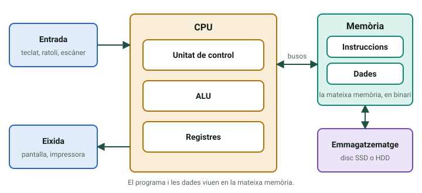
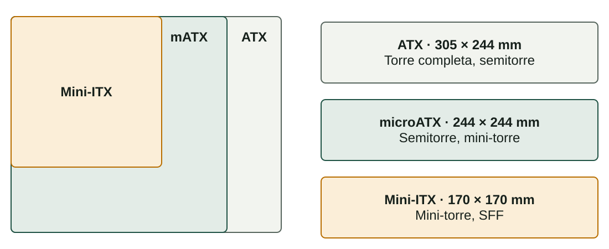
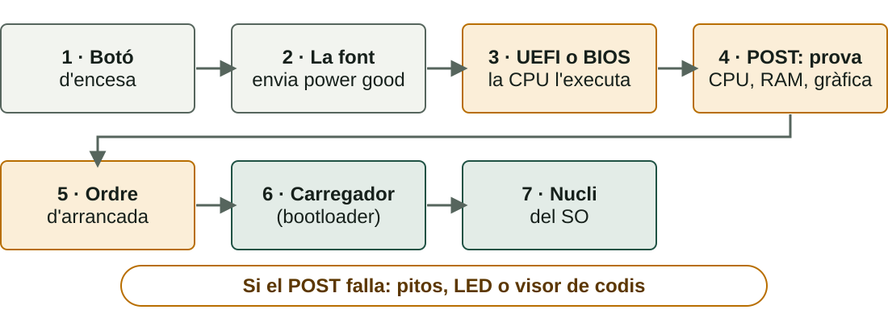

## Què aprendràs

:::pasos
- Com s'organitza un **ordinador** segons **Von Neumann**
- Quin **xassís** i quina **placa base** cal triar
- Quins **components** hi ha en una placa base
- Què passa **des de l'encesa** fins al sistema operatiu
:::

---

## Què és un ordinador?

Una màquina que rep dades, les processa, mostra el resultat i el guarda.

| Fase | Components |
|---|---|
| **Entrada** | Teclat, ratolí, escàner |
| **Procés** | CPU i memòria RAM |
| **Eixida** | Monitor, impressora, altaveus |
| **Emmagatzematge** | Disc SSD o HDD |

---

## Programa i dades, en la mateixa memòria

::::columnas

:::pasos
- **1945**: John von Neumann
- Programa i dades, en la **mateixa memòria**
- Mateix format **binari**
- Canviar de programa és **carregar un altre arxiu**
:::
::::

---

## Maquinari, programari i ordinadors «amagats»

:::pasos
- **Maquinari**: la part física, tot el que pots tocar
- **Programari**: el sistema operatiu i les aplicacions
- **Sistemes encastats**: caixer, router, rentadora…
- Executen programari concret; no hi instal·les res nou
:::

---

## El xassís: no és només estètica

:::pasos
- Allotja i **protegix** els components
- Determina **quina placa base** hi cap
- Condiciona el **flux d'aire** i la temperatura
- Limita **unitats**, ventiladors i targetes
:::

---

## Xassís per a equips de sobretaula

| Tipus | Ús típic | Inconvenient |
|---|---|---|
| **Torre completa** | Servidors, gamma alta | Ocupa molt d'espai |
| **Semitorre** | Casa i oficina | Expansió més limitada |
| **Mini-torre** | Equips compactes | Menys ranures i refrigeració |

---

## Xassís compactes i especials

| Tipus | Ús típic | Inconvenient |
|---|---|---|
| **SFF o *slim*** | Oficines amb poc espai | Quasi sense ampliació |
| ***All-in-one*** | Ofimàtica | Ampliació quasi nul·la |
| **Portàtil** | Mobilitat | Components soldats |
| **Servidor en *rack*** | Centres de dades | Necessita armari *rack* |

---

## Quin xassís per a un servidor d'arxius?

:::note[Exemple resolt]
Servidor del departament: **4 discs durs**, funcionant 24 hores al dia.
:::

:::pasos
- La clau no és el nom, sinó el que **oferix**
- Com a mínim **4 badies de 3,5"** i bon flux d'aire
- **Torre completa** (o semitorre amb prou badies)
- Un **SFF** no tindria espai ni refrigeració
:::

---

## La placa base

:::pasos
- El **circuit imprés principal** de l'ordinador
- Fibra de vidre amb **4 a 8 capes** de pistes de coure
- Connecta els components i porta **energia i dades**
- Convertix peces soltes en un **sistema informàtic**
:::

---

## El chipset: qui parla amb qui

:::pasos
- Gestiona la comunicació entre **CPU, memòria i dispositius**
- Determina els **processadors** que admet la placa
- També els **ports USB i SATA** i l'*overclocking*
- Abans: **northbridge** i **southbridge**
- Ara el controlador de memòria **és dins de la CPU**
:::

---

## Gammes de chipset

| Fabricant | Alta | Mitjana | Entrada |
|---|---|---|---|
| **Intel** | Z790 | B760 | H610 |
| **AMD** | X670 | B650 | A620 |

:::pasos
- Es diferencien per les **funcions** que activen
- No per les CPU que admeten
- Els noms canvien; **l'escala** es manté
:::

---

## El sòcol de la CPU

| Fabricant | Sòcol | Contactes | Famílies |
|---|---|---|---|
| **Intel** | LGA1700 | Pins a la placa | Core 12a–14a gen. |
| **AMD** | AM5 | Pins a la placa | Ryzen 7000 i posteriors |
| **AMD** (anterior) | AM4 | Pins en la CPU | Ryzen 1000 a 5000 |

:::caution[No és qüestió de rendiment]
La CPU ha de tindre el **sòcol** de la placa. Comprova també que la **UEFI** l'admet.
:::

---

## Ranures de RAM: dual channel

:::pasos
- Les plaques domèstiques: **2 a 4 ranures DIMM**
- Colors per parelles: **no és decoració**
- Indiquen quines usar juntes
- Activen el **dual channel**: dos mòduls en paral·lel
- Duplica l'**ample de banda**
:::

---

## Ranures PCIe: línies i generació

| Generació | Per línia (x1) | Ranura x16 |
|---|---|---|
| **PCIe 3.0** | ≈ 1 GB/s | ≈ 16 GB/s |
| **PCIe 4.0** | ≈ 2 GB/s | ≈ 32 GB/s |
| **PCIe 5.0** | ≈ 4 GB/s | ≈ 63 GB/s |

:::pasos
- Ranures **x1, x4, x8 i x16**: més línies, més dades
- Cada generació **duplica** la velocitat
- Compatibles **cap enrere**
- Una x16 pot tindre connectades només **4 o 8 línies**
:::

---

## SATA i M.2

| | SATA 2,5" | M.2 SATA | M.2 NVMe |
|---|---|---|---|
| **Connexió** | Cable SATA | Ranura M.2 | Ranura M.2 |
| **Bus** | SATA | SATA | **PCIe** |
| **Velocitat** | ≈ 550 MB/s | ≈ 550 MB/s | 3.500–10.000 MB/s |

:::caution[M.2 no vol dir «ràpid»]
Mira al manual quin tipus admet **cada ranura**: SATA, NVMe o tots dos.
:::

---

## Connectors d'alimentació i xip UEFI

:::pasos
- **ATX principal**, 24 pins: alimenta la placa
- **EPS12V**, 4 o 8 pins: alimenta la **CPU**
- Un xip no volàtil guarda el **microprogramari**
- Una pila **CR2032** manté el rellotge
:::

---

## BIOS heretada i UEFI

| | BIOS | UEFI |
|---|---|---|
| **Interfície** | Text, teclat | Gràfica, ratolí |
| **Disc d'arrancada** | Fins a 2 TB (MBR) | Sense eixe límit (GPT) |
| ***Secure Boot*** | No | Sí |

:::pasos
- Quasi totes les plaques noves usen **UEFI**
- Tothom continua dient «la BIOS»
:::

---

## Ports del panell posterior

:::pasos
- **USB**: tipus A i, cada vegada més, **tipus C**
- **HDMI** i **DisplayPort**: només amb la **gràfica integrada**
- Xarxa **RJ45** (Ethernet)
- Àudio: *jack* de **3,5 mm**
- Antenes, si la placa té **Wi-Fi**
:::

---

## Factors de forma

Una placa **xicoteta** cap en un xassís gran; una **ATX** no cabrà mai en un xassís per a Mini-ITX.

---

## De l'encesa al sistema operatiu

---

## El POST: la primera comprovació

:::pasos
- Comprova **CPU, RAM, gràfica i teclat**
- Si falla: **pitos**, LED o visor de dos dígits
- Els codis depenen del **fabricant**: són al manual
- Després, l'**ordre d'arrancada** busca un carregador
:::

---

## Un equip que no arranca

| Símptoma | Primer pas |
|---|---|
| **No s'encén res** | Cable i interruptor de la font |
| **Ventiladors, però sense imatge** | Tornar a inserir la RAM |
| **Pitos o LED** | Consultar el codi al manual |
| ***No bootable device*** | Revisar disc i ordre d'arrancada |

---

## Entrar a la UEFI

:::tip[Una tecla en encendre l'equip]
**Supr**, **F2**, **F10** o **F12**, segons el fabricant. La pantalla inicial sol indicar-la.
:::

---

## Prova-ho: la placa base

::laboratorio[Mapa de la placa]{src="placa-base" pestana="mapa"}

::laboratorio[Com viatgen les dades]{src="placa-base" pestana="arq"}

---

## Prova-ho: components

::laboratorio[Formats]{src="placa-base" pestana="formatos"}

::laboratorio[Sòcols i xipsets]{src="placa-base" pestana="sockets"}

---

## Prova-ho: ranures i ports

::laboratorio[RAM i expansió]{src="placa-base" pestana="mem"}

::laboratorio[Ports i connectors]{src="placa-base" pestana="puertos"}

---

## Prova-ho: arrancada i pràctica

::laboratorio[UEFI i arrancada]{src="placa-base" pestana="firm"}

::laboratorio[Pràctica]{src="placa-base" pestana="prac"}

---

## Prova-ho: Von Neumann

::laboratorio[Von Neumann en marxa]{src="dins-la-cpu" pestana="von-neumann"}

---

## Resum

- **Von Neumann**: programa i dades en la mateixa memòria
- **Xassís** i **factor de forma** han d'encaixar
- **Placa base**: chipset, sòcol, RAM, PCIe, SATA i M.2, UEFI
- **Arrancada**: font → UEFI → POST → carregador → SO

[Activitats de la unitat →](/docencia/dam/sistemas-informaticos/ud01-hardware/actividades/)
