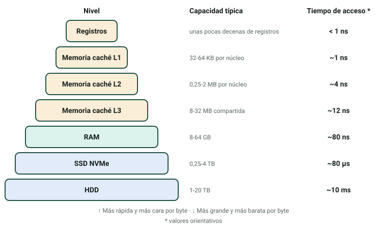
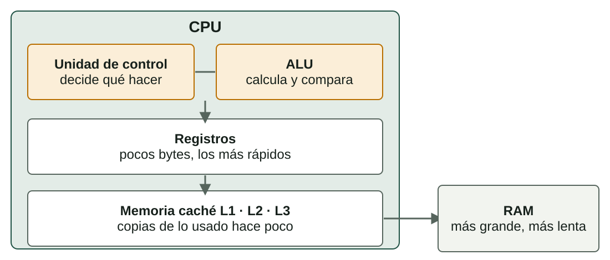
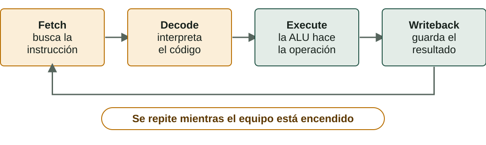

## Qué aprenderás

:::pasos
- Qué **niveles de memoria** tiene un ordenador
- Cómo **leer** una RAM: DDR, velocidad, latencia y canales
- Qué hay **dentro de una CPU**
- Cómo se ejecuta una instrucción: el **ciclo de instrucción**
- Por qué los **GHz** no lo son todo
:::

---

## La jerarquía de memoria

---

## Qué memoria es cada una

| Memoria | Tecnología | Volátil | Dónde está |
|---|---|---|---|
| **Registros** | Circuitos de la CPU | Sí | Dentro de la CPU |
| **Memoria caché** | SRAM | Sí | Dentro de la CPU |
| **RAM** | DRAM | Sí | Módulos DIMM o SO-DIMM |
| **Firmware** | Memoria flash | No | Chip de la placa |
| **Almacenamiento** | Flash NAND o platos | No | SSD o HDD |

---

## Qué pasa cuando la RAM se llena

:::pasos
- Una memoria **volátil** pierde el contenido sin corriente
- El SO mueve datos al disco: **memoria virtual** o *swap*
- El equipo sigue, pero **mucho más lento**
- El disco es mucho más lento que la RAM
:::

---

## La RAM es la memoria de trabajo

::::columnas
:::pasos
- Guarda **temporalmente** datos e instrucciones
- **Acceso aleatorio**: tarda lo mismo en cualquier posición
- **Volátil**: cada bit es un condensador que se descarga
- Por eso se **refresca** constantemente
:::

:::note[Una analogía]
El **almacenamiento** es el archivador de la oficina. La **RAM** es la mesa de trabajo: al apagar, queda vacía.
:::
::::

---

## Generaciones DDR

| Generación | Desde | Velocidades (MT/s) | Voltaje |
|---|---|---|---|
| **DDR3** (en desuso) | 2007 | 1333–2133 | 1,5 V |
| **DDR4** | 2014 | 2133–3600 | 1,2 V |
| **DDR5** | 2021 | 4800–8000 | 1,1 V |

:::caution[Incompatibles entre sí]
La **muesca** del módulo cambia de sitio: un DDR5 no entra en una placa DDR4.
:::

---

## DIMM, SO-DIMM y ECC

:::pasos
- **DIMM** (largos): equipos de sobremesa
- **SO-DIMM** (más cortos): portátiles y miniPC
- **ECC**: servidores y estaciones de trabajo
- La ECC **detecta y corrige** errores de un bit
:::

---

## Las cuatro características de una RAM

:::pasos
- **Capacidad**: en GB; habitual 8, 16 o 32 GB por módulo
- **Velocidad**: en **MT/s**, millones de transferencias por segundo
- **Latencia (CL)**: ciclos que tarda en responder
- **Canales**: *dual* o *quad channel*
:::

---

## Velocidad y latencia

:::pasos
- **DDR4-3200** hace 3200 MT/s
- En el márketing: «3200 MHz», pero el reloj real es **la mitad**
- Un **CL** más bajo es mejor… pero hay que pasarlo a **tiempo real**
:::

**Latencia (ns) = CL × 2000 ÷ velocidad (MT/s)**

---

## Canales y ancho de banda

:::pasos
- Con **2 o 4 módulos** (idealmente idénticos) la placa los lee **en paralelo**
- Multiplica el **ancho de banda**
- **No cambia** la latencia
:::

**Ancho de banda por canal = velocidad (MT/s) × 8 bytes**

---

## Ejemplo resuelto: DDR4-3200 CL16

:::pasos
1. Latencia: 16 × 2000 ÷ 3200 = **10 ns**
2. Ancho de banda por canal: 3200 × 8 = **25,6 GB/s**
3. En *dual channel*, dos módulos iguales: **51,2 GB/s**
4. La latencia sigue siendo de **10 ns**
:::

---

## Ejemplo resuelto: DDR5-4800 CL40

:::pasos
1. Latencia: 40 × 2000 ÷ 4800 ≈ **16,7 ns**
2. Ancho de banda por canal: 4800 × 8 = **38,4 GB/s**
3. Más ancho de banda, pero **latencia algo peor**
:::

La DDR5 no es «más rápida» en todo.

---

## Perfiles XMP y EXPO

:::caution[Un kit puede arrancar más lento de lo que anuncia]
Un «DDR4-3600» puede arrancar a una velocidad base inferior hasta que activas el perfil **XMP** (Intel) o **EXPO** (AMD) en la UEFI.
:::

:::pasos
- Si mezclas módulos distintos, todo va a la velocidad **del más lento**
:::

---

## La CPU por dentro

---

## Cuatro partes principales

:::pasos
- **ALU**: operaciones aritméticas y lógicas
- **Unidad de control**: decide qué instrucción buscar y qué activar
- **Registros**: unas pocas decenas, mucho más rápidos que la RAM
- **Memoria caché**: copias de lo usado hace poco
:::

---

## Tres niveles de memoria caché

| Nivel | Tamaño típico | Dónde está |
|---|---|---|
| **L1** | 32–64 KB por núcleo | Dentro de cada núcleo |
| **L2** | 0,25–2 MB por núcleo | Dentro de cada núcleo |
| **L3** | 8–32 MB | Compartida entre núcleos |

L1 es la más rápida; L3, más lenta, pero mucho más rápida que la RAM.

---

## El cuello de botella de Von Neumann

:::pasos
- CPU y memoria comparten **un único camino**
- Eso **limita** la velocidad
- La **memoria caché** lo alivia
- Las CPU actuales separan la caché L1 de **instrucciones** y de **datos**
:::

---

## Arquitectura y microarquitectura

:::note[Dos conceptos diferentes]
El **repertorio de instrucciones** (ISA) es el contrato entre software y CPU. La **microarquitectura** es cómo cada fabricante construye la CPU por dentro.
:::

:::pasos
- ISA: **x86-64** (Intel y AMD), **ARM**, **RISC-V**
- Un programa x86-64 **no se ejecuta** directamente en ARM
- Hay que **recompilarlo** o traducirlo
:::

---

## El ciclo de instrucción

---

## Las cuatro fases

| Fase | Qué pasa |
|---|---|
| **Fetch** | Se trae la siguiente instrucción a un registro |
| **Decode** | Se interpreta: qué operación y con qué datos |
| **Execute** | La ALU hace la operación |
| **Writeback** | El resultado se guarda en un registro o en memoria |

---

## Ejemplo: la instrucción «sumar 2 + 3»

:::pasos
1. **Fetch**: busca `ADD R1, R2` en memoria
2. **Decode**: es una suma; R1 vale 2 y R2 vale 3
3. **Execute**: la ALU calcula 2 + 3 = **5**
4. **Writeback**: el 5 se guarda en el registro de destino
:::

---

## Una CPU a 3 GHz

:::pasos
- **3.000 millones** de ciclos de reloj por segundo
- Una instrucción puede necesitar **más de un ciclo**
- El ***pipeline*** solapa las fases de varias instrucciones
- Puede terminar **más de una por ciclo**
:::

---

## El ordenador sencillo: cinco registros

| Registro | Nombre | Qué guarda |
|---|---|---|
| **CP** | Contador de programa | Dirección de la siguiente instrucción |
| **RDM** | Registro de dirección de memoria | Dirección que se leerá o escribirá |
| **RIM** | Registro de intercambio de memoria | Dato que va a memoria o viene de ella |
| **RI** | Registro de instrucción | La instrucción en ejecución |
| **AC** | Acumulador | Resultado de la ALU |

---

## Ejecutar `LOAD 10`, paso a paso

:::pasos
1. **RDM ← CP**: la dirección de la instrucción es 0
2. **RIM ← M[RDM]**: se lee el 110 de memoria
3. **RI ← RIM; CP ← CP + 1**: la instrucción es `LOAD 10`
4. **RDM ← 10**: la dirección del dato
5. **RIM ← M[RDM]**: se lee el 2
6. **AC ← RIM**: el acumulador vale **2**
:::

Pasos 1–3: *fetch*. Pasos 4–5: acceso al dato. Paso 6: *writeback*.

---

## Núcleos e hilos

:::pasos
- Un **núcleo** es, en la práctica, una CPU completa
- El SO **reparte** el trabajo entre núcleos
- Muchos mezclan núcleos de **rendimiento** y de **eficiencia**
- **Hyper-Threading** o **SMT**: dos **hilos** por núcleo
- Eso **no duplica** el rendimiento
:::

---

## Los GHz no lo son todo

:::pasos
- La **frecuencia**: ciclos por segundo
- El **IPC**: instrucciones útiles que terminan por ciclo
- Según el diseño de la CPU
:::

**Rendimiento ≈ frecuencia × IPC**

Una CPU moderna a 3,5 GHz puede superar a una antigua a 4 GHz.

---

## Más núcleos, pero no proporcionalmente

:::note[Ejemplo: 4 núcleos, programa repartible en un 80 %]
Tiempo = 0,2 + 0,8 ÷ 4 = **0,4** del original.
:::

:::pasos
- Aceleración de **2,5**, no de 4
- La parte que **no se puede repartir** limita la ganancia
:::

---

## TDP y refrigeración

:::pasos
- **TDP**: calor, en vatios, que la CPU está diseñada para disipar
- En modo **turbo** puede consumir mucho más
- **65 W**: vale un disipador de aire sencillo
- **125–150 W o más**: disipador grande o refrigeración líquida
- Sin evacuar el calor, la CPU baja la frecuencia: ***thermal throttling***
:::

---

## Familias de CPU habituales

| Familia | Fabricante | Núcleos (gama media) | Socket |
|---|---|---|---|
| **Core i5 / i7** (14.ª gen.) | Intel | 10 a 20 | LGA1700 |
| **Ryzen 5 / 7** (serie 7000) | AMD | 6 a 8 | AM5 |

---

## Pruébalo: dentro de la CPU

::laboratorio[Von Neumann en marcha]{src="dins-la-cpu" pestana="von-neumann"}

::laboratorio[Registros paso a paso]{src="dins-la-cpu" pestana="registres"}

---

## Pruébalo: ciclo y datos

::laboratorio[El ciclo de instrucción]{src="dins-la-cpu" pestana="cicle"}

::laboratorio[¿Dónde está el dato?]{src="dins-la-cpu" pestana="dada"}

---

## Pruébalo: RAM y núcleos

::laboratorio[Calculadora de RAM]{src="dins-la-cpu" pestana="ram"}

::laboratorio[Núcleos, hilos e IPC]{src="dins-la-cpu" pestana="nuclis"}

---

## Pruébalo: práctica

::laboratorio[Práctica]{src="dins-la-cpu" pestana="practica"}

---

## Resumen

- **Memoria**: más cerca de la CPU, más rápida, cara y pequeña
- **RAM**: velocidad, **latencia real** y canales, no solo los MHz
- **CPU**: unidad de control, ALU, registros y caché
- **Ciclo**: *fetch*, *decode*, *execute*, *writeback*
- **Rendimiento** ≈ frecuencia × IPC

[Actividades de la unidad →](/docencia/dam/sistemas-informaticos/ud01-hardware/actividades/es/)
