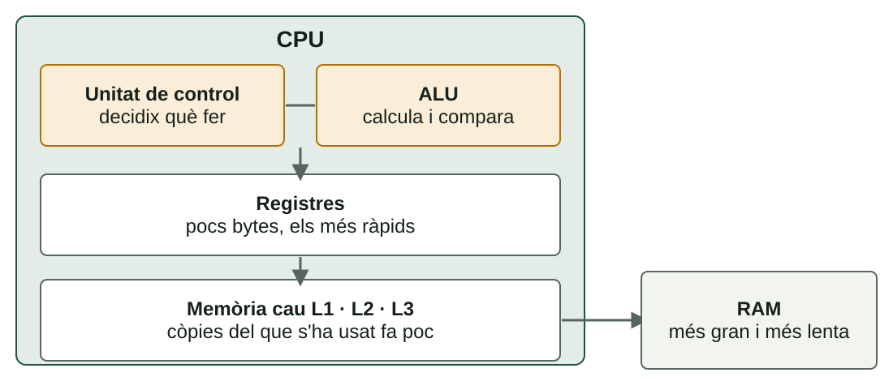
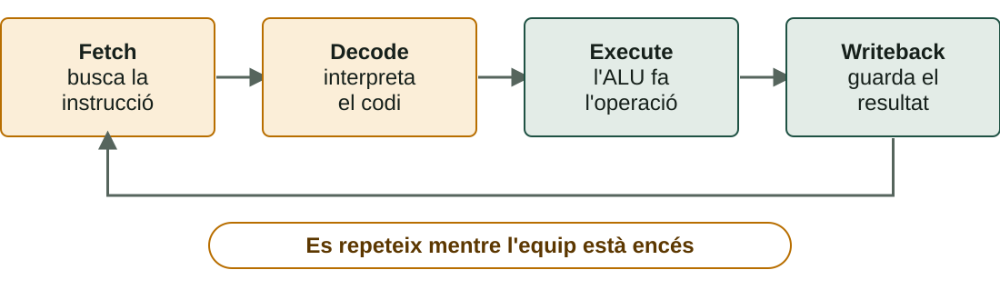

## Què aprendràs

:::pasos
- Quins **nivells de memòria** té un ordinador
- Com **llegir** una RAM: DDR, velocitat, latència i canals
- Què hi ha **dins d'una CPU**
- Com s'executa una instrucció: el **cicle d'instrucció**
- Per què els **GHz** no ho són tot
:::

---

## La jerarquia de memòria

---

## Quina memòria és cada una

| Memòria | Tecnologia | Volàtil | On és |
|---|---|---|---|
| **Registres** | Circuits de la CPU | Sí | Dins de la CPU |
| **Memòria cau** | SRAM | Sí | Dins de la CPU |
| **RAM** | DRAM | Sí | Mòduls DIMM o SO-DIMM |
| **Microprogramari** | Memòria flash | No | Xip de la placa |
| **Emmagatzematge** | Flash NAND o plats | No | SSD o HDD |

---

## Què passa quan la RAM s'omple

:::pasos
- Una memòria **volàtil** perd el contingut sense corrent
- El SO mou dades al disc: **memòria virtual** o *swap*
- L'equip continua, però **molt més lent**
- El disc és molt més lent que la RAM
:::

---

## La RAM és la memòria de treball

::::columnas
:::pasos
- Guarda **temporalment** dades i instruccions
- **Accés aleatori**: tarda igual en qualsevol posició
- **Volàtil**: cada bit és un condensador que es descarrega
- Per això es **refresca** constantment
:::

:::note[Una analogia]
L'**emmagatzematge** és l'arxivador de l'oficina. La **RAM** és la taula de treball: en apagar, queda buida.
:::
::::

---

## Generacions DDR

| Generació | Des de | Velocitats (MT/s) | Voltatge |
|---|---|---|---|
| **DDR3** (en desús) | 2007 | 1333–2133 | 1,5 V |
| **DDR4** | 2014 | 2133–3600 | 1,2 V |
| **DDR5** | 2021 | 4800–8000 | 1,1 V |

:::caution[Incompatibles entre si]
L'**osca** del mòdul canvia de lloc: un DDR5 no entra en una placa DDR4.
:::

---

## DIMM, SO-DIMM i ECC

:::pasos
- **DIMM** (llargs): equips de sobretaula
- **SO-DIMM** (més curts): portàtils i miniPC
- **ECC**: servidors i estacions de treball
- L'ECC **detecta i corregix** errors d'un bit
:::

---

## Les quatre característiques d'una RAM

:::pasos
- **Capacitat**: en GB; habitual 8, 16 o 32 GB per mòdul
- **Velocitat**: en **MT/s**, milions de transferències per segon
- **Latència (CL)**: cicles que tarda a respondre
- **Canals**: *dual* o *quad channel*
:::

---

## Velocitat i latència

:::pasos
- **DDR4-3200** fa 3200 MT/s
- En el màrqueting: «3200 MHz», però el rellotge real és **la meitat**
- Un **CL** més baix és millor… però cal passar-lo a **temps real**
:::

**Latència (ns) = CL × 2000 ÷ velocitat (MT/s)**

---

## Canals i ample de banda

:::pasos
- Amb **2 o 4 mòduls** (idealment idèntics) la placa els llig **en paral·lel**
- Multiplica l'**ample de banda**
- **No canvia** la latència
:::

**Ample de banda per canal = velocitat (MT/s) × 8 bytes**

---

## Exemple resolt: DDR4-3200 CL16

:::pasos
1. Latència: 16 × 2000 ÷ 3200 = **10 ns**
2. Ample de banda per canal: 3200 × 8 = **25,6 GB/s**
3. En *dual channel*, dos mòduls iguals: **51,2 GB/s**
4. La latència continua sent de **10 ns**
:::

---

## Exemple resolt: DDR5-4800 CL40

:::pasos
1. Latència: 40 × 2000 ÷ 4800 ≈ **16,7 ns**
2. Ample de banda per canal: 4800 × 8 = **38,4 GB/s**
3. Més ample de banda, però **latència una mica pitjor**
:::

La DDR5 no és «més ràpida» en tot.

---

## Perfils XMP i EXPO

:::caution[Un kit pot arrancar més lent del que anuncia]
Un «DDR4-3600» pot arrancar a una velocitat base inferior fins que actives el perfil **XMP** (Intel) o **EXPO** (AMD) a la UEFI.
:::

:::pasos
- Si barreges mòduls diferents, tot va a la velocitat **del més lent**
:::

---

## La CPU per dins

---

## Quatre parts principals

:::pasos
- **ALU**: operacions aritmètiques i lògiques
- **Unitat de control**: decidix quina instrucció buscar i què activar
- **Registres**: unes poques desenes, molt més ràpids que la RAM
- **Memòria cau**: còpies del que s'ha usat fa poc
:::

---

## Tres nivells de memòria cau

| Nivell | Mida típica | On és |
|---|---|---|
| **L1** | 32–64 KB per nucli | Dins de cada nucli |
| **L2** | 0,25–2 MB per nucli | Dins de cada nucli |
| **L3** | 8–32 MB | Compartida entre nuclis |

L1 és la més ràpida; L3, més lenta, però molt més ràpida que la RAM.

---

## El coll d'ampolla de Von Neumann

:::pasos
- CPU i memòria compartixen **un únic camí**
- Això **limita** la velocitat
- La **memòria cau** l'alleugerix
- Les CPU actuals separen la cau L1 d'**instruccions** i de **dades**
:::

---

## Arquitectura i microarquitectura

:::note[Dos conceptes diferents]
El **repertori d'instruccions** (ISA) és el contracte entre programari i CPU. La **microarquitectura** és com cada fabricant construïx la CPU per dins.
:::

:::pasos
- ISA: **x86-64** (Intel i AMD), **ARM**, **RISC-V**
- Un programa x86-64 **no s'executa** directament en ARM
- Cal **recompilar-lo** o traduir-lo
:::

---

## El cicle d'instrucció

---

## Les quatre fases

| Fase | Què passa |
|---|---|
| **Fetch** | Es porta la propera instrucció a un registre |
| **Decode** | S'interpreta: quina operació i amb quines dades |
| **Execute** | L'ALU fa l'operació |
| **Writeback** | El resultat es guarda en un registre o en memòria |

---

## Exemple: la instrucció «sumar 2 + 3»

:::pasos
1. **Fetch**: busca `ADD R1, R2` en memòria
2. **Decode**: és una suma; R1 val 2 i R2 val 3
3. **Execute**: l'ALU calcula 2 + 3 = **5**
4. **Writeback**: el 5 es guarda en el registre de destí
:::

---

## Una CPU a 3 GHz

:::pasos
- **3.000 milions** de cicles de rellotge per segon
- Una instrucció pot necessitar **més d'un cicle**
- El ***pipeline*** solapa les fases de diverses instruccions
- Pot acabar **més d'una per cicle**
:::

---

## L'ordinador senzill: cinc registres

| Registre | Nom | Què guarda |
|---|---|---|
| **CP** | Comptador de programa | Adreça de la propera instrucció |
| **RDM** | Registre d'adreça de memòria | Adreça que es llegirà o escriurà |
| **RIM** | Registre d'intercanvi de memòria | Dada que va a memòria o ve d'ella |
| **RI** | Registre d'instrucció | La instrucció en execució |
| **AC** | Acumulador | Resultat de l'ALU |

---

## Executar `LOAD 10`, pas a pas

:::pasos
1. **RDM ← CP**: l'adreça de la instrucció és 0
2. **RIM ← M[RDM]**: es llig el 110 de memòria
3. **RI ← RIM; CP ← CP + 1**: la instrucció és `LOAD 10`
4. **RDM ← 10**: l'adreça de la dada
5. **RIM ← M[RDM]**: es llig el 2
6. **AC ← RIM**: l'acumulador val **2**
:::

Passos 1–3: *fetch*. Passos 4–5: accés a la dada. Pas 6: *writeback*.

---

## Nuclis i fils

:::pasos
- Un **nucli** és, a la pràctica, una CPU completa
- El SO **repartix** el treball entre nuclis
- Molts mesclen nuclis de **rendiment** i d'**eficiència**
- **Hyper-Threading** o **SMT**: dos **fils** per nucli
- Això **no duplica** el rendiment
:::

---

## El GHz no ho és tot

:::pasos
- La **freqüència**: cicles per segon
- L'**IPC**: instruccions útils que s'acaben per cicle
- Segons el disseny de la CPU
:::

**Rendiment ≈ freqüència × IPC**

Una CPU moderna a 3,5 GHz pot superar una antiga a 4 GHz.

---

## Més nuclis, però no proporcionalment

:::note[Exemple: 4 nuclis, programa repartible en un 80 %]
Temps = 0,2 + 0,8 ÷ 4 = **0,4** del original.
:::

:::pasos
- Acceleració de **2,5**, no de 4
- La part que **no es pot repartir** limita el guany
:::

---

## TDP i refrigeració

:::pasos
- **TDP**: calor, en vats, que la CPU es dissenya per a dissipar
- En mode **turbo** pot consumir molt més
- **65 W**: val un dissipador d'aire senzill
- **125–150 W o més**: dissipador gran o refrigeració líquida
- Sense evacuar la calor, la CPU baixa la freqüència: ***thermal throttling***
:::

---

## Famílies de CPU habituals

| Família | Fabricant | Nuclis (gamma mitjana) | Sòcol |
|---|---|---|---|
| **Core i5 / i7** (14a gen.) | Intel | 10 a 20 | LGA1700 |
| **Ryzen 5 / 7** (sèrie 7000) | AMD | 6 a 8 | AM5 |

---

## Prova-ho: dins de la CPU

::laboratorio[Von Neumann en marxa]{src="dins-la-cpu" pestana="von-neumann"}

::laboratorio[Registres pas a pas]{src="dins-la-cpu" pestana="registres"}

---

## Prova-ho: cicle i dades

::laboratorio[El cicle d'instrucció]{src="dins-la-cpu" pestana="cicle"}

::laboratorio[On és la dada?]{src="dins-la-cpu" pestana="dada"}

---

## Prova-ho: RAM i nuclis

::laboratorio[Calculadora de RAM]{src="dins-la-cpu" pestana="ram"}

::laboratorio[Nuclis, fils i IPC]{src="dins-la-cpu" pestana="nuclis"}

---

## Prova-ho: pràctica

::laboratorio[Pràctica]{src="dins-la-cpu" pestana="practica"}

---

## Resum

- **Memòria**: més prop de la CPU, més ràpida, cara i xicoteta
- **RAM**: velocitat, **latència real** i canals, no només els MHz
- **CPU**: unitat de control, ALU, registres i cau
- **Cicle**: *fetch*, *decode*, *execute*, *writeback*
- **Rendiment** ≈ freqüència × IPC

[Activitats de la unitat →](/docencia/dam/sistemas-informaticos/ud01-hardware/actividades/)
