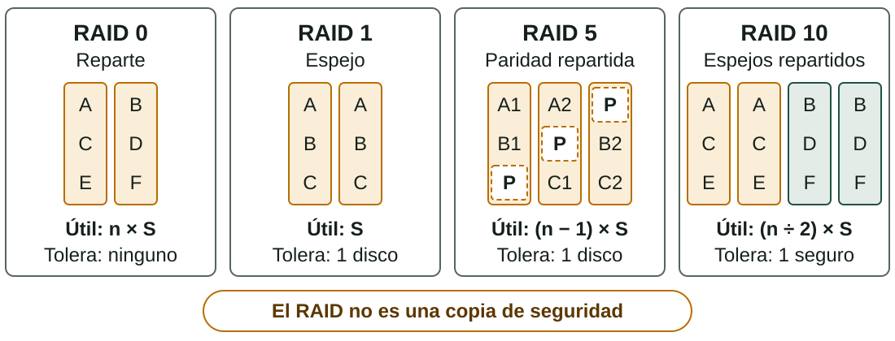
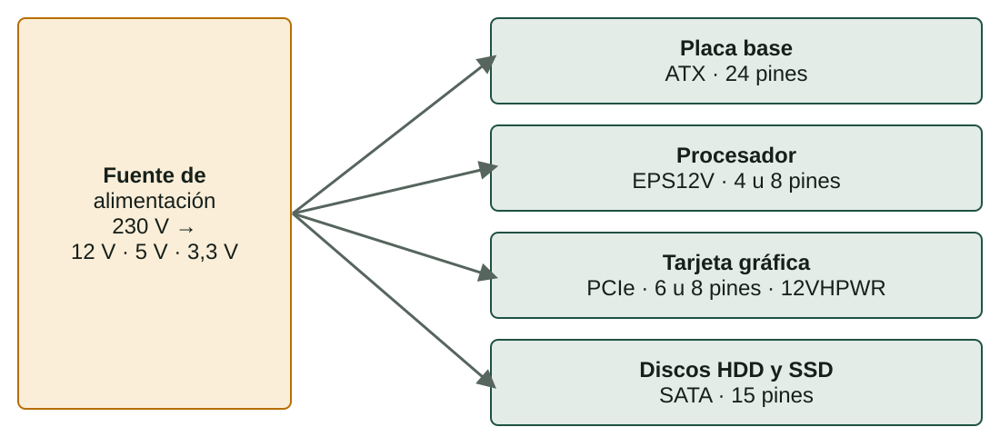

## Qué aprenderás

:::pasos
- Cómo funcionan **HDD**, **SSD SATA** y **SSD NVMe**
- Qué son los **IOPS** y cómo comparar discos
- Cómo agrupa discos el **RAID** y qué no protege
- Cómo elegir una **fuente de alimentación**: potencia, conectores y eficiencia
:::

---

## El almacenamiento es permanente

:::pasos
- A diferencia de la RAM, **conserva el contenido** apagado
- Tres tipos principales: **HDD**, **SSD SATA**, **SSD M.2 NVMe**
- Cómo funcionan por dentro explica **velocidad, precio y durabilidad**
:::

---

## HDD: platos y cabezal

:::pasos
- **Platos** magnéticos a **5.400 o 7.200** revoluciones por minuto
- Un **cabezal** se mueve sobre la superficie, como un tocadiscos
- El más **económico por gigabyte**
- El más **lento**: el cabezal tarda un tiempo de búsqueda
- El único con **partes móviles**: sensible a golpes y vibraciones
:::

---

## SSD SATA: sin piezas mecánicas

:::pasos
- Guarda la información en chips de **memoria flash**
- Sin cabezal, el acceso es **casi instantáneo**
- Usa la misma interfaz que un HDD: **cable SATA**
- La interfaz le pone un techo de unos **550–600 MB/s**
:::

---

## SSD M.2 NVMe: sin el cuello de botella

:::pasos
- Se conecta directamente al **bus PCIe** de la placa
- **NVMe** es el protocolo pensado para aprovecharlo
- Gama media: más de **3.500 MB/s**
- Gama alta (PCIe 4.0 o 5.0): **7.000–10.000 MB/s** o más
:::

---

## Comparativa

| Tipo | Secuencial | IOPS (aprox.) | Precio por GB |
|---|---|---|---|
| **HDD** | 80–250 MB/s | 50–200 | Muy bajo |
| **SSD SATA** | hasta ≈ 550 MB/s | 80.000–100.000 | Medio |
| **SSD NVMe** | 3.500–10.000 MB/s | 300.000–1.000.000 | Alto |

---

## Los IOPS

:::pasos
- **IOPS**: operaciones de lectura o escritura **pequeñas y dispersas** por segundo
- La velocidad **secuencial** importa al copiar archivos grandes
- Los IOPS importan en **servidores** con muchos usuarios y en **bases de datos**
:::

---

## Tipos de celda y durabilidad

:::pasos
- **SLC**: 1 bit por celda · **MLC**: 2 · **TLC**: 3 · **QLC**: 4
- Más bits: más capacidad por euro
- Pero **menos velocidad de escritura** y menos durabilidad
- Cada celda admite un número **limitado de escrituras**
- **TBW**: terabytes que puedes escribir antes de que acabe la garantía
:::

---

## Un disco de «1 TB» muestra 931 GB

:::pasos
1. El fabricante cuenta en potencias de 10: 1 TB = **10¹² bytes**
2. Windows cuenta en potencias de 2, pero escribe «GB»
3. 10¹² ÷ 2³⁰ ≈ **931 GB**
4. No falta espacio: es un **cambio de unidades**
:::

---

## Velocidad donde importa, capacidad donde no

:::note[Ejemplo resuelto: equipo doméstico]
**SSD NVMe de 500 GB** para el sistema y los programas. **HDD de 2 TB** para fotos, vídeos y documentos.
:::

:::pasos
- El NVMe hace que arranque y responda con **agilidad**
- El HDD lo guarda todo a un **coste por GB mucho menor**
:::

---

## ¿Qué es el RAID?

:::pasos
- ***Redundant Array of Independent Disks***
- Agrupa varios discos en **una única unidad lógica**
- Gana **velocidad**, **tolerancia a fallos** o ambas
- Cada **nivel** reparte los datos de una manera
:::

---

## Los niveles de RAID más habituales

---

## Capacidad y tolerancia

Con *n* discos de tamaño *S*:

| Nivel | Mínimo | Capacidad útil | Tolera |
|---|---|---|---|
| **RAID 0** | 2 | n × S | Ninguno |
| **RAID 1** | 2 | S | 1 disco |
| **RAID 5** | 3 | (n − 1) × S | 1 disco |
| **RAID 6** | 4 | (n − 2) × S | 2 discos |
| **RAID 10** | 4 | (n ÷ 2) × S | 1 seguro |

---

## Paridad y JBOD

:::pasos
- **Paridad**: información de control calculada a partir de los datos
- Permite **reconstruir** un disco que ha fallado
- RAID 5 reparte datos y paridad; RAID 6 tiene **doble paridad**
- **JBOD**: discos tal como son, **sin redundancia**
:::

---

## Ejemplo resuelto: cuatro discos de 4 TB

:::pasos
1. **RAID 0**: 4 × 4 = 16 TB, sin tolerancia
2. **RAID 5**: (4 − 1) × 4 = **12 TB**, aguanta 1 disco
3. **RAID 6**: (4 − 2) × 4 = **8 TB**, aguanta 2 discos
4. **RAID 10**: 4 ÷ 2 × 4 = **8 TB**, aguanta 1 disco seguro
:::

Para copias de seguridad: RAID 5 aprovecha mejor el espacio; RAID 6 es más seguro.

---

## Cuando un disco falla

:::pasos
- El RAID **reconstruye** los datos en un disco nuevo
- Con discos de muchos TB puede durar **horas o días**
- En ese tiempo, un segundo fallo sería **grave en RAID 5**
- Con discos grandes: **RAID 6** o **RAID 10**
- Lo gestiona una **controladora** o el SO: `mdadm`, espacios de almacenamiento
:::

---

## El RAID no es una copia de seguridad

:::caution[Protege de un disco que falla, no de un error]
No protege de un archivo borrado por error, de un virus que cifra los datos, de un fallo de la controladora, de un incendio o de un robo. Hace falta una **copia en otro lugar**.
:::

---

## La fuente de alimentación (PSU)

:::pasos
- Transforma los **230 V** de corriente alterna en corriente continua
- Principalmente **12 V, 5 V y 3,3 V**
- No conviene elegirla solo por el precio
- Una fuente de mala calidad puede **dañar el resto del equipo**
:::

---

## No abras nunca una fuente

:::danger[Peligro]
Los **condensadores** pueden mantener una carga peligrosa aunque esté desconectada. Enchufada, mantiene **5 V de reserva** en la placa. Antes de tocar nada dentro del equipo, **desenchufa el cable de corriente**.
:::

---

## Qué alimenta cada conector

---

## Otros conectores y cables modulares

:::pasos
- **12VHPWR / 12V-2x6**, 16 pines: gráficas muy potentes
- **Molex**, 4 pines: formato antiguo, ventiladores y periféricos
:::

:::caution[Cables modulares]
No son intercambiables entre marcas o modelos, aunque los conectores encajen: los **pines** pueden ser distintos. Usa siempre los cables de **tu fuente**.
:::

---

## Cuánta potencia necesitas

:::pasos
- La potencia máxima se mide en **vatios (W)**
- **Suma** el consumo aproximado de cada componente
- Deja un **margen del 20–30 %**
- Cerca del límite, la fuente dura menos y hay más riesgo de apagones
:::

---

## Consumos aproximados

| Componente | Entrada | Media | Alta |
|---|---|---|---|
| **CPU** | 35–65 W | 65–125 W | 125–250 W |
| **Gráfica dedicada** | 75–150 W | 150–250 W | 250–450 W |

:::pasos
- **Placa base**: 30–60 W · **RAM**: 3–5 W por módulo
- **SSD NVMe**: 3–9 W · **SSD SATA**: 2–4 W · **HDD**: 6–10 W
- **Ventiladores**: 2–4 W cada uno
:::

---

## Ejemplo resuelto: elegir una fuente

:::pasos
1. CPU 125 W + gráfica 200 W + resto 75 W = **400 W**
2. Margen del 30 %: 400 × 1,3 = **520 W**
3. La fuente comercial inmediatamente superior: **550 W**
:::

---

## Eficiencia: la certificación 80 PLUS

| Certificación | Eficiencia aprox. |
|---|---|
| **Bronze** | 85 % |
| **Silver** | 88 % |
| **Gold** | 90 % |
| **Platinum** | 92 % |
| **Titanium** | 94 % |

El nivel básico, **80 PLUS**, es del 80 %.

---

## Qué ahorra una fuente más eficiente

:::pasos
- Una fuente pierde parte de la energía en forma de **calor**
- Más eficiente: menos electricidad gastada, menos calor y **menos ruido**
- Componentes de **300 W** con una fuente básica: 300 ÷ 0,80 = **375 W**
- Con una Platinum: 300 ÷ 0,92 ≈ **326 W**
:::

---

## Modular, semimodular o no modular

:::pasos
- **Modular**: todos los cables se pueden desconectar; más orden y más flujo de aire
- **Semimodular**: los imprescindibles (el ATX de 24 pines) son fijos
- **No modular**: todos los cables son fijos
- Formato habitual **ATX**; **SFX** para chasis pequeños
:::

---

## Resumen

- **HDD** barato y lento · **SSD SATA** rápido · **NVMe** el más rápido
- **IOPS** y velocidad secuencial no son lo mismo
- **RAID**: velocidad o redundancia, pero **nunca una copia de seguridad**
- **Fuente**: suma los consumos y deja un **margen del 20–30 %**

[Actividades de la unidad →](/docencia/dam/sistemas-informaticos/ud01-hardware/actividades/es/)
