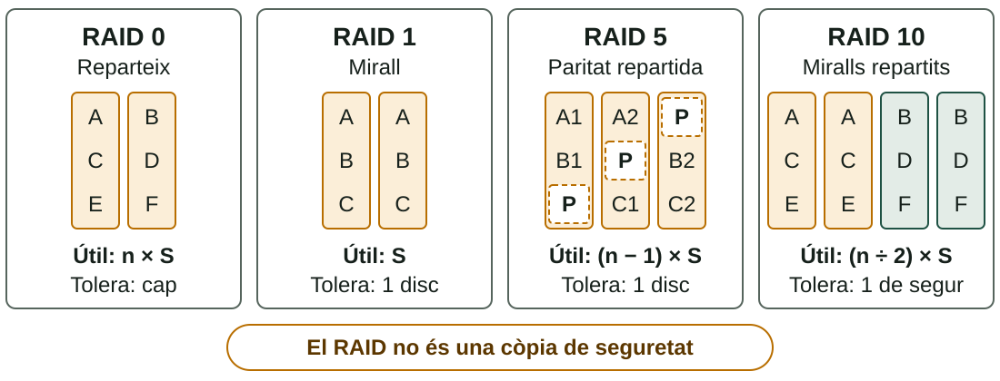
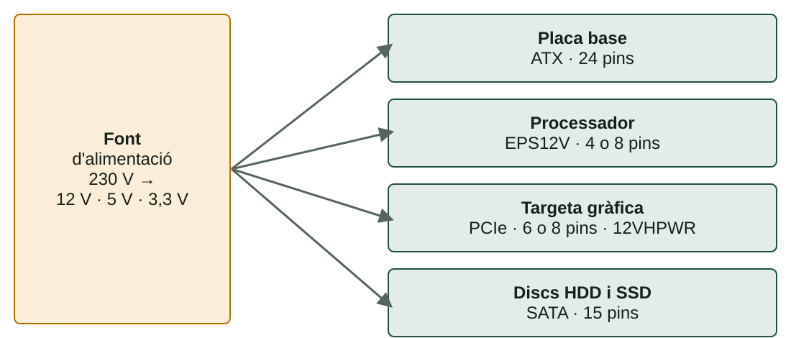

## Què aprendràs

:::pasos
- Com funcionen **HDD**, **SSD SATA** i **SSD NVMe**
- Què són els **IOPS** i com comparar discs
- Com agrupa discs el **RAID** i què no protegix
- Com triar una **font d'alimentació**: potència, connectors i eficiència
:::

---

## L'emmagatzematge és permanent

:::pasos
- A diferència de la RAM, **conserva el contingut** apagat
- Tres tipus principals: **HDD**, **SSD SATA**, **SSD M.2 NVMe**
- Com funcionen per dins explica **velocitat, preu i durabilitat**
:::

---

## HDD: plats i capçal

:::pasos
- **Plats** magnètics a **5.400 o 7.200** revolucions per minut
- Un **capçal** es mou sobre la superfície, com un tocadiscos
- El més **econòmic per gigabyte**
- El més **lent**: el capçal tarda un temps de busca
- L'únic amb **parts mòbils**: sensible a colps i vibracions
:::

---

## SSD SATA: sense peces mecàniques

:::pasos
- Guarda la informació en xips de **memòria flash**
- Sense capçal, l'accés és **quasi instantani**
- Usa la mateixa interfície que un HDD: **cable SATA**
- La interfície li posa un sostre d'uns **550–600 MB/s**
:::

---

## SSD M.2 NVMe: sense el coll d'ampolla

:::pasos
- Es connecta directament al **bus PCIe** de la placa
- **NVMe** és el protocol pensat per a aprofitar-lo
- Gamma mitjana: més de **3.500 MB/s**
- Gamma alta (PCIe 4.0 o 5.0): **7.000–10.000 MB/s** o més
:::

---

## Comparativa

| Tipus | Seqüencial | IOPS (aprox.) | Preu per GB |
|---|---|---|---|
| **HDD** | 80–250 MB/s | 50–200 | Molt baix |
| **SSD SATA** | fins a ≈ 550 MB/s | 80.000–100.000 | Mitjà |
| **SSD NVMe** | 3.500–10.000 MB/s | 300.000–1.000.000 | Alt |

---

## Els IOPS

:::pasos
- **IOPS**: operacions de lectura o escriptura **xicotetes i disperses** per segon
- La velocitat **seqüencial** importa en copiar arxius grans
- Els IOPS importen en **servidors** amb molts usuaris i en **bases de dades**
:::

---

## Tipus de cel·la i durabilitat

:::pasos
- **SLC**: 1 bit per cel·la · **MLC**: 2 · **TLC**: 3 · **QLC**: 4
- Més bits: més capacitat per euro
- Però **menys velocitat d'escriptura** i menys durabilitat
- Cada cel·la admet un nombre **limitat d'escriptures**
- **TBW**: terabytes que pots escriure abans que acabe la garantia
:::

---

## Un disc d'«1 TB» mostra 931 GB

:::pasos
1. El fabricant compta en potències de 10: 1 TB = **10¹² bytes**
2. Windows compta en potències de 2, però escriu «GB»
3. 10¹² ÷ 2³⁰ ≈ **931 GB**
4. No falta espai: és un **canvi d'unitats**
:::

---

## Velocitat on importa, capacitat on no

:::note[Exemple resolt: equip domèstic]
**SSD NVMe de 500 GB** per al sistema i els programes. **HDD de 2 TB** per a fotos, vídeos i documents.
:::

:::pasos
- L'NVMe fa que arranque i responga amb **agilitat**
- L'HDD ho guarda tot a un **cost per GB molt menor**
:::

---

## Què és el RAID?

:::pasos
- ***Redundant Array of Independent Disks***
- Agrupa diversos discs en **una única unitat lògica**
- Guanya **velocitat**, **tolerància a fallades** o totes dues
- Cada **nivell** reparteix les dades d'una manera
:::

---

## Els nivells de RAID més habituals

---

## Capacitat i tolerància

Amb *n* discs de mida *S*:

| Nivell | Mínim | Capacitat útil | Tolera |
|---|---|---|---|
| **RAID 0** | 2 | n × S | Cap |
| **RAID 1** | 2 | S | 1 disc |
| **RAID 5** | 3 | (n − 1) × S | 1 disc |
| **RAID 6** | 4 | (n − 2) × S | 2 discs |
| **RAID 10** | 4 | (n ÷ 2) × S | 1 de segur |

---

## Paritat i JBOD

:::pasos
- **Paritat**: informació de control calculada a partir de les dades
- Permet **reconstruir** un disc que ha fallat
- RAID 5 repartix dades i paritat; RAID 6 té **doble paritat**
- **JBOD**: discs tal com són, **sense redundància**
:::

---

## Exemple resolt: quatre discs de 4 TB

:::pasos
1. **RAID 0**: 4 × 4 = 16 TB, sense tolerància
2. **RAID 5**: (4 − 1) × 4 = **12 TB**, aguanta 1 disc
3. **RAID 6**: (4 − 2) × 4 = **8 TB**, aguanta 2 discs
4. **RAID 10**: 4 ÷ 2 × 4 = **8 TB**, aguanta 1 disc de segur
:::

Per a còpies de seguretat: RAID 5 aprofita millor l'espai; RAID 6 és més segur.

---

## Quan un disc falla

:::pasos
- El RAID **reconstruïx** les dades en un disc nou
- Amb discs de molts TB pot durar **hores o dies**
- En eixe temps, una segona fallada seria **greu en RAID 5**
- Amb discs grans: **RAID 6** o **RAID 10**
- Ho gestiona una **controladora** o el SO: `mdadm`, espais d'emmagatzematge
:::

---

## El RAID no és una còpia de seguretat

:::caution[Protegix d'un disc que falla, no d'un error]
No protegix d'un fitxer esborrat per error, d'un virus que xifra les dades, d'una fallada de la controladora, d'un incendi o d'un robatori. Cal una **còpia en un altre lloc**.
:::

---

## La font d'alimentació (PSU)

:::pasos
- Transforma els **230 V** de corrent altern en corrent continu
- Principalment **12 V, 5 V i 3,3 V**
- No convé triar-la només pel preu
- Una font de mala qualitat pot **danyar la resta de l'equip**
:::

---

## No obris mai una font

:::danger[Perill]
Els **condensadors** poden mantindre una càrrega perillosa encara que estiga desconnectada. Endollada, manté **5 V de reserva** en la placa. Abans de tocar res dins de l'equip, **desendolla el cable de corrent**.
:::

---

## Què alimenta cada connector

---

## Altres connectors i cables modulars

:::pasos
- **12VHPWR / 12V-2x6**, 16 pins: gràfiques molt potents
- **Molex**, 4 pins: format antic, ventiladors i perifèrics
:::

:::caution[Cables modulars]
No són intercanviables entre marques o models, encara que els connectors encaixen: els **pins** poden ser diferents. Usa sempre els cables de **la teua font**.
:::

---

## Quanta potència necessites

:::pasos
- La potència màxima es mesura en **vats (W)**
- **Suma** el consum aproximat de cada component
- Deixa un **marge del 20–30 %**
- Prop del límit, la font dura menys i hi ha més risc d'apagades
:::

---

## Consums aproximats

| Component | Entrada | Mitjana | Alta |
|---|---|---|---|
| **CPU** | 35–65 W | 65–125 W | 125–250 W |
| **Gràfica dedicada** | 75–150 W | 150–250 W | 250–450 W |

:::pasos
- **Placa base**: 30–60 W · **RAM**: 3–5 W per mòdul
- **SSD NVMe**: 3–9 W · **SSD SATA**: 2–4 W · **HDD**: 6–10 W
- **Ventiladors**: 2–4 W cada un
:::

---

## Exemple resolt: triar una font

:::pasos
1. CPU 125 W + gràfica 200 W + resta 75 W = **400 W**
2. Marge del 30 %: 400 × 1,3 = **520 W**
3. La font comercial immediatament superior: **550 W**
:::

---

## Eficiència: la certificació 80 PLUS

| Certificació | Eficiència aprox. |
|---|---|
| **Bronze** | 85 % |
| **Silver** | 88 % |
| **Gold** | 90 % |
| **Platinum** | 92 % |
| **Titanium** | 94 % |

El nivell bàsic, **80 PLUS**, és del 80 %.

---

## Què estalvia una font més eficient

:::pasos
- Una font perd part de l'energia en forma de **calor**
- Més eficient: menys electricitat gastada, menys calor i **menys soroll**
- Components de **300 W** amb una font bàsica: 300 ÷ 0,80 = **375 W**
- Amb una Platinum: 300 ÷ 0,92 ≈ **326 W**
:::

---

## Modular, semimodular o no modular

:::pasos
- **Modular**: tots els cables es poden desconnectar; més ordre i més flux d'aire
- **Semimodular**: els imprescindibles (l'ATX de 24 pins) són fixos
- **No modular**: tots els cables són fixos
- Format habitual **ATX**; **SFX** per a xassís xicotets
:::

---

## Resum

- **HDD** barat i lent · **SSD SATA** ràpid · **NVMe** el més ràpid
- **IOPS** i velocitat seqüencial no són el mateix
- **RAID**: velocitat o redundància, però **mai una còpia de seguretat**
- **Font**: suma els consums i deixa un **marge del 20–30 %**

[Activitats de la unitat →](/docencia/dam/sistemas-informaticos/ud01-hardware/actividades/)
