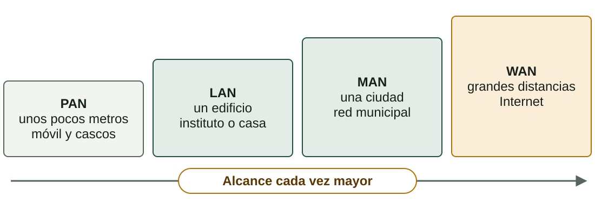
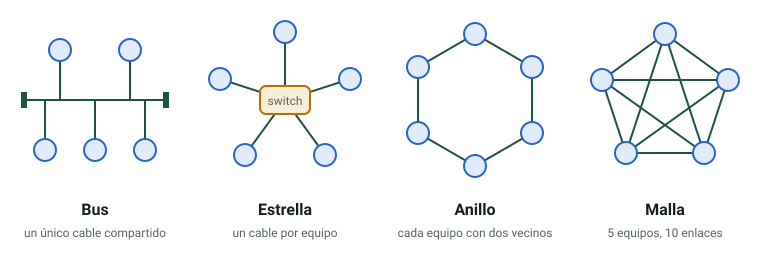
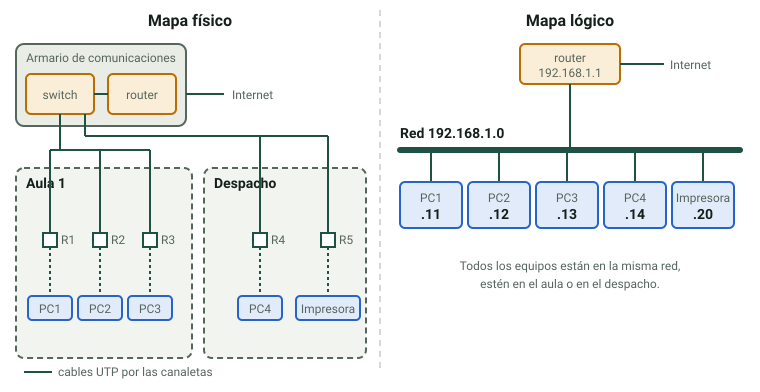
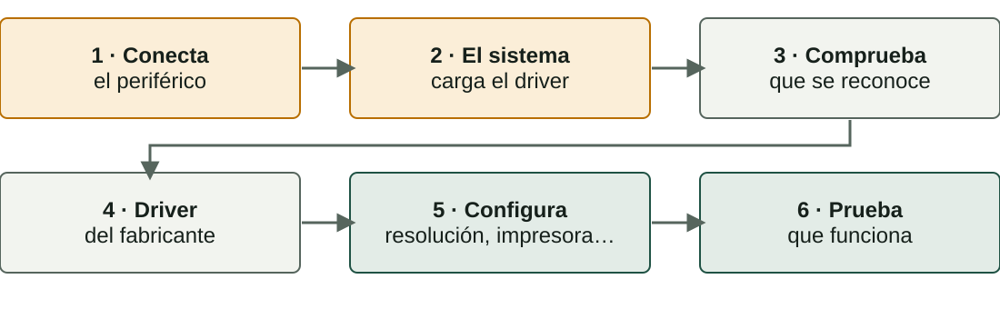

## Qué aprenderás

:::pasos
- Qué **tipos de redes** y **topologías** hay
- Qué **medios** y **dispositivos** las forman
- Cómo se documenta una red: **mapa físico** y **mapa lógico**
- Cómo **trabajar con seguridad** en el taller
- Cómo **instalar** y comprobar un periférico
:::

---

## Qué es una red

:::pasos
- Dispositivos **conectados entre sí**: ordenadores, servidores, impresoras, móviles…
- Por **cable** o sin hilos
- Para **compartir** información y recursos
- Archivos, impresoras, **Internet** o potencia de cálculo
:::

---

## Tipos de redes según su alcance



---

## Topologías: cómo se organizan las conexiones



---

## Ventajas e inconvenientes

| Topología | Ventaja | Inconveniente |
|---|---|---|
| **Bus** | Muy económica | Si falla el cable, cae todo |
| **Estrella** | Un fallo afecta a un equipo | Si falla el switch, cae todo |
| **Anillo** | Tráfico equitativo | Un punto roto corta el anillo |
| **Malla** | Máxima redundancia | Cara y compleja |

---

## Casi todas las LAN son en estrella

:::pasos
- Uno o varios **switches**
- Una avería afecta a **un solo puesto de trabajo**
- **Bus** y **anillo**: redes antiguas
- Malla completa de *n* equipos: **n × (n − 1) ÷ 2** enlaces
- 8 equipos: **28 cables**; 20 equipos: **190**
:::

---

## Medios de transmisión

| Medio | Conector | Velocidad típica | Uso |
|---|---|---|---|
| **Par trenzado (UTP)** | RJ45 | 1 Gb/s (hasta 10) | LAN cableadas |
| **Fibra óptica** | SC, LC | Varios Gb/s | Troncales, centros de datos |
| **Wi-Fi** | Sin conector | Cientos de Mb/s a Gb/s | Movilidad |

---

## UTP y fibra: lo que hay que saber

:::pasos
- UTP: máximo **100 m** por tramo
- Las **categorías** (5e, 6, 6A…) marcan la velocidad; la 6A llega a **10 Gb/s**
- El conector RJ45 es técnicamente un **8P8C**
- La fibra transmite **luz**: llega más lejos, sin interferencias
- **Monomodo** para distancias largas; **multimodo** para cortas
:::

---

## Switch y router

:::pasos
- **Switch**: conecta equipos de **una misma red local**
- El *hub* antiguo repetía todo a todos los puertos
- El switch aprende qué hay en cada puerto y envía **solo al destinatario**
- **Router**: conecta **redes distintas** y decide por dónde va cada paquete
- El «router» de casa es router, switch y **punto de acceso Wi-Fi**
:::

---

## Dos mapas complementarios

::::columnas
:::note[Mapa físico]
Dónde está cada **switch**, cada **cable**, cada **toma**. Sirve para **localizar una avería**.
:::

:::note[Mapa lógico]
Qué **direcciones IP** y qué **redes**, y qué camino sigue el tráfico. Sirve para **entender y depurar**.
:::
::::

---

## Un mismo despacho, dos mapas



---

## Cableado simple, organización lógica compleja

:::pasos
- Físicamente: todo en **estrella** hacia un armario
- Encima: **redes distintas** para profesorado, alumnado y administración
- Comparten **los mismos cables**
:::

---

## El taller: tres ideas

:::pasos
- **Evitar** el riesgo
- **Protegerse**
- Saber **qué hacer** si pasa algo
:::

La **Ley 31/1995** de Prevención de Riesgos Laborales obliga a evaluar y prevenir los riesgos del puesto de trabajo.

---

## Antes de abrir un equipo

:::pasos
1. Apágalo y **desenchufa el cable de corriente**
2. Pulsa unos segundos el botón de encendido: descarga la electricidad residual
3. Espera a que se **enfríe**
4. Superficie **limpia e iluminada**; tornillos en un recipiente
5. Quítate pulseras, anillos y cadenas
6. **No abras nunca una fuente de alimentación**
:::

---

## Descargas electrostáticas (ESD)

:::pasos
- Tu cuerpo acumula **electricidad estática**
- Tú no la notas por debajo de unos **3.000 V**
- Un chip puede dañarse con mucho menos, **sin que se note**
- La pieza puede fallar **semanas después**
:::

---

## Cómo evitar la ESD

:::pasos
- **Pulsera antiestática** conectada a una parte metálica sin pintar
- Sin ella, toca a menudo una **parte metálica sin pintar**
- Coge tarjetas y módulos **por los bordes**
- Guarda las piezas en **bolsas antiestáticas**
- Evita la **moqueta** y la ropa de lana o sintética
:::

---

## Otros riesgos del taller

:::pasos
- **Cortes y heridas**: bordes del chasis, pines
- **Cargas**: flexiona las rodillas, pide ayuda
- **Cables**: recogidos; desconecta tirando del **conector**
- **Líquidos** lejos de los equipos; lávate las manos tras usar pasta térmica
:::

---

## Pilas, fuego y residuos

:::pasos
- **Baterías de litio**: no las perfores ni las calientes; la hinchada, retirada
- **Fuego**: conoce el extintor y la salida; en un equipo eléctrico, **nunca agua**
- **Residuos**: a un punto de recogida autorizado, no a la basura
:::

---

## Ergonomía

:::pasos
- Pantalla a la **altura de los ojos**, a **50–70 cm**
- **Espalda** apoyada, **pies** en el suelo
- Evita los **reflejos**
- **Pausas** cortas y regulares
:::

---

## Periféricos

| Tipo | Ejemplos | Conexiones |
|---|---|---|
| **Entrada** | Teclado, ratón, escáner, cámara | USB, Bluetooth, *jack* |
| **Salida** | Monitor, impresora, altavoces | HDMI, DisplayPort, USB |
| **Entrada y salida** | Pantalla táctil, disco externo | USB, Thunderbolt, RJ45 |

---

## USB: la velocidad depende del puerto y del cable

:::pasos
- **USB 2.0**: 480 Mb/s
- **USB 3.x**: de 5 a 20 Gb/s según la versión
- **USB4** y **Thunderbolt**: hasta 40 Gb/s o más
:::

:::caution[USB-C no garantiza nada]
Un conector **USB-C** no garantiza velocidad ni vídeo: depende del **puerto** y del **cable**.
:::

---

## Monitores e impresoras

:::pasos
- **IPS**: buenos colores y ángulos · **VA**: mucho contraste · **TN**: rápido y barato
- **OLED**: cada píxel emite luz; riesgo de *burn-in*
- **QLED**: un LCD con puntos cuánticos, no OLED
- **Láser**: tóner, rápida · **Tinta**: buena para color y foto
:::

---

## Instalar un periférico en seis pasos



---

## Conectar y dejar que el SO lo reconozca

:::pasos
- Los **USB** se pueden enchufar con el equipo encendido (*hot-plug*)
- El sistema carga un **controlador** (*driver*)
- A menudo es automático: ***plug and play***
- Si hace falta, instala el del fabricante, de su **web oficial**
:::

---

## Comprobar en Linux

```bash
lsusb               # USB
lspci               # PCI/PCIe
lsblk               # discos
sudo dmesg | tail   # núcleo
```

Dispositivos **USB**, tarjetas, discos y **mensajes del núcleo** al enchufar.

---

## Comprobar en Windows

```powershell
Get-PnpDevice -PresentOnly | Where-Object Status -ne 'OK'
```

El **Administrador de dispositivos** (`devmgmt.msc`) marca los que tienen problemas.

---

## La práctica presencial

:::pasos
1. **Identificar componentes**: placa, CPU, RAM, almacenamiento y fuente
2. **Manipulación guiada**: desmontar y montar RAM y una unidad
3. **Conectores de red**: par trenzado, RJ45 y fibra
4. **Ficha de reconocimiento**: se completa y se entrega en Aules
:::

Por parejas. Repasa antes la **seguridad en el taller**.

---

## Resumen

- **LAN en estrella**: switch dentro de la red, router entre redes
- **Mapa físico** para encontrar averías, **mapa lógico** para entender
- **Seguridad**: desenchufa, descarga la ESD y **no abras nunca una fuente**
- **Periférico**: conecta, comprueba, controlador, configura, prueba

[Actividades de la unidad →](/docencia/dam/sistemas-informaticos/ud01-hardware/actividades/es/)
