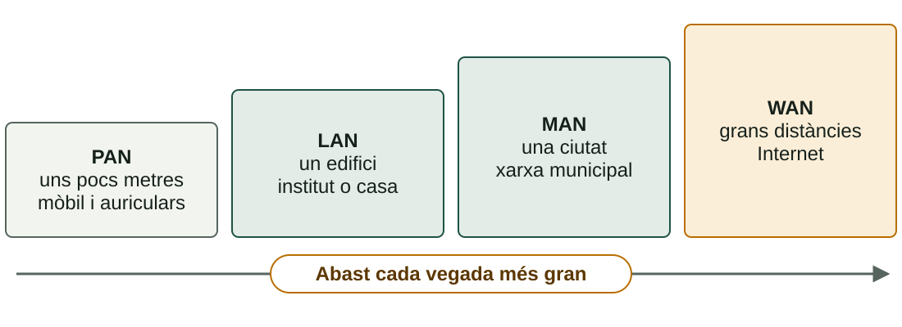
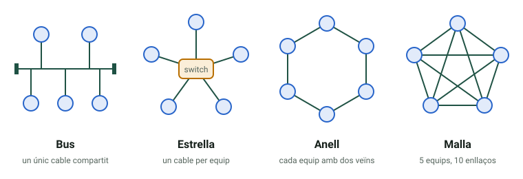
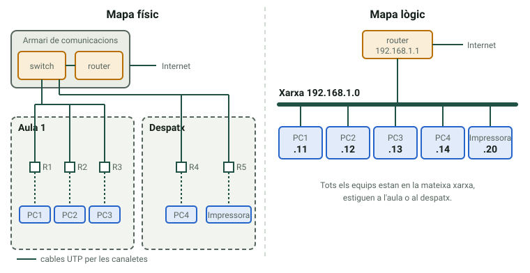
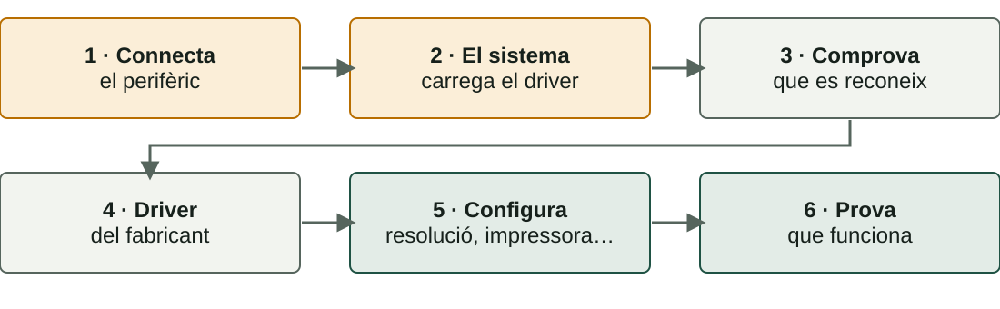

## Què aprendràs

:::pasos
- Quins **tipus de xarxes** i **topologies** hi ha
- Quins **mitjans** i **dispositius** les formen
- Com es documenta una xarxa: **mapa físic** i **mapa lògic**
- Com **treballar amb seguretat** en el taller
- Com **instal·lar** i comprovar un perifèric
:::

---

## Què és una xarxa

:::pasos
- Dispositius **connectats entre si**: ordinadors, servidors, impressores, mòbils…
- Per **cable** o sense fil
- Per **compartir** informació i recursos
- Arxius, impressores, **Internet** o potència de càlcul
:::

---

## Tipus de xarxes segons l'abast



---

## Topologies: com s'organitzen les connexions



---

## Avantatges i inconvenients

| Topologia | Avantatge | Inconvenient |
|---|---|---|
| **Bus** | Molt econòmica | Si falla el cable, cau tot |
| **Estrella** | Una fallada afecta un equip | Si falla el switch, cau tot |
| **Anell** | Trànsit equitatiu | Un punt trencat talla l'anell |
| **Malla** | Màxima redundància | Cara i complexa |

---

## Quasi totes les LAN són en estrella

:::pasos
- Un o diversos **switches**
- Una avaria afecta **un sol lloc de treball**
- **Bus** i **anell**: xarxes antigues
- Malla completa de *n* equips: **n × (n − 1) ÷ 2** enllaços
- 8 equips: **28 cables**; 20 equips: **190**
:::

---

## Mitjans de transmissió

| Mitjà | Connector | Velocitat típica | Ús |
|---|---|---|---|
| **Parell trenat (UTP)** | RJ45 | 1 Gb/s (fins a 10) | LAN cablejades |
| **Fibra òptica** | SC, LC | Diversos Gb/s | Troncals, centres de dades |
| **Wi-Fi** | Sense connector | Centenars de Mb/s a Gb/s | Mobilitat |

---

## UTP i fibra: el que cal saber

:::pasos
- UTP: màxim **100 m** per tram
- Les **categories** (5e, 6, 6A…) marquen la velocitat; la 6A arriba als **10 Gb/s**
- El connector RJ45 és tècnicament un **8P8C**
- La fibra transmet **llum**: arriba més lluny, sense interferències
- **Monomode** per a distàncies llargues; **multimode** per a curtes
:::

---

## Switch i router

:::pasos
- **Switch**: connecta equips d'**una mateixa xarxa local**
- El *hub* antic repetia tot a tots els ports
- El switch aprén què hi ha en cada port i envia **només al destinatari**
- **Router**: connecta **xarxes diferents** i decidix per on va cada paquet
- El «router» de casa és router, switch i **punt d'accés Wi-Fi**
:::

---

## Dos mapes complementaris

::::columnas
:::note[Mapa físic]
On està cada **switch**, cada **cable**, cada **presa**. Serveix per a **localitzar una avaria**.
:::

:::note[Mapa lògic]
Quines **adreces IP** i quines **xarxes**, i quin camí seguix el trànsit. Serveix per a **entendre i depurar**.
:::
::::

---

## Un mateix despatx, dos mapes



---

## Cablejat simple, organització lògica complexa

:::pasos
- Físicament: tot en **estrella** cap a un armari
- Damunt: **xarxes diferents** per a professorat, alumnat i administració
- Compartixen **els mateixos cables**
:::

---

## El taller: tres idees

:::pasos
- **Evitar** el risc
- **Protegir-se**
- Saber **què fer** si passa alguna cosa
:::

La **Llei 31/1995** de Prevenció de Riscos Laborals obliga a avaluar i prevenir els riscos del lloc de treball.

---

## Abans d'obrir un equip

:::pasos
1. Apaga'l i **desendolla el cable de corrent**
2. Prem uns segons el botó d'encesa: descarrega l'electricitat residual
3. Espera que es **refrede**
4. Superfície **neta i il·luminada**; cargols en un recipient
5. Lleva't polseres, anells i cadenes
6. **No obris mai una font d'alimentació**
:::

---

## Descàrregues electrostàtiques (ESD)

:::pasos
- El teu cos acumula **electricitat estàtica**
- Tu no la notes per davall d'uns **3.000 V**
- Un xip pot danyar-se amb molt menys, **sense que es note**
- La peça pot fallar **setmanes després**
:::

---

## Com evitar l'ESD

:::pasos
- **Polsera antiestàtica** connectada a una part metàl·lica sense pintar
- Sense ella, toca sovint una **part metàl·lica sense pintar**
- Agafa targetes i mòduls **pels cantons**
- Guarda les peces en **bosses antiestàtiques**
- Evita la **moqueta** i la roba de llana o sintètica
:::

---

## Altres riscos del taller

:::pasos
- **Talls i ferides**: cantons del xassís, pins
- **Càrregues**: flexiona els genolls, demana ajuda
- **Cables**: recollits; desconnecta estirant del **connector**
- **Líquids** lluny dels equips; llava't les mans amb pasta tèrmica
:::

---

## Piles, foc i residus

:::pasos
- **Bateries de liti**: no les perfores ni les escalfes; la inflada, retirada
- **Foc**: coneix l'extintor i l'eixida; en un equip elèctric, **mai aigua**
- **Residus**: a un punt de recollida autoritzat, no al fem
:::

---

## Ergonomia

:::pasos
- Pantalla a l'**altura dels ulls**, a **50–70 cm**
- **Esquena** recolzada, **peus** a terra
- Evita els **reflexos**
- **Pauses** curtes i regulars
:::

---

## Perifèrics

| Tipus | Exemples | Connexions |
|---|---|---|
| **Entrada** | Teclat, ratolí, escàner, càmera | USB, Bluetooth, *jack* |
| **Eixida** | Monitor, impressora, altaveus | HDMI, DisplayPort, USB |
| **Entrada i eixida** | Pantalla tàctil, disc extern | USB, Thunderbolt, RJ45 |

---

## USB: la velocitat depén del port i del cable

:::pasos
- **USB 2.0**: 480 Mb/s
- **USB 3.x**: de 5 a 20 Gb/s segons la versió
- **USB4** i **Thunderbolt**: fins a 40 Gb/s o més
:::

:::caution[USB-C no garantix res]
Un connector **USB-C** no garantix velocitat ni vídeo: depén del **port** i del **cable**.
:::

---

## Monitors i impressores

:::pasos
- **IPS**: bons colors i angles · **VA**: molt contrast · **TN**: ràpid i barat
- **OLED**: cada píxel emet llum; risc de *burn-in*
- **QLED**: un LCD amb punts quàntics, no OLED
- **Làser**: tòner, ràpida · **Tinta**: bona per a color i foto
:::

---

## Instal·lar un perifèric en sis passos



---

## Connectar i deixar que el SO el reconega

:::pasos
- Els **USB** es poden endollar amb l'equip encés (*hot-plug*)
- El sistema carrega un **controlador** (*driver*)
- Sovint és automàtic: ***plug and play***
- Si cal, instal·la el del fabricant, del seu **web oficial**
:::

---

## Comprovar en Linux

```bash
lsusb               # USB
lspci               # PCI/PCIe
lsblk               # discs
sudo dmesg | tail   # nucli
```

Dispositius **USB**, targetes, discs i **missatges del nucli** en endollar.

---

## Comprovar en Windows

```powershell
Get-PnpDevice -PresentOnly | Where-Object Status -ne 'OK'
```

L'**Administrador de dispositius** (`devmgmt.msc`) marca els que tenen problemes.

---

## La pràctica presencial

:::pasos
1. **Identificar components**: placa, CPU, RAM, emmagatzematge i font
2. **Manipulació guiada**: desmuntar i muntar RAM i una unitat
3. **Connectors de xarxa**: parell trenat, RJ45 i fibra
4. **Fitxa de reconeixement**: es completa i s'entrega en Aules
:::

Per parelles. Repassa abans la **seguretat al taller**.

---

## Resum

- **LAN en estrella**: switch dins de la xarxa, router entre xarxes
- **Mapa físic** per a trobar avaries, **mapa lògic** per a entendre
- **Seguretat**: desendolla, descarrega l'ESD i **no obris mai una font**
- **Perifèric**: connecta, comprova, controlador, configura, prova

[Activitats de la unitat →](/docencia/dam/sistemas-informaticos/ud01-hardware/actividades/)
