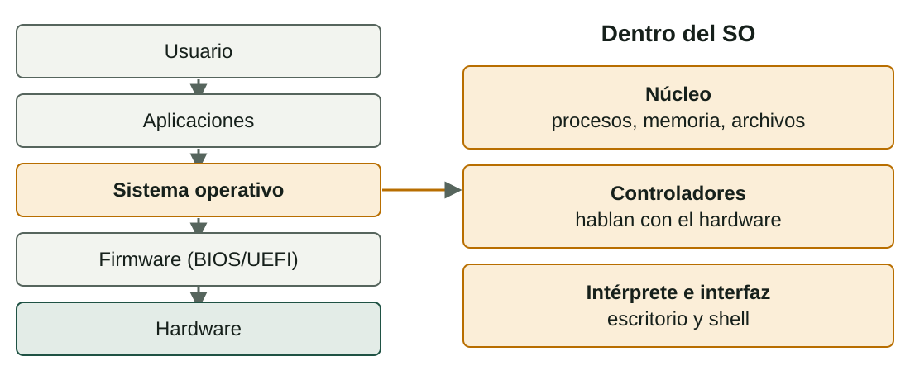

## Qué aprenderás

:::pasos
- Qué hace un **sistema operativo** y de qué piezas se compone
- Cómo se **clasifican** los SO y cómo se comparan
- Qué **licencias** hay y qué permiten
- Qué **sistema de archivos** elegir: FAT32, exFAT, NTFS o ext4
:::

---

## El SO es el intermediario

:::pasos
- Gestiona los recursos: **CPU, memoria, almacenamiento, periféricos**
- Las aplicaciones no hablan con el disco: piden el servicio con una **llamada al sistema**
- Sin esta capa, cada programa llevaría el código de **cada disco y cada impresora**
:::

---

## Cinco niveles, tres piezas



---

## Cinco funciones del SO

:::pasos
- **Procesos**: qué programa usa la CPU en cada momento
- **Memoria**: reparte la RAM y aísla los programas
- **Archivos**: organiza los datos en el disco
- **Entrada y salida**: teclado, pantalla, red, discos…
- **Seguridad y usuarios**: cuentas, permisos y aislamiento
:::

---

## Cuántas personas, qué servicio

| Tipo | Idea | Ejemplos |
|---|---|---|
| **Monousuario** | Una sola persona a la vez | MS-DOS, Windows doméstico |
| **Multiusuario** | Varios usuarios, cada uno con sus permisos | Linux, Windows Server, macOS |
| **De red** | Da servicio a otros equipos | Windows Server, Linux de servidor |

---

## No son categorías excluyentes

:::pasos
- Un servidor es a la vez **multiusuario** y **de red**
- La frontera **monousuario / multiusuario** no es nítida
- Windows 10/11: varias cuentas, pero **una sesión gráfica** a la vez
- Justifica siempre **el criterio** que usas
:::

---

## Tipos de software según la licencia

| Tipo | Qué permite | Ejemplos |
|---|---|---|
| **Libre** | Usar, estudiar, modificar y redistribuir | Linux, FreeBSD, LibreOffice |
| **Código abierto** | Código accesible; se solapa con el libre | Android (base), Chromium |
| **Propietario** | El fabricante controla el código (EULA) | Windows, macOS |
| **Freeware** | Gratuito, pero con el código cerrado | Algunos controladores |
| **Shareware** | Se prueba gratis un tiempo | Versiones de evaluación |

---

## Dos tipos de licencia libre

:::pasos
- **Copyleft** (GPL): las obras derivadas mantienen la misma libertad
- El núcleo **Linux** es GPL
- **Permisivas** (MIT, BSD): el código puede ir a productos cerrados
:::

:::caution[Libre no significa gratuito]
«Libre» se refiere a las **libertades**, no al precio.
:::

---

## Licencias de Windows

:::pasos
- **OEM**: preinstalada, vinculada a ese hardware
- **Retail**: se compra suelta y, en general, se puede transferir
- **Por volumen**: empresas y centros, para muchos equipos
- **Windows Server**: reglas propias (núcleos y acceso de cliente)
- **Antes de desplegar**: comprueba que la licencia cubre el uso
:::

---

## Cómo se comparan dos sistemas

:::pasos
- **Requisitos** mínimos y recomendados: CPU, RAM, disco, firmware
- **Compatibilidad** con el hardware y el software
- **Coste** de la licencia
- **Soporte**
- **Seguridad**
:::

---

## Ejemplo resuelto: renovar un aula

:::pasos
1. **30 ordenadores** para programación, presupuesto ajustado
2. Hacen falta compiladores, editores y máquinas virtuales
3. Una distribución **Linux** (Ubuntu) evita el coste de licencias
4. Se administra en bloque y exige menos hardware
5. Comprueba que el software de la asignatura tenga versión para **Linux**
:::

---

## ¿Qué es un sistema de archivos?

Un disco, por sí mismo, es solo una sucesión de bytes.

:::pasos
- El **sistema de archivos** es la estructura que el SO escribe encima
- Organiza nombres, carpetas, fechas, permisos y ubicación
- **Clúster**: la unidad mínima de asignación
- **Journaling**: anota lo que va a hacer antes de cambiar nada
- Si se apaga de golpe, deja el volumen **coherente**
:::

---

## FAT32 y exFAT

::::columnas
:::pasos
- **FAT32**: compatible con casi todo
- Archivo máximo: **4 GiB − 1 B**
- Sin permisos ni journaling
- Es el de la **partición EFI**
:::

:::pasos
- **exFAT**: pensado para memorias flash
- Sin el límite práctico de 4 GiB
- Sin permisos ni journaling
- Linux, de serie, desde el núcleo **5.7**
:::
::::

---

## Los límites de volumen de FAT32

:::pasos
- «8 TB por partición»: depende del **clúster** y del **sector**
- Sectores de 512 B y clústeres de 32 KiB → unos **8 TiB**
- Las **herramientas de formateo** pueden poner un límite propio
- Windows, durante años: **máximo 32 GB** al crear (pero los leía)
:::

:::caution[Piensa en órdenes de magnitud]
Ante estas cifras, comprueba la herramienta concreta que usas.
:::

---

## NTFS y ext4

::::columnas
:::pasos
- **NTFS**: el nativo de Windows
- Permisos por archivo y carpeta (**ACL**)
- Cifrado, compresión y **journaling**
- Linux lo lee con controladores
:::

:::pasos
- **ext4**: el más habitual en Linux
- Permisos **propietario, grupo, otros**
- Archivos de hasta **16 TiB**, con **journaling**
- Windows no lo reconoce de serie
:::
::::

---

## Comparativa: límites y permisos

| | Archivo máximo | Permisos por usuario | Journaling |
|---|---|---|---|
| **FAT32** | 4 GiB − 1 B | No | No |
| **exFAT** | Prácticamente ilimitado | No | No |
| **NTFS** | Enorme (≥ 16 TiB) | Sí (ACL) | Sí |
| **ext4** | 16 TiB | Sí (UGO) | Sí |

---

## Comparativa: quién lo lee

| | Windows | Linux | macOS |
|---|---|---|---|
| **FAT32** | Sí | Sí | Sí |
| **exFAT** | Sí | Sí (núcleo 5.7+) | Sí |
| **NTFS** | Sí (nativo) | Con controlador | Solo lectura |
| **ext4** | Hace falta software extra | Sí (nativo) | No |

---

## Ejemplo resuelto: un pendrive para tres equipos

:::pasos
1. Pendrive de 64 GB, vídeos de **6 GB**, para Windows, Linux y un televisor
2. **FAT32** queda descartado: límite de 4 GiB por archivo
3. **NTFS** y **ext4** quedan descartados: el televisor no los entiende o solo los lee
4. **exFAT** lo cumple, sin permisos ni journaling
5. Comprueba que el televisor admite **exFAT**
:::

---

## Formatear desde la línea de órdenes

::::columnas
```bash
lsblk -f
sudo mkfs.ext4 /dev/sdb1
```

```powershell
Get-Volume
format E: /FS:NTFS /Q
```
::::

:::danger[Formatear destruye los datos]
`mkfs` y `format` **borran** lo que haya. Comprueba **tres veces** qué dispositivo es y practica siempre en **máquinas virtuales**.
:::

---

## Pruébalo

::laboratorio[¿Qué sistema de archivos?]{src="particions-i-arrencada" pestana="sistema-arxius"}

---

## Resumen

- El **SO** es el intermediario entre aplicaciones y hardware
- **Libre** significa libertades, no precio
- Compara por **requisitos, compatibilidad, coste, soporte y seguridad**
- **FAT32** compatible · **exFAT** compartir · **NTFS** Windows · **ext4** Linux

[Actividades de la unidad →](/docencia/dam/sistemas-informaticos/ud02-instalacion-sistemas-operativos/actividades/es/)
