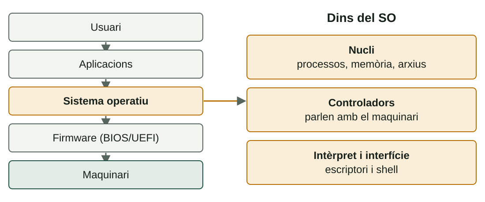

## Què aprendràs

:::pasos
- Què fa un **sistema operatiu** i de quines peces es compon
- Com es **classifiquen** els SO i com es comparen
- Quines **llicències** hi ha i què permeten
- Quin **sistema d'arxius** cal triar: FAT32, exFAT, NTFS o ext4
:::

---

## El SO és l'intermediari

:::pasos
- Gestiona els recursos: **CPU, memòria, emmagatzematge, perifèrics**
- Les aplicacions no parlen amb el disc: demanen el servici amb una **crida al sistema**
- Sense esta capa, cada programa duria el codi de **cada disc i cada impressora**
:::

---

## Cinc nivells, tres peces



---

## Cinc funcions del SO

:::pasos
- **Processos**: quin programa usa la CPU en cada moment
- **Memòria**: reparteix la RAM i aïlla els programes
- **Arxius**: organitza les dades al disc
- **Entrada i eixida**: teclat, pantalla, xarxa, discos…
- **Seguretat i usuaris**: comptes, permisos i aïllament
:::

---

## Quantes persones, quin servici

| Tipus | Idea | Exemples |
|---|---|---|
| **Monousuari** | Una sola persona alhora | MS-DOS, Windows domèstic |
| **Multiusuari** | Diversos usuaris, cada un amb els seus permisos | Linux, Windows Server, macOS |
| **De xarxa** | Dona servici a altres equips | Windows Server, Linux de servidor |

---

## No són categories excloents

:::pasos
- Un servidor és alhora **multiusuari** i **de xarxa**
- La frontera **monousuari / multiusuari** no és nítida
- Windows 10/11: diversos comptes, però **una sessió gràfica** a la vegada
- Justifica sempre **el criteri** que uses
:::

---

## Tipus de programari segons la llicència

| Tipus | Què permet | Exemples |
|---|---|---|
| **Lliure** | Usar, estudiar, modificar i redistribuir | Linux, FreeBSD, LibreOffice |
| **Codi obert** | Codi accessible; se solapa amb el lliure | Android (base), Chromium |
| **Propietari** | El fabricant controla el codi (EULA) | Windows, macOS |
| **Freeware** | Gratuït, però amb el codi tancat | Alguns controladors |
| **Shareware** | Es prova gratis un temps | Versions d'avaluació |

---

## Dos tipus de llicència lliure

:::pasos
- **Copyleft** (GPL): les obres derivades mantenen la mateixa llibertat
- El nucli **Linux** és GPL
- **Permissives** (MIT, BSD): el codi pot anar a productes tancats
:::

:::caution[Lliure no vol dir gratuït]
«Lliure» fa referència a les **llibertats**, no al preu.
:::

---

## Llicències de Windows

:::pasos
- **OEM**: preinstal·lada, vinculada a eixe maquinari
- **Retail**: es compra solta i, en general, es pot transferir
- **Per volum**: empreses i centres, per a molts equips
- **Windows Server**: regles pròpies (nuclis i accés de client)
- **Abans de desplegar**: comprova que la llicència cobrix l'ús
:::

---

## Com es comparen dos sistemes

:::pasos
- **Requisits** mínims i recomanats: CPU, RAM, disc, firmware
- **Compatibilitat** amb el maquinari i el programari
- **Cost** de la llicència
- **Suport**
- **Seguretat**
:::

---

## Exemple resolt: renovar una aula

:::pasos
1. **30 ordinadors** per a programació, pressupost ajustat
2. Cal compiladors, editors i màquines virtuals
3. Una distribució **Linux** (Ubuntu) evita el cost de llicències
4. S'administra en bloc i exigix menys maquinari
5. Comprova que el programari de l'assignatura tinga versió per a **Linux**
:::

---

## Què és un sistema d'arxius?

Un disc, per si mateix, és només una successió de bytes.

:::pasos
- El **sistema d'arxius** és l'estructura que el SO escriu damunt
- Organitza noms, carpetes, dates, permisos i ubicació
- **Clúster**: la unitat mínima d'assignació
- **Journaling**: anota què va a fer abans de canviar res
- Si s'apaga de colp, deixa el volum **coherent**
:::

---

## FAT32 i exFAT

::::columnas
:::pasos
- **FAT32**: compatible amb quasi tot
- Arxiu màxim: **4 GiB − 1 B**
- Sense permisos ni journaling
- És el de la **partició EFI**
:::

:::pasos
- **exFAT**: pensat per a memòries flash
- Sense el límit pràctic de 4 GiB
- Sense permisos ni journaling
- Linux, de sèrie, des del nucli **5.7**
:::
::::

---

## NTFS i ext4

::::columnas
:::pasos
- **NTFS**: el natiu de Windows
- Permisos per arxiu i carpeta (**ACL**)
- Xifratge, compressió i **journaling**
- Linux el llig amb controladors
:::

:::pasos
- **ext4**: el més habitual en Linux
- Permisos **propietari, grup, altres**
- Arxius de fins a **16 TiB**, amb **journaling**
- Windows no el reconeix de sèrie
:::
::::

---

## Comparativa: límits i permisos

| | Arxiu màxim | Permisos per usuari | Journaling |
|---|---|---|---|
| **FAT32** | 4 GiB − 1 B | No | No |
| **exFAT** | Pràcticament il·limitat | No | No |
| **NTFS** | Enorme (≥ 16 TiB) | Sí (ACL) | Sí |
| **ext4** | 16 TiB | Sí (UGO) | Sí |

---

## Comparativa: qui el llig

| | Windows | Linux | macOS |
|---|---|---|---|
| **FAT32** | Sí | Sí | Sí |
| **exFAT** | Sí | Sí (nucli 5.7+) | Sí |
| **NTFS** | Sí (natiu) | Amb controlador | Només lectura |
| **ext4** | Cal programari extra | Sí (natiu) | No |

---

## Exemple resolt: un pendrive per a tres equips

:::pasos
1. Pendrive de 64 GB, vídeos de **6 GB**, per a Windows, Linux i un televisor
2. **FAT32** queda descartat: límit de 4 GiB per arxiu
3. **NTFS** i **ext4** queden descartats: el televisor no els entén o només els llig
4. **exFAT** ho compleix, sense permisos ni journaling
5. Comprova que el televisor admet **exFAT**
:::

---

## Formatar des de la línia d'ordres

::::columnas
```bash
lsblk -f
sudo mkfs.ext4 /dev/sdb1
```

```powershell
Get-Volume
format E: /FS:NTFS /Q
```
::::

:::danger[Formatar destrueix les dades]
`mkfs` i `format` **esborren** el que hi haja. Comprova **tres vegades** quin dispositiu és i practica sempre en **màquines virtuals**.
:::

---

## Prova-ho

::laboratorio[Quin sistema d'arxius?]{src="particions-i-arrencada" pestana="sistema-arxius"}

---

## Resum

- El **SO** és l'intermediari entre aplicacions i maquinari
- **Lliure** vol dir llibertats, no preu
- Compara per **requisits, compatibilitat, cost, suport i seguretat**
- **FAT32** compatible · **exFAT** compartir · **NTFS** Windows · **ext4** Linux

[Activitats de la unitat →](/docencia/dam/sistemas-informaticos/ud02-instalacion-sistemas-operativos/actividades/)
