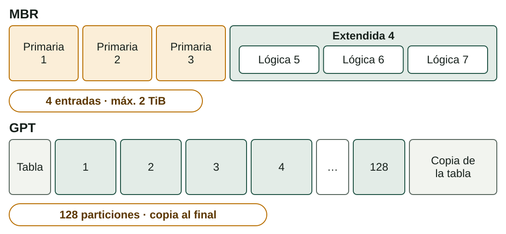

## Qué aprenderás

:::pasos
- Cómo **planificar** una instalación y preparar el **medio**
- Qué es **particionar** y cómo son **MBR** y **GPT**
- Cómo se **llaman** los discos y las particiones
- Cómo montar un **dual boot** y seguir la **cadena de arranque**
:::

---

## Planifica antes de instalar

Una instalación «a ciegas» es la forma más fácil de perder datos.

:::pasos
- **Requisitos** y **compatibilidad**: CPU, RAM, disco, controladores
- **Firmware**: UEFI o BIOS clásica, Secure Boot
- **Copia de seguridad** antes de tocar nada
- **Licencia** en regla para los SO propietarios
- **Red** para actualizaciones y controladores
- **Documenta** lo que haces: decisiones, particiones, capturas
:::

---

## El medio de instalación

Un SO se distribuye como una **imagen ISO**: hay que grabarla en un USB arrancable.

| Herramienta | Plataforma | Notas |
|---|---|---|
| **Media Creation Tool** | Windows | Descarga y prepara Windows |
| **Rufus** | Windows | Elige MBR o GPT |
| **balenaEtcher** | Windows, macOS, Linux | Sencillo |
| `dd` | Linux | Un error destruye datos |

:::pasos
- Comprueba el **hash SHA-256** de la ISO
- Menú de arranque: **F12, F2, Supr, Esc**
:::

---

## ¿Qué es particionar?

Dividir un disco físico en secciones lógicas independientes.

:::pasos
- Cada **partición** puede tener su propio sistema de archivos
- **Separar el sistema de los datos**
- **Dual boot**: varios sistemas en un disco
- Las que el SO necesita: **EFI** y **swap**
- **Aislar** una zona, como el *log* de un servidor
:::

:::caution[No es una copia de seguridad]
Si el disco físico falla, se pierden todas las particiones.
:::

---

## Dos esquemas: MBR y GPT

---

## MBR: máximo cuatro entradas

:::pasos
- Tabla en el **primer sector** de 512 bytes
- Máximo **4 primarias**, o **3 primarias + 1 extendida**
- Solo **una extendida** por disco
- Las **lógicas** viven dentro de la extendida
- Direcciones de 32 bits: máximo **2 TiB**
:::

---

## GPT: el esquema moderno

:::pasos
- Asociado a **UEFI**
- **128 particiones** por defecto, todas iguales
- Sin el límite de 2 TiB
- **Copia de la tabla** al final del disco
- Cada partición se identifica con un **GUID**
:::

---

## ¿Qué esquema elegir?

:::pasos
- **Equipo UEFI** → **GPT**
- **BIOS clásica** → **MBR** para Windows
- **Disco de más de 2 TiB** → **GPT**, siempre
:::

:::note[Ejemplo resuelto]
Windows 11 en un disco nuevo de 4 TB: exige UEFI y el disco pasa de 2 TiB. Solución: **GPT**.
:::

---

## Cómo se llaman en Linux

| Dispositivo | Disco | 1.ª partición |
|---|---|---|
| Disco SATA o USB | `/dev/sda` | `/dev/sda1` |
| Segundo disco SATA | `/dev/sdb` | `/dev/sdb1` |
| SSD NVMe | `/dev/nvme0n1` | `/dev/nvme0n1p1` |
| Disco de una VM VirtIO | `/dev/vda` | `/dev/vda1` |

:::pasos
- En MBR, **1 a 4** para primarias y extendida
- Las **lógicas** empiezan siempre por el **5**
- 2 primarias + extendida + 3 lógicas: `sda1` `sda2` `sda3` · `sda5` `sda6` `sda7`
:::

---

## Windows: letras y particiones propias

:::pasos
- Una **letra de unidad** por volumen: `C:`, `D:`…
- La **EFI** y la extendida no tienen letra
- Discos físicos: **Disco 0**, **Disco 1**… en el Administrador de discos
- En UEFI crea **EFI** (FAT32), **MSR**, **C:** (NTFS) y **recuperación**
:::

---

## Un esquema típico para Linux

| Partición | Sistema | Montaje | Tamaño |
|---|---|---|---|
| **EFI** (ESP) | FAT32 | `/boot/efi` | 512 MiB – 1 GiB |
| **Raíz** | ext4 | `/` | 25–50 GiB o más |
| **Datos** (opcional) | ext4 | `/home` | El resto del disco |
| **Swap** | swap | — | 2–4 GiB |

:::pasos
- Separar **`/home`**: reinstalas sin perder los datos
- La **swap** se usa cuando se llena la RAM
- Con **BIOS y MBR** no hay partición EFI
:::

---

## Dual boot: tres reglas

:::pasos
1. **Instala primero Windows** y después Linux
2. **Haz espacio desde Windows**: reduce el volumen
3. **Mismo modo de firmware** en los dos: UEFI o BIOS clásica
:::

Linux detecta Windows y lo añade al menú de **GRUB**; si lo haces al revés, Linux queda fuera del menú.

---

## Cosas que hacen fallar un dual boot

:::pasos
- **Inicio rápido** de Windows: desactívalo antes de instalar Linux
- **BitLocker**: puede pedir la clave de recuperación
- **Reloj**: Windows usa la hora local y Linux la UTC
- Si Windows no arranca, suele ser el **gestor de arranque**, no los datos
:::

---

## La cadena de arranque

---

## Errores típicos de arranque

:::pasos
- `grub rescue>`: GRUB no encuentra sus archivos
- `0xc000000f` en Windows: el gestor no encuentra el **BCD**
- **Kernel panic**: el núcleo no ha podido montar la raíz
:::

---

## Herramientas de particionado

| Herramienta | Entorno | Para qué |
|---|---|---|
| **Instalador** del SO | Windows, Linux | Durante la instalación |
| **Administrador de discos** | Windows | Crear, reducir, extender, formatear |
| `diskpart` | Windows (consola) | Las mismas tareas por órdenes |
| **GParted** | Linux (también *live*) | Gráfica; reduce y mueve particiones |
| `fdisk`, `gdisk`, `parted` | Linux (consola) | Más potentes, más precisión |

:::danger[Un error puede dejar inaccesible un disco]
Comprueba el número del disco y practica en **máquinas virtuales**.
:::

---

## Pruébalo: particiones

::laboratorio[Constructor MBR/GPT]{src="particions-i-arrencada" pestana="mbr-gpt"}

::laboratorio[Nombres de discos]{src="particions-i-arrencada" pestana="noms-discos"}

---

## Pruébalo: Linux y dual boot

::laboratorio[Esquema Linux]{src="particions-i-arrencada" pestana="esquema-linux"}

::laboratorio[Dual boot]{src="particions-i-arrencada" pestana="dual-boot"}

---

## Pruébalo: arranque y práctica

::laboratorio[Cadena de arranque]{src="particions-i-arrencada" pestana="arrencada"}

::laboratorio[Práctica]{src="particions-i-arrencada" pestana="practica"}

---

## Resumen

- **Planifica**: requisitos, firmware, copia de seguridad y medio
- **MBR**: 4 entradas y 2 TiB · **GPT**: 128 particiones, sin límite práctico
- **Dual boot**: primero Windows, después Linux
- **Cadena**: firmware → gestor → núcleo → servicios

[Actividades de la unidad →](/docencia/dam/sistemas-informaticos/ud02-instalacion-sistemas-operativos/actividades/es/)
