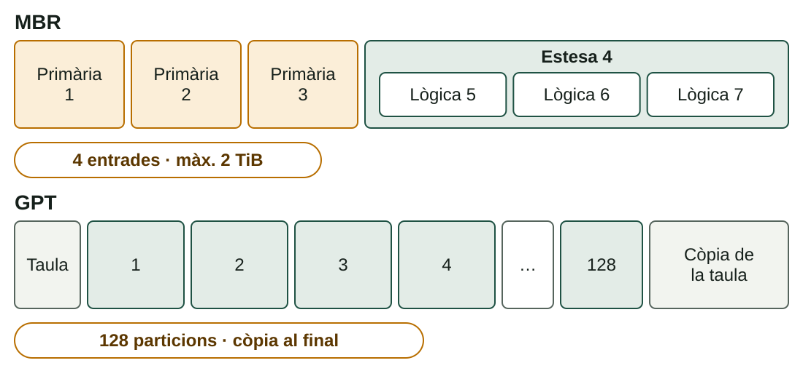

## Què aprendràs

:::pasos
- Com **planificar** una instal·lació i preparar el **medi**
- Què és **particionar** i com són **MBR** i **GPT**
- Com es **diuen** els discs i les particions
- Com muntar un **dual boot** i seguir la **cadena d'arrancada**
:::

---

## Planifica abans d'instal·lar

Una instal·lació «a cegues» és la manera més fàcil de perdre dades.

:::pasos
- **Requisits** i **compatibilitat**: CPU, RAM, disc, controladors
- **Firmware**: UEFI o BIOS clàssica, Secure Boot
- **Còpia de seguretat** abans de tocar res
- **Llicència** en regla per als SO propietaris
- **Xarxa** per a actualitzacions i controladors
- **Documenta** el que fas: decisions, particions, captures
:::

---

## El medi d'instal·lació

Un SO es distribuïx com una **imatge ISO**: cal gravar-la en un USB arrancable.

| Eina | Plataforma | Notes |
|---|---|---|
| **Media Creation Tool** | Windows | Baixa i prepara Windows |
| **Rufus** | Windows | Tria MBR o GPT |
| **balenaEtcher** | Windows, macOS, Linux | Senzill |
| `dd` | Linux | Un error destruïx dades |

:::pasos
- Comprova el **hash SHA-256** de l'ISO
- Menú d'arrancada: **F12, F2, Supr, Esc**
:::

---

## Què és particionar?

Dividir un disc físic en seccions lògiques independents.

:::pasos
- Cada **partició** pot tindre el seu sistema d'arxius
- **Separar el sistema de les dades**
- **Dual boot**: diversos sistemes en un disc
- Les que el SO necessita: **EFI** i **swap**
- **Aïllar** una zona, com el *log* d'un servidor
:::

:::caution[No és una còpia de seguretat]
Si el disc físic falla, es perden totes les particions.
:::

---

## Dos esquemes: MBR i GPT

---

## MBR: màxim quatre entrades

:::pasos
- Taula en el **primer sector** de 512 bytes
- Màxim **4 primàries**, o **3 primàries + 1 estesa**
- Només **una estesa** per disc
- Les **lògiques** viuen dins de l'estesa
- Adreces de 32 bits: màxim **2 TiB**
:::

---

## GPT: l'esquema modern

:::pasos
- Associat a **UEFI**
- **128 particions** per defecte, totes iguals
- Sense el límit de 2 TiB
- **Còpia de la taula** al final del disc
- Cada partició s'identifica amb un **GUID**
:::

---

## Quin esquema triar?

:::pasos
- **Equip UEFI** → **GPT**
- **BIOS clàssica** → **MBR** per a Windows
- **Disc de més de 2 TiB** → **GPT**, sempre
:::

:::note[Exemple resolt]
Windows 11 en un disc nou de 4 TB: exigix UEFI i el disc passa de 2 TiB. Solució: **GPT**.
:::

---

## Com es diuen en Linux

| Dispositiu | Disc | 1a partició |
|---|---|---|
| Disc SATA o USB | `/dev/sda` | `/dev/sda1` |
| Segon disc SATA | `/dev/sdb` | `/dev/sdb1` |
| SSD NVMe | `/dev/nvme0n1` | `/dev/nvme0n1p1` |
| Disc d'una VM VirtIO | `/dev/vda` | `/dev/vda1` |

:::pasos
- En MBR, **1 a 4** per a primàries i estesa
- Les **lògiques** comencen sempre pel **5**
- 2 primàries + estesa + 3 lògiques: `sda1` `sda2` `sda3` · `sda5` `sda6` `sda7`
:::

---

## Windows: lletres i particions pròpies

:::pasos
- Una **lletra d'unitat** per volum: `C:`, `D:`…
- L'**EFI** i l'estesa no tenen lletra
- Discs físics: **Disc 0**, **Disc 1**… en l'Administrador de discos
- En UEFI crea **EFI** (FAT32), **MSR**, **C:** (NTFS) i **recuperació**
:::

---

## Un esquema típic per a Linux

| Partició | Sistema | Muntatge | Grandària |
|---|---|---|---|
| **EFI** (ESP) | FAT32 | `/boot/efi` | 512 MiB – 1 GiB |
| **Arrel** | ext4 | `/` | 25–50 GiB o més |
| **Dades** (opcional) | ext4 | `/home` | La resta del disc |
| **Swap** | swap | — | 2–4 GiB |

:::pasos
- Separar **`/home`**: reinstal·les sense perdre les dades
- La **swap** s'usa quan s'ompli la RAM
- Amb **BIOS i MBR** no hi ha partició EFI
:::

---

## Dual boot: tres regles

:::pasos
1. **Instal·la primer Windows** i després Linux
2. **Fes espai des de Windows**: redueix el volum
3. **Mateix mode de firmware** en els dos: UEFI o BIOS clàssica
:::

Linux detecta Windows i l'afig al menú de **GRUB**; si fas l'ordre contrari, Linux queda fora del menú.

---

## Coses que fan fallar un dual boot

:::pasos
- **Inici ràpid** de Windows: desactiva'l abans d'instal·lar Linux
- **BitLocker**: pot demanar la clau de recuperació
- **Rellotge**: Windows usa l'hora local i Linux l'UTC
- Si Windows no arranca, sol ser el **gestor d'arrancada**, no les dades
:::

---

## La cadena d'arrancada

---

## Errors típics d'arrancada

:::pasos
- `grub rescue>`: GRUB no troba els seus fitxers
- `0xc000000f` en Windows: el gestor no troba el **BCD**
- **Kernel panic**: el nucli no ha pogut muntar l'arrel
:::

---

## Eines de particionat

| Eina | Entorn | Per a què |
|---|---|---|
| **Instal·lador** del SO | Windows, Linux | Durant la instal·lació |
| **Administrador de discos** | Windows | Crear, reduir, estendre, formatar |
| `diskpart` | Windows (consola) | Les mateixes tasques per ordres |
| **GParted** | Linux (també *live*) | Gràfica; reduïx i mou particions |
| `fdisk`, `gdisk`, `parted` | Linux (consola) | Més potents, més precisió |

:::danger[Un error pot fer inaccessible un disc]
Comprova el número del disc i practica en **màquines virtuals**.
:::

---

## Prova-ho: particions

::laboratorio[Constructor MBR/GPT]{src="particions-i-arrencada" pestana="mbr-gpt"}

::laboratorio[Noms de discos]{src="particions-i-arrencada" pestana="noms-discos"}

---

## Prova-ho: Linux i dual boot

::laboratorio[Esquema Linux]{src="particions-i-arrencada" pestana="esquema-linux"}

::laboratorio[Dual boot]{src="particions-i-arrencada" pestana="dual-boot"}

---

## Prova-ho: arrancada i pràctica

::laboratorio[Cadena d'arrancada]{src="particions-i-arrencada" pestana="arrencada"}

::laboratorio[Pràctica]{src="particions-i-arrencada" pestana="practica"}

---

## Resum

- **Planifica**: requisits, firmware, còpia de seguretat i medi
- **MBR**: 4 entrades i 2 TiB · **GPT**: 128 particions, sense límit pràctic
- **Dual boot**: primer Windows, després Linux
- **Cadena**: firmware → gestor → nucli → servicis

[Activitats de la unitat →](/docencia/dam/sistemas-informaticos/ud02-instalacion-sistemas-operativos/actividades/)
