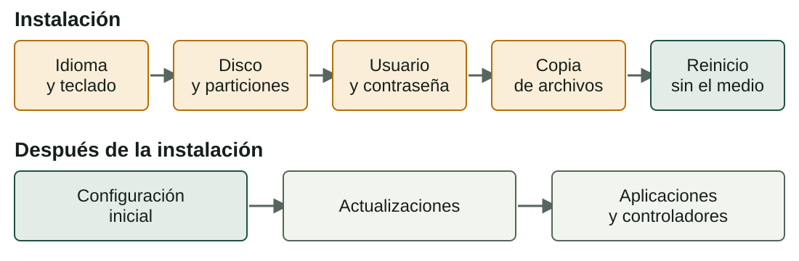
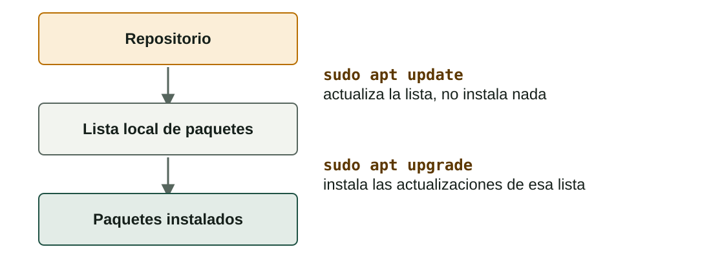

## Qué aprenderás

:::pasos
- Las **fases** de instalar un SO cliente: **Windows** y **Ubuntu**
- Qué revisar en la **configuración inicial**
- Cómo mantener al día el **sistema** y las **aplicaciones**
- Cómo **diagnosticar controladores** con las herramientas de cada sistema
:::

---

## Del instalador al equipo listo

Un SO recién instalado **no está terminado**.



---

## Windows: instalación limpia

:::pasos
1. **Arrancar desde el medio** (USB o ISO) en modo UEFI
2. **Idioma, hora y teclado**, clave, edición y licencia
3. **Tipo**: *Actualizar* o *Personalizada* (la limpia)
4. **Selección de la partición**: crea, elimina o elige el espacio libre
5. **Copia de archivos** y reinicios: no quites el USB antes de tiempo
6. **Configuración inicial** (OOBE) y primer inicio de sesión
:::

---

## Requisitos de Windows 11

:::pasos
- Procesador de **64 bits** compatible
- **4 GB** de RAM y **64 GB** de almacenamiento
- Firmware **UEFI** con **Secure Boot**
- Módulo **TPM 2.0**
- Según Microsoft: **consulta la página oficial**, pueden cambiar
:::

---

## Ubuntu: prueba primero, elige después

:::pasos
- Modo **live**: prueba el sistema desde el USB sin instalar nada
- **Borrar el disco**: lo más simple, pero destruye lo que haya
- **Junto a Windows**: dual boot, redimensiona y añade Ubuntu
- **Manual**: tú diseñas las particiones (EFI, `/`, `/home`, swap)
- Siempre: **idioma → disco → usuario → copia → reinicio**
:::

---

## Configuración inicial

| Qué | Windows | Ubuntu |
|---|---|---|
| **Nombre del equipo** | `Rename-Computer` | `hostnamectl` |
| **Cuenta de usuario** | Configuración → Cuentas | `adduser` |
| **Red** | `ipconfig` | `ip a` |
| **Fecha, hora y zona** | Configuración → Hora e idioma | `timedatectl` |
| **Actualizaciones** | Windows Update | `apt update` y `apt upgrade` |

---

## Actualiza primero de todo

:::pasos
- La imagen puede tener meses: **vulnerabilidades** conocidas desde el primer minuto
- **De seguridad**: corrigen vulnerabilidades, las más urgentes
- **De calidad**: corrigen fallos sin añadir funciones
- **De funcionalidades**: novedades o cambio de versión principal
:::

:::tip[Hábito profesional]
Antes de una actualización grande: **copia de seguridad** o **instantánea**.
:::

---

## Actualizar en Windows

:::pasos
- **Windows Update**: parches y, a veces, controladores
- Muchas piden un **reinicio**
:::

```powershell
Get-HotFix        # parches instalados
winget upgrade    # programas con actualización
```

---

## apt: dos tiempos, en este orden



---

## Aplicaciones en Windows

:::pasos
- **Instalador descargado** (`.exe` o `.msi`): solo de la web oficial
- **Microsoft Store**
- **`winget`**: el gestor de paquetes de Windows
- Desinstalar: *Configuración → Aplicaciones*; pueden quedar **restos**
:::

---

## Aplicaciones en Ubuntu

:::pasos
- **Repositorios**: servidores con paquetes verificados
- `apt install`: instala con sus **dependencias**
- `apt remove` conserva la configuración; `apt purge` también la borra
- `apt autoremove`: elimina las dependencias que ya no usa nadie
- **Snap** y **Flatpak** incluyen sus dependencias
:::

---

## Las mismas acciones, dos herramientas

| Acción | Windows | Ubuntu |
|---|---|---|
| Buscar | `winget search` | `apt search` |
| Instalar | `winget install` | `sudo apt install` |
| Actualizar todo | `winget upgrade --all` | `sudo apt update && sudo apt upgrade` |
| Desinstalar | `winget uninstall` | `sudo apt remove` / `purge` |

---

## Instala solo desde fuentes de confianza

:::pasos
- El **repositorio** de la distribución
- La **tienda oficial**
- La **web del fabricante**
:::

:::caution[Vía de entrada del software malicioso]
Un instalador de procedencia dudosa es la vía más común. No ejecutes nada como administrador si no sabes qué hace.
:::

---

## ¿Qué es un controlador?

:::pasos
- El **controlador** (*driver*) deja que el SO hable con un componente concreto
- Sin él, el dispositivo **no funciona** o va con un **controlador genérico**
- Ejemplo: una gráfica dedicada que muestra imagen, pero **sin aceleración 3D**
:::

---

## Windows: el Administrador de dispositivos

:::pasos
- **Triángulo amarillo**: dispositivo con problema; «Dispositivo desconocido», sin controlador
- Propiedades → *Controlador*: **actualizar**, **revertir** o **desinstalar**
- Las propiedades dan un **código de error** (el 28: sin controladores)
- Para gráficas: el controlador oficial del **fabricante**
:::

---

## Linux: quién usa cada dispositivo

::::columnas
```bash
lspci
lspci -k
lsusb
ubuntu-drivers devices
```

:::pasos
- El **núcleo** ya lleva muchos controladores
- `lspci -k`: qué controlador usa cada dispositivo
- Sin línea **Kernel driver in use**: **sin controlador**
- *Controladores adicionales*: los propietarios
:::
::::

---

## Ejemplo resuelto: adaptador de pantalla básico

:::pasos
1. El Administrador muestra **«Adaptador de pantalla básico de Microsoft»**
2. Hay imagen gracias a un **controlador genérico**
3. Faltan la aceleración 3D y las resoluciones altas
4. Solución: el **controlador oficial** del fabricante
5. Al final aparece el **nombre real** de la tarjeta, sin aviso
:::

---

## Método de diagnóstico

:::pasos
1. **Detecta**: ¿aparece en el sistema?
2. **Identifica** el modelo exacto
3. **Comprueba el estado** del controlador
4. **Actualiza**: Windows Update, gestor de paquetes o web del fabricante
5. **Vuelve atrás** si empezó con una actualización
6. **Documenta** lo que has hecho y el resultado
:::

---

## Resumen

- Instalación: **medio → idioma → disco → usuario → copia → reinicio**
- Después: **configurar** y **actualizar** (`apt update` antes de `apt upgrade`)
- Software solo de **fuentes de confianza**
- Controladores: **detecta, identifica, comprueba, actualiza, vuelve atrás, documenta**

[Actividades de la unidad →](/docencia/dam/sistemas-informaticos/ud02-instalacion-sistemas-operativos/actividades/es/)
