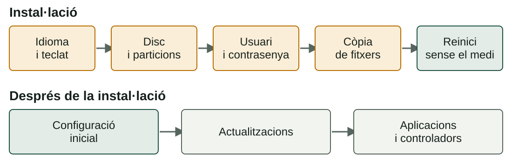
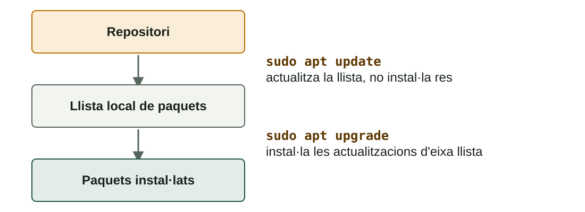

## Què aprendràs

:::pasos
- Les **fases** d'instal·lar un SO client: **Windows** i **Ubuntu**
- Què revisar en la **configuració inicial**
- Com mantindre al dia el **sistema** i les **aplicacions**
- Com **diagnosticar controladors** amb les eines de cada sistema
:::

---

## De l'instal·lador a l'equip llest

Un SO acabat d'instal·lar **no està acabat**.



---

## Windows: instal·lació neta

:::pasos
1. **Arrancar des del medi** (USB o ISO) en mode UEFI
2. **Idioma, hora i teclat**, clau, edició i llicència
3. **Tipus**: *Actualitza* o *Personalitzada* (la neta)
4. **Selecció de la partició**: crea, elimina o tria l'espai lliure
5. **Còpia de fitxers** i reinicis: no traques l'USB abans de temps
6. **Configuració inicial** (OOBE) i primer inici de sessió
:::

---

## Requisits de Windows 11

:::pasos
- Processador de **64 bits** compatible
- **4 GB** de RAM i **64 GB** d'emmagatzematge
- Firmware **UEFI** amb **Secure Boot**
- Mòdul **TPM 2.0**
- Segons Microsoft: **consulta la pàgina oficial**, poden canviar
:::

---

## Ubuntu: prova primer, tria després

:::pasos
- Mode **live**: prova el sistema des de l'USB sense instal·lar res
- **Esborrar el disc**: el més simple, però destruïx el que hi haja
- **Al costat de Windows**: dual boot, redimensiona i afig Ubuntu
- **Manual**: tu dissenyes les particions (EFI, `/`, `/home`, swap)
- Sempre: **idioma → disc → usuari → còpia → reinici**
:::

---

## Configuració inicial

| Què | Windows | Ubuntu |
|---|---|---|
| **Nom de l'equip** | `Rename-Computer` | `hostnamectl` |
| **Compte d'usuari** | Configuració → Comptes | `adduser` |
| **Xarxa** | `ipconfig` | `ip a` |
| **Data, hora i zona** | Configuració → Hora i idioma | `timedatectl` |
| **Actualitzacions** | Windows Update | `apt update` i `apt upgrade` |

---

## Actualitza primer de tot

:::pasos
- La imatge pot tindre mesos: **vulnerabilitats** conegudes des del primer minut
- **De seguretat**: corregixen vulnerabilitats, les més urgents
- **De qualitat**: corregixen fallades sense afegir funcions
- **De funcionalitats**: novetats o canvi de versió principal
:::

:::tip[Hàbit professional]
Abans d'una actualització gran: **còpia de seguretat** o **instantània**.
:::

---

## Actualitzar en Windows

:::pasos
- **Windows Update**: parxes i, de vegades, controladors
- Moltes demanen un **reinici**
:::

```powershell
Get-HotFix        # parxes instal·lades
winget upgrade    # programes amb actualització
```

---

## apt: dos temps, en este ordre



---

## Aplicacions en Windows

:::pasos
- **Instal·lador descarregat** (`.exe` o `.msi`): només del web oficial
- **Microsoft Store**
- **`winget`**: el gestor de paquets de Windows
- Desinstal·lar: *Configuració → Aplicacions*; poden quedar **restes**
:::

---

## Aplicacions en Ubuntu

:::pasos
- **Repositoris**: servidors amb paquets verificats
- `apt install`: instal·la amb les seues **dependències**
- `apt remove` conserva la configuració; `apt purge` també l'esborra
- `apt autoremove`: elimina les dependències que ja no fa servir ningú
- **Snap** i **Flatpak** inclouen les seues dependències
:::

---

## Les mateixes accions, dues eines

| Acció | Windows | Ubuntu |
|---|---|---|
| Buscar | `winget search` | `apt search` |
| Instal·lar | `winget install` | `sudo apt install` |
| Actualitzar tot | `winget upgrade --all` | `sudo apt update && sudo apt upgrade` |
| Desinstal·lar | `winget uninstall` | `sudo apt remove` / `purge` |

---

## Instal·la només des de fonts de confiança

:::pasos
- El **repositori** de la distribució
- La **botiga oficial**
- El **web del fabricant**
:::

:::caution[Via d'entrada del programari maliciós]
Un instal·lador de procedència dubtosa és la via més comuna. No executes res com a administrador si no saps què fa.
:::

---

## Què és un controlador?

:::pasos
- El **controlador** (*driver*) deixa que el SO parle amb un component concret
- Sense ell, el dispositiu **no funciona** o va amb un **controlador genèric**
- Exemple: una gràfica dedicada que mostra imatge, però **sense acceleració 3D**
:::

---

## Windows: l'Administrador de dispositius

:::pasos
- **Triangle groc**: dispositiu amb problema; «Dispositiu desconegut», sense controlador
- Propietats → *Controlador*: **actualitzar**, **revertir** o **desinstal·lar**
- Les propietats donen un **codi d'error** (el 28: sense controladors)
- Per a gràfiques: el controlador oficial del **fabricant**
:::

---

## Linux: qui fa servir cada dispositiu

::::columnas
```bash
lspci
lspci -k
lsusb
ubuntu-drivers devices
```

:::pasos
- El **nucli** ja porta molts controladors
- `lspci -k`: quin controlador usa cada dispositiu
- Sense línia **Kernel driver in use**: **sense controlador**
- *Controladors addicionals*: els propietaris
:::
::::

---

## Exemple resolt: adaptador de pantalla bàsic

:::pasos
1. L'Administrador mostra **«Adaptador de pantalla bàsic de Microsoft»**
2. Hi ha imatge gràcies a un **controlador genèric**
3. Falten l'acceleració 3D i les resolucions altes
4. Solució: el **controlador oficial** del fabricant
5. Al final apareix el **nom real** de la targeta, sense avís
:::

---

## Mètode de diagnòstic

:::pasos
1. **Detecta**: ix en el sistema?
2. **Identifica** el model exacte
3. **Comprova l'estat** del controlador
4. **Actualitza**: Windows Update, gestor de paquets o web del fabricant
5. **Torna enrere** si va començar amb una actualització
6. **Documenta** el que has fet i el resultat
:::

---

## Resum

- Instal·lació: **medi → idioma → disc → usuari → còpia → reinici**
- Després: **configurar** i **actualitzar** (`apt update` abans d'`apt upgrade`)
- Programari només de **fonts de confiança**
- Controladors: **detecta, identifica, comprova, actualitza, torna enrere, documenta**

[Activitats de la unitat →](/docencia/dam/sistemas-informaticos/ud02-instalacion-sistemas-operativos/actividades/)
