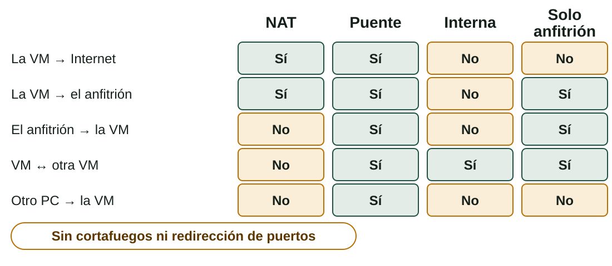

## Qué aprenderás

:::pasos
- Qué es un **SO servidor** y qué tipo de instalación elegir
- Cómo funcionan la **virtualización** y los **hipervisores**
- Cómo **crear y gestionar** una máquina virtual: red e instantáneas
- Qué mecanismo de **recuperación** sirve en cada problema
:::

---

## Un SO servidor

:::pasos
- Optimizado para dar servicio **estable y continuo**, 24 horas al día
- Prioriza **fiabilidad, seguridad y rendimiento en red**
- **Windows Server** o una distribución Linux de servidor
- Ediciones *Standard* y *Datacenter*; hay **versiones de evaluación**
:::

---

## Server Core o Experiencia de escritorio

| | **Server Core** | **Experiencia de escritorio** |
|---|---|---|
| Interfaz | Consola y PowerShell | Escritorio gráfico completo |
| Administración | Por órdenes o **en remoto** | Local, con el Administrador del servidor |
| Recursos | Menos disco y RAM | Más |
| Superficie de ataque | **Menor** | Mayor |
| Para quién | Servidores de producción | Aprendizaje, pruebas, software con interfaz |

---

## Una decisión que no se deshace

:::caution[No se puede cambiar sin reinstalar]
El instalador muestra las dos opciones para cada edición: elige bien a la primera.
:::

:::pasos
- Servidor de archivos y `DHCP`, administrado por una persona experta → **Server Core**
- Aula de prácticas donde se explora Windows Server por primera vez → **Experiencia de escritorio**
:::

---

## Virtualización

:::pasos
- Varios SO **invitados** (*guests*) en un mismo equipo **anfitrión** (*host*)
- Cada uno como si fuera un ordenador con su propio hardware
- El **hipervisor** crea y gestiona las **máquinas virtuales** (VM)
- Reparte los recursos: **CPU, RAM, disco y red**
:::

---

## Dos tipos de hipervisor

| Tipo | Cómo funciona | Ejemplos |
|---|---|---|
| **Tipo 1** (*bare metal*) | Directamente sobre el hardware; típico de servidores | ESXi, Proxmox VE (KVM), Hyper-V |
| **Tipo 2** (*hosted*) | Como una aplicación dentro de un SO anfitrión | VirtualBox, VMware Workstation |

:::pasos
- En clase: **VirtualBox**, de tipo 2
- Hyper-V viene en Windows Pro, Enterprise y Education, **no en Home**
:::

---

## Hay que activar la virtualización en el hardware

:::caution[Actívala en la UEFI]
Sin **Intel VT-x** o **AMD-V** (SVM), VirtualBox no podrá iniciar máquinas de 64 bits.
:::

:::pasos
- Las extensiones se activan en la **UEFI**
- Hyper-V y WSL2 pueden entrar en **conflicto** con VirtualBox
:::

---

## ¿Por qué virtualizar?

:::pasos
- **Probar** varios SO sin equipos físicos adicionales
- **Instantáneas** para volver atrás en segundos
- **Aislamiento**: un error en la VM no afecta directamente al anfitrión
- **Aprovechamiento**: varios servidores pequeños en un solo equipo
:::

---

## Repartir los recursos con cabeza

:::pasos
- **Nunca toda la RAM ni todos los núcleos** del anfitrión
- Regla prudente: no pasar de la **mitad** de la RAM y de los núcleos
- La suma de las VM en marcha no debe exceder los recursos físicos
- Inconvenientes: la VM es **más lenta**, y si el anfitrión falla, fallan todas
:::

---

## Crear una VM es definir hardware virtual

:::pasos
- **CPU**: 2 núcleos virtuales
- **RAM**: 4 GB
- **Disco virtual**: un archivo (`.vdi`) de 25 GB
- **Red**: NAT
- **Firmware**: EFI, si quieres practicar UEFI/GPT
- **Soporte**: la ISO en la unidad óptica virtual
:::

---

## Disco, operaciones y clonado

:::pasos
- Disco de **tamaño fijo**: reserva todo el espacio, algo más rápido
- Disco **asignado dinámicamente**: el archivo crece a medida que se usa
- **Iniciar, pausar, apagar** y guardar el estado
- **Ajustar** RAM y CPU, con la VM apagada
- **Clonar**: varios equipos a partir de una instalación
:::

---

## Guest Additions

:::pasos
- Paquete que se instala **dentro del SO invitado** (VMware Tools en VMware)
- Mejora los **gráficos** y redimensiona la ventana
- Habilita el **portapapeles** y las **carpetas compartidas**
- En Linux: el usuario debe pertenecer al grupo **`vboxsf`**
:::

```bash
sudo apt install build-essential dkms linux-headers-$(uname -r)
sudo adduser $USER vboxsf
```

---

## Cuatro modos de red

| Modo | Idea | Cuándo |
|---|---|---|
| **NAT** | Sale a Internet por el anfitrión; **no es visible** | Navegar y actualizar |
| **Puente** | Un equipo más de la red, con **IP propia** | Servidor visible en el aula |
| **Interna** | Solo con otras VM de la misma red | Laboratorio aislado |
| **Solo anfitrión** | VM y anfitrión se ven; sin Internet | Administrar sin salir |

---

## Quién puede hablar con quién



---

## Instantáneas

:::pasos
- Guarda el **estado completo** de la VM: disco y, si está en marcha, memoria
- Si algo sale mal, la **restauras**
- Puedes hacer una **cadena** de instantáneas y bifurcarla
:::

```bash
VBoxManage snapshot "ubuntu" take "inicial"
VBoxManage snapshot "ubuntu" restore "inicial"
```

---

## Una instantánea no es una copia de seguridad

:::caution[Vive en el mismo disco que la VM]
Si el anfitrión se rompe o el disco falla, pierdes la VM y sus instantáneas.
:::

:::pasos
- Sirve para **deshacer un cambio**, no para una avería
- No acumules muchas: ocupan espacio y **ralentizan** la VM
:::

---

## Recuperación: según el problema

| Problema | Mecanismo |
|---|---|
| Windows arranca, pero un cambio lo ha roto | **Punto de restauración** |
| Windows no arranca | **WinRE** (entorno de recuperación) |
| El equipo va muy mal | **Restablecer este PC** |
| Linux no arranca con el núcleo nuevo | **GRUB → Opciones avanzadas** |
| GRUB o el arranque estropeados | **USB *live*** |

---

## Recuperación: imágenes, VM y datos

| Problema | Mecanismo |
|---|---|
| Volver al estado exacto de todo el disco | **Imagen o clon** (Clonezilla) |
| Un error en una VM | **Instantánea** |
| Archivos borrados | **Copia de seguridad de datos** |

:::caution[La regla de oro]
Ningún mecanismo de recuperación sustituye a una **copia de seguridad de los datos en otro lugar**.
:::

---

## La sesión presencial

:::pasos
1. **Crear una VM** en VirtualBox: 2 CPU, 4 GB, disco de 25 GB
2. **Instalar el Linux indicado**, siguiendo el proceso de la página 3
3. **Guest Additions** y una **carpeta compartida**
4. **Instantánea**: cambio de prueba, restaurar y comprobar
5. **Windows Server**: arrancar el instalador hasta *Server Core* o *Experiencia de escritorio*
:::

Haz capturas durante el proceso: **no esperes al final**.

---

## Resumen

- **Server Core** o **Experiencia de escritorio**: no se cambia después
- **Tipo 1** sobre el hardware · **tipo 2** dentro de un SO · activa **VT-x / AMD-V**
- Red: **NAT, puente, interna** o **solo anfitrión**
- **Instantánea** para deshacer · **copia de seguridad** para proteger

[Actividades de la unidad →](/docencia/dam/sistemas-informaticos/ud02-instalacion-sistemas-operativos/actividades/es/)
