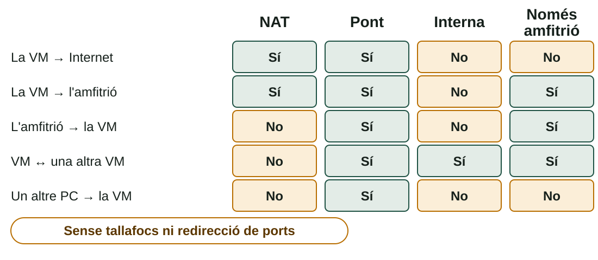

## Què aprendràs

:::pasos
- Què és un **SO servidor** i quin tipus d'instal·lació triar
- Com funciona la **virtualització** i els **hipervisors**
- Com **crear i gestionar** una màquina virtual: xarxa i instantànies
- Quin mecanisme de **recuperació** serveix en cada problema
:::

---

## Un SO servidor

:::pasos
- Optimitzat per a donar servici **estable i contínua**, 24 hores al dia
- Prioritza **fiabilitat, seguretat i rendiment en xarxa**
- **Windows Server** o una distribució Linux de servidor
- Edicions *Standard* i *Datacenter*; hi ha **versions d'avaluació**
:::

---

## Server Core o Escriptori de l'experiència

| | **Server Core** | **Escriptori de l'experiència** |
|---|---|---|
| Interfície | Consola i PowerShell | Escriptori gràfic complet |
| Administració | Per ordres o **en remot** | Local, amb Administrador del servidor |
| Recursos | Menys disc i RAM | Més |
| Superfície d'atac | **Menor** | Major |
| Per a qui | Servidors de producció | Aprenentatge, proves, programari amb interfície |

---

## Una decisió que no es desfà

:::caution[No es pot canviar sense reinstal·lar]
L'instal·lador mostra les dues opcions per a cada edició: triar bé a la primera.
:::

:::pasos
- Servidor de fitxers i `DHCP`, administrat per una persona experta → **Server Core**
- Aula de pràctiques on s'explora Windows Server per primera vegada → **Escriptori de l'experiència**
:::

---

## Virtualització

:::pasos
- Diversos SO **convidats** (*guests*) en un mateix equip **amfitrió** (*host*)
- Cada un com si fóra un ordinador amb el seu propi maquinari
- L'**hipervisor** crea i gestiona les **màquines virtuals** (VM)
- Reparteix els recursos: **CPU, RAM, disc i xarxa**
:::

---

## Dos tipus d'hipervisor

| Tipus | Com funciona | Exemples |
|---|---|---|
| **Tipus 1** (*bare metal*) | Directament sobre el maquinari; típic de servidors | ESXi, Proxmox VE (KVM), Hyper-V |
| **Tipus 2** (*hosted*) | Com una aplicació dins d'un SO amfitrió | VirtualBox, VMware Workstation |

:::pasos
- En classe: **VirtualBox**, de tipus 2
- Hyper-V ve en Windows Pro, Enterprise i Education, **no en Home**
:::

---

## Cal activar la virtualització al maquinari

:::caution[Activa-la en la UEFI]
Sense **Intel VT-x** o **AMD-V** (SVM), VirtualBox no podrà iniciar màquines de 64 bits.
:::

:::pasos
- Les extensions s'activen en la **UEFI**
- Hyper-V i WSL2 poden entrar en **conflicte** amb VirtualBox
:::

---

## Per què virtualitzar?

:::pasos
- **Provar** diversos SO sense equips físics addicionals
- **Instantànies** per a tornar enrere en segons
- **Aïllament**: un error en la VM no afecta directament l'amfitrió
- **Aprofitament**: diversos servidors petits en un sol equip
:::

---

## Repartir els recursos amb seny

:::pasos
- **Mai tota la RAM ni tots els nuclis** de l'amfitrió
- Regla prudent: no passar de la **meitat** de la RAM i dels nuclis
- La suma de les VM en marxa no ha d'excedir els recursos físics
- Inconvenients: la VM és **més lenta**, i si l'amfitrió falla, fallen totes
:::

---

## Crear una VM és definir maquinari virtual

:::pasos
- **CPU**: 2 nuclis virtuals
- **RAM**: 4 GB
- **Disc virtual**: un fitxer (`.vdi`) de 25 GB
- **Xarxa**: NAT
- **Firmware**: EFI, si vols practicar UEFI/GPT
- **Suport**: la ISO en la unitat òptica virtual
:::

---

## Disc, operacions i clonatge

:::pasos
- Disc de **grandària fixa**: reserva tot l'espai, una mica més ràpid
- Disc **assignat dinàmicament**: el fitxer creix a mesura que s'usa
- **Iniciar, pausar, apagar** i guardar l'estat
- **Ajustar** RAM i CPU, amb la VM apagada
- **Clonar**: diversos equips a partir d'una instal·lació
:::

---

## Guest Additions

:::pasos
- Paquet que s'instal·la **dins del SO convidat** (VMware Tools en VMware)
- Millora la **gràfica** i redimensiona la finestra
- Habilita el **porta-retalls** i les **carpetes compartides**
- En Linux: l'usuari ha de pertànyer al grup **`vboxsf`**
:::

```bash
sudo apt install build-essential dkms linux-headers-$(uname -r)
sudo adduser $USER vboxsf
```

---

## Quatre modes de xarxa

| Mode | Idea | Quan |
|---|---|---|
| **NAT** | Ix a Internet per l'amfitrió; **no és visible** | Navegar i actualitzar |
| **Pont** | Equip més de la xarxa, amb **IP pròpia** | Servidor visible en l'aula |
| **Interna** | Només amb altres VM de la mateixa xarxa | Laboratori aïllat |
| **Només amfitrió** | VM i amfitrió es veuen; sense Internet | Administrar sense eixir |

---

## Qui pot parlar amb qui



---

## Instantànies

:::pasos
- Guarda l'**estat complet** de la VM: disc i, si està en marxa, memòria
- Si alguna cosa ix malament, la **restaures**
- Pots fer una **cadena** d'instantànies i bifurcar-la
:::

```bash
VBoxManage snapshot "ubuntu" take "inicial"
VBoxManage snapshot "ubuntu" restore "inicial"
```

---

## Una instantània no és una còpia de seguretat

:::caution[Viu en el mateix disc que la VM]
Si l'amfitrió es trenca o el disc falla, perds la VM i les seues instantànies.
:::

:::pasos
- Serveix per a **desfer un canvi**, no per a una avaria
- No n'acumules moltes: ocupen espai i **alenteixen** la VM
:::

---

## Recuperació: segons el problema

| Problema | Mecanisme |
|---|---|
| Windows arranca, però un canvi l'ha trencat | **Punt de restauració** |
| Windows no arranca | **WinRE** (entorn de recuperació) |
| L'equip va molt malament | **Restableix este PC** |
| Linux no arranca amb el nucli nou | **GRUB → Opcions avançades** |
| GRUB o l'arrancada espatllats | **USB *live*** |

---

## Recuperació: imatges, VM i dades

| Problema | Mecanisme |
|---|---|
| Tornar a l'estat exacte de tot el disc | **Imatge o clon** (Clonezilla) |
| Un error en una VM | **Instantània** |
| Fitxers esborrats | **Còpia de seguretat de dades** |

:::caution[La regla d'or]
Cap mecanisme de recuperació substituïx una **còpia de seguretat de les dades en un altre lloc**.
:::

---

## La sessió presencial

:::pasos
1. **Crear una VM** en VirtualBox: 2 CPU, 4 GB, disc de 25 GB
2. **Instal·lar el Linux indicat**, seguint el procés de la pàgina 3
3. **Guest Additions** i una **carpeta compartida**
4. **Instantània**: canvi de prova, restaurar i comprovar
5. **Windows Server**: arrancar l'instal·lador fins a *Server Core* o *Escriptori*
:::

Fes captures durant el procés: **no esperes al final**.

---

## Resum

- **Server Core** o **Escriptori de l'experiència**: no es canvia després
- **Tipus 1** sobre el maquinari · **tipus 2** dins d'un SO · activa **VT-x / AMD-V**
- Xarxa: **NAT, pont, interna** o **només amfitrió**
- **Instantània** per a desfer · **còpia de seguretat** per a protegir

[Activitats de la unitat →](/docencia/dam/sistemas-informaticos/ud02-instalacion-sistemas-operativos/actividades/)
