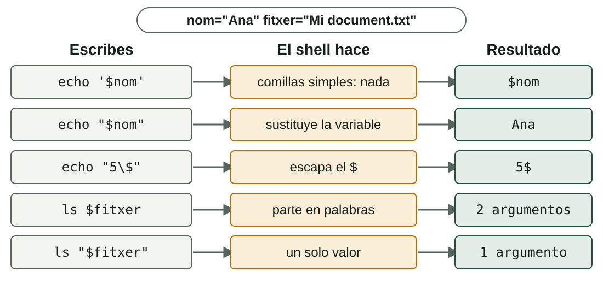
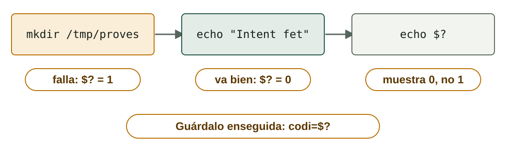

## Qué aprenderás

:::pasos
- Qué es un **script** y cómo se ejecuta en **Bash** y en **PowerShell**
- Qué son el **shebang**, los permisos y la **política de ejecución**
- Cómo guardar información en **variables** y qué hacen las **comillas**
- Cómo sabe un script si una orden ha ido bien: el **código de salida**
:::

---

## ¿Qué es un script?

:::pasos
- Un **archivo de texto** con una secuencia de órdenes
- El **shell** las ejecuta una detrás de otra
- Se guarda y se repite **sin errores de tecleo**
- Se puede **programar** para que se ejecute solo
:::

---

## Dos shells en paralelo

| | Bash | PowerShell |
|---|---|---|
| **Por las tuberías** | **Texto** | **Objetos** |
| **Extensión** | `.sh` | `.ps1` |
| **Tipos de datos** | Casi todo es texto | Tipos reales de .NET |
| **Si hay un fallo** | Continúa | Depende del fallo |

---

## Las órdenes no se traducen

:::note[Órdenes, variables y opciones, siempre las originales]
`echo`, `chmod`, `Write-Host`, `-eq`… Solo se traducen los **comentarios** y los **mensajes** que escribes tú.
:::

:::pasos
- Bash 4 o posterior en Linux
- Windows PowerShell 5.1 en Windows
- `sudo` o consola «como administrador»: **necesita privilegios**
:::

---

## El primer script en Bash

```bash
#!/bin/bash
# primer_script.sh
echo "Hola, açò és un script en Bash"
```

:::pasos
- `#!/bin/bash` es el ***shebang***: qué intérprete usar
- Todo lo que empieza por `#` es un **comentario**
:::

---

## Dos formas de ejecutarlo

```bash
bash primer_script.sh      # no hace falta permiso
chmod +x primer_script.sh  # da permiso de ejecución
./primer_script.sh         # lo ejecuta (usa el shebang)
```

---

## Tres cosas que sorprenden

:::pasos
- Sin **`chmod +x`**: `Permission denied`
- Sin **`./`**: `command not found` (la carpeta actual no está en el `PATH`)
- Sin **shebang**: el comportamiento depende de quién lo ejecute
- **Pon siempre el shebang**
:::

---

## El primer script en PowerShell

```powershell
# primer_script.ps1
Write-Host "Hola, açò és un script en PowerShell"
```

```powershell
.\primer_script.ps1
```

:::pasos
- Se lanza escribiendo la **ruta**
- Hace falta el **`.\`**: la carpeta actual no se busca sola
:::

---

## La política de ejecución

| Política | Qué permite |
|---|---|
| **Restricted** | Ningún script (predeterminada en Windows cliente) |
| **AllSigned** | Solo scripts firmados |
| **RemoteSigned** | Propios sin firmar; descargados, firmados |
| **Bypass** | No bloquea nada ni avisa |

---

## Consultar y cambiar la política

```powershell
Get-ExecutionPolicy -List
Set-ExecutionPolicy RemoteSigned -Scope CurrentUser
```

:::caution[Privilegios]
Sin `-Scope`, cambia la política de **todo el equipo** y hay que ser administrador. Con `-Scope CurrentUser` **no hace falta**: la mejor opción en una máquina de pruebas.
:::

---

## La política no es una barrera

:::pasos
- Protege contra **errores**, no contra atacantes
- Se puede saltar para un solo script: `powershell.exe -ExecutionPolicy Bypass -File script.ps1`
- En PowerShell sobre Linux o macOS, **no se aplica**
:::

---

## Variables: asignar y leer

| | Bash | PowerShell |
|---|---|---|
| **Asignar** | `nom="Ana"` | `$nom = "Ana"` |
| **Leer** | `echo "$nom"` | `Write-Host $nom` |
| **Delimitar el nombre** | `echo "${nom}s"` | `Write-Host "${nom}s"` |

---

## Variables: tipos, entorno y resultados

| | Bash | PowerShell |
|---|---|---|
| **Tipos** | Todo es texto | `[int]$edat = 17` |
| **Variable de entorno** | `echo "$HOME"` | `$env:USERPROFILE` |
| **Resultado de una orden** | `data=$(date +%F)` | `$data = Get-Date -Format "yyyy-MM-dd"` |

---

## El error más frecuente en Bash

:::danger[Sin espacios alrededor del signo =]
`edat = 20` **no** es una asignación: el shell ejecuta la orden `edat` y responde `edat: command not found`. Se escribe **`edat=20`**.
:::

:::pasos
- En **PowerShell** pasa al revés: `$edat = 20` es normal
:::

---

## El `$`: cuándo sí y cuándo no

:::pasos
- **Leer** una variable en Bash: `$nom`
- **Asignarla** en Bash: `nom=…`, **sin** `$`
- En **PowerShell** el `$` va **siempre**
:::

---

## Qué hace el shell con las comillas



---

## Antes de ejecutar, el shell transforma la línea

:::pasos
- **Sustituye** variables
- **Ejecuta** las órdenes entre `$( )`
- Hace **cálculos**
- **Separa** el texto en palabras
- Las comillas deciden **qué se transforma**
:::

---

## Sustitución de órdenes

```bash
echo "avui és $(date +%F)"
```

```powershell
"avui és $(Get-Date -Format yyyy-MM-dd)"
```

Dentro de comillas dobles, `$( )` ejecuta la orden y pone su **salida**.

---

## La división en palabras

```bash
fitxer="Mi document.txt"
ls $fitxer     # ls recibe DOS argumentos
ls "$fitxer"   # ls recibe UN argumento
```

:::pasos
- Una variable **sin comillas** se rompe por los espacios
- En Bash, pon **siempre** `"$variable"` entre comillas dobles
- PowerShell no tiene este problema
:::

---

## Aritmética en Bash

```bash
a=7
b=2
suma=$((a + b))        # 9
quocient=$((a / b))    # 3  (división entera)
resta=$((a % b))       # 1  (resto)
```

:::pasos
- Los cálculos van dentro de `$(( ))` y solo con **enteros**
- PowerShell calcula directamente y usa decimales: `7 / 2` vale **3.5**
:::

---

## Comparar: números y texto

| Comparación | Bash `[ ]` | PowerShell |
|---|---|---|
| **Números: =, ≠** | `-eq`, `-ne` | `-eq`, `-ne` |
| **Números: >, <, ≥, ≤** | `-gt`, `-lt`, `-ge`, `-le` | `-gt`, `-lt`, `-ge`, `-le` |
| **Texto: =, ≠** | `=`, `!=` | `-eq`, `-ne` |
| **Texto vacío / no vacío** | `-z "$x"`, `-n "$x"` | `[string]::IsNullOrEmpty($x)` |
| **Y, o, no** | `&&`, `\|\|`, `!` | `-and`, `-or`, `-not` |

---

## Detalles que hay que tener presentes

:::pasos
- Bash: los **espacios dentro de los corchetes** son obligatorios: `[ "$a" -gt "$b" ]`
- `-eq` con texto en Bash: error `integer expression expected`
- PowerShell **no distingue mayúsculas** en `-eq`; para distinguirlas, `-ceq`
- En PowerShell, **`>` no compara**: redirige a un archivo
:::

---

## El código de salida

:::pasos
- Cada orden devuelve al shell un número: el **código de salida**
- **`0`** significa **éxito**
- **Cualquier otro valor** (1, 2, 127…) es un tipo de error
- En Bash, la orden anterior deja el código en **`$?`**
:::

---

## Leer `$?` en Bash

```bash
ls /etc > /dev/null
echo $?                  # 0: ha ido bien
ls /carpeta_inexistent 2> /dev/null
echo $?                  # 2: ls ha fallado
grep -q "root" /etc/passwd
echo $?                  # 0: se ha encontrado
```

---

## La trampa: cada orden sobrescribe `$?`



---

## Guardar el código y salir con el tuyo

:::pasos
- Si lo necesitas, **guárdalo** enseguida: `codi=$?`
- `exit 0`: todo bien · `exit 1`: ha habido un error
- Sin `exit`, el código es el de **la última orden**
- Quien lance el script (otro script, `cron`, el Programador de tareas) puede consultarlo
:::

---

## Dos indicadores en PowerShell

| | Qué es |
|---|---|
| **`$?`** | `True` o `False`: si la última instrucción ha ido bien |
| **`$LASTEXITCODE`** | El número del último **programa externo** (`ping`, `tar`, `robocopy`…) |

`exit 1` también funciona en un `.ps1`.

---

## Pruébalo: ejecutar un script

::laboratorio[Ejecutar un script]{src="tracador-de-scripts" pestana="executar"}

---

## Pruébalo: comillas y expansión

::laboratorio[Comillas y expansión]{src="tracador-de-scripts" pestana="cometes"}

---

## Pruébalo: seguir el script línea a línea

::laboratorio[Trazador]{src="tracador-de-scripts" pestana="tracador"}

---

## Resumen

- **Script**: archivo de texto; en Bash, **shebang** y `chmod +x`; en PowerShell, `.\` y política de ejecución
- Bash: **sin espacios** en `nom=valor`; **siempre** `"$variable"`
- **Comillas simples**: nada · **dobles**: sustituyen
- **Código de salida**: `0` es éxito; `$?` se sobrescribe en cada orden

[Actividades de la unidad →](/docencia/dam/sistemas-informaticos/ud03-automatizacion-scripting/actividades/es/)
