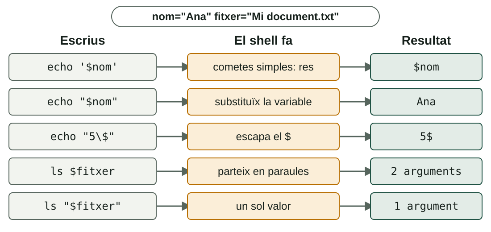
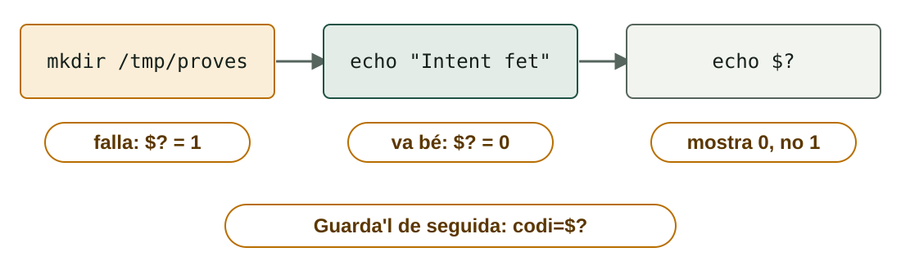

## Què aprendràs

:::pasos
- Què és un **script** i com s'executa en **Bash** i en **PowerShell**
- Què són el **shebang**, els permisos i la **política d'execució**
- Com guardar informació en **variables** i què fan les **cometes**
- Com sap un script si una ordre ha anat bé: el **codi d'eixida**
:::

---

## Què és un script?

:::pasos
- Un **fitxer de text** amb una seqüència d'ordres
- El **shell** les executa una darrere de l'altra
- Es guarda i es repetix **sense errors de teclejat**
- Es pot **programar** perquè s'execute sol
:::

---

## Dos shells en paral·lel

| | Bash | PowerShell |
|---|---|---|
| **Per les canonades** | **Text** | **Objectes** |
| **Extensió** | `.sh` | `.ps1` |
| **Tipus de dades** | Quasi tot és text | Tipus reals de .NET |
| **Si hi ha errada** | Continua | Depén de l'errada |

---

## Les ordres no es tradueixen

:::note[Ordres, variables i opcions, sempre els originals]
`echo`, `chmod`, `Write-Host`, `-eq`… Només es tradueixen els **comentaris** i els **missatges** que escrius tu.
:::

:::pasos
- Bash 4 o posterior en Linux
- Windows PowerShell 5.1 en Windows
- `sudo` o consola «com a administrador»: **necessita privilegis**
:::

---

## El primer script en Bash

```bash
#!/bin/bash
# primer_script.sh
echo "Hola, açò és un script en Bash"
```

:::pasos
- `#!/bin/bash` és el ***shebang***: quin intèrpret usar
- Tot el que comença per `#` és un **comentari**
:::

---

## Dues maneres d'executar-lo

```bash
bash primer_script.sh      # no cal permís
chmod +x primer_script.sh  # dona permís d'execució
./primer_script.sh         # l'executa (usa el shebang)
```

---

## Tres coses que sorprenen

:::pasos
- Sense **`chmod +x`**: `Permission denied`
- Sense **`./`**: `command not found` (la carpeta actual no és en el `PATH`)
- Sense **shebang**: el comportament depén de qui l'execute
- **Posa-hi sempre el shebang**
:::

---

## El primer script en PowerShell

```powershell
# primer_script.ps1
Write-Host "Hola, açò és un script en PowerShell"
```

```powershell
.\primer_script.ps1
```

:::pasos
- Es llança escrivint la **ruta**
- Cal el **`.\`**: la carpeta actual no es busca sola
:::

---

## La política d'execució

| Política | Què permet |
|---|---|
| **Restricted** | Cap script (predeterminada en Windows client) |
| **AllSigned** | Només scripts signats |
| **RemoteSigned** | Propis sense signar; descarregats, signats |
| **Bypass** | No bloqueja res ni avisa |

---

## Consultar i canviar la política

```powershell
Get-ExecutionPolicy -List
Set-ExecutionPolicy RemoteSigned -Scope CurrentUser
```

:::caution[Privilegis]
Sense `-Scope`, canvia la política de **tot l'equip** i cal ser administrador. Amb `-Scope CurrentUser` **no cal**: la millor opció en una màquina de proves.
:::

---

## La política no és una barrera

:::pasos
- Protegix contra **errors**, no contra atacants
- Es pot saltar per a un sol script: `powershell.exe -ExecutionPolicy Bypass -File script.ps1`
- En PowerShell sobre Linux o macOS, **no s'aplica**
:::

---

## Variables: assignar i llegir

| | Bash | PowerShell |
|---|---|---|
| **Assignar** | `nom="Ana"` | `$nom = "Ana"` |
| **Llegir** | `echo "$nom"` | `Write-Host $nom` |
| **Delimitar el nom** | `echo "${nom}s"` | `Write-Host "${nom}s"` |

---

## Variables: tipus, entorn i resultats

| | Bash | PowerShell |
|---|---|---|
| **Tipus** | Tot és text | `[int]$edat = 17` |
| **Variable d'entorn** | `echo "$HOME"` | `$env:USERPROFILE` |
| **Resultat d'una ordre** | `data=$(date +%F)` | `$data = Get-Date -Format "yyyy-MM-dd"` |

---

## L'error més freqüent en Bash

:::danger[Sense espais al voltant del signe =]
`edat = 20` **no** és una assignació: el shell executa l'ordre `edat` i respon `edat: command not found`. S'escriu **`edat=20`**.
:::

:::pasos
- En **PowerShell** passa al revés: `$edat = 20` és normal
:::

---

## El `$`: quan sí i quan no

:::pasos
- **Llegir** una variable en Bash: `$nom`
- **Assignar-la** en Bash: `nom=…`, **sense** `$`
- En **PowerShell** el `$` va **sempre**
:::

---

## Què fa el shell amb les cometes



---

## Abans d'executar, el shell transforma la línia

:::pasos
- **Substituïx** variables
- **Executa** les ordres entre `$( )`
- Fa **càlculs**
- **Separa** el text en paraules
- Les cometes decidixen **què es transforma**
:::

---

## Substitució d'ordres

```bash
echo "avui és $(date +%F)"
```

```powershell
"avui és $(Get-Date -Format yyyy-MM-dd)"
```

Dins de cometes dobles, `$( )` executa l'ordre i posa la seua **eixida**.

---

## El partit de paraules

```bash
fitxer="Mi document.txt"
ls $fitxer     # ls rep DOS arguments
ls "$fitxer"   # ls rep UN argument
```

:::pasos
- Una variable **sense cometes** es trenca pels espais
- En Bash, posa **sempre** `"$variable"` entre cometes dobles
- PowerShell no té este problema
:::

---

## Aritmètica en Bash

```bash
a=7
b=2
suma=$((a + b))        # 9
quocient=$((a / b))    # 3  (divisió entera)
resta=$((a % b))       # 1  (residu)
```

:::pasos
- Els càlculs van dins de `$(( ))` i només amb **enters**
- PowerShell calcula directament i usa decimals: `7 / 2` val **3.5**
:::

---

## Comparar: números i text

| Comparació | Bash `[ ]` | PowerShell |
|---|---|---|
| **Números: =, ≠** | `-eq`, `-ne` | `-eq`, `-ne` |
| **Números: >, <, ≥, ≤** | `-gt`, `-lt`, `-ge`, `-le` | `-gt`, `-lt`, `-ge`, `-le` |
| **Text: =, ≠** | `=`, `!=` | `-eq`, `-ne` |
| **Text buit / no buit** | `-z "$x"`, `-n "$x"` | `[string]::IsNullOrEmpty($x)` |
| **I, o, no** | `&&`, `\|\|`, `!` | `-and`, `-or`, `-not` |

---

## Detalls que cal tindre presents

:::pasos
- Bash: els **espais dins dels claudàtors** són obligatoris: `[ "$a" -gt "$b" ]`
- `-eq` amb text en Bash: error `integer expression expected`
- PowerShell **no distingix majúscules** en `-eq`; per a distingir-les, `-ceq`
- En PowerShell, **`>` no compara**: redirigix a un fitxer
:::

---

## El codi d'eixida

:::pasos
- Cada ordre torna al shell un número: el **codi d'eixida**
- **`0`** significa **èxit**
- **Qualsevol altre valor** (1, 2, 127…) és un tipus d'error
- En Bash, l'ordre anterior deixa el codi en **`$?`**
:::

---

## Llegir `$?` en Bash

```bash
ls /etc > /dev/null
echo $?                  # 0: ha anat bé
ls /carpeta_inexistent 2> /dev/null
echo $?                  # 2: ls ha fallat
grep -q "root" /etc/passwd
echo $?                  # 0: s'ha trobat
```

---

## La trampa: cada ordre sobreescriu `$?`



---

## Guardar el codi i eixir amb el teu

:::pasos
- Si el necessites, **guarda'l** de seguida: `codi=$?`
- `exit 0`: tot bé · `exit 1`: hi ha hagut un error
- Sense `exit`, el codi és el de **l'última ordre**
- Qui llance l'script (un altre script, `cron`, el Programador de tasques) el pot consultar
:::

---

## Dos indicadors en PowerShell

| | Què és |
|---|---|
| **`$?`** | `True` o `False`: si l'última instrucció ha anat bé |
| **`$LASTEXITCODE`** | El número de l'últim **programa extern** (`ping`, `tar`, `robocopy`…) |

`exit 1` també funciona en un `.ps1`.

---

## Prova-ho: executar un script

::laboratorio[Executar un script]{src="tracador-de-scripts" pestana="executar"}

---

## Prova-ho: cometes i expansió

::laboratorio[Cometes i expansió]{src="tracador-de-scripts" pestana="cometes"}

---

## Prova-ho: seguir l'script línia a línia

::laboratorio[Traçador]{src="tracador-de-scripts" pestana="tracador"}

---

## Resum

- **Script**: fitxer de text; en Bash, **shebang** i `chmod +x`; en PowerShell, `.\` i política d'execució
- Bash: **sense espais** en `nom=valor`; **sempre** `"$variable"`
- **Cometes simples**: res · **dobles**: substituïxen
- **Codi d'eixida**: `0` és èxit; `$?` es sobreescriu en cada ordre

[Activitats de la unitat →](/docencia/dam/sistemas-informaticos/ud03-automatizacion-scripting/actividades/)
