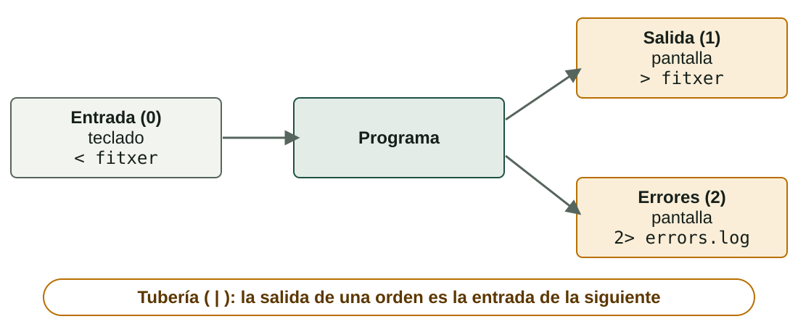
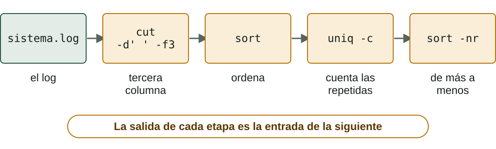

## Qué aprenderás

:::pasos
- Cómo **decide** un script: `if`, `elif`, `else` y `case`
- Cómo **repite**: bucles `for` y `while`
- Cómo **recibe datos**: parámetros y entrada del usuario
- Cómo desviar la salida: **redirecciones** y **tuberías**
- Órdenes de texto: `grep`, `sort`, `uniq`, `sed`…
:::

---

## if / elif / else

::::columnas
```bash
#!/bin/bash
nota=$1
if [ "$nota" -ge 9 ]; then
  echo "Excel·lent"
elif [ "$nota" -ge 5 ]; then
  echo "Aprovat"
else
  echo "Suspés"
fi
```

```powershell
param([int]$nota)
if ($nota -ge 9) {
    Write-Host "Excel·lent"
} elseif ($nota -ge 5) {
    Write-Host "Aprovat"
} else {
    Write-Host "Suspés"
}
```
::::

---

## Las diferencias de sintaxis son sistemáticas

| | Bash | PowerShell |
|---|---|---|
| **Condición** | Entre `[ ]` | Entre `( )` |
| **Bloque** | `then` … `fi` | Llaves `{ }` |
| **«Si no, si»** | `elif` | `elseif` |
| **Cierre** | `fi` | `}` |

---

## En Bash, `if` evalúa un código de salida

:::pasos
- Ejecuta la orden tras `if`; si devuelve **`0`**, ejecuta el bloque `then`
- `[ … ]` es, en realidad, **una orden** (también `test …`)
:::

```bash
if grep -q "^$usuari:" /etc/passwd; then
  echo "L'usuari $usuari existeix"
fi
```

---

## Pruebas sobre archivos

| Prueba | Bash | PowerShell |
|---|---|---|
| **Existe** | `[ -e "$x" ]` | `Test-Path $x` |
| **Es un archivo** | `[ -f "$x" ]` | `Test-Path $x -PathType Leaf` |
| **Es una carpeta** | `[ -d "$x" ]` | `Test-Path $x -PathType Container` |
| **Tiene contenido** | `[ -s "$x" ]` | `(Get-Item $x).Length -gt 0` |
| **Leer, escribir, ejecutar** | `-r`, `-w`, `-x` | Permisos ACL |

---

## Combinar condiciones

:::pasos
- Bash: `[ -f "$x" ] && [ -r "$x" ]`
- Con **`[[ ]]`**: `[[ -f $x && -r $x ]]`
- `[[ ]]` es propio de Bash: no parte palabras; admite `==` con patrones y `=~`
- PowerShell: `if ((Test-Path $x) -and ($n -gt 3))`
:::

---

## case y switch

::::columnas
```bash
case "$op" in
  1) date +%F ;;
  2) whoami ;;
  3) echo "Adéu"; exit 0 ;;
  *) echo "No vàlida" >&2
     exit 2 ;;
esac
```

```powershell
switch ($op) {
  "1" { Get-Date }
  "2" { whoami }
  "3" { exit 0 }
  default { exit 2 }
}
```
::::

---

## case: las claves del menú

:::pasos
- Más limpio que una cadena de `elif`
- Cada alternativa acaba en **`;;`**
- **`*)`** hace de «cualquier otro valor»
- **`>&2`** envía el mensaje a la salida de errores
:::

---

## Dos familias de bucles

:::pasos
- **`for`**: recorre una **lista**
- **`while`**: repite **mientras se cumpla** una condición
- **`until`**: repite **hasta que se cumpla**
:::

---

## for: recorrer una lista

```bash
for fruita in poma pera taronja; do
  echo "Fruita: $fruita"
done
```

```powershell
foreach ($fruita in "poma", "pera", "taronja") {
    Write-Host "Fruita: $fruita"
}
```

---

## for: contar

```bash
for i in {1..5}; do echo "Volta $i"; done
for ((i = 1; i <= 5; i++)); do echo "$i"; done
```

```powershell
1..5 | ForEach-Object { Write-Host "Volta $_" }
for ($i = 1; $i -le 5; $i++) { Write-Host $i }
```

---

## while: mientras se cumpla

::::columnas
```bash
n=3
while [ "$n" -gt 0 ]; do
  echo "Queden $n"
  n=$((n - 1))
done
```

```powershell
$n = 3
while ($n -gt 0) {
    Write-Host "Queden $n"
    $n--
}
```
::::

---

## Un archivo tras otro

```bash
for f in *.txt; do echo "$f"; done
```

```powershell
foreach ($f in Get-ChildItem *.txt) { Write-Host $f.Name }
```

:::pasos
- **`break`** sale del bucle; **`continue`** salta a la vuelta siguiente
- En `ForEach-Object`, **`$_`** es el elemento actual
:::

---

## Leer un archivo línea a línea

```bash
while read -r linia; do
  echo "Línia: $linia"
done < usuaris.txt
```

```powershell
Get-Content .\usuaris.txt | ForEach-Object { Write-Host "Línia: $_" }
```

---

## Qué hacen `-r` y `<` en el bucle de lectura

:::pasos
- `-r` impide que Bash interprete las **barras invertidas**
- `< usuaris.txt` **redirige** el archivo a la entrada del bucle
:::

---

## Cuidado con los bucles infinitos

:::caution[Olvidar actualizar la variable de la condición]
Si en un `while` olvidas `n=$((n - 1))`, el script no terminará nunca. Se corta con **Ctrl + C**.
:::

---

## Parámetros del script

| Bash | Significado |
|---|---|
| **`$0`** | Nombre con el que se ha lanzado |
| **`$1`, `$2`…** | Primer, segundo… parámetro |
| **`$#`** | Cuántos parámetros se han pasado |
| **`"$@"`** | Todos, **cada uno como palabra separada** |
| **`shift`** | Descarta `$1` y desplaza el resto |

---

## Ejemplo: saluda.sh

```bash
#!/bin/bash
if [ $# -lt 1 ]; then
  echo "Ús: $0 nom..." >&2
  exit 1
fi
for nom in "$@"; do
  echo "Hola, $nom"
done
echo "He saludat $# persones"
```

`./saluda.sh Ana Luis "Maria Lopez"` saluda a **tres** personas.

---

## PowerShell: parámetros con nombre

```powershell
param(
    [Parameter(Mandatory)][string]$Carpeta,
    [int]$Dies = 7
)
Write-Host "Carpeta: $Carpeta · dies: $Dies"
```

:::pasos
- `.\copia.ps1 -Carpeta C:\Dades -Dies 3`, o por posición
- Si falta un obligatorio, PowerShell lo **pide**
- Sin `param()`, caen en el array **`$args`**
:::

---

## Preguntar al usuario

```bash
read -p "Com et dius? " nom
read -s -p "Contrasenya: " clau; echo
```

```powershell
$nom = Read-Host "Com et dius?"
$clau = Read-Host "Contrasenya" -AsSecureString
```

---

## Valida lo que has recibido

:::pasos
- Si lees con `read`, pasa la variable **siempre entre comillas**
- Comprueba que hay **parámetros**
- Comprueba que el archivo **existe**
- Comprueba que el número es **un número**
- Si no: `exit` con un código **distinto de 0**
:::

---

## Los tres canales de un programa



---

## Redirigir a archivos

| Queremos… | Bash | PowerShell |
|---|---|---|
| **Salida a un archivo** (sobrescribe) | `orden > fitxer` | `orden > fitxer` |
| **Añadir al final** | `orden >> fitxer` | `orden >> fitxer` |
| **Solo los errores** | `orden 2> errors.log` | `orden 2> errors.log` |
| **Salida y errores juntos** | `orden >> a.log 2>&1` | `orden *>> a.log` |

---

## Otras redirecciones

| Queremos… | Bash | PowerShell |
|---|---|---|
| **Tirar la salida** | `orden > /dev/null` | `orden > $null` |
| **Archivo como entrada** | `orden < fitxer` | `Get-Content fitxer \| orden` |
| **Salida a mensaje de error** | `echo "mal" >&2` | `Write-Error "mal"` |

---

## Tuberías: texto u objetos

:::pasos
- Una **tubería** (`|`) conecta la salida de una orden con la entrada de la siguiente
- En Bash viaja **texto**
- En PowerShell viajan **objetos**
- Por eso `Sort-Object Length` ordena por una propiedad sin «cortar» columnas
:::

---

## Órdenes de texto: buscar

| Tarea | Bash | PowerShell |
|---|---|---|
| **Buscar texto** | `grep "error" log.txt` | `Select-String "error" log.txt` |
| **Sin distinguir mayúsculas** | `grep -i error log.txt` | por defecto |
| **Distinguir mayúsculas** | por defecto | `Select-String ERROR log.txt -CaseSensitive` |
| **Líneas que no coinciden** | `grep -v INFO log.txt` | `Select-String INFO log.txt -NotMatch` |

---

## Órdenes de texto: mirar un archivo

| Tarea | Bash | PowerShell |
|---|---|---|
| **Primeras líneas** | `head -n 10 log.txt` | `Get-Content log.txt -Head 10` |
| **Últimas líneas** | `tail -n 10 log.txt` | `Get-Content log.txt -Tail 10` |
| **Seguir en directo** | `tail -f log.txt` | `Get-Content log.txt -Tail 10 -Wait` |
| **Contar líneas** | `wc -l log.txt` | `(Get-Content log.txt).Count` |

---

## Órdenes de texto: transformar

| Tarea | Bash | PowerShell |
|---|---|---|
| **Una columna** | `cut -d: -f1 /etc/passwd` | `($_ -split ':')[0]` |
| **Ordenar** | `sort fitxer` | `Sort-Object` |
| **Repetidas y contarlas** | `sort f \| uniq -c` | `Group-Object` |
| **Cambiar letras** | `tr 'a-z' 'A-Z'` | `$text.ToUpper()` |
| **Sustituir texto** | `sed 's/vell/nou/g' f` | `-replace 'vell','nou'` |

---

## Notas que evitan disgustos

:::pasos
- **`grep` distingue mayúsculas; `Select-String` no**
- `uniq` solo junta líneas **consecutivas**: haz `sort` antes
- `sed 's/…/…/g'` **no toca el archivo**; con `-i` sí: haz copia o usa `-i.bak`
- `-replace` usa expresiones regulares y no distingue mayúsculas
- Un `grep` sin resultados devuelve **1**: no es un error, es «no está»
:::

---

## Ejemplo resuelto: ¿cuántas líneas de error?

```bash
grep "ERROR" sistema.log | wc -l
```

```powershell
(Select-String "ERROR" sistema.log -CaseSensitive).Count
```

---

## ¿Cuántas líneas de cada nivel?



---

## Lo mismo en PowerShell

```powershell
Get-Content sistema.log |
  ForEach-Object { ($_ -split ' ')[2] } |
  Group-Object | Sort-Object Count -Descending
```

Cada etapa hace **una cosa pequeña**; la salida de una es la entrada de la siguiente. Esa es toda la idea de las tuberías.

---

## Pruébalo: condiciones

::laboratorio[Condiciones]{src="tracador-de-scripts" pestana="condicions"}

---

## Pruébalo: seguir bucles

::laboratorio[Trazador]{src="tracador-de-scripts" pestana="tracador"}

---

## Pruébalo: parámetros y read

::laboratorio[Parámetros y read]{src="tracador-de-scripts" pestana="parametres"}

---

## Pruébalo: Bash y PowerShell, cara a cara

::laboratorio[Bash ↔ PowerShell]{src="tracador-de-scripts" pestana="bash-ps"}

---

## Resumen

- **Decide**: `if` y `case`; en Bash, `if` evalúa un **código de salida**
- **Repite**: `for` para listas, `while` para condiciones
- **Recibe datos**: `$1`, `"$@"`, `param()`, `read` y `Read-Host`
- **Tuberías**: texto en Bash, objetos en PowerShell
- **Texto**: `grep`, `sort`, `uniq`, `sed` y sus equivalentes

[Actividades de la unidad →](/docencia/dam/sistemas-informaticos/ud03-automatizacion-scripting/actividades/es/)
