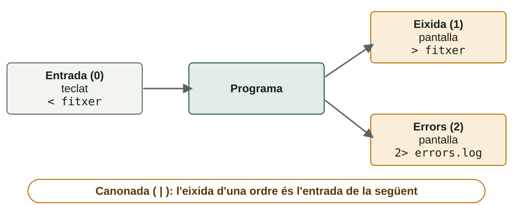
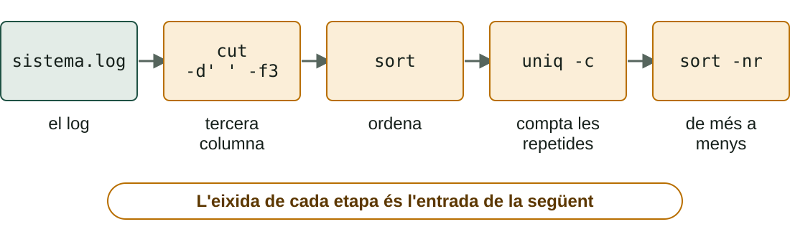

## Què aprendràs

:::pasos
- Com **decidix** un script: `if`, `elif`, `else` i `case`
- Com **repetix**: bucles `for` i `while`
- Com **rep dades**: paràmetres i entrada de l'usuari
- Com desviar l'eixida: **redireccions** i **canonades**
- Ordres de text: `grep`, `sort`, `uniq`, `sed`…
:::

---

## if / elif / else

::::columnas
```bash
#!/bin/bash
nota=$1
if [ "$nota" -ge 9 ]; then
  echo "Excel·lent"
elif [ "$nota" -ge 5 ]; then
  echo "Aprovat"
else
  echo "Suspés"
fi
```

```powershell
param([int]$nota)
if ($nota -ge 9) {
    Write-Host "Excel·lent"
} elseif ($nota -ge 5) {
    Write-Host "Aprovat"
} else {
    Write-Host "Suspés"
}
```
::::

---

## Les diferències de sintaxi són sistemàtiques

| | Bash | PowerShell |
|---|---|---|
| **Condició** | Entre `[ ]` | Entre `( )` |
| **Bloc** | `then` … `fi` | Claus `{ }` |
| **«Si no, si»** | `elif` | `elseif` |
| **Tancament** | `fi` | `}` |

---

## En Bash, `if` avalua un codi d'eixida

:::pasos
- Executa l'ordre després d'`if`; si torna **`0`**, executa el bloc `then`
- `[ … ]` és, en realitat, **una ordre** (també `test …`)
:::

```bash
if grep -q "^$usuari:" /etc/passwd; then
  echo "L'usuari $usuari existeix"
fi
```

---

## Proves sobre fitxers

| Prova | Bash | PowerShell |
|---|---|---|
| **Existix** | `[ -e "$x" ]` | `Test-Path $x` |
| **És un fitxer** | `[ -f "$x" ]` | `Test-Path $x -PathType Leaf` |
| **És una carpeta** | `[ -d "$x" ]` | `Test-Path $x -PathType Container` |
| **Té contingut** | `[ -s "$x" ]` | `(Get-Item $x).Length -gt 0` |
| **Llegir, escriure, executar** | `-r`, `-w`, `-x` | Permisos ACL |

---

## Combinar condicions

:::pasos
- Bash: `[ -f "$x" ] && [ -r "$x" ]`
- Amb **`[[ ]]`**: `[[ -f $x && -r $x ]]`
- `[[ ]]` és propi de Bash: no parteix paraules; admet `==` amb patrons i `=~`
- PowerShell: `if ((Test-Path $x) -and ($n -gt 3))`
:::

---

## case i switch

::::columnas
```bash
case "$op" in
  1) date +%F ;;
  2) whoami ;;
  3) echo "Adéu"; exit 0 ;;
  *) echo "No vàlida" >&2
     exit 2 ;;
esac
```

```powershell
switch ($op) {
  "1" { Get-Date }
  "2" { whoami }
  "3" { exit 0 }
  default { exit 2 }
}
```
::::

---

## case: les claus del menú

:::pasos
- Més net que una cadena d'`elif`
- Cada alternativa acaba en **`;;`**
- **`*)`** fa de «qualsevol altre valor»
- **`>&2`** envia el missatge a l'eixida d'errors
:::

---

## Dues famílies de bucles

:::pasos
- **`for`**: recorre una **llista**
- **`while`**: repetix **mentre es complisca** una condició
- **`until`**: repetix **fins que es complisca**
:::

---

## for: recórrer una llista

```bash
for fruita in poma pera taronja; do
  echo "Fruita: $fruita"
done
```

```powershell
foreach ($fruita in "poma", "pera", "taronja") {
    Write-Host "Fruita: $fruita"
}
```

---

## for: comptar

```bash
for i in {1..5}; do echo "Volta $i"; done
for ((i = 1; i <= 5; i++)); do echo "$i"; done
```

```powershell
1..5 | ForEach-Object { Write-Host "Volta $_" }
for ($i = 1; $i -le 5; $i++) { Write-Host $i }
```

---

## while: mentre es complisca

::::columnas
```bash
n=3
while [ "$n" -gt 0 ]; do
  echo "Queden $n"
  n=$((n - 1))
done
```

```powershell
$n = 3
while ($n -gt 0) {
    Write-Host "Queden $n"
    $n--
}
```
::::

---

## Un fitxer després de l'altre

```bash
for f in *.txt; do echo "$f"; done
```

```powershell
foreach ($f in Get-ChildItem *.txt) { Write-Host $f.Name }
```

:::pasos
- **`break`** ix del bucle; **`continue`** salta a la volta següent
- En `ForEach-Object`, **`$_`** és l'element actual
:::

---

## Llegir un fitxer línia a línia

```bash
while read -r linia; do
  echo "Línia: $linia"
done < usuaris.txt
```

```powershell
Get-Content .\usuaris.txt | ForEach-Object { Write-Host "Línia: $_" }
```

---

## Què fan `-r` i `<` en el bucle de lectura

:::pasos
- `-r` impedix que Bash interprete les **barres invertides**
- `< usuaris.txt` **redirigix** el fitxer a l'entrada del bucle
:::

---

## Compte amb els bucles infinits

:::caution[Oblidar actualitzar la variable de la condició]
Si en un `while` oblides `n=$((n - 1))`, l'script no acabarà mai. Es talla amb **Ctrl + C**.
:::

---

## Paràmetres de l'script

| Bash | Significat |
|---|---|
| **`$0`** | Nom amb què s'ha llançat |
| **`$1`, `$2`…** | Primer, segon… paràmetre |
| **`$#`** | Quants paràmetres s'han passat |
| **`"$@"`** | Tots, **cada un com a paraula separada** |
| **`shift`** | Descarta `$1` i desplaça la resta |

---

## Exemple: saluda.sh

```bash
#!/bin/bash
if [ $# -lt 1 ]; then
  echo "Ús: $0 nom..." >&2
  exit 1
fi
for nom in "$@"; do
  echo "Hola, $nom"
done
echo "He saludat $# persones"
```

`./saluda.sh Ana Luis "Maria Lopez"` saluda **tres** persones.

---

## PowerShell: paràmetres amb nom

```powershell
param(
    [Parameter(Mandatory)][string]$Carpeta,
    [int]$Dies = 7
)
Write-Host "Carpeta: $Carpeta · dies: $Dies"
```

:::pasos
- `.\copia.ps1 -Carpeta C:\Dades -Dies 3`, o per posició
- Si falta un obligatori, PowerShell el **demana**
- Sense `param()`, cauen en l'array **`$args`**
:::

---

## Preguntar a l'usuari

```bash
read -p "Com et dius? " nom
read -s -p "Contrasenya: " clau; echo
```

```powershell
$nom = Read-Host "Com et dius?"
$clau = Read-Host "Contrasenya" -AsSecureString
```

---

## Valida el que has rebut

:::pasos
- Si llegeixes amb `read`, passa la variable **sempre per cometes**
- Comprova que hi ha **paràmetres**
- Comprova que el fitxer **existix**
- Comprova que el número és **un número**
- Si no: `exit` amb un codi **diferent de 0**
:::

---

## Els tres canals d'un programa



---

## Redirigir a fitxers

| Volem… | Bash | PowerShell |
|---|---|---|
| **Eixida a un fitxer** (sobreescriu) | `ordre > fitxer` | `ordre > fitxer` |
| **Afegir al final** | `ordre >> fitxer` | `ordre >> fitxer` |
| **Només els errors** | `ordre 2> errors.log` | `ordre 2> errors.log` |
| **Eixida i errors junts** | `ordre >> a.log 2>&1` | `ordre *>> a.log` |

---

## Altres redireccions

| Volem… | Bash | PowerShell |
|---|---|---|
| **Llençar l'eixida** | `ordre > /dev/null` | `ordre > $null` |
| **Fitxer com a entrada** | `ordre < fitxer` | `Get-Content fitxer \| ordre` |
| **Eixida a missatge d'error** | `echo "mal" >&2` | `Write-Error "mal"` |

---

## Canonades: text o objectes

:::pasos
- Una **canonada** (`|`) connecta l'eixida d'una ordre amb l'entrada de la següent
- En Bash viaja **text**
- En PowerShell viatgen **objectes**
- Per això `Sort-Object Length` ordena per una propietat sense «tallar» columnes
:::

---

## Ordres de text: buscar

| Tasca | Bash | PowerShell |
|---|---|---|
| **Buscar text** | `grep "error" log.txt` | `Select-String "error" log.txt` |
| **Sense distingir majúscules** | `grep -i error log.txt` | per defecte |
| **Distingir majúscules** | per defecte | `Select-String ERROR log.txt -CaseSensitive` |
| **Línies que no coincidixen** | `grep -v INFO log.txt` | `Select-String INFO log.txt -NotMatch` |

---

## Ordres de text: mirar un fitxer

| Tasca | Bash | PowerShell |
|---|---|---|
| **Primeres línies** | `head -n 10 log.txt` | `Get-Content log.txt -Head 10` |
| **Últimes línies** | `tail -n 10 log.txt` | `Get-Content log.txt -Tail 10` |
| **Seguir en directe** | `tail -f log.txt` | `Get-Content log.txt -Tail 10 -Wait` |
| **Comptar línies** | `wc -l log.txt` | `(Get-Content log.txt).Count` |

---

## Ordres de text: transformar

| Tasca | Bash | PowerShell |
|---|---|---|
| **Una columna** | `cut -d: -f1 /etc/passwd` | `($_ -split ':')[0]` |
| **Ordenar** | `sort fitxer` | `Sort-Object` |
| **Repetides i comptar-les** | `sort f \| uniq -c` | `Group-Object` |
| **Canviar lletres** | `tr 'a-z' 'A-Z'` | `$text.ToUpper()` |
| **Substituir text** | `sed 's/vell/nou/g' f` | `-replace 'vell','nou'` |

---

## Notes que eviten disgustos

:::pasos
- **`grep` distingix majúscules; `Select-String` no**
- `uniq` només junta línies **consecutives**: fes `sort` abans
- `sed 's/…/…/g'` **no toca el fitxer**; amb `-i` sí: fes còpia o usa `-i.bak`
- `-replace` usa expressions regulars i no distingix majúscules
- Un `grep` sense resultats torna **1**: no és un error, és «no hi és»
:::

---

## Exemple resolt: quantes línies d'error?

```bash
grep "ERROR" sistema.log | wc -l
```

```powershell
(Select-String "ERROR" sistema.log -CaseSensitive).Count
```

---

## Quantes línies de cada nivell?



---

## El mateix en PowerShell

```powershell
Get-Content sistema.log |
  ForEach-Object { ($_ -split ' ')[2] } |
  Group-Object | Sort-Object Count -Descending
```

Cada etapa fa **una cosa xicoteta**; l'eixida de l'una és l'entrada de la següent. Eixa és tota la idea de les canonades.

---

## Prova-ho: condicions

::laboratorio[Condicions]{src="tracador-de-scripts" pestana="condicions"}

---

## Prova-ho: seguir bucles

::laboratorio[Traçador]{src="tracador-de-scripts" pestana="tracador"}

---

## Prova-ho: paràmetres i read

::laboratorio[Paràmetres i read]{src="tracador-de-scripts" pestana="parametres"}

---

## Prova-ho: Bash i PowerShell, cara a cara

::laboratorio[Bash ↔ PowerShell]{src="tracador-de-scripts" pestana="bash-ps"}

---

## Resum

- **Decidix**: `if` i `case`; en Bash, `if` avalua un **codi d'eixida**
- **Repetix**: `for` per a llistes, `while` per a condicions
- **Rep dades**: `$1`, `"$@"`, `param()`, `read` i `Read-Host`
- **Canonades**: text en Bash, objectes en PowerShell
- **Text**: `grep`, `sort`, `uniq`, `sed` i els seus equivalents

[Activitats de la unitat →](/docencia/dam/sistemas-informaticos/ud03-automatizacion-scripting/actividades/)
