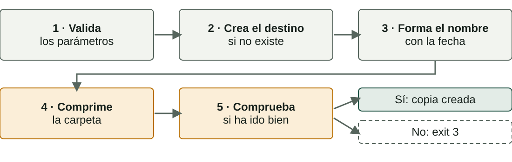
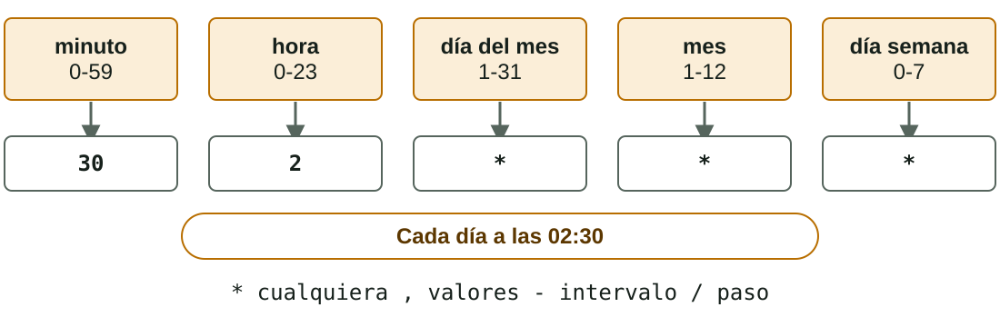

## Qué aprenderás

:::pasos
- Un script de **copia de seguridad con fecha**
- Un script de **alta masiva de usuarios**
- Un script de **monitorización del disco**
- Cómo **programarlos** con `cron` y el Programador de tareas
:::

---

## Pruébalo todo en una máquina de pruebas

:::danger[Son acciones reales]
Crear usuarios, programar tareas y borrar copias **modifican el sistema**. Hazlo en una máquina virtual o en un equipo de prácticas, nunca en tu ordenador del día a día.
:::

---

## Script de copia con fecha

:::pasos
- Comprime una carpeta en **un único archivo**
- Pone **la fecha en el nombre**: cada día, un archivo distinto
- Las copias anteriores **no se sobrescriben**
:::

---

## Los pasos del script de copia



---

## backup.sh: los parámetros

```bash
origen=$1
desti=$2
if [ $# -ne 2 ]; then
  echo "Ús: $0 <origen> <destí>" >&2
  exit 1
fi
```

---

## backup.sh: origen, destino y nombre

```bash
if [ ! -d "$origen" ]; then
  echo "No existeix la carpeta $origen" >&2
  exit 2
fi
mkdir -p "$desti"
data=$(date +%Y-%m-%d)
arxiu="$desti/backup_$data.tar.gz"
```

---

## backup.sh: comprimir y comprobar

```bash
if tar -czf "$arxiu" "$origen"; then
  echo "Còpia creada: $arxiu"
else
  echo "La còpia ha fallat" >&2
  exit 3
fi
```

---

## Backup.ps1: validar los parámetros

```powershell
param(
    [Parameter(Mandatory)][string]$Origen,
    [Parameter(Mandatory)][string]$Desti
)
if (-not (Test-Path $Origen -PathType Container)) {
    Write-Error "No existeix la carpeta $Origen"
    exit 2
}
```

---

## Backup.ps1: hacer la copia

```powershell
New-Item -ItemType Directory -Path $Desti -Force | Out-Null
$data = Get-Date -Format "yyyy-MM-dd"
$arxiu = Join-Path $Desti "backup_$data.zip"
Compress-Archive -Path $Origen -DestinationPath $arxiu -Force
if ($?) {
    Write-Host "Còpia creada: $arxiu"
} else {
    exit 3
}
```

---

## Un script fiable no miente

:::pasos
- **Valida** los parámetros: `exit 1` o `2` si faltan o son incorrectos
- **Crea** el destino si no existe
- **Forma** el nombre con la fecha
- **Comprueba** si la copia ha ido bien antes de decir que lo ha hecho
:::

---

## Cosas que hay que saber de la copia

:::pasos
- `tar -czf`: **c**rea un archivo comprimido con gzip (**z**) en el fichero (**f**)
- `Compress-Archive` (PowerShell 5.1): límites con archivos de **unos 2 GB** o abiertos por otros programas
- Para copias grandes: **`robocopy`** u otras herramientas
- Comprueba el resultado: `tar -tzf …` lista el contenido
:::

---

## Alta masiva de usuarios

:::pasos
- Preparar un aula: **25 cuentas**
- Un archivo `usuaris.txt`, **un nombre por línea**
- Un bucle lo resuelve en un segundo
:::

---

## crear_usuaris.sh: privilegios y parámetros

```bash
if [ "$(id -u)" -ne 0 ]; then
  echo "Cal executar-lo amb sudo" >&2
  exit 1
fi
if [ $# -ne 1 ] || [ ! -f "$1" ]; then
  echo "Ús: sudo $0 <fitxer_amb_noms>" >&2
  exit 2
fi
read -s -p "Contrasenya inicial: " clau
```

---

## crear_usuaris.sh: recorrer los nombres

```bash
while read -r usuari; do
  [ -z "$usuari" ] && continue
  if id "$usuari" > /dev/null 2>&1; then
    echo "Ja existeix: $usuari"
  else
    # la cuenta se crea en la diapositiva siguiente
  fi
done < "$1"
```

---

## crear_usuaris.sh: crear la cuenta

```bash
useradd -m -s /bin/bash "$usuari"
echo "$usuari:$clau" | chpasswd
chage -d 0 "$usuari"
echo "Usuari creat: $usuari"
```

---

## CrearUsuaris.ps1: preparar

```powershell
#Requires -RunAsAdministrator
param([Parameter(Mandatory)][string]$Fitxer)
$clau = Read-Host "Contrasenya inicial" -AsSecureString
```

---

## CrearUsuaris.ps1: el bucle

```powershell
Get-Content $Fitxer | Where-Object { $_.Trim() -ne "" } |
  ForEach-Object {
    if (Get-LocalUser -Name $_ -ErrorAction SilentlyContinue) {
      Write-Host "Ja existeix: $_"
    } else {
      New-LocalUser -Name $_ -Password $clau | Out-Null
      Write-Host "Usuari creat: $_"
    }
  }
```

---

## Alta masiva: privilegios

:::pasos
- `useradd` y `chpasswd` piden **`sudo`**
- `New-LocalUser` exige una consola **como administrador**
- `#Requires -RunAsAdministrator` hace que PowerShell lo compruebe y pare
:::

---

## Alta masiva: contraseñas

:::pasos
- **`New-LocalUser`** necesita contraseña o `-NoPassword`; si no, **se queda esperando**
- Aquí se pide **una sola vez** con `-AsSecureString`
- **`useradd -m`** crea la cuenta **sin contraseña**
- `chpasswd` la asigna y **`chage -d 0`** obliga a cambiarla
- **Nunca** escribas una contraseña dentro del script
:::

---

## Alta masiva: limpieza de la prueba

:::pasos
- Una política de contraseñas débil puede hacer fallar el alta: elige una **más larga y compleja**
- Linux: `sudo userdel -r nom`
- Windows: `Remove-LocalUser -Name nom`
- La carpeta de perfil de Windows se borra **aparte**
:::

---

## Monitorización del disco

:::pasos
- Calcula qué **porcentaje** del disco está lleno
- Avisa si pasa de un **umbral** (aquí, el 80 %)
- **Anota cada comprobación** en un archivo de registro
- Las tareas programadas **no tienen pantalla**
:::

---

## comprovar_disc.sh

```bash
llindar=${1:-80}
registre="$HOME/disc.log"
us=$(df -P / | tail -1 | awk '{print $5}' | tr -d '%')
data=$(date '+%Y-%m-%d %H:%M')
echo "$data · disc al $us%" >> "$registre"
if [ "$us" -gt "$llindar" ]; then
  echo "$data · AVÍS: el disc supera el $llindar%" \
    | tee -a "$registre"
fi
```

---

## ComprovarDisc.ps1: el cálculo

```powershell
param([int]$Llindar = 80)
$registre = Join-Path $env:USERPROFILE "disc.log"
$disc = Get-PSDrive C
$us = [math]::Round($disc.Used / ($disc.Used + $disc.Free) * 100)
$data = Get-Date -Format "yyyy-MM-dd HH:mm"
```

---

## ComprovarDisc.ps1: registrar y avisar

```powershell
Add-Content -Path $registre -Value "$data · disc al $us%"
if ($us -gt $Llindar) {
    Write-Host "AVÍS: el disc supera el $Llindar%"
    Add-Content $registre "$data · AVÍS: el disc supera el $Llindar%"
}
```

---

## Cómo se obtiene el porcentaje en Bash

:::pasos
1. **`df -P /`**: el uso de la raíz (`-P` evita que una línea se parta)
2. **`tail -1`**: la última línea
3. **`awk '{print $5}'`**: la quinta columna, por ejemplo `42%`
4. **`tr -d '%'`**: quita el símbolo
:::

`${1:-80}`: el primer parámetro, o **80** si no hay ninguno.

---

## Acentos en los scripts de PowerShell

:::caution[AVÍS puede salir con caracteres extraños]
Windows PowerShell 5.1 lee como ANSI un `.ps1` en UTF-8 **sin BOM**. Guárdalo como **«UTF-8 con BOM»** o evita los acentos en los mensajes.
:::

---

## Pruébalo: traza comprovar_disc

::laboratorio[Trazador]{src="tracador-de-scripts" pestana="tracador"}

---

## cron: el planificador de Linux

:::pasos
- Un servicio que **cada minuto** mira las tareas programadas
- Cada usuario tiene su **crontab**: `crontab -e`
- Cada línea: **cinco campos de tiempo** y la orden
:::

---

## Los cinco campos de una línea de crontab



---

## Ejemplos de crontab

| Línea | Cuándo se ejecuta |
|---|---|
| `30 2 * * *` | Cada día a las 02:30 |
| `0 * * * *` | Cada hora en punto |
| `*/5 * * * *` | Cada 5 minutos |

---

## Más ejemplos de crontab

| Línea | Cuándo se ejecuta |
|---|---|
| `0 9 * * 1` | Cada lunes a las 9:00 |
| `0 8 * * 1-5` | De lunes a viernes a las 8:00 |
| `0 0 1 * *` | El día 1 de cada mes, a medianoche |

---

## Los símbolos del crontab

:::pasos
- **`*`**: cualquier valor
- **`,`**: separa valores (`1,15`)
- **`-`**: un intervalo (`1-5`)
- **`/`**: un paso (`*/5`)
:::

---

## La línea de la práctica de clase

:::pasos
- **`*/5 * * * *`**: cada 5 minutos
- **`/home/usuari/comprovar_disc.sh`**: el script, con **ruta absoluta**
- **`>> /home/usuari/cron.log 2>&1`**: la salida y los errores, **al registro**
:::

---

## Órdenes útiles de cron

```bash
crontab -e                       # editar tus tareas
crontab -l                       # listarlas
systemctl status cron            # ¿el servicio está activo?
cat ~/disc.log                   # el registro de nuestro script
grep CRON /var/log/syslog | tail # lo que ha lanzado cron
```

---

## Errores típicos con cron

:::pasos
- **Rutas absolutas**: cron tiene un entorno mínimo; el script, con permiso de ejecución
- **El `%`** se debe escribir `\%`: pon el `date` dentro del script
- **Salida perdida**: redirige con `>> fitxer 2>&1`
- **`crontab -r`** borra todo el crontab **sin preguntar**
:::

---

## Una ejecución única: at

:::pasos
- `at` programa una tarea **una sola vez**
- Hace falta el paquete `at`
- `atq` lista las pendientes
:::

---

## El Programador de tareas de Windows

:::pasos
- Se usa con `taskschd.msc`: una interfaz gráfica
- **Desencadenador** (*trigger*): **cuándo** se ejecuta
- **Acción**: **qué** se ejecuta
:::

---

## La acción de una tarea en la interfaz

:::pasos
- **Programa o script**: `powershell.exe`
- **Agregar argumentos**: `-NoProfile -ExecutionPolicy Bypass -File "C:\Scripts\ComprovarDisc.ps1"`
- Desencadenador: «Repetir la tarea cada: **5 minutos**»
:::

---

## schtasks: la línea de órdenes

```text
schtasks /create /tn "ComprovarDisc" /sc minute /mo 5 /tr "…"
schtasks /query /tn "ComprovarDisc" /v /fo list
schtasks /run /tn "ComprovarDisc"
schtasks /delete /tn "ComprovarDisc" /f
```

:::pasos
- `/tr "…"`: `powershell.exe -NoProfile -ExecutionPolicy Bypass -File C:\Scripts\ComprovarDisc.ps1`
- Cada día a las 2:30: `/sc daily /st 02:30`
:::

---

## No programes el .ps1 directamente

:::caution[Windows lo abre como un documento]
`/tr "C:\Scripts\Backup.ps1"` **no ejecuta el script**. La acción debe ser **`powershell.exe` con `-File`**, y `-ExecutionPolicy Bypass` solo para esta tarea.
:::

---

## Condiciones de la tarea

:::pasos
- Con tu usuario, solo se ejecuta **mientras tienes la sesión iniciada**
- En un portátil, por defecto, **no se ejecuta con batería**
- Para tareas de sistema: `/ru SYSTEM` (consola de administrador)
:::

---

## Dos mundos, la misma idea

| | Linux | Windows |
|---|---|---|
| **Planificador** | `cron` | Programador de tareas |
| **Dónde se define** | `crontab -e` | Interfaz o `schtasks` |
| **«Cuándo»** | Los 5 campos | Desencadenador |
| **«Qué»** | La orden de la línea | Acción |

---

## Dos mundos: ejemplos y resultados

| | Linux | Windows |
|---|---|---|
| **Cada 5 minutos** | `*/5 * * * *` | `/sc minute /mo 5` |
| **Cada día a las 2:30** | `30 2 * * *` | `/sc daily /st 02:30` |
| **Dónde mirar el resultado** | Tu registro | El registro y el *Historial* |
| **Una vez** | `at` | `/sc once` |

---

## Qué harás en la presencial

:::pasos
1. Escribir y probar el script de **copia de seguridad**
2. Escribir y probar el **alta masiva** de 5 usuarios
3. Escribir y probar la **comprobación del disco**
4. **Programarla** cada 5 minutos y verificarla en el registro
5. **Documentar** con capturas y una reflexión breve
:::

---

## Resumen

- **Copia**: fecha en el nombre y comprobar el resultado antes de decir que ha ido bien
- **Alta masiva**: privilegios, contraseña inicial **una sola vez** y nunca dentro del script
- **Disco**: umbral, **registro** y `df`
- **cron**: cinco campos, **rutas absolutas** · **schtasks**: `powershell.exe -File`

[Actividades de la unidad →](/docencia/dam/sistemas-informaticos/ud03-automatizacion-scripting/actividades/es/)
