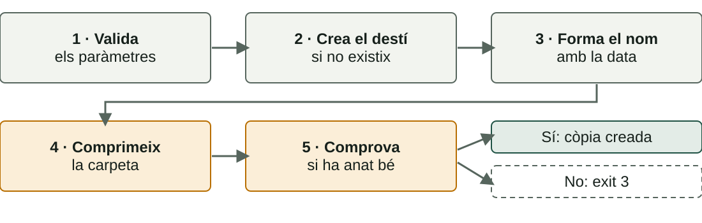
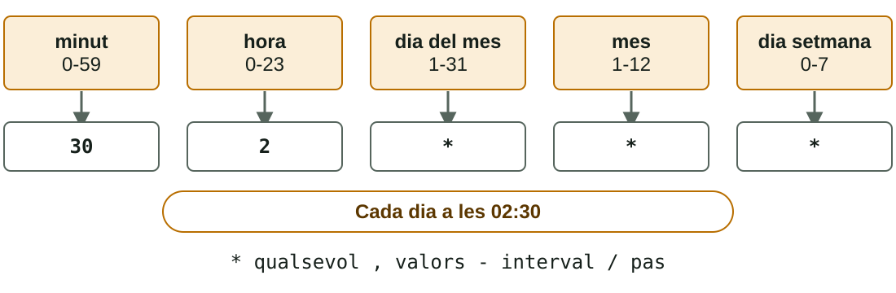

## Què aprendràs

:::pasos
- Un script de **còpia de seguretat amb data**
- Un script d'**alta massiva d'usuaris**
- Un script de **monitoratge del disc**
- Com **programar-los** amb `cron` i el Programador de tasques
:::

---

## Prova-ho tot en una màquina de proves

:::danger[Són accions reals]
Crear usuaris, programar tasques i esborrar còpies **modifiquen el sistema**. Fes-ho en una màquina virtual o en un equip de pràctiques, mai en el teu ordinador del dia a dia.
:::

---

## Script de còpia amb data

:::pasos
- Comprimix una carpeta en **un únic fitxer**
- Posa **la data en el nom**: cada dia, un fitxer diferent
- Les còpies anteriors **no se sobreescriuen**
:::

---

## Els passos de l'script de còpia



---

## backup.sh: els paràmetres

```bash
origen=$1
desti=$2
if [ $# -ne 2 ]; then
  echo "Ús: $0 <origen> <destí>" >&2
  exit 1
fi
```

---

## backup.sh: origen, destí i nom

```bash
if [ ! -d "$origen" ]; then
  echo "No existeix la carpeta $origen" >&2
  exit 2
fi
mkdir -p "$desti"
data=$(date +%Y-%m-%d)
arxiu="$desti/backup_$data.tar.gz"
```

---

## backup.sh: comprimir i comprovar

```bash
if tar -czf "$arxiu" "$origen"; then
  echo "Còpia creada: $arxiu"
else
  echo "La còpia ha fallat" >&2
  exit 3
fi
```

---

## Backup.ps1: validar els paràmetres

```powershell
param(
    [Parameter(Mandatory)][string]$Origen,
    [Parameter(Mandatory)][string]$Desti
)
if (-not (Test-Path $Origen -PathType Container)) {
    Write-Error "No existeix la carpeta $Origen"
    exit 2
}
```

---

## Backup.ps1: fer la còpia

```powershell
New-Item -ItemType Directory -Path $Desti -Force | Out-Null
$data = Get-Date -Format "yyyy-MM-dd"
$arxiu = Join-Path $Desti "backup_$data.zip"
Compress-Archive -Path $Origen -DestinationPath $arxiu -Force
if ($?) {
    Write-Host "Còpia creada: $arxiu"
} else {
    exit 3
}
```

---

## Un script fiable no menteix

:::pasos
- **Valida** els paràmetres: `exit 1` o `2` si falten o són incorrectes
- **Crea** el destí si no existix
- **Forma** el nom amb la data
- **Comprova** si la còpia ha anat bé abans de dir que ho ha fet
:::

---

## Coses que cal saber de la còpia

:::pasos
- `tar -czf`: **c**rea un arxiu comprimit amb gzip (**z**) en el fitxer (**f**)
- `Compress-Archive` (PowerShell 5.1): límits amb fitxers d'**uns 2 GB** o oberts per altres programes
- Per a còpies grans: **`robocopy`** o altres eines
- Comprova el resultat: `tar -tzf …` llista el contingut
:::

---

## Alta massiva d'usuaris

:::pasos
- Preparar una aula: **25 comptes**
- Un fitxer `usuaris.txt`, **un nom per línia**
- Un bucle ho resol en un segon
:::

---

## crear_usuaris.sh: privilegis i paràmetres

```bash
if [ "$(id -u)" -ne 0 ]; then
  echo "Cal executar-lo amb sudo" >&2
  exit 1
fi
if [ $# -ne 1 ] || [ ! -f "$1" ]; then
  echo "Ús: sudo $0 <fitxer_amb_noms>" >&2
  exit 2
fi
read -s -p "Contrasenya inicial: " clau
```

---

## crear_usuaris.sh: recórrer els noms

```bash
while read -r usuari; do
  [ -z "$usuari" ] && continue
  if id "$usuari" > /dev/null 2>&1; then
    echo "Ja existeix: $usuari"
  else
    # el compte es crea en la diapositiva següent
  fi
done < "$1"
```

---

## crear_usuaris.sh: crear el compte

```bash
useradd -m -s /bin/bash "$usuari"
echo "$usuari:$clau" | chpasswd
chage -d 0 "$usuari"
echo "Usuari creat: $usuari"
```

---

## CrearUsuaris.ps1: preparar

```powershell
#Requires -RunAsAdministrator
param([Parameter(Mandatory)][string]$Fitxer)
$clau = Read-Host "Contrasenya inicial" -AsSecureString
```

---

## CrearUsuaris.ps1: el bucle

```powershell
Get-Content $Fitxer | Where-Object { $_.Trim() -ne "" } |
  ForEach-Object {
    if (Get-LocalUser -Name $_ -ErrorAction SilentlyContinue) {
      Write-Host "Ja existeix: $_"
    } else {
      New-LocalUser -Name $_ -Password $clau | Out-Null
      Write-Host "Usuari creat: $_"
    }
  }
```

---

## Alta massiva: privilegis

:::pasos
- `useradd` i `chpasswd` demanen **`sudo`**
- `New-LocalUser` exigix una consola **com a administrador**
- `#Requires -RunAsAdministrator` fa que PowerShell ho comprove i pare
:::

---

## Alta massiva: contrasenyes

:::pasos
- **`New-LocalUser`** necessita contrasenya o `-NoPassword`; si no, **s'atura a esperar**
- Ací es demana **una sola vegada** amb `-AsSecureString`
- **`useradd -m`** crea el compte **sense contrasenya**
- `chpasswd` l'assigna i **`chage -d 0`** obliga a canviar-la
- **Mai** escrigues una contrasenya dins de l'script
:::

---

## Alta massiva: neteja de la prova

:::pasos
- Una política de contrasenyes dèbil pot fer fallar l'alta: tria una **més llarga i complexa**
- Linux: `sudo userdel -r nom`
- Windows: `Remove-LocalUser -Name nom`
- La carpeta de perfil de Windows s'esborra **a part**
:::

---

## Monitoratge del disc

:::pasos
- Calcula quin **percentatge** del disc està ple
- Avisa si passa d'un **llindar** (aquí, el 80 %)
- **Anota cada comprovació** en un fitxer de registre
- Les tasques programades **no tenen pantalla**
:::

---

## comprovar_disc.sh

```bash
llindar=${1:-80}
registre="$HOME/disc.log"
us=$(df -P / | tail -1 | awk '{print $5}' | tr -d '%')
data=$(date '+%Y-%m-%d %H:%M')
echo "$data · disc al $us%" >> "$registre"
if [ "$us" -gt "$llindar" ]; then
  echo "$data · AVÍS: el disc supera el $llindar%" \
    | tee -a "$registre"
fi
```

---

## ComprovarDisc.ps1: el càlcul

```powershell
param([int]$Llindar = 80)
$registre = Join-Path $env:USERPROFILE "disc.log"
$disc = Get-PSDrive C
$us = [math]::Round($disc.Used / ($disc.Used + $disc.Free) * 100)
$data = Get-Date -Format "yyyy-MM-dd HH:mm"
```

---

## ComprovarDisc.ps1: registrar i avisar

```powershell
Add-Content -Path $registre -Value "$data · disc al $us%"
if ($us -gt $Llindar) {
    Write-Host "AVÍS: el disc supera el $Llindar%"
    Add-Content $registre "$data · AVÍS: el disc supera el $Llindar%"
}
```

---

## Com s'obté el percentatge en Bash

:::pasos
1. **`df -P /`**: l'ús de l'arrel (`-P` evita que una línia es parteixca)
2. **`tail -1`**: l'última línia
3. **`awk '{print $5}'`**: la cinquena columna, per exemple `42%`
4. **`tr -d '%'`**: lleva el símbol
:::

`${1:-80}`: el primer paràmetre, o **80** si no hi ha cap.

---

## Accents en els scripts de PowerShell

:::caution[AVÍS pot eixir amb caràcters estranys]
Windows PowerShell 5.1 llig com a ANSI un `.ps1` en UTF-8 **sense BOM**. Desa'l com a **«UTF-8 amb BOM»** o evita els accents en els missatges.
:::

---

## Prova-ho: traça comprovar_disc

::laboratorio[Traçador]{src="tracador-de-scripts" pestana="tracador"}

---

## cron: el planificador de Linux

:::pasos
- Un servei que **cada minut** mira les tasques programades
- Cada usuari té el seu **crontab**: `crontab -e`
- Cada línia: **cinc camps de temps** i l'ordre
:::

---

## Els cinc camps d'una línia de crontab



---

## Exemples de crontab

| Línia | Quan s'executa |
|---|---|
| `30 2 * * *` | Cada dia a les 02:30 |
| `0 * * * *` | Cada hora en punt |
| `*/5 * * * *` | Cada 5 minuts |

---

## Més exemples de crontab

| Línia | Quan s'executa |
|---|---|
| `0 9 * * 1` | Cada dilluns a les 9:00 |
| `0 8 * * 1-5` | De dilluns a divendres a les 8:00 |
| `0 0 1 * *` | El dia 1 de cada mes, a mitjanit |

---

## Els símbols del crontab

:::pasos
- **`*`**: qualsevol valor
- **`,`**: separa valors (`1,15`)
- **`-`**: un interval (`1-5`)
- **`/`**: un pas (`*/5`)
:::

---

## La línia de la pràctica de classe

:::pasos
- **`*/5 * * * *`**: cada 5 minuts
- **`/home/usuari/comprovar_disc.sh`**: l'script, amb **ruta absoluta**
- **`>> /home/usuari/cron.log 2>&1`**: l'eixida i els errors, **al registre**
:::

---

## Ordres útils de cron

```bash
crontab -e                       # editar les teues tasques
crontab -l                       # llistar-les
systemctl status cron            # el servei està actiu?
cat ~/disc.log                   # el registre del nostre script
grep CRON /var/log/syslog | tail # el que ha llançat cron
```

---

## Errors típics amb cron

:::pasos
- **Rutes absolutes**: cron té un entorn mínim; l'script, amb permís d'execució
- **El `%`** s'ha d'escriure `\%`: posa el `date` dins de l'script
- **Eixida perduda**: redirigix amb `>> fitxer 2>&1`
- **`crontab -r`** esborra tot el crontab **sense preguntar**
:::

---

## Una execució única: at

:::pasos
- `at` programa una tasca **una sola vegada**
- Cal el paquet `at`
- `atq` llista les pendents
:::

---

## El Programador de tasques de Windows

:::pasos
- Es fa servir amb `taskschd.msc`: una interfície gràfica
- **Desencadenador** (*trigger*): **quan** s'executa
- **Acció**: **què** s'executa
:::

---

## L'acció d'una tasca en la interfície

:::pasos
- **Programa o script**: `powershell.exe`
- **Afig arguments**: `-NoProfile -ExecutionPolicy Bypass -File "C:\Scripts\ComprovarDisc.ps1"`
- Desencadenador: «Repeteix la tasca cada: **5 minuts**»
:::

---

## schtasks: la línia d'ordres

```text
schtasks /create /tn "ComprovarDisc" /sc minute /mo 5 /tr "…"
schtasks /query /tn "ComprovarDisc" /v /fo list
schtasks /run /tn "ComprovarDisc"
schtasks /delete /tn "ComprovarDisc" /f
```

:::pasos
- `/tr "…"`: `powershell.exe -NoProfile -ExecutionPolicy Bypass -File C:\Scripts\ComprovarDisc.ps1`
- Cada dia a les 2:30: `/sc daily /st 02:30`
:::

---

## No programes el .ps1 directament

:::caution[Windows l'obri com un document]
`/tr "C:\Scripts\Backup.ps1"` **no executa l'script**. L'acció ha de ser **`powershell.exe` amb `-File`**, i `-ExecutionPolicy Bypass` només per a esta tasca.
:::

---

## Condicions de la tasca

:::pasos
- Amb el teu usuari, només s'executa **mentre tens la sessió iniciada**
- En un portàtil, per defecte, **no s'executa amb bateria**
- Per a tasques de sistema: `/ru SYSTEM` (consola d'administrador)
:::

---

## Dos mons, la mateixa idea

| | Linux | Windows |
|---|---|---|
| **Planificador** | `cron` | Programador de tasques |
| **On es defineix** | `crontab -e` | Interfície o `schtasks` |
| **«Quan»** | Els 5 camps | Desencadenador |
| **«Què»** | L'ordre de la línia | Acció |

---

## Dos mons: exemples i resultats

| | Linux | Windows |
|---|---|---|
| **Cada 5 minuts** | `*/5 * * * *` | `/sc minute /mo 5` |
| **Cada dia a les 2:30** | `30 2 * * *` | `/sc daily /st 02:30` |
| **On mirar el resultat** | El teu registre | El registre i l'*Historial* |
| **Una vegada** | `at` | `/sc once` |

---

## Què faràs a la presencial

:::pasos
1. Escriure i provar l'script de **còpia de seguretat**
2. Escriure i provar l'**alta massiva** de 5 usuaris
3. Escriure i provar la **comprovació del disc**
4. **Programar-la** cada 5 minuts i verificar-la en el registre
5. **Documentar** amb captures i una reflexió breu
:::

---

## Resum

- **Còpia**: data en el nom i comprovar el resultat abans de dir que ha anat bé
- **Alta massiva**: privilegis, contrasenya inicial **una sola vegada** i mai dins de l'script
- **Disc**: llindar, **registre** i `df`
- **cron**: cinc camps, **rutes absolutes** · **schtasks**: `powershell.exe -File`

[Activitats de la unitat →](/docencia/dam/sistemas-informaticos/ud03-automatizacion-scripting/actividades/)
