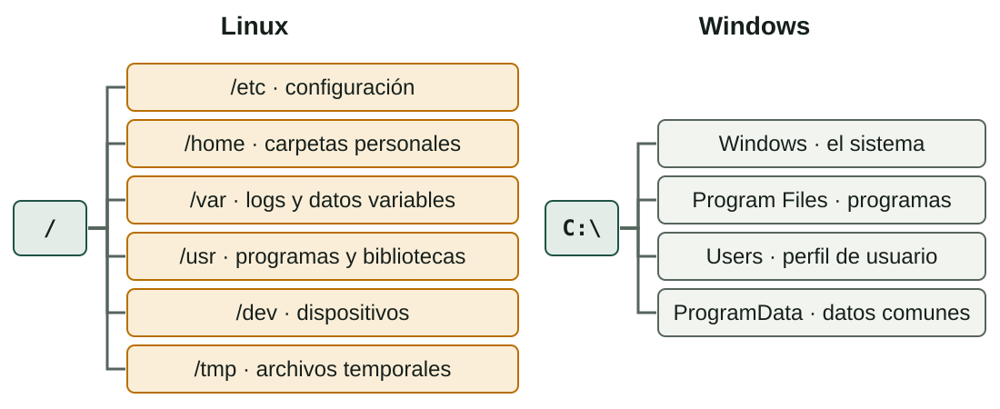
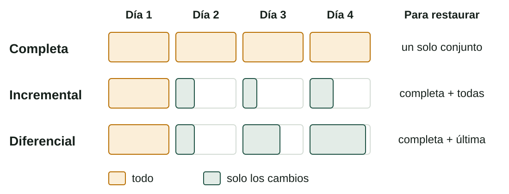

## Qué aprenderás

:::pasos
- Cómo se organizan las **carpetas** de Linux y de Windows
- Cómo **localizar** información con herramientas gráficas y con órdenes
- Qué **estrategias de copia** hay y cómo **restaurarlas**
- Utilidades del día a día: **compresores**, `df`, `du`, `rsync` y `robocopy`
:::

---

## Linux: un único árbol

:::pasos
- No hay unidades como `C:`: todo cuelga de la **raíz** (`/`)
- La ***Filesystem Hierarchy Standard*** (FHS) fija qué va en cada carpeta
- Por eso todas las distribuciones se parecen
:::

---

## Dos árboles de carpetas



---

## Directorios de Linux (1)

| Directorio | Qué contiene |
|---|---|
| `/` | La raíz de todo el árbol |
| `/bin`, `/sbin` | Órdenes básicas y de administración |
| `/boot` | El núcleo y los archivos del arranque (GRUB) |
| `/dev` | Los dispositivos como archivos: `/dev/sda`, `/dev/null` |

---

## Directorios de Linux (2)

| Directorio | Qué contiene |
|---|---|
| `/etc` | **Configuración** del sistema y de los servicios, en texto |
| `/home` | Las carpetas personales de los usuarios |
| `/root` | La carpeta personal del administrador |
| `/lib`, `/lib64` | Bibliotecas que necesitan los programas |

---

## Directorios de Linux (3)

| Directorio | Qué contiene |
|---|---|
| `/media`, `/mnt` | Dónde se montan soportes: automático o a mano |
| `/opt` | Software adicional de terceros |
| `/proc`, `/sys` | Sistemas de archivos **virtuales**: núcleo y procesos en directo |
| `/run` | Datos de la ejecución actual |

---

## Directorios de Linux (4)

| Directorio | Qué contiene |
|---|---|
| `/srv` | Datos que sirven los servicios (web, FTP…) |
| `/tmp` | Archivos temporales |
| `/usr` | La mayoría de los programas; `/usr/local` para el administrador |
| `/var` | Datos que **varían**: logs, colas, bases de datos, webs |

---

## Rutas absolutas y relativas

:::pasos
- **Absoluta**: empieza por `/` y vale desde cualquier sitio: `/etc/passwd`
- **Relativa**: cuenta desde donde estás: `documents/nota.txt`
- `.` carpeta actual · `..` la padre · `~` tu carpeta personal
- **Linux distingue mayúsculas**: `Nota.txt` y `nota.txt` son distintos
:::

---

## Windows: unidades

:::pasos
- Disco en **unidades** (`C:`, `D:`…), cada una con su árbol
- Carpetas separadas con **`\`**
- **No** distingue mayúsculas
:::

---

## Carpetas de Windows (1)

| Carpeta | Qué contiene |
|---|---|
| `C:\Windows` | El sistema operativo; `System32`: ejecutables y bibliotecas |
| `C:\Program Files` | Programas de 64 bits |
| `C:\Program Files (x86)` | Programas de 32 bits |
| `C:\Users\<usuario>` | El **perfil** de cada usuario |

---

## Carpetas de Windows (2)

| Carpeta | Qué contiene |
|---|---|
| `C:\Users\<usuario>\AppData` | Configuración y datos de los programas de cada usuario (oculta) |
| `C:\ProgramData` | Datos de programas comunes a todos los usuarios (oculta) |
| `C:\Users\Public` | Carpetas compartidas entre los usuarios |

---

## Variables de entorno de Windows

:::pasos
- Evitan escribir **rutas fijas**
- `%USERPROFILE%` (CMD) o `$env:USERPROFILE` (PowerShell): `C:\Users\<usuario>`
- También: `%APPDATA%`, `%TEMP%`, `%SystemRoot%`, `%ProgramFiles%`
:::

---

## Moverse por el árbol (1)

| Tarea | Bash | PowerShell |
|---|---|---|
| **Dónde estoy** | `pwd` | `Get-Location` |
| **Cambiar de carpeta** | `cd /etc` | `Set-Location C:\Windows` |
| **Listar** | `ls -l` | `Get-ChildItem` |

---

## Moverse por el árbol (2)

| Tarea | Bash | PowerShell |
|---|---|---|
| **Crear carpeta** | `mkdir proves` | `New-Item -ItemType Directory proves` |
| **Copiar, mover, borrar** | `cp`, `mv`, `rm` | `Copy-Item`, `Move-Item`, `Remove-Item` |
| **Ver el árbol** | `tree` | `tree` |

---

## Localizar información: herramientas gráficas

:::pasos
- **Windows**: el cuadro de búsqueda del Explorador y la búsqueda de Windows
- **Linux**: la lupa o **Ctrl + F** dentro de una carpeta
- Filtran por **tipo, fecha y tamaño**; en Windows usan un **índice**
- Son cómodas, pero no se pueden **automatizar**
:::

---

## find: recorrer el árbol en directo

```bash
find /var/log -name "*.log"          # por nombre
find ~ -type f -iname "*.pdf"        # sin distinguir mayúsculas
find /home -type f -size +100M       # de más de 100 MB
find ~/documents -type f -mtime -7   # de los últimos 7 días
```

---

## locate, which y grep

:::pasos
- **`locate`**: consulta una **base de datos** de índices; se refresca con `sudo updatedb`
- Instantáneo, pero puede estar **desfasado** (`sudo apt install plocate`)
- **`which ls`** y **`whereis`**: dónde está el ejecutable
- **`grep -r "paraula" /etc 2>/dev/null`**: buscar **dentro** de los archivos
:::

---

## Buscar en PowerShell

```powershell
Get-ChildItem C:\Users -Recurse -Filter *.pdf
Get-ChildItem C:\Dades -Recurse -File |
  Where-Object { $_.Length -gt 100MB }
Get-Command notepad
```

:::pasos
- `-ErrorAction SilentlyContinue` oculta los errores de permiso
- En CMD clásico: `dir /s /b *.pdf`
:::

---

## Buscar por fecha y dentro de los archivos

```powershell
Get-ChildItem C:\Dades -Recurse -File |
  Where-Object { $_.LastWriteTime -gt (Get-Date).AddDays(-7) }
Get-ChildItem C:\Dades -Recurse -File | Select-String "paraula"
```

---

## Cuidado con -delete

:::caution[Sin papelera]
`find … -delete` y `Remove-Item` **no tienen papelera**. Ejecuta primero la búsqueda **sola**, mira la lista y solo entonces añade el borrado.
:::

---

## Tres estrategias de copia



---

## Qué copia cada tipo

| Tipo | Qué copia | Restaurar |
|---|---|---|
| **Completa** | Todo, cada vez | Rápido: un solo conjunto |
| **Incremental** | Los cambios desde la **última copia** | Lento: la completa y todas las incrementales |
| **Diferencial** | Los cambios desde la última **completa** | Medio: la completa y la última diferencial |

---

## La regla 3-2-1

:::pasos
- **3** copias de los datos
- En **2** soportes distintos
- **1** fuera del equipo o del edificio
:::

Las estrategias se trabajarán con más detalle en la unidad de seguridad.

---

## Restaurar es lo que importa

```bash
tar -tzf backup.tar.gz | head
mkdir -p /tmp/restauracio
tar -xzf backup.tar.gz -C /tmp/restauracio
```

:::pasos
- **`-t`**: listar · **`-x`**: extraer · **`-C`**: carpeta de destino
- Restaura **primero en una carpeta de prueba**
:::

---

## Un solo archivo y comparar con el original

```bash
tar -xzf backup.tar.gz -C /tmp/rest home/ana/documents/nota.txt
diff -r /home/ana/documents /tmp/rest/home/ana/documents
```

:::pasos
- Dentro del archivo, las rutas **han perdido la barra inicial**
- Si restauras **encima del original**, sobrescribes lo que tienes
:::

---

## Saber si la copia se ha dañado

```bash
sha256sum backup.tar.gz > sumes.sha256
sha256sum -c sumes.sha256
```

```powershell
Get-FileHash D:\Backups\backup.zip -Algorithm SHA256
```

:::pasos
- Calcula la **suma de verificación** (*hash*) al crearla
- Vuelve a calcularla cuando quieras usarla: **OK** o **FAILED**
:::

---

## Restaurar en Windows

```powershell
Expand-Archive D:\Backups\backup.zip C:\Restauracio
```

:::pasos
- **`-Force`** sobrescribe los archivos que ya existen en el destino
- Windows tiene herramientas propias (Historial de archivos…); en Linux, **Déjà Dup**
- Son el equivalente gráfico del script
:::

---

## Una copia que no se ha probado no es una copia

:::note[La prueba de verdad]
**Restaura** en una carpeta de prueba y comprueba que todo está y que los archivos se pueden abrir. Planifícalo como una tarea más, por ejemplo **una vez al mes**.
:::

---

## Empaquetar y comprimir

:::pasos
- **Empaquetar** (`tar`): reunir muchos archivos en uno
- **Comprimir** (`gzip`, `xz`): hacerlo más pequeño
- Son dos pasos distintos: por eso el **`.tar.gz`**
:::

---

## Compresores

| Herramienta | Extensión | Características |
|---|---|---|
| **gzip** | `.gz` | Rápido; el más extendido en Linux |
| **bzip2** | `.bz2` | Comprime más, más lento |
| **xz** | `.xz` | La mejor compresión, la más lenta |
| **zip** | `.zip` | Universal: se abre en todos los sistemas |
| **7-Zip** | `.7z` | Alta compresión, software libre |

---

## Compresores: órdenes

```bash
tar -czf carpeta.tar.gz carpeta   # empaqueta + gzip
tar -cJf carpeta.tar.xz carpeta   # empaqueta + xz
zip -r carpeta.zip carpeta        # zip
gzip -k fitxer                    # conserva el original
```

---

## Medir el espacio: df y du

```bash
df -h               # espacio de cada partición
df -hT /            # con el tipo de sistema de archivos
du -sh ~/documents  # tamaño total de una carpeta
du -h --max-depth=1 /var | sort -h
```

:::pasos
- **`df`**: la **partición** entera · **`du`**: una **carpeta**
- No tienen por qué coincidir exactamente
- **`ncdu`** lo muestra de forma interactiva
:::

---

## Medir el espacio en PowerShell

```powershell
Get-PSDrive -PSProvider FileSystem
Get-Volume
(Get-ChildItem C:\Dades -Recurse -File |
  Measure-Object Length -Sum).Sum / 1MB
```

---

## Copiar bien: rsync

```bash
rsync -av --dry-run /home/ana/documents/ /backups/documents/
rsync -av /home/ana/documents/ /backups/documents/
rsync -av --delete /home/ana/documents/ /backups/documents/
```

:::pasos
- **`--dry-run`**: simula, no copia
- **`--delete`**: borra del destino lo que ya no existe en el origen
- `-a` conserva permisos y fechas; `-v` explica qué hace
:::

---

## rsync: la barra final importa

:::pasos
- `documents/` copia el **contenido**
- `documents` (sin barra) copia la **carpeta** dentro del destino
- Por SSH a otro equipo: `rsync -av -e ssh /dades/ usuari@servidor:/backups/dades/`
:::

---

## Copiar bien: robocopy

```text
robocopy C:\Dades D:\Backups\Dades /E /R:1 /W:1
```

:::pasos
- **`/E`** incluye subcarpetas (también vacías)
- **`/R:1 /W:1`** limita los reintentos
- No uses **`/MIR`** sin pensar: **borra** del destino lo que no haya en el origen
:::

---

## Los códigos de salida de robocopy son especiales

:::caution[Del 0 al 7 es éxito]
Solo **8 o más** indica errores. Un script que mire `$LASTEXITCODE -eq 0` consideraría fallida una copia perfectamente buena.
:::

---

## Clonezilla

:::pasos
- Se arranca desde un **USB**
- **Clona un disco o una partición** a una imagen
- Útil para **replicar un aula**
- No se programa con scripts
:::

---

## Instalar y evaluar una utilidad

:::pasos
- **Funcionalidad**: ¿hace lo que necesitas?
- **Rendimiento**: ¿cuánto tarda y cuánto espacio ahorra?
- **Fiabilidad**: ¿puedes restaurar lo que has copiado?
- **Compatibilidad y licencia**
- **Mantenimiento y documentación**
:::

---

## Instalar utilidades

```bash
sudo apt install rsync ncdu
```

```powershell
winget install 7zip.7zip
```

:::pasos
- Mide el tiempo: `time orden` o `Measure-Command { … }`
- Y el **tamaño** del archivo resultante
:::

---

## Resumen

- **Linux**: un árbol desde `/`; **Windows**: unidades y `C:\Users`
- **Búsqueda**: `find`, `locate`, `Get-ChildItem`; **sin papelera** al borrar
- **Copia**: completa, incremental, diferencial; **3-2-1**
- **Restaurar** en una carpeta de prueba y verificar con **hash**
- **Utilidades**: `tar`, `df`, `du`, `rsync`, `robocopy`

[Actividades de la unidad →](/docencia/dam/sistemas-informaticos/ud03-automatizacion-scripting/actividades/es/)
