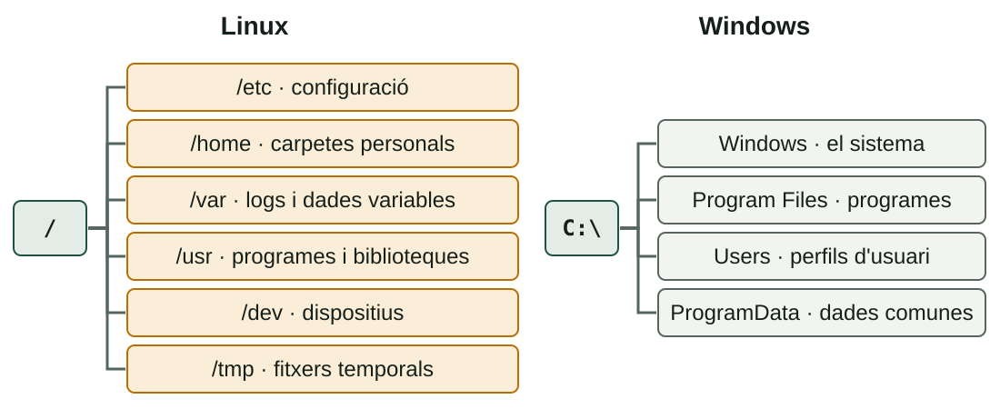
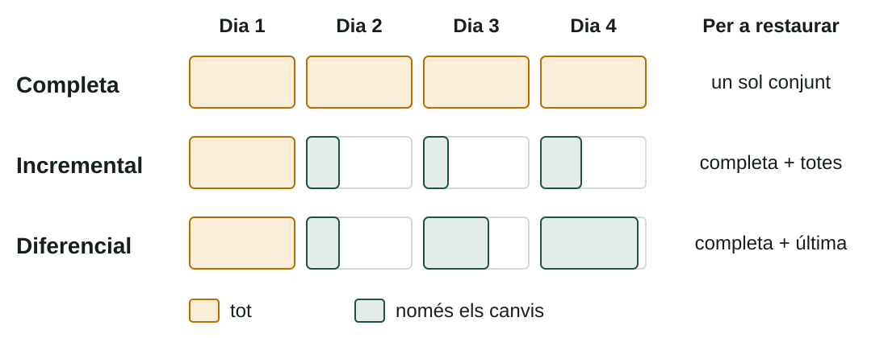

## Què aprendràs

:::pasos
- Com s'organitzen les **carpetes** de Linux i de Windows
- Com **localitzar** informació amb eines gràfiques i amb ordres
- Quines **estratègies de còpia** hi ha i com **restaurar-les**
- Utilitats del dia a dia: **compressors**, `df`, `du`, `rsync` i `robocopy`
:::

---

## Linux: un únic arbre

:::pasos
- No hi ha unitats com `C:`: tot penja de l'**arrel** (`/`)
- La ***Filesystem Hierarchy Standard*** (FHS) fixa què va a cada carpeta
- Per això totes les distribucions s'assemblen
:::

---

## Dos arbres de carpetes



---

## Directoris de Linux (1)

| Directori | Què conté |
|---|---|
| `/` | L'arrel de tot l'arbre |
| `/bin`, `/sbin` | Ordres bàsiques i d'administració |
| `/boot` | El nucli i els fitxers de l'arrencada (GRUB) |
| `/dev` | Els dispositius com a fitxers: `/dev/sda`, `/dev/null` |

---

## Directoris de Linux (2)

| Directori | Què conté |
|---|---|
| `/etc` | **Configuració** del sistema i dels serveis, en text |
| `/home` | Les carpetes personals dels usuaris |
| `/root` | La carpeta personal de l'administrador |
| `/lib`, `/lib64` | Biblioteques que necessiten els programes |

---

## Directoris de Linux (3)

| Directori | Què conté |
|---|---|
| `/media`, `/mnt` | On es munten suports: automàtic o a mà |
| `/opt` | Programari addicional de tercers |
| `/proc`, `/sys` | Sistemes de fitxers **virtuals**: nucli i processos en directe |
| `/run` | Dades de l'execució actual |

---

## Directoris de Linux (4)

| Directori | Què conté |
|---|---|
| `/srv` | Dades que servixen els serveis (web, FTP…) |
| `/tmp` | Fitxers temporals |
| `/usr` | La majoria dels programes; `/usr/local` per a l'administrador |
| `/var` | Dades que **varien**: logs, cues, bases de dades, webs |

---

## Rutes absolutes i relatives

:::pasos
- **Absoluta**: comença per `/` i val des de qualsevol lloc: `/etc/passwd`
- **Relativa**: compta des d'on estàs: `documents/nota.txt`
- `.` carpeta actual · `..` la pare · `~` la teua carpeta personal
- **Linux distingix majúscules**: `Nota.txt` i `nota.txt` són diferents
:::

---

## Windows: unitats

:::pasos
- Disc en **unitats** (`C:`, `D:`…), cada una amb el seu arbre
- Carpetes separades amb **`\`**
- **No** distingix majúscules
:::

---

## Carpetes de Windows (1)

| Carpeta | Què conté |
|---|---|
| `C:\Windows` | El sistema operatiu; `System32`: executables i biblioteques |
| `C:\Program Files` | Programes de 64 bits |
| `C:\Program Files (x86)` | Programes de 32 bits |
| `C:\Users\<usuari>` | El **perfil** de cada usuari |

---

## Carpetes de Windows (2)

| Carpeta | Què conté |
|---|---|
| `C:\Users\<usuari>\AppData` | Configuració i dades dels programes de cada usuari (oculta) |
| `C:\ProgramData` | Dades de programes comunes a tots els usuaris (oculta) |
| `C:\Users\Public` | Carpetes compartides entre els usuaris |

---

## Variables d'entorn de Windows

:::pasos
- Eviten escriure **rutes fixes**
- `%USERPROFILE%` (CMD) o `$env:USERPROFILE` (PowerShell): `C:\Users\<usuari>`
- També: `%APPDATA%`, `%TEMP%`, `%SystemRoot%`, `%ProgramFiles%`
:::

---

## Moure's per l'arbre (1)

| Tasca | Bash | PowerShell |
|---|---|---|
| **On sóc** | `pwd` | `Get-Location` |
| **Canviar de carpeta** | `cd /etc` | `Set-Location C:\Windows` |
| **Llistar** | `ls -l` | `Get-ChildItem` |

---

## Moure's per l'arbre (2)

| Tasca | Bash | PowerShell |
|---|---|---|
| **Crear carpeta** | `mkdir proves` | `New-Item -ItemType Directory proves` |
| **Copiar, moure, esborrar** | `cp`, `mv`, `rm` | `Copy-Item`, `Move-Item`, `Remove-Item` |
| **Veure l'arbre** | `tree` | `tree` |

---

## Localitzar informació: eines gràfiques

:::pasos
- **Windows**: el quadre de cerca de l'Explorador i la cerca de Windows
- **Linux**: la lupa o **Ctrl + F** dins d'una carpeta
- Filtren per **tipus, data i mida**; en Windows usen un **índex**
- Són còmodes, però no es poden **automatitzar**
:::

---

## find: recórrer l'arbre en directe

```bash
find /var/log -name "*.log"          # per nom
find ~ -type f -iname "*.pdf"        # sense distingir majúscules
find /home -type f -size +100M       # de més de 100 MB
find ~/documents -type f -mtime -7   # dels últims 7 dies
```

---

## locate, which i grep

:::pasos
- **`locate`**: consulta una **base de dades** d'índexs; es refresca amb `sudo updatedb`
- Instantani, però pot estar **desfasat** (`sudo apt install plocate`)
- **`which ls`** i **`whereis`**: on és l'executable
- **`grep -r "paraula" /etc 2>/dev/null`**: buscar **dins** dels fitxers
:::

---

## Cercar en PowerShell

```powershell
Get-ChildItem C:\Users -Recurse -Filter *.pdf
Get-ChildItem C:\Dades -Recurse -File |
  Where-Object { $_.Length -gt 100MB }
Get-Command notepad
```

:::pasos
- `-ErrorAction SilentlyContinue` amaga els errors de permís
- En CMD clàssic: `dir /s /b *.pdf`
:::

---

## Cercar per data i dins dels fitxers

```powershell
Get-ChildItem C:\Dades -Recurse -File |
  Where-Object { $_.LastWriteTime -gt (Get-Date).AddDays(-7) }
Get-ChildItem C:\Dades -Recurse -File | Select-String "paraula"
```

---

## Compte amb -delete

:::caution[Sense paperera]
`find … -delete` i `Remove-Item` **no tenen paperera**. Executa primer la cerca **sola**, mira la llista i només aleshores afig l'esborrat.
:::

---

## Tres estratègies de còpia



---

## Què copia cada tipus

| Tipus | Què copia | Restaurar |
|---|---|---|
| **Completa** | Tot, cada vegada | Ràpid: un sol conjunt |
| **Incremental** | Els canvis des de l'**última còpia** | Lent: la completa i totes les incrementals |
| **Diferencial** | Els canvis des de l'última **completa** | Mitjà: la completa i l'última diferencial |

---

## La regla 3-2-1

:::pasos
- **3** còpies de les dades
- En **2** suports diferents
- **1** fora de l'equip o de l'edifici
:::

Les estratègies es treballaran amb més detall en la unitat de seguretat.

---

## Restaurar és la part que importa

```bash
tar -tzf backup.tar.gz | head
mkdir -p /tmp/restauracio
tar -xzf backup.tar.gz -C /tmp/restauracio
```

:::pasos
- **`-t`**: llistar · **`-x`**: extraure · **`-C`**: carpeta de destí
- Restaura **primer en una carpeta de prova**
:::

---

## Un sol fitxer i comparar amb l'original

```bash
tar -xzf backup.tar.gz -C /tmp/rest home/ana/documents/nota.txt
diff -r /home/ana/documents /tmp/rest/home/ana/documents
```

:::pasos
- Dins de l'arxiu, les rutes **han perdut la barra inicial**
- Si restaures **damunt de l'original**, sobreescrius el que tens
:::

---

## Saber si la còpia s'ha malmés

```bash
sha256sum backup.tar.gz > sumes.sha256
sha256sum -c sumes.sha256
```

```powershell
Get-FileHash D:\Backups\backup.zip -Algorithm SHA256
```

:::pasos
- Calcula la **suma de verificació** (*hash*) en crear-la
- Torna a calcular-la quan vulgues usar-la: **OK** o **FAILED**
:::

---

## Restaurar en Windows

```powershell
Expand-Archive D:\Backups\backup.zip C:\Restauracio
```

:::pasos
- **`-Force`** sobreescriu els fitxers que ja existixen en el destí
- Windows té eines pròpies (Historial de fitxers…); en Linux, **Déjà Dup**
- Són l'equivalent gràfic de l'script
:::

---

## Una còpia que no s'ha provat no és una còpia

:::note[La prova de veritat]
**Restaura** en una carpeta de prova i comprova que tot hi és i que els fitxers es poden obrir. Planifica-ho com una tasca més, per exemple **un cop al mes**.
:::

---

## Empaquetar i comprimir

:::pasos
- **Empaquetar** (`tar`): reunir molts fitxers en un
- **Comprimir** (`gzip`, `xz`): fer-lo menys gran
- Són dos passos diferents: per això el **`.tar.gz`**
:::

---

## Compressors

| Eina | Extensió | Característiques |
|---|---|---|
| **gzip** | `.gz` | Ràpid; el més estés en Linux |
| **bzip2** | `.bz2` | Comprimix més, més lent |
| **xz** | `.xz` | La millor compressió, la més lenta |
| **zip** | `.zip` | Universal: s'obri en tots els sistemes |
| **7-Zip** | `.7z` | Alta compressió, programari lliure |

---

## Compressors: ordres

```bash
tar -czf carpeta.tar.gz carpeta   # empaqueta + gzip
tar -cJf carpeta.tar.xz carpeta   # empaqueta + xz
zip -r carpeta.zip carpeta        # zip
gzip -k fitxer                    # conserva l'original
```

---

## Mesurar l'espai: df i du

```bash
df -h               # espai de cada partició
df -hT /            # amb el tipus de sistema d'arxius
du -sh ~/documents  # mida total d'una carpeta
du -h --max-depth=1 /var | sort -h
```

:::pasos
- **`df`**: la **partició** sencera · **`du`**: una **carpeta**
- No han de coincidir exactament
- **`ncdu`** ho mostra de manera interactiva
:::

---

## Mesurar l'espai en PowerShell

```powershell
Get-PSDrive -PSProvider FileSystem
Get-Volume
(Get-ChildItem C:\Dades -Recurse -File |
  Measure-Object Length -Sum).Sum / 1MB
```

---

## Copiar bé: rsync

```bash
rsync -av --dry-run /home/ana/documents/ /backups/documents/
rsync -av /home/ana/documents/ /backups/documents/
rsync -av --delete /home/ana/documents/ /backups/documents/
```

:::pasos
- **`--dry-run`**: simula, no copia
- **`--delete`**: esborra del destí el que ja no existix en l'origen
- `-a` conserva permisos i dates; `-v` explica què fa
:::

---

## rsync: la barra final importa

:::pasos
- `documents/` copia el **contingut**
- `documents` (sense barra) copia la **carpeta** dins del destí
- Per SSH a un altre equip: `rsync -av -e ssh /dades/ usuari@servidor:/backups/dades/`
:::

---

## Copiar bé: robocopy

```text
robocopy C:\Dades D:\Backups\Dades /E /R:1 /W:1
```

:::pasos
- **`/E`** inclou subcarpetes (també buides)
- **`/R:1 /W:1`** limita els reintents
- No uses **`/MIR`** sense pensar: **esborra** del destí el que no hi haja en l'origen
:::

---

## Els codis d'eixida de robocopy són especials

:::caution[Del 0 al 7 és èxit]
Només **8 o més** indica errors. Un script que mire `$LASTEXITCODE -eq 0` consideraria fallida una còpia perfectament bona.
:::

---

## Clonezilla

:::pasos
- S'arranca des d'un **USB**
- **Clona un disc o una partició** a una imatge
- Útil per a **replicar una aula**
- No es programa amb scripts
:::

---

## Instal·lar i avaluar una utilitat

:::pasos
- **Funcionalitat**: fa el que necessites?
- **Rendiment**: quant tarda i quant espai estalvia?
- **Fiabilitat**: pots restaurar el que has copiat?
- **Compatibilitat i llicència**
- **Manteniment i documentació**
:::

---

## Instal·lar utilitats

```bash
sudo apt install rsync ncdu
```

```powershell
winget install 7zip.7zip
```

:::pasos
- Mesura el temps: `time ordre` o `Measure-Command { … }`
- I la **mida** del fitxer resultant
:::

---

## Resum

- **Linux**: un arbre des de `/`; **Windows**: unitats i `C:\Users`
- **Cerca**: `find`, `locate`, `Get-ChildItem`; **sense paperera** en esborrar
- **Còpia**: completa, incremental, diferencial; **3-2-1**
- **Restaurar** en una carpeta de prova i verificar amb **hash**
- **Utilitats**: `tar`, `df`, `du`, `rsync`, `robocopy`

[Activitats de la unitat →](/docencia/dam/sistemas-informaticos/ud03-automatizacion-scripting/actividades/)
