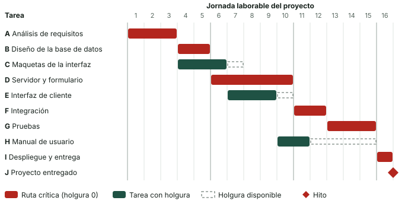

Una lista de tareas te dice **qué** hay que hacer; un diagrama de Gantt te dice **cuándo**, **en qué orden** y **qué puede retrasarte**. Es la herramienta de calendario más usada en la gestión de proyectos, y saber calcular la **ruta crítica** te permite responder a la pregunta que siempre llega: «si esta tarea se retrasa dos días, ¿llegamos a tiempo?».

:::tip[Cómo trabajar esta página]
**Tiempo orientativo:** 60 minutos de lectura y 60 de práctica con lápiz y papel.

1. Lee las secciones 1 a 3 y abre las pestañas «Tareas» y «Gantt» del [laboratorio](/docencia/smr/proyecto-intermodular/ud00-trabajo-en-proyectos/laboratorios/gantt-y-ciclos/#tareas).
2. Haz a mano la pasada hacia adelante y hacia atrás de la sección 4 y compárala con la pestaña «Ruta crítica».
3. Resuelve la [actividad 2](/docencia/smr/proyecto-intermodular/ud00-trabajo-en-proyectos/actividades-planificacion/).
:::

## 1. Qué es un diagrama de Gantt

Es un gráfico de barras horizontales donde:

- **cada fila es una tarea**;
- **el eje horizontal es el tiempo** (días, semanas…);
- **la posición y la longitud de cada barra** muestran cuándo empieza la tarea y cuánto dura.

Lleva el nombre de Henry Gantt, ingeniero que popularizó este tipo de gráficos a principios del siglo XX. Hoy lo generan casi todas las herramientas de gestión de proyectos, pero conviene saber construirlo y calcularlo a mano para entender qué hace la herramienta por ti.

## 2. Los elementos

| Elemento | Qué es | Cómo se dibuja |
|---|---|---|
| **Tarea** | Trabajo con principio y fin, que consume tiempo y recursos | Barra |
| **Duración** | Tiempo que lleva hacer la tarea (jornadas, no horas de reloj) | Longitud de la barra |
| **Dependencia** | Relación de orden entre dos tareas | Flecha o columna «predecesoras» |
| **Hito** | Momento clave sin duración (una aprobación, una entrega) | Rombo |
| **Tarea resumen** | Agrupa varias tareas (un paquete de la EDT) | Barra fina que abarca a sus hijas |
| **Holgura** | Tiempo que una tarea puede retrasarse sin retrasar el proyecto | Barra punteada tras la tarea |
| **Ruta crítica** | Cadena de tareas sin holgura que marca la duración del proyecto | Color destacado |

### Tipos de dependencia

Una **dependencia** indica que el orden de dos tareas no es libre. El tipo más habitual, y el que usaremos, es **fin-inicio**: «B no puede empezar hasta que A termine». Por ejemplo, las pruebas no pueden empezar hasta que la integración esté hecha.

Las herramientas profesionales admiten otras tres, menos frecuentes:

| Tipo | Significado | Ejemplo |
|---|---|---|
| **Fin-inicio** (FS) | B empieza cuando A termina | Probar después de integrar |
| **Inicio-inicio** (SS) | B empieza cuando A empieza | Redactar el manual mientras se desarrolla |
| **Fin-fin** (FF) | B termina cuando A termina | La documentación acaba al terminar las pruebas |
| **Inicio-fin** (SF) | B termina cuando A empieza | Muy raro; se usa en relevos de turnos |

Además, una dependencia puede llevar un **retardo** (esperar dos días tras terminar A) o un **adelanto** (empezar B un día antes de que termine A). Para empezar, trabaja solo con fin-inicio y sin retardos.

:::note[Dependencias de verdad, no de comodidad]
Una dependencia debe existir por una **razón real**: la salida de A es la entrada de B. Si pones dependencias solo porque «así nos acomoda», el calendario será más largo de lo necesario y la ruta crítica engañosa.
:::

## 3. El ejemplo: el portal de citas de Byte Alacant

**Reparaciones Byte Alacant, S. L.** (empresa ficticia) quiere un portal para que los clientes pidan cita de reparación. Los paquetes de trabajo de la EDT de la [página anterior](/docencia/smr/proyecto-intermodular/ud00-trabajo-en-proyectos/01-planificacion-y-organizacion/) se han convertido en estas tareas, con su duración en **jornadas laborables** y sus predecesoras:

| Id. | Tarea | Duración (días) | Predecesoras |
|---|---|---:|---|
| A | Análisis de requisitos | 3 | — |
| B | Diseño de la base de datos | 2 | A |
| C | Maquetas de la interfaz | 3 | A |
| D | Servidor y formulario de citas | 5 | B |
| E | Interfaz de cliente | 3 | C |
| F | Integración | 2 | D, E |
| G | Pruebas | 3 | F |
| H | Manual de usuario | 2 | E |
| I | Despliegue y entrega | 1 | G, H |
| J | **Proyecto entregado** (hito) | 0 | I |

Y este es el diagrama resultante, empezando el lunes 2 de noviembre de 2026:

Observa tres cosas:

- **B y C empiezan a la vez** porque ambas dependen solo de A: dos personas pueden trabajar en paralelo.
- **El manual (H) tiene mucha holgura:** puede hacerse en cualquier momento entre que acaba la interfaz y la entrega.
- **El proyecto dura 16 jornadas**, aunque la suma de todas las duraciones es 24. La diferencia es el trabajo que se hace en paralelo.

## 4. Calcular el calendario a mano

Para saber cuándo empieza y acaba cada tarea y cuál tiene holgura se hacen dos recorridos de la red, uno hacia adelante y otro hacia atrás. Los tiempos se cuentan desde **0** (el inicio del primer día), de modo que una tarea que empieza en 3 y dura 2 acaba en 5.

### Pasada hacia adelante: lo más pronto posible

Para cada tarea, de las primeras a las últimas:

- **ES** (*Early Start*, inicio más temprano) = el mayor **EF** de sus predecesoras. Si no tiene, vale 0.
- **EF** (*Early Finish*, fin más temprano) = **ES + duración**.

El **EF más alto de todo el proyecto** es su duración mínima. Con tareas que tienen varias predecesoras manda la que **termina más tarde**: F no puede empezar hasta que acaben D (EF = 10) y E (EF = 9), así que ES(F) = máx(10, 9) = 10.

### Pasada hacia atrás: lo más tarde permitido

Se parte de que el proyecto termina en su duración mínima y se retrocede, de las últimas tareas a las primeras:

- **LF** (*Late Finish*, fin más tardío) = el menor **LS** de sus sucesoras. Si no tiene sucesoras, vale la duración del proyecto.
- **LS** (*Late Start*, inicio más tardío) = **LF − duración**.

Aquí manda la sucesora que **necesita empezar antes**: E tiene dos sucesoras, F (LS = 10) y H (LS = 13), así que LF(E) = mín(10, 13) = 10.

### Holgura y ruta crítica

- **Holgura total** = LS − ES (o LF − EF). Es lo que puede retrasarse la tarea sin retrasar el proyecto.
- **Tarea crítica** = holgura total **0**.
- **Ruta crítica** = cadena de tareas críticas desde el inicio hasta el final. Su duración es la del proyecto.

Resultado para el portal de citas:

| Tarea | Dur. | ES | EF | LS | LF | Holgura | ¿Crítica? |
|---|---:|---:|---:|---:|---:|---:|---|
| A | 3 | 0 | 3 | 0 | 3 | 0 | Sí |
| B | 2 | 3 | 5 | 3 | 5 | 0 | Sí |
| C | 3 | 3 | 6 | 4 | 7 | 1 | No |
| D | 5 | 5 | 10 | 5 | 10 | 0 | Sí |
| E | 3 | 6 | 9 | 7 | 10 | 1 | No |
| F | 2 | 10 | 12 | 10 | 12 | 0 | Sí |
| G | 3 | 12 | 15 | 12 | 15 | 0 | Sí |
| H | 2 | 9 | 11 | 13 | 15 | 4 | No |
| I | 1 | 15 | 16 | 15 | 16 | 0 | Sí |
| J | 0 | 16 | 16 | 16 | 16 | 0 | Sí |

La **ruta crítica** es **A → B → D → F → G → I → J**: 3 + 2 + 5 + 2 + 3 + 1 = **16 jornadas**. Comprueba que coincide con el EF máximo.

### Qué te dice la ruta crítica

- **Cualquier retraso en una tarea crítica retrasa el proyecto** día por día. Si D tarda 7 en lugar de 5, el proyecto acaba en 18.
- **Una tarea con holgura aguanta un retraso** menor o igual que su holgura. Si H tarda 4 días más, no pasa nada; si tarda 5 más, el proyecto se alarga un día.
- **Acortar el proyecto exige acortar la ruta crítica.** Adelantar el manual (H) no sirve de nada: no está en la ruta.
- **La ruta crítica puede cambiar.** Si la maqueta (C) se retrasa 2 días, su holgura (1) se agota y pasa a ser crítica: la ruta nueva es A → C → E → F → G → I y el proyecto se alarga un día (17). Si dos rutas empatan, hay **dos rutas críticas**, y el proyecto es más frágil.

### Holgura libre

Existe otra holgura, la **libre**: el retraso que una tarea admite **sin retrasar a ninguna sucesora** (no solo al proyecto). Se calcula como el menor ES de sus sucesoras menos el EF de la tarea. En el ejemplo, C tiene holgura total 1 pero **libre 0**, porque E empieza justo al terminar C: si C se retrasa, E se retrasa (aunque el proyecto aún aguante ese día). H tiene libre 4: ninguna tarea depende de ella salvo I, que no empieza hasta el día 15.

## 5. De los días a las fechas

Las duraciones se miden en **jornadas laborables**. Para pasar a fechas se elige el día de inicio y se cuentan **solo los días laborables**, saltando sábados y domingos (y los festivos, que cada calendario define). Con inicio el lunes 2 de noviembre de 2026, la jornada 5 es el viernes 6 y la 6 es el lunes 9; la jornada 16 es el lunes 23.

Tareas de la ruta crítica del ejemplo: A el 2, 3 y 4 de noviembre; B el 5 y 6; D del 9 al 13; F el 16 y 17; G del 18 al 20; I el 23.

## 6. Cómo construir un Gantt, paso a paso

1. **Parte de la EDT:** cada paquete de trabajo es una tarea (o varias).
2. **Estima la duración** de cada tarea. Hazlo entre varias personas si es posible: se estima mejor en grupo. Añade un margen razonable, pero no inflies cada tarea «por si acaso».
3. **Define las dependencias**, preguntando para cada tarea: «¿qué necesito tener hecho antes de empezar esto?».
4. **Marca los hitos:** aprobaciones del cliente, entregas, el fin del proyecto.
5. **Calcula** ES, EF, LS, LF y holguras. Una herramienta lo hace sola, pero revisa el resultado.
6. **Asigna responsables** y comprueba que nadie tiene más trabajo en paralelo del que puede hacer.
7. **Guarda la línea base** (el plan inicial) y, durante la ejecución, compárala con lo real.

## 7. Errores típicos

| Error | Consecuencia | Cómo evitarlo |
|---|---|---|
| Tareas demasiado grandes («Desarrollo: 30 días») | Imposible de controlar; no sabes si vas bien hasta el final | Descomponer hasta tareas de pocos días |
| Olvidar tareas de pruebas, documentación o gestión | El calendario se queda corto | Revisar la EDT con la regla del 100 % |
| Dependencias que faltan | Tareas que se programan antes de tiempo | Preguntarse qué entradas necesita cada tarea |
| Dependencias que sobran | El proyecto parece más largo y la ruta crítica sale mal | Quitar las que sean solo de comodidad |
| Estimar sin tener en cuenta las vacaciones y festivos | Todo se desplaza | Marcar los días no laborables en el calendario |
| Suponer que una persona puede dedicar todas sus horas al proyecto | Retrasos en cadena | Considerar clases, otros proyectos y baja productividad real |
| No actualizar el Gantt | Se consulta un plan que ya no existe | Revisarlo cada semana y comparar con la línea base |
| Creer que el Gantt es el plan | El diagrama no recoge calidad, riesgos ni coste | Usarlo junto a los demás documentos |

:::caution[El Gantt es una previsión, no una promesa]
Los cálculos son exactos, pero las **duraciones son estimaciones**. Un Gantt bien hecho no garantiza que el proyecto salga en 16 días; te dice qué tareas vigilar y cuánto margen tienes. Por eso se actualiza con lo que realmente ocurre.
:::

## Comprueba lo aprendido

1. Una tarea tiene ES = 6, duración 4 y LF = 14. ¿Cuál es su holgura?

   

   
Respuesta

   EF = 6 + 4 = 10 y la holgura es LF − EF = 14 − 10 = **4 días**. (También: LS = 14 − 4 = 10 y LS − ES = 4.)
   

2. La tarea X depende de P (acaba en el día 8) y de Q (acaba en el día 11). ¿Cuándo es su ES?

   

   
Respuesta

   En el día **11**: manda la predecesora que termina más tarde. P podría retrasarse 3 días sin afectar a X (su holgura libre).
   

3. En el ejemplo del portal, el manual (H) se retrasa 6 días. ¿Cuánto se retrasa el proyecto?

   

   
Respuesta

   H tiene 4 días de holgura, así que 6 − 4 = **2 días** de retraso: el proyecto pasa de 16 a 18 jornadas, y H se convierte en parte de la ruta crítica.
   

4. ¿Por qué acortar una tarea que no está en la ruta crítica no reduce la duración del proyecto?

   

   
Respuesta

   Porque la duración del proyecto la marca la cadena de tareas sin holgura. Una tarea con holgura ya tiene tiempo de sobra; hacerla más corta solo aumenta su holgura.
   

5. ¿Qué diferencia hay entre una tarea y un hito?

   

   
Respuesta

   La tarea consume tiempo y recursos (tiene duración); el hito marca un momento (duración 0), como una aprobación del cliente o la entrega.
   

## Glosario

| Término | Definición |
|---|---|
| **Diagrama de Gantt** | Gráfico de barras que muestra tareas y fechas en un eje temporal |
| **Dependencia fin-inicio** | La sucesora no puede empezar hasta que la predecesora termina |
| **Predecesora / sucesora** | Tarea que debe ir antes / después de otra |
| **Hito** | Punto clave del proyecto sin duración |
| **ES / EF** | Inicio y fin más tempranos de una tarea |
| **LS / LF** | Inicio y fin más tardíos que no retrasan el proyecto |
| **Holgura total** | Retraso máximo de una tarea sin retrasar el fin del proyecto |
| **Holgura libre** | Retraso máximo de una tarea sin retrasar a ninguna sucesora |
| **Ruta crítica** | Cadena de tareas con holgura cero que fija la duración mínima del proyecto |
| **Línea base** | Plan aprobado al empezar, que sirve de referencia para medir desviaciones |
