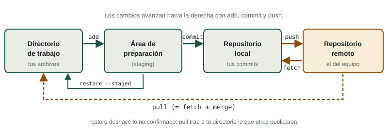

¿Has tenido alguna vez archivos como `memoria_final.docx`, `memoria_final_v2.docx` y `memoria_final_DEFINITIVA_ahora_si.docx`? Eso es un control de versiones casero, y falla en cuanto trabajan dos personas a la vez. **Git** es el sistema de control de versiones más usado en desarrollo de software: guarda la **historia** de un proyecto, permite volver atrás y deja que varias personas trabajen en paralelo sin pisarse. Tu proyecto intermodular puede incluir código, scripts de configuración, documentación en Markdown o la propia web: todo eso se gestiona mejor con Git.

:::tip[Practica mientras lees]
En el [Simulador de Git](/docencia/smr/proyecto-intermodular/ud00-trabajo-en-proyectos/laboratorios/simulador-git/#terminal) puedes escribir las órdenes de esta página y ver cómo cambia el historial, sin instalar nada. Las ramas de la siguiente página (2.2.2) también se practican allí.
:::

## 1. Qué es el control de versiones

Un sistema de control de versiones registra **cada cambio** del proyecto, con **quién** lo hizo, **cuándo** y **por qué**. Aporta:

- **Historia:** puedes ver cómo era el proyecto hace una semana y qué cambió.
- **Vuelta atrás:** si algo se rompe, recuperas la versión buena.
- **Trabajo en paralelo:** cada persona trabaja en su copia y después se combinan los cambios.
- **Responsabilidad y contexto:** cada cambio queda explicado en un mensaje.

Git es **distribuido**: cada persona tiene en su ordenador una copia completa del repositorio con toda la historia. Lo habitual es, además, tener un **repositorio remoto** compartido (en un servidor del centro o en una plataforma de alojamiento) donde el equipo sube y descarga el trabajo.

## 2. Las zonas de Git



| Zona | Qué contiene | Se mueve con |
|---|---|---|
| **Directorio de trabajo** | Los archivos tal como los ves y editas | Tu editor |
| **Área de preparación** (*staging area* o *index*) | La foto de lo que irá en el próximo commit | `git add` |
| **Repositorio local** | La historia: todos tus commits | `git commit` |
| **Repositorio remoto** | La copia compartida del equipo | `git push`, `git fetch`, `git pull` |

El área de preparación parece un paso de más, pero es muy útil: puedes cambiar diez archivos y confirmar **solo los tres** que forman un cambio lógico.

Un **commit** es una instantánea del proyecto con un identificador (una cadena de caracteres hexadecimales, de la que normalmente se ven los 7 primeros), un autor, una fecha, un mensaje y un enlace al commit anterior.

## 3. Primera configuración

Antes del primer commit, Git necesita saber quién eres. Se hace una sola vez por ordenador:

```bash
git config --global user.name "Tu Nombre"
git config --global user.email "tu.correo@ejemplo.test"
```

:::caution[En los ordenadores del centro]
Si usas un ordenador compartido, configura el nombre solo para el repositorio (quita `--global` dentro de la carpeta del proyecto) y no dejes sesiones ni credenciales guardadas al terminar.
:::

## 4. Crear o clonar un repositorio

Tienes dos formas de empezar:

```bash
# A) Convertir una carpeta existente en repositorio
cd portal-incidencias
git init -b main

# B) Copiar un repositorio que ya existe en un servidor
git clone git@servidor.ejemplo.test:byte-alacant/portal-incidencias.git
```

`git init` crea una carpeta oculta `.git` donde vive toda la historia. `git clone` descarga el repositorio completo y lo deja enlazado con el remoto, que por convención se llama `origin`. La dirección puede empezar por `git@` (SSH) o por `https://`, según cómo te dé acceso tu plataforma.

:::note[¿main o master?]
Según la versión de Git y la configuración, la rama inicial puede llamarse `master` o `main`. Las plataformas actuales suelen usar `main`. Con `git init -b main` (en versiones recientes de Git) o con `git branch -m main` eliges el nombre. En estos apuntes y en el simulador es `main`.
:::

## 5. El ciclo básico de trabajo

El ritmo de trabajo con Git se repite una y otra vez:

```text
editar archivos → git status → git add → git commit → (de vez en cuando) git push
```

### 5.1 `git status`: dónde estoy

```bash
git status
```

Es la orden que más usarás. Te dice en qué rama estás, qué archivos has modificado, cuáles están preparados para el commit y cuáles son nuevos y Git aún no sigue (*untracked*). Ante la duda, `git status`.

### 5.2 `git add`: preparar cambios

```bash
git add index.html          # un archivo concreto
git add src/ docs/          # una carpeta entera
git add .                   # todo lo que haya cambiado en la carpeta actual
```

`git add .` es cómodo, pero revisa antes con `git status` qué vas a incluir. Así evitas subir archivos que no querías.

### 5.3 `git commit`: guardar la instantánea

```bash
git commit -m "Añade el formulario de alta de avería"
```

La opción `-m` es el mensaje. Sin ella, Git abre un editor de texto para escribirlo. Si quieres confirmar todos los archivos **ya seguidos** que has modificado sin pasar por `git add`, existe `git commit -am "mensaje"` (no incluye archivos nuevos).

### 5.4 `git log`: ver la historia

```bash
git log                     # historia completa
git log --oneline           # una línea por commit
git log --oneline --graph --all   # con forma de árbol y todas las ramas
```

Salida típica de `--oneline`:

```text
3f9a1c2 Añade validación del teléfono
b71e04d Añade el formulario de alta de avería
a0c55e8 Crea la estructura inicial del portal
```

### 5.5 `git diff`: qué ha cambiado exactamente

```bash
git diff                    # cambios sin preparar (directorio de trabajo vs. área de preparación)
git diff --staged           # cambios preparados (listos para el commit)
```

Las líneas que empiezan por `-` se han quitado y las que empiezan por `+` se han añadido. Mira siempre `git diff --staged` justo antes de confirmar.

### 5.6 `git push` y `git pull`: compartir con el equipo

```bash
git remote add origin git@servidor.ejemplo.test:byte-alacant/portal-incidencias.git   # solo si no lo clonaste
git push -u origin main     # la primera vez: sube main y recuerda el destino
git push                    # después, basta con esto
git pull                    # trae y combina lo que otros han subido
```

`git pull` equivale, en su comportamiento por defecto, a `git fetch` (descargar lo nuevo del remoto) seguido de combinarlo con tu rama. Si prefieres mirar antes de combinar, haz `git fetch` y compara.

Regla de equipo: **antes de empezar a trabajar, `git pull`; cuando termines un trozo, `git push`**. Si el remoto tiene commits que tú no tienes, Git rechazará tu `push` hasta que hagas `git pull`.

## 6. Mensajes de commit útiles

El mensaje es para tu «yo» del futuro y para tu equipo. Compara:

| Mal | Bien |
|---|---|
| `cambios` | `Corrige el cálculo del IVA en el presupuesto` |
| `arreglos varios` | `Valida el formato del teléfono en el alta` |
| `wip` | `Añade la tabla de clientes a la base de datos` |
| `asdf` | `Documenta la instalación del servidor de pruebas` |

Convenciones recomendadas (propuesta):

1. **Primera línea breve** (unos 50-72 caracteres), que complete la frase «este commit… ».
2. **En imperativo o en presente** y de forma coherente: «Añade», «Corrige», «Elimina».
3. **Sin punto final** en la primera línea.
4. Si hace falta explicar el porqué, deja **una línea en blanco** y escribe un párrafo debajo.
5. **Un commit, un cambio lógico.** Si el mensaje necesita «y», quizá son dos commits.
6. Si usas una herramienta de incidencias, empieza con su clave: `PORT-12: Añade el formulario de alta` (véase 2.2.4).

## 7. `.gitignore`: lo que no debe entrar

No todo debe estar en el repositorio: contraseñas, archivos temporales, carpetas de dependencias, archivos del editor o registros. El archivo `.gitignore`, en la raíz del proyecto, lista los patrones que Git debe ignorar:

```text
# Registros y temporales
*.log
*.tmp

# Configuración con secretos
.env

# Dependencias
node_modules/

# Archivos del sistema
.DS_Store
Thumbs.db
```

Cada línea es un patrón; `*` significa «cualquier cosa», una barra final indica una carpeta y `#` inicia un comentario. El propio `.gitignore` **sí** se sube al repositorio, para que todo el equipo ignore lo mismo.

:::danger[Los secretos no van al repositorio]
Si subes una contraseña, una clave de acceso o datos personales, aunque la borres después **sigue en la historia**. Ignora esos archivos desde el principio y, si te ocurre, avisa al profesor: habrá que cambiar la clave. Además, `.gitignore` solo afecta a los archivos que Git aún no sigue.
:::

## 8. Deshacer cambios con `restore`

Todos nos equivocamos. Para los errores más comunes, antes de hacer commit, usa `git restore`:

```bash
git restore index.html              # descarta los cambios SIN preparar de un archivo (¡irreversible!)
git restore --staged index.html     # saca el archivo del área de preparación (conserva tus cambios)
```

| Situación | Orden |
|---|---|
| Me arrepiento de lo que escribí en un archivo y quiero volver a la última versión confirmada | `git restore archivo` |
| He hecho `git add` de un archivo por error | `git restore --staged archivo` |
| El último mensaje de commit tiene una errata (y aún no lo he subido) | `git commit --amend -m "Mensaje corregido"` |

:::caution[`git restore archivo` no pregunta]
Los cambios no confirmados que descartas con `git restore` no se pueden recuperar. Si dudas, haz antes un commit (aunque sea provisional) o copia el archivo. Algunas guías antiguas usan `git checkout -- archivo`, que hace lo mismo: sigue funcionando, pero `restore` es más claro.
:::

Para deshacer algo que **ya has subido** al remoto no uses trucos que reescriban la historia compartida: crea un commit nuevo que corrija el problema (`git revert` es la orden pensada para eso) y consulta con tu equipo.

## Comprueba lo aprendido

1. ¿Para qué sirve el área de preparación?

   <details><summary>Respuesta</summary>

   Para elegir qué cambios formarán parte del próximo commit. Permite agrupar solo los cambios relacionados, aunque hayas modificado más archivos.

   </details>

2. Has modificado `app.js` y `notas.txt`, pero solo quieres confirmar `app.js`. ¿Qué órdenes usas?

   <details><summary>Respuesta</summary>

   ```bash
   git add app.js
   git commit -m "Mensaje que explique el cambio de app.js"
   ```

   `notas.txt` seguirá modificado y sin preparar.

   </details>

3. ¿Qué diferencia hay entre `git restore archivo` y `git restore --staged archivo`?

   <details><summary>Respuesta</summary>

   La primera descarta los cambios del directorio de trabajo (pierdes lo que escribiste). La segunda solo quita el archivo del área de preparación y conserva los cambios en el directorio de trabajo.

   </details>

4. ¿Qué pasa si añades `.env` a `.gitignore` después de haberlo subido en un commit?

   <details><summary>Respuesta</summary>

   Nada con lo que ya está en la historia: `.gitignore` solo afecta a archivos que Git no sigue todavía. El contenido seguirá en el historial, por lo que hay que cambiar las claves que contuviera.

   </details>

5. Señala qué mensaje es mejor y por qué: «arreglos» o «Corrige el redondeo del total del presupuesto».

   <details><summary>Respuesta</summary>

   El segundo, porque dice qué se hizo y permite entender la historia sin abrir el commit.

   </details>

## Glosario

| Término | Definición |
|---|---|
| Repositorio | Carpeta de proyecto con toda su historia de cambios |
| Commit | Instantánea del proyecto, con autor, fecha y mensaje |
| Área de preparación (*staging area*) | Zona donde se eligen los cambios del próximo commit |
| Rama (*branch*) | Línea de desarrollo independiente; se explica en 2.2.2 |
| Remoto (*remote*) | Copia del repositorio en un servidor; el habitual se llama `origin` |
| `HEAD` | Puntero al commit (o rama) en el que estás trabajando |
| `.gitignore` | Archivo con los patrones que Git no debe seguir |
| Clonar | Descargar una copia completa de un repositorio remoto |
