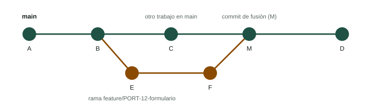

Imagina que tú preparas el formulario de alta de averías mientras una compañera corrige el buscador. Si ambos trabajáis sobre los mismos archivos y a la vez, tarde o temprano pisaréis lo que hace el otro. Las **ramas** resuelven el problema: cada persona trabaja en una línea de historia propia y, cuando su parte está lista y revisada, se **fusiona** con la rama principal. Esta página enseña a crearlas, cambiar entre ellas, fusionarlas y, cuando toca, resolver conflictos.

:::tip[Practica en el simulador]
Las pestañas «Grafo de commits», «Retos guiados» y «Conflictos» del [Simulador de Git](/docencia/smr/proyecto-intermodular/ud00-trabajo-en-proyectos/laboratorios/simulador-git/#grafo) están pensadas para esta página.
:::

## 1. Qué es una rama

Una rama es, en realidad, **un puntero móvil a un commit**. La rama `main` apunta al último commit de la línea principal; cuando haces un commit, el puntero avanza solo. Crear una rama es barato: no copia archivos, solo crea un puntero nuevo. `HEAD` indica en qué rama estás.



En el dibujo, la rama de funcionalidad sale del commit **B**, avanza con **E** y **F**, mientras `main` sigue con **C**. Al fusionar se crea **M**, que tiene dos padres. Después, `main` puede continuar con **D**.

## 2. Órdenes básicas

```bash
git branch                          # lista las ramas; la actual lleva un asterisco
git branch feature/PORT-12-formulario   # crea una rama (sin cambiarte a ella)
git switch feature/PORT-12-formulario   # te cambia de rama
git switch -c feature/PORT-12-formulario   # crea y cambia, todo en uno
git switch main                     # vuelve a main
git branch -d feature/PORT-12-formulario   # borra una rama ya fusionada
```

Cuando cambias de rama, Git **reescribe tu directorio de trabajo** con los archivos de esa rama. Por eso conviene tener los cambios confirmados antes de cambiar: si lo que has modificado entra en conflicto con la otra rama, Git se negará a cambiar y te avisará.

:::note[`switch` y `checkout`]
Hasta hace unos años todo se hacía con `git checkout`, que sirve para varias cosas (cambiar de rama y restaurar archivos). Las órdenes `git switch` (ramas) y `git restore` (archivos) se separaron para que fuera más claro. Verás `git checkout rama` y `git checkout -b rama` en muchos tutoriales: funcionan igual.
:::

### Nombres de rama

Acuerda una convención en el equipo. Una propuesta: `tipo/CLAVE-descripción-corta`, en minúsculas y con guiones:

| Rama | Para qué |
|---|---|
| `feature/PORT-12-formulario-alta` | Funcionalidad nueva |
| `fix/PORT-31-buscador-tildes` | Corrección de un error |
| `docs/PORT-40-manual-instalacion` | Documentación |

No uses espacios ni caracteres raros. Incluir la clave de la incidencia permite enlazar rama y tarea (véase 2.2.4).

## 3. Fusionar ramas con `merge`

Para traer a `main` el trabajo de otra rama:

```bash
git switch main
git merge feature/PORT-12-formulario
```

Estás **en la rama que recibe** y nombras la que se incorpora. Hay dos resultados posibles:

| Caso | Cuándo ocurre | Qué hace Git |
|---|---|---|
| **Avance rápido** (*fast-forward*) | `main` no ha avanzado desde que creaste la rama | Mueve el puntero de `main` hacia delante. No hay commit de fusión |
| **Fusión con commit** | `main` y la rama han avanzado cada una por su lado | Crea un commit de fusión con dos padres (el **M** del dibujo) |

Con `git merge --no-ff rama` se fuerza el commit de fusión aunque pudiera hacerse el avance rápido; algunos equipos lo prefieren para que la historia muestre cada funcionalidad como un bloque. Una vez fusionada, la rama ya no hace falta: `git branch -d nombre`.

Si las dos ramas han tocado **archivos distintos** (o zonas distintas del mismo archivo), Git combina todo solo. Si han tocado **las mismas líneas**, hay un conflicto.

## 4. Conflictos: qué son y cómo se resuelven

Un **conflicto** no es un error del proyecto: es Git diciendo «yo no sé cuál de las dos versiones quieres, decídelo tú».

```text
$ git merge feature/PORT-12-formulario
Auto-merging index.html
CONFLICT (content): Merge conflict in index.html
Automatic merge failed; fix conflicts and then commit the result.
```

El archivo en conflicto queda con marcas:

```text
<<<<<<< HEAD
<h1>Reparaciones Byte Alacant</h1>
=======
<h1>Reparaciones y citas</h1>
>>>>>>> feature/PORT-12-formulario
```

- Entre `<<<<<<< HEAD` y `=======`: **tu versión** (la de la rama en la que estás).
- Entre `=======` y `>>>>>>>`: **la versión de la otra rama**.

### Pasos para resolver

1. **No entres en pánico.** `git status` te dice qué archivos están en conflicto («both modified»).
2. **Abre cada archivo** y decide qué debe quedar: tu versión, la otra, o una combinación de las dos. Habla con la persona que hizo el otro cambio si no está claro.
3. **Borra las marcas** (`<<<<<<<`, `=======` y `>>>>>>>`) y deja el texto final. Un resultado válido podría ser:

   ```text
   <h1>Reparaciones Byte Alacant: pide tu cita</h1>
   ```

4. **Comprueba que el proyecto funciona** (abre la página, ejecuta las pruebas).
5. **Marca como resuelto y confirma:**

   ```bash
   git add index.html
   git commit            # el mensaje de la fusión ya viene escrito
   ```

6. Si te lías, puedes **abortar** la fusión y volver al punto de partida con `git merge --abort`.

:::caution[Cuidado con dejar marcas dentro]
Un error clásico es hacer `git add` sin borrar las marcas: Git no lo impide, y acabarás con `<<<<<<<` dentro de tu código o tu documento. Busca siempre esas tres marcas antes de confirmar.
:::

Para **reducir** los conflictos: ramas de vida corta, tareas pequeñas, `git pull` frecuente de `main` a tu rama y no reformatear archivos enteros sin avisar.

## 5. Flujos de trabajo habituales

### 5.1 Una rama por tarea

La práctica más extendida y recomendable para equipos pequeños:

1. Parte de un `main` actualizado (`git switch main` y `git pull`).
2. Crea una **rama para la tarea** (`git switch -c feature/PORT-12-formulario`).
3. Haz commits pequeños con buenos mensajes.
4. Sube la rama (`git push -u origin feature/PORT-12-formulario`).
5. Pide la **revisión** y fusiona (véase abajo).
6. Borra la rama y actualiza tu `main` local.

### 5.2 Pull request / merge request

Las plataformas de alojamiento de repositorios ofrecen una solicitud para incorporar una rama a otra, que se llama **pull request** o **merge request** según la plataforma. La rama no se fusiona directamente: se abre una solicitud donde el equipo puede:

- **Ver los cambios** línea a línea y comentarlos.
- **Revisar:** otra persona aprueba o pide cambios.
- **Pasar comprobaciones automáticas** (pruebas, análisis de estilo) si el proyecto las tiene.
- **Fusionar** con un botón cuando todo está en orden.

Es el mejor sitio para aprender de los compañeros y detectar fallos antes de que lleguen a `main`. Un buen título de solicitud lleva la clave y explica el cambio en una frase.

### 5.3 Proteger `main`

Se considera buena práctica que `main` contenga siempre algo que **funciona**. Las plataformas permiten **proteger la rama**: impedir que alguien suba directamente a `main`, exigir al menos una revisión aprobada y/o que pasen las comprobaciones automáticas. El administrador del repositorio es quien configura esas reglas. En un equipo de clase, aunque la plataforma no lo imponga, se puede **acordar como norma**: «nadie hace `push` a `main`; todo entra por solicitud con revisión».

### 5.4 ¿Y `rebase`?

Existe otra forma de integrar cambios, `git rebase`, que **reescribe** los commits para que cuelguen de otro punto. Da una historia más lineal, pero reescribir commits ya compartidos causa problemas. No lo usaremos en el módulo; basta con saber que existe y recordar la regla de oro: **no reescribas historia que otros ya tienen**.

## 6. Un ejemplo completo

```bash
git switch main
git pull
git switch -c feature/PORT-12-formulario
# ... editas formulario.html ...
git add formulario.html
git commit -m "PORT-12: Añade el formulario de alta de avería"
git push -u origin feature/PORT-12-formulario
# ... abres la solicitud de fusión, te la revisan y se fusiona ...
git switch main
git pull
git branch -d feature/PORT-12-formulario
```

## Comprueba lo aprendido

1. ¿Qué es una rama de Git?

   <details><summary>Respuesta</summary>

   Un puntero móvil a un commit. Avanza cada vez que haces un commit estando en esa rama. Permite trabajar en una línea de historia independiente.

   </details>

2. ¿Qué diferencia hay entre una fusión de avance rápido y una fusión con commit de fusión?

   <details><summary>Respuesta</summary>

   En el avance rápido, `main` no ha cambiado y Git solo mueve su puntero; no hay commit nuevo. En la fusión con commit, ambas ramas han avanzado y Git crea un commit con dos padres que combina ambas líneas.

   </details>

3. Tras `git merge` ves `CONFLICT (content): Merge conflict in index.html`. Indica los pasos a seguir.

   <details><summary>Respuesta</summary>

   Abrir el archivo, decidir el contenido final, borrar las marcas `<<<<<<<`, `=======` y `>>>>>>>`, comprobar que funciona, hacer `git add index.html` y `git commit`. Si no se quiere continuar, `git merge --abort`.

   </details>

4. ¿Por qué se protege la rama `main`?

   <details><summary>Respuesta</summary>

   Para garantizar que siempre contiene una versión revisada y funcional: evita subidas directas y exige revisión o comprobaciones antes de fusionar.

   </details>

## Glosario

| Término | Definición |
|---|---|
| Rama (*branch*) | Puntero móvil a un commit; línea de desarrollo independiente |
| `HEAD` | Indica la rama y el commit en los que estás ahora |
| Fusión (*merge*) | Incorporar a una rama los cambios de otra |
| Avance rápido (*fast-forward*) | Fusión que solo mueve el puntero, sin commit nuevo |
| Conflicto | Cambios incompatibles en las mismas líneas que Git no puede combinar solo |
| Pull request / merge request | Solicitud de fusión con revisión en la plataforma de alojamiento |
| Protección de rama | Reglas que limitan quién y cómo puede cambiar una rama |
