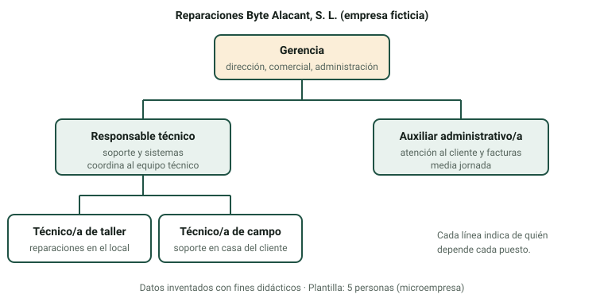

Cuando llegues a una empresa, lo primero que necesitarás saber es quién decide qué, a quién preguntar cada cosa y con qué medios se trabaja. Esta página te enseña a dibujar y a leer esa organización, a repartir las funciones entre departamentos (aunque en una empresa pequeña los haga la misma persona) y a valorar qué personas y qué medios hacen falta para prestar un servicio.

:::tip[Cómo trabajar esta página]
**Tiempo orientativo:** unos 45 minutos de lectura y 2 horas de práctica.

1. Lee las secciones 1 y 2 y mira el organigrama de ejemplo.
2. Estudia la tabla de departamentos (sección 3) y comprueba si la dominas con el clasificador de tareas.
3. Practica en las pestañas «Organigrama», «Departamentos» y «Clientes» (recursos) del [laboratorio](/docencia/smr/proyecto-intermodular/ud01-sector-productivo/laboratorios/perfil-empresa/#organigrama) y haz la [actividad 2](/docencia/smr/proyecto-intermodular/ud01-sector-productivo/actividades/).
:::

## 1. La estructura organizativa

La **estructura organizativa** es la forma en que una empresa reparte el trabajo y la autoridad: qué puestos existen, qué hace cada uno y de quién depende. No es un adorno: decide la rapidez con que se toman decisiones y quién responde cuando algo falla.

Las más habituales en el sector TIC son:

| Estructura | Cómo es | Dónde la encontrarás |
|---|---|---|
| **Plana** | Pocos niveles; la persona que dirige trabaja codo con codo con el resto | Microempresas y servicios técnicos pequeños |
| **Funcional** | Se agrupa a las personas por función (comercial, técnico, administración) y cada grupo tiene un responsable | Pymes de servicios, tiendas, distribuidores |
| **Por proyectos** | Equipos que se forman para cada proyecto o cliente y se deshacen al terminar | Empresas de desarrollo e integradores |
| **Matricial** | Cada persona depende a la vez de un responsable funcional y de un jefe de proyecto | Empresas grandes, operadores |

En la práctica las estructuras se mezclan, y la que se ve depende sobre todo del tamaño: cuanto más pequeña es la empresa, más plana es la estructura y más tareas distintas hace cada persona.

## 2. El organigrama

El **organigrama** es el dibujo de la estructura: cajas (puestos o unidades) unidas por líneas que indican la dependencia. Se lee de arriba abajo: la caja de arriba manda sobre las de abajo.

### 2.1 Cómo dibujar uno que sirva

1. **Empieza por los puestos, no por los nombres.** Un organigrama de empresa describe cargos («responsable técnico»), no personas; las personas cambian y los puestos permanecen.
2. **Una persona depende de una sola caja** (en una estructura sencilla). Si dudas de quién depende alguien, pregúntalo: es una pregunta legítima en una entrevista.
3. **Pon al lado de cada caja sus funciones clave**, como en el ejemplo (dirección, comercial, administración…).
4. **Comenta el organigrama.** Lo que se evalúa no es el dibujo, sino que sepas explicar por qué la empresa se organiza así: cuántos niveles tiene, qué funciones están cubiertas y cuáles no.

:::caution[Fíjate en lo que falta]
Un organigrama te dice también lo que **no** hay. En una empresa de servicios técnicos suelen ser imprescindibles cuatro funciones: dirección, comercial (aunque sea la misma persona que dirige), soporte técnico y administración (facturas, cobros, impuestos). Si falta alguna, no es que no se haga: es que la hace alguien que no figura, o que no se hace. El laboratorio te avisa de las que no ve cubiertas.
:::

### 2.2 Tres plantillas según el tamaño

| Tamaño | Rasgos del organigrama | Ejemplo |
|---|---|---|
| Micro | Dos o tres niveles; la persona que dirige también vende, factura y atiende | Gerencia y dos técnicos |
| Pequeña | Responsables por área (técnico, comercial, administración) | Dirección, responsable técnico, comercial, administración y equipo técnico |
| Mediana | Un departamento para cada función, con su responsable | Dirección general y cinco o seis departamentos |

## 3. Departamentos y funciones

Un **departamento** es un grupo de personas que se ocupa de una función concreta de la empresa. En una empresa grande hay un equipo para cada departamento; en una pequeña, un departamento puede ser una sola persona, o incluso una parte de la jornada de otra.

Estos son los departamentos principales de una empresa TIC. Fíjate en cada columna: la **finalidad** es para qué existe el departamento y las **funciones** son lo que hace día a día.

| Departamento | Finalidad | Funciones típicas | Perfil habitual |
|---|---|---|---|
| **Dirección** | Marcar el rumbo y tomar las decisiones importantes | Fijar objetivos, aprobar inversiones, representar a la empresa, firmar acuerdos | Gerente, dirección general |
| **Comercial y marketing** | Conseguir y conservar clientes | Prospección, presupuestos, negociación de contratos, web y redes sociales | Comercial, técnico-comercial |
| **Soporte técnico (SAT)** | Atender las averías e incidencias de los clientes | Registrar y resolver incidencias, reparar equipos, instalar y configurar puestos | Técnico SMR |
| **Sistemas e infraestructura** | Mantener los servicios y la red de los clientes (y los propios) | Administrar servidores y redes, copias de seguridad, seguridad, monitorización | Técnico de sistemas, administrador de sistemas |
| **Desarrollo** | Crear y mantener aplicaciones | Programar, probar, publicar y mantener software | Programador, analista |
| **Administración y finanzas** | Controlar el dinero y los papeles | Facturar, cobrar, pagar, contabilidad, impuestos | Administrativo, contable |
| **Recursos humanos** | Cuidar a las personas de la empresa | Selección, contratos, nóminas, formación, vacaciones | Responsable de RR. HH. |
| **Compras y logística** | Conseguir y mover los materiales | Pedir a proveedores, controlar el stock, envíos y recogidas | Responsable de compras, almacenero |
| **Calidad** | Asegurar que el trabajo se hace como se prometió | Procedimientos, no conformidades, encuestas de satisfacción, mejora | Responsable de calidad |

:::note[Soporte y sistemas no son lo mismo]
Soporte técnico trabaja de cara al **usuario** (un portátil que no arranca, una impresora que no imprime). Sistemas e infraestructura trabaja de cara a **los servicios compartidos** (el servidor de ficheros, la red, las copias). En una microempresa los hace la misma persona; en una grande son equipos distintos.
:::

### 3.1 Departamento no es lo mismo que persona

En una empresa de cinco personas no hay nueve departamentos con su jefe cada uno. Lo que hay son **funciones** que alguien tiene que cubrir. La pregunta útil no es «¿tiene departamento de calidad?», sino «¿quién se encarga de que el trabajo salga bien y de qué forma?». Si la respuesta es «el gerente, cuando revisa las reparaciones», la función existe aunque no tenga departamento.

Para saber si dominas el reparto, el laboratorio incluye un **clasificador de tareas**: te enseña una tarea («emitir y reclamar facturas») y eliges a qué departamento corresponde. Al corregirte te explica el porqué.

## 4. Los recursos humanos

Los **recursos humanos** son las personas con las que cuenta la empresa para prestar sus servicios. Para valorarlos no basta con contarlas. Para cada perfil hay que saber:

- **Cuántas personas** hay y con qué dedicación (jornada completa, media jornada).
- **Qué sabe hacer cada una**: perfil y competencias (certificaciones, idiomas, experiencia).
- **Cuántas horas útiles** aporta al año. Una persona con jornada completa no dedica todas sus horas a trabajo facturable: hay vacaciones, formación, reuniones y gestión.
- **Cuánto cuesta**: el coste para la empresa es mayor que el sueldo neto porque incluye cotizaciones y otros gastos laborales.

:::caution[Consulta el convenio]
Las categorías, la jornada y los salarios de cada sector los fija el **convenio colectivo** aplicable. No des cifras de memoria: si tu ficha necesita un coste por perfil, indica que es una **estimación** y de dónde lo has sacado.
:::

La cifra que más te interesa es la **capacidad de trabajo**: horas útiles de la plantilla técnica en un año. En la página siguiente la compararás con las horas que exigen los clientes para ver si la empresa llega o se ahoga.

## 5. Los recursos materiales

Los **recursos materiales** son todo lo que no son personas y se necesita para trabajar. En una empresa de servicios TIC suelen clasificarse así:

| Tipo | Ejemplos | Qué tener en cuenta |
|---|---|---|
| Local e instalaciones | Taller, tienda, oficina, almacén | Alquiler o propiedad, superficie, suministros |
| Equipos y herramientas | Puestos de trabajo, banco de pruebas, herramientas de taller, instrumentos de medida | Coste de compra y vida útil (amortización) |
| Vehículos | Furgoneta o coche para visitas | Renting, combustible, seguro |
| Licencias y servicios | Programas de gestión, antivirus, copias de seguridad en la nube, gestor de incidencias | Cuota por usuario o por equipo; muchas se pagan cada mes |
| Material para vender o consumir | Repuestos, discos, cables, consumibles | Existencias (stock) y proveedores |
| Seguros y servicios externos | Seguro de responsabilidad, gestoría | Cuotas anuales |

### 5.1 Cómo valorar los recursos

Valorar no es listar: es **medir si los recursos bastan y cuánto cuestan**. El método es una tabla con cuatro columnas: *recurso*, *cantidad*, *coste anual por unidad* y *coste total*. La suma de costes la comparas después con los ingresos que genera la actividad. En el laboratorio (pestaña «Clientes») verás esa comparación con una empresa de ejemplo.

Ejemplo con datos inventados de la empresa ficticia *Reparaciones Byte Alacant*: 1 furgoneta en renting a 4.800 € al año y 3.600 € de licencias y servicios dan 8.400 € al año de recursos materiales solo en estas dos partidas. Eso, repartido en las horas de trabajo que se facturan, ya es parte del precio de cada servicio.

## Comprueba lo aprendido

1. ¿Qué diferencia hay entre una estructura plana y una funcional? ¿Cuál esperas encontrar en una empresa de tres personas?

   

   
Respuesta

   En la plana hay pocos niveles y quien dirige trabaja con el equipo; en la funcional se agrupa a la gente por función con un responsable en cada una. En una empresa de tres personas, la plana.

   

2. Un organigrama muestra «Gerencia», «Técnico A» y «Técnico B». ¿Qué funciones clave no se ven cubiertas y qué preguntarías?

   

   
Respuesta

   Administración (facturas, cobros) y comercial no aparecen como tales. Habría que preguntar quién las hace: probablemente la gerencia, que además de dirigir vende y factura.

   

3. ¿A qué departamento corresponde «realizar y probar copias de seguridad de los servidores de un cliente»? ¿Y «resolver un correo de un usuario que no puede imprimir»?

   

   
Respuesta

   Las copias de seguridad son de sistemas e infraestructura (servicio compartido); el usuario que no puede imprimir es de soporte técnico (trabajo de cara al usuario).

   

4. Una persona tiene jornada completa, pero la empresa solo cuenta con 1.500 horas útiles al año de ella. ¿Por qué no con todas las horas del año?

   

   
Respuesta

   Porque hay que descontar vacaciones, festivos, formación, reuniones y tareas de gestión que no se pueden facturar a clientes.

   

5. Pon tres recursos materiales de una empresa de servicios TIC que se paguen cada mes o cada año.

   

   
Respuesta

   Por ejemplo: alquiler del local, renting de la furgoneta, licencias del programa de gestión de incidencias o copias de seguridad en la nube, seguro de responsabilidad civil.

   

## Glosario

| Término | Definición |
|---|---|
| Estructura organizativa | Reparto del trabajo y la autoridad en una empresa |
| Organigrama | Dibujo de la estructura: puestos o unidades y sus dependencias |
| Estructura plana | Con pocos niveles jerárquicos |
| Estructura funcional | Se agrupa por funciones: comercial, técnica, administración… |
| Departamento | Grupo de personas que cubre una función de la empresa |
| Función | Tarea o responsabilidad concreta que cumple un puesto o un departamento |
| SAT | Servicio de asistencia técnica: atiende averías e incidencias |
| Recursos humanos | Las personas con las que cuenta la empresa |
| Recursos materiales | Local, equipos, vehículos, licencias y materiales necesarios para trabajar |
| Capacidad | Horas útiles que la plantilla puede dedicar al trabajo facturable |
| Convenio colectivo | Acuerdo que fija categorías, jornada y salarios de un sector |
| Amortización | Reparto del coste de un equipo durante los años que se espera usarlo |
