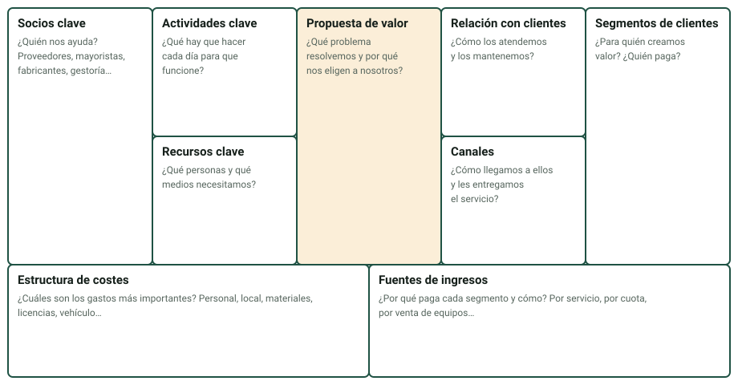

Una empresa existe porque alguien necesita algo y está dispuesto a pagarlo. Esta página sigue ese hilo: quién es el cliente y qué necesita, cuánto dinero y cuánto trabajo supone atenderlo, qué decisiones toma la empresa para responder y cómo comprueba si le funcionan. Son los criterios más «de negocio» de la unidad y los que más se entienden con números, así que aquí vas a calcular.

:::tip[Cómo trabajar esta página]
**Tiempo orientativo:** unos 50 minutos de lectura y 2,5 horas de práctica.

1. Lee las secciones 1 y 2 con calculadora y reproduce el ejemplo resuelto.
2. Las secciones 3 y 4 (Canvas y estrategia) se aprenden rellenando: ten abierta la pestaña «Canvas» del laboratorio mientras lees.
3. Termina con la sección 5 (indicadores) y practica con las pestañas «Clientes», «Canvas» e «Indicadores» del [laboratorio](/docencia/smr/proyecto-intermodular/ud01-sector-productivo/laboratorios/perfil-empresa/#clientes). Después, haz las [actividades 3 y 4](/docencia/smr/proyecto-intermodular/ud01-sector-productivo/actividades/).
:::

## 1. Clientes, segmentos y necesidades

Un **cliente** es quien paga por un producto o servicio. Un **segmento de clientes** es un grupo de clientes con necesidades parecidas, a los que se atiende de forma parecida. Distinguir segmentos es la mejor manera de entender qué ofrece una empresa y a quién.

Los segmentos habituales para una empresa TIC de tu zona son:

| Segmento | Qué necesita | Cómo suele pagar |
|---|---|---|
| Hogares y particulares | Reparar, instalar, configurar; resolver una avería puntual | Por servicio, con presupuesto |
| Autónomos y microempresas | Que su equipo funcione sin que ellos sepan de informática | Por horas o por servicio, a demanda |
| Pymes | Soporte continuo, copias, red y seguridad | Contrato de mantenimiento con cuota periódica |
| Administraciones y centros educativos | Equipamiento, mantenimiento y cumplimiento de requisitos | Contratos y concursos |
| Asociaciones y entidades sociales | Lo mismo que una pyme, con poco presupuesto | Tarifas reducidas, subvenciones |

Una **necesidad** no es lo que el cliente pide («un ordenador nuevo»), sino el problema que quiere resolver («poder facturar sin que se cuelgue el programa»). Quien entiende la necesidad detrás de la petición propone mejor solución y, con frecuencia, más barata. Anota en tu cuaderno las necesidades que detectes: te harán falta en la unidad siguiente.

## 2. Volumen de negocio y necesidades de los clientes

El **volumen de negocio** (también llamado cifra de negocios) es el dinero que ingresa una empresa por sus ventas y servicios durante un periodo, normalmente un año. No es lo mismo que el beneficio: el beneficio es lo que queda después de restar los gastos.

Como no tienes las cuentas internas de una empresa, aprenderás a **estimarlo desde sus clientes**:

> **Ingresos estimados = Σ (número de clientes de cada segmento × ingreso medio anual por cliente)**

Esa cifra, por sí sola, no dice si la empresa puede cumplirla. Para saberlo hay que traducir la demanda a trabajo:

> **Horas demandadas = Σ (número de clientes × horas anuales por cliente)**
> **Horas disponibles = técnicos × horas útiles por técnico y año**
> **Carga de trabajo = horas demandadas ÷ horas disponibles**

La carga es el termómetro: si pasa del 100 % la empresa no llega; si está muy por debajo, paga a personas que no están ocupadas.

### 2.1 Ejemplo resuelto

Empresa ficticia *Reparaciones Byte Alacant* (todos los datos son inventados):

| Segmento | Clientes | Ingreso medio anual | Horas por cliente | Ingresos | Horas |
|---|---|---|---|---|---|
| Particulares | 900 | 70 € | 1 | 63.000 € | 900 |
| Autónomos y microempresas | 120 | 450 € | 7 | 54.000 € | 840 |
| Pymes con contrato de mantenimiento | 25 | 3.600 € | 40 | 90.000 € | 1.000 |
| Entidades sociales | 12 | 700 € | 10 | 8.400 € | 120 |
| **Total** | 1.057 | | | **215.400 €** | **2.860** |

- Con **3 técnicos** y 1.500 horas útiles cada uno: 4.500 horas disponibles → carga = 2.860 ÷ 4.500 ≈ **63,6 %**. Equilibrada.
- Con **2 técnicos**: 3.000 horas disponibles → carga ≈ **95,3 %**. Sobrecarga: cualquier imprevisto retrasa el trabajo.
- Ingreso por hora demandada: 215.400 ÷ 2.860 ≈ **75,3 €/h** (incluye la venta de piezas y equipos).

Si la empresa quiere trabajar como máximo al 85 %, necesita 2.860 ÷ (1.500 × 0,85) ≈ 2,24 técnicos, es decir, **3 técnicos** (hay que redondear siempre hacia arriba).

:::note[Umbrales de la unidad (propuesta)]
Usamos como regla orientativa que por encima del **85 %** hay riesgo de sobrecarga y por debajo del **50 %** hay infrautilización. No son cifras oficiales: son una convención de la unidad para que tengas un criterio al comentar los resultados.
:::

### 2.2 Cómo se interpreta

Los números no acaban en el resultado: hay que **leerlos en relación con las necesidades de los clientes**. Por ejemplo, la mitad de las horas de la empresa del ejemplo se las lleva un segmento que supone solo 25 clientes. Eso significa que la empresa depende mucho de los contratos con pymes y que perder dos de ellos es un golpe grande. Esa es la conclusión que se espera de ti, no «sale 63,6 %».

En la pestaña «Clientes» del laboratorio, además, comparas los ingresos con el coste de los recursos humanos y materiales: con los datos del ejemplo, 215.400 € de ingresos frente a 204.000 € de costes dejan un resultado orientativo de 11.400 €, un margen ajustado (alrededor del 5 %).

## 3. Propuesta de valor y modelo de negocio (Canvas)

La **propuesta de valor** es la razón por la que un cliente elige a una empresa y no a otra: qué problema resuelve y qué ofrece de especial. Se expresa mejor como un beneficio («tus equipos funcionan y no te preocupas») que como una lista de servicios («instalación, redes, copias»).

El **modelo de negocio** describe cómo la empresa crea, entrega y captura valor. La herramienta más usada para dibujarlo es el **lienzo del modelo de negocio (Business Model Canvas)**, creado por Alexander Osterwalder, con nueve bloques:

| Bloque | Pregunta guía | Ejemplo de *Byte Alacant* |
|---|---|---|
| Segmentos de clientes | ¿Para quién? | Hogares, autónomos, pymes, entidades sociales |
| Propuesta de valor | ¿Qué problema resolvemos y por qué nos eligen? | Reparación rápida con presupuesto cerrado y mantenimiento que evita averías |
| Canales | ¿Cómo llegamos y entregamos? | Tienda-taller, web con cita previa, visita a domicilio |
| Relación con clientes | ¿Cómo los atendemos y los conservamos? | Trato personal; revisión periódica a clientes con contrato |
| Fuentes de ingresos | ¿Cómo y qué paga cada segmento? | Pago por servicio, cuota de mantenimiento, venta de equipos con margen |
| Recursos clave | ¿Qué necesitamos? | Equipo técnico, taller, furgoneta, programa de incidencias |
| Actividades clave | ¿Qué hacemos cada día? | Reparar, atender incidencias, mantenimiento preventivo |
| Socios clave | ¿Quién nos ayuda? | Mayoristas de componentes, gestoría, fabricantes |
| Estructura de costes | ¿Qué cuesta más? | Personal, repuestos, local, licencias |

:::tip[Rellena en este orden]
Empieza por los **segmentos** y la **propuesta de valor** (el centro del lienzo), sigue por canales y relación con clientes, después ingresos, y deja para el final recursos, actividades, socios y costes. Si algún bloque te queda vacío, no lo inventes: es una señal de que te falta información para investigar.
:::

## 4. Estrategia

La **estrategia** es el conjunto de decisiones con las que una empresa responde a la demanda de sus clientes. No es un eslogan: es elegir qué hacer, para quién y qué dejar de lado. Estas son las respuestas estratégicas más frecuentes en el sector TIC:

| Decisión | Qué implica | Riesgo |
|---|---|---|
| **Especialización** | Centrarse en un sector (clínicas, despachos) o en un servicio | Depender de pocos clientes |
| **Precio competitivo** | Ofrecer tarifas bajas para ganar volumen | Márgenes estrechos |
| **Nivel de servicio (SLA)** | Comprometerse por contrato a un tiempo de respuesta | Penalizaciones si no se cumple |
| **Cercanía** | Atención presencial y rapidez local | Difícil de crecer |
| **Servicios recurrentes** | Cuotas mensuales por mantenimiento en lugar de cobrar por avería | Hay que ganarse al cliente al principio |
| **Alianzas** | Colaborar con fabricantes u otras empresas | Dependencia del socio |
| **Sostenibilidad y reparación** | Reparar y reutilizar antes que vender nuevo | Más tiempo por equipo |

Una estrategia válida **se justifica**: dices qué demanda atiende. «Servicios recurrentes con cuota mensual» se justifica con el dato de que las pymes no quieren afrontar averías imprevistas. Un máximo de **dos o tres decisiones bien justificadas** es mejor que siete sin explicar.

## 5. Indicadores de resultados

Un **indicador** (KPI, *key performance indicator*) es una medida con la que se comprueba si la estrategia funciona. Un buen indicador tiene cuatro cosas: **qué mide**, **en qué unidad**, **un objetivo** y **una dirección** (¿mejor cuanto más alto o cuanto más bajo?).

| Indicador | Qué mide | Mejor si… |
|---|---|---|
| Facturación mensual | Ingresos del mes | Sube |
| Margen bruto | (Ingresos − coste directo) ÷ ingresos | Sube |
| Incidencias resueltas | Tickets cerrados al mes | Sube |
| Tiempo medio de resolución | Horas desde que se abre un ticket hasta que se cierra | Baja |
| Cumplimiento del SLA | % de incidencias resueltas dentro del plazo pactado | Sube |
| Satisfacción del cliente | Nota media en las encuestas | Sube |
| Renovación de contratos | % de contratos que se renuevan | Sube |
| Utilización de horas facturables | Horas facturadas ÷ horas disponibles | Sube hasta un límite |
| Clientes activos | Nº de clientes con actividad en el periodo | Sube |

### 5.1 Leer una serie de datos

Un solo dato no cuenta nada. Con **seis periodos** puedes ver la tendencia. Ejemplo (datos inventados) de *Byte Alacant* con dos indicadores y su semáforo:

| Indicador | Objetivo | P1 | P2 | P3 | P4 | P5 | P6 | Lectura |
|---|---|---|---|---|---|---|---|---|
| Tiempo medio de resolución (h) | 8 | 14 | 12 | 11 | 10 | 9 | 8,5 | Mejora cada mes; casi en el objetivo |
| Cumplimiento del SLA (%) | 90 | 78 | 81 | 84 | 86 | 88 | 91 | Objetivo alcanzado en el último periodo |

El **semáforo** (criterio propuesto en esta unidad): verde si se cumple el objetivo; ámbar si se está a menos de un 10 % de cumplirlo; rojo si está más lejos. Para el tiempo de resolución (que mejora al bajar) el último dato, 8,5 h, está dentro del 10 % de 8 h, así que sale ámbar; el SLA, que mejora al subir, sale verde. El semáforo se escribe con palabras además de con color.

La parte importante es la **interpretación**: «¿funciona la estrategia?». Aquí diríamos que las decisiones sobre atención rápida están funcionando (el tiempo baja y el SLA sube) pero que hay que vigilar que no se estanque cerca del objetivo.

## Comprueba lo aprendido

1. Una empresa tiene 40 clientes que pagan 1.200 € al año de media y 200 clientes que pagan 50 € de media. ¿Cuál es su volumen de negocio estimado?

   

   
Respuesta

   40 × 1.200 = 48.000 € y 200 × 50 = 10.000 €. En total, **58.000 € al año**.

   

2. Esa empresa tiene un solo técnico con 1.500 horas útiles y sus clientes demandan 1.400 horas. ¿Qué carga tiene y qué conclusión sacas?

   

   
Respuesta

   1.400 ÷ 1.500 ≈ 93,3 %. Está por encima del 85 %: hay riesgo de sobrecarga, y la empresa debería ampliar la plantilla o reducir horas por cliente.

   

3. ¿Qué diferencia hay entre lo que pide un cliente y su necesidad? Pon un ejemplo.

   

   
Respuesta

   Lo que pide es la solución que imagina («un ordenador nuevo»); la necesidad es el problema que quiere resolver («que el programa de facturación no se cuelgue»). Entender la necesidad permite proponer una solución mejor o más barata.

   

4. ¿Qué bloques del Canvas empiezas rellenando y por qué?

   

   
Respuesta

   Segmentos de clientes y propuesta de valor, porque el resto del modelo (canales, ingresos, recursos…) depende de saber para quién se crea valor y cuál es ese valor.

   

5. El tiempo medio de resolución objetivo es 6 h y el último dato es 7,4 h. ¿Qué color de semáforo sale con el criterio de la unidad? ¿Y si el último fuera 5,8 h?

   

   
Respuesta

   En este indicador mejora al bajar. 7,4 h supera el objetivo en un 23 %: está más lejos del 10 %, así que sale **rojo**. Con 5,8 h se cumple el objetivo: **verde**.

   

## Glosario

| Término | Definición |
|---|---|
| Cliente | Persona o entidad que paga por un producto o servicio |
| Segmento de clientes | Grupo de clientes con necesidades y forma de atención parecidas |
| Necesidad | Problema que el cliente quiere resolver |
| Volumen de negocio | Ingresos por ventas y servicios de una empresa en un periodo |
| Carga de trabajo | Horas demandadas divididas entre horas disponibles |
| Propuesta de valor | Razón por la que el cliente elige a la empresa |
| Modelo de negocio | Descripción de cómo la empresa crea, entrega y obtiene valor |
| Canvas (lienzo del modelo de negocio) | Esquema de nueve bloques para describir un modelo de negocio |
| Estrategia | Decisiones con las que la empresa responde a la demanda |
| SLA | Acuerdo de nivel de servicio: tiempos de respuesta comprometidos |
| Indicador (KPI) | Medida con objetivo que permite saber si la estrategia funciona |
| Semáforo | Resumen en tres estados (verde, ámbar, rojo) del cumplimiento de un objetivo |
