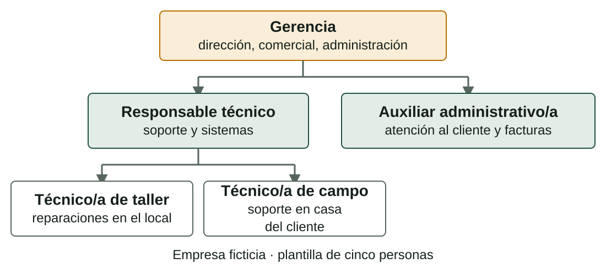

## Qué aprenderás

:::pasos
- La **estructura organizativa** de una empresa TIC
- Dibujar y leer un **organigrama**
- Repartir las funciones en **departamentos**
- Valorar los **recursos humanos**
- Valorar los **recursos materiales** y su coste
:::

---

## La estructura reparte trabajo y autoridad

:::pasos
- Qué **puestos** existen y qué hace cada uno
- De **quién depende** cada puesto
- Decide la **rapidez** de las decisiones
- Decide **quién responde** cuando algo falla
:::

---

## Cuatro estructuras habituales

---

## Plana y funcional

| | Plana | Funcional |
|---|---|---|
| **Cómo es** | Pocos niveles; quien dirige trabaja con el equipo | Se agrupa por función, con un responsable en cada una |
| **Dónde** | Microempresas y servicios técnicos pequeños | Pymes de servicios, tiendas, distribuidores |

---

## Por proyectos y matricial

| | Por proyectos | Matricial |
|---|---|---|
| **Cómo es** | Equipos que se forman para cada proyecto o cliente y se deshacen al terminar | Cada persona depende a la vez de un responsable funcional y de un jefe de proyecto |
| **Dónde** | Empresas de desarrollo e integradores | Empresas grandes, operadores |

---

## El tamaño decide la estructura

:::pasos
- En la práctica las estructuras **se mezclan**
- Cuanto **más pequeña** es la empresa…
- …**más plana** es la estructura
- …y **más tareas distintas** hace cada persona
:::

---

## El organigrama dibuja la estructura

---

## Cómo se lee un organigrama

:::pasos
- **Cajas**: puestos o unidades
- **Líneas**: dependencia
- Se lee **de arriba abajo**
- La caja de arriba **manda** sobre las de abajo
:::

---

## Cómo dibujar un organigrama que sirva

:::pasos
1. Empieza por los **puestos**, no por los nombres
2. Una persona depende de **una sola caja**
3. Pon al lado de cada caja sus **funciones clave**
4. **Coméntalo**: explica por qué la empresa se organiza así
:::

---

## Un organigrama dice también lo que falta

:::caution[Fíjate en lo que falta]
Si falta una función, o la hace alguien que no figura, o no se hace.
:::

:::pasos
- **Dirección**
- **Comercial**, aunque sea quien dirige
- **Soporte técnico**
- **Administración**: facturas, cobros, impuestos
:::

---

## Tres plantillas según el tamaño

| Tamaño | Rasgos del organigrama | Ejemplo |
|---|---|---|
| **Micro** | Dos o tres niveles; quien dirige también vende, factura y atiende | Gerencia y dos técnicos |
| **Pequeña** | Responsables por área | Dirección, responsable técnico, comercial, administración y equipo técnico |
| **Mediana** | Un departamento por función, con su responsable | Dirección general y cinco o seis departamentos |

---

## Un departamento cubre una función

:::pasos
- **Departamento**: grupo de personas que se ocupa de una función
- En una empresa grande, un **equipo** por departamento
- En una pequeña puede ser **una persona**…
- …o **una parte de la jornada** de otra
:::

---

## Departamentos: de dirigir a atender

| Departamento | Finalidad |
|---|---|
| **Dirección** | Marcar el rumbo y tomar las decisiones importantes |
| **Comercial y marketing** | Conseguir y conservar clientes |
| **Soporte técnico (SAT)** | Atender las averías e incidencias de los clientes |
| **Sistemas e infraestructura** | Mantener los servicios y la red de los clientes (y los propios) |
| **Desarrollo** | Crear y mantener aplicaciones |

---

## Departamentos: de cobrar a mejorar

| Departamento | Finalidad |
|---|---|
| **Administración y finanzas** | Controlar el dinero y los papeles |
| **Recursos humanos** | Cuidar a las personas de la empresa |
| **Compras y logística** | Conseguir y mover los materiales |
| **Calidad** | Asegurar que el trabajo se hace como se prometió |

---

## Soporte y sistemas no son lo mismo

:::note[Dos mirillas distintas]
En una microempresa los hace la misma persona; en una grande, equipos distintos.
:::

| | Soporte técnico | Sistemas e infraestructura |
|---|---|---|
| **Mira hacia** | El **usuario** | Los **servicios compartidos** |
| **Ejemplo** | Un portátil que no arranca | El servidor de ficheros, la red, las copias |

---

## Departamento no es lo mismo que persona

:::pasos
- Una empresa de cinco personas **no tiene nueve jefes**
- Tiene **funciones** que alguien debe cubrir
- Pregunta útil: «¿**quién se encarga** de que el trabajo salga bien?»
- Si responde «el gerente al revisar», la función **existe**
:::

---

## Valorar las personas no es solo contarlas

:::pasos
- **Cuántas** hay y con qué dedicación
- **Qué sabe hacer** cada una: perfil y competencias
- **Cuántas horas útiles** aporta al año
- **Cuánto cuesta**: más que el sueldo neto
:::

---

## La capacidad es la cifra clave

:::pasos
- **Capacidad**: horas útiles de la plantilla técnica en un año
- No son todas las horas: hay **vacaciones, formación, reuniones y gestión**
- En la página siguiente la compararás con las **horas que piden los clientes**
:::

:::caution[Consulta el convenio]
Categorías, jornada y salarios los fija el convenio colectivo: si das un coste por perfil, di que es una estimación y de dónde sale.
:::

---

## Los recursos materiales: todo lo que no son personas

:::pasos
- **Local e instalaciones**: taller, tienda, oficina, almacén
- **Equipos y herramientas**: se amortizan
- **Vehículos**: renting, combustible, seguro
- **Licencias y servicios**: muchas se pagan cada mes
- **Material** para vender o consumir: stock y proveedores
- **Seguros y servicios externos**: cuotas anuales
:::

---

## Valorar es medir si bastan y cuánto cuestan

| Recurso | Cantidad | Coste anual por unidad | Coste total |
|---|---:|---:|---:|
| Furgoneta en renting | 1 | 4.800 € | 4.800 € |
| Licencias y servicios | 1 | 3.600 € | 3.600 € |
| **Total de estas dos partidas** | | | **8.400 €** |

Datos inventados de la empresa ficticia *Reparaciones Byte Alacant*. Este coste forma parte del precio de cada servicio.

---

## Pruébalo: organigrama y departamentos

::laboratorio[Organigrama]{src="perfil-empresa" pestana="organigrama"}

::laboratorio[Departamentos]{src="perfil-empresa" pestana="departamentos"}

---

## Pruébalo: los recursos

::laboratorio[Clientes]{src="perfil-empresa" pestana="clientes"}

---

## Resumen

- La **estructura** reparte trabajo y autoridad; cuanto más pequeña la empresa, más **plana**
- El **organigrama** muestra puestos, dependencias y también lo que **falta**
- Un **departamento** es una función, no necesariamente una persona
- Recursos humanos: personas, competencias, **horas útiles** y coste
- Recursos materiales: se **valoran con una tabla** de cantidad y coste

[Actividades de la unidad →](/docencia/smr/proyecto-intermodular/ud01-sector-productivo/actividades/)
