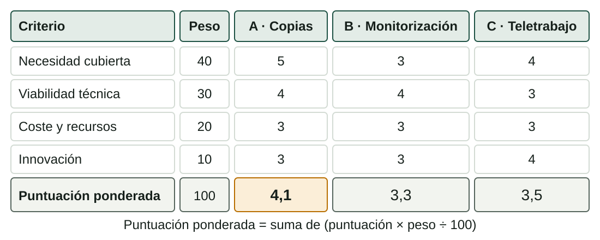

## Qué aprenderás

:::pasos
- Detectar y **priorizar necesidades** reales de una pyme
- **Generar ideas** en grupo sin censurarlas
- **Elegir** con una matriz de criterios ponderados
- Informarte de **lo que ya existe**
- Decidir qué **aspecto innovador** aplicar
:::

---

## Tres palabras que se parecen

| Palabra | Qué es | Ejemplo (datos inventados) |
|---|---|---|
| **Necesidad** | Lo que falta o molesta para hacer bien el trabajo o la vida | «Las pymes no pueden recuperar sus archivos si el equipo falla» |
| **Problema** | La situación concreta que lo causa, con causas y efectos | «Las copias son manuales, sin comprobar y en el mismo equipo» |
| **Oportunidad** | La posibilidad de mejorar que se abre al resolverlo | «Copias con restauración comprobada, como cuota mensual» |

---

## La necesidad no nombra ninguna solución

:::pasos
- «Necesitan un **NAS**»: has saltado a la solución
- Escribe lo que **falta o duele**…
- …no lo que **se compra**
- Así compruebas si esa solución es **la mejor**
:::

---

## Un problema tiene causas y efectos

Atacar la **causa** suele dar mejores proyectos que tapar el efecto.

---

## Una necesidad se afirma con evidencia

| Técnica | Qué consiste en | Límite |
|---|---|---|
| **Observación** | Ver cómo trabajan y dónde se atascan | Lleva tiempo y puede alterar lo observado |
| **Entrevista** | Hablar con quien tiene el problema | Pocas personas; cuentan lo que recuerdan |
| **Encuesta** | Mismas preguntas a muchas personas | Preguntas mal hechas dan respuestas inútiles |
| **Análisis de incidencias** | Contar y clasificar avisos y averías registrados | Solo ves lo que alguien avisó |

---

## Combina técnicas y anota los datos

:::pasos
- Lo mejor: **al menos dos** técnicas
- Cada necesidad lleva **quién** la sufre, **cuántas veces** ocurre y **qué cuesta**
- Y **de dónde sale el dato**
- Si es una suposición, dilo: «**estimación del equipo**»
- Un dato sin fuente **no es evidencia**
:::

---

## Entrevistas y encuestas: sin datos personales

:::caution[Datos de personas]
No apuntes nombres ni datos personales de nadie.
:::

:::pasos
- Basta con el **cargo**: «gerente de una gestoría»
- Y con lo que ha dicho
- Siempre **con su permiso**
:::

---

## Priorizar con impacto y urgencia

:::pasos
- Puntúa cada necesidad de **1 a 5** en dos ejes
- **Impacto**: cuánto daño causa o cuánto valor tiene resolverla
- **Urgencia**: frecuencia, plazos, riesgo de empeorar
- **Prioridad = impacto × urgencia** (de 1 a 25)
:::

---

## Ejemplo de prioridades

| Necesidad | Evidencia (inventada) | Impacto × urgencia | Prioridad |
|---|---|---|---:|
| Copias sin comprobar | 3 de 25 pymes perdieron archivos en un año | 5 × 4 | **20** |
| Nadie vigila el servidor del cliente | 6 caídas detectadas por el cliente | 4 × 3 | **12** |
| Incidencias por teléfono sin registro | 1 de cada 4 avisos se olvida | 3 × 4 | **12** |
| Equipos antiguos acumulados | 14 equipos parados | 2 × 2 | **4** |

Es fácil defender la primera y explicar por qué no eliges la última.

---

## Primero generar, después evaluar

:::pasos
- La regla de oro: **separar generar de evaluar**
- Primero **muchas ideas** sin criticar
- Después, a **elegir**
- Si juzgas mientras se proponen, **se callan las ideas raras**: a veces, las buenas
:::

---

## Tres técnicas sencillas para equipos pequeños

:::pasos
- **Lluvia de ideas**: 10 minutos, todo el mundo propone y alguien apunta; cantidad antes que calidad
- **Escritura en silencio** (*brainwriting*): 5 minutos sin hablar; luego se leen y se completan
- **SCAMPER**: preguntas para transformar algo que ya existe
:::

---

## SCAMPER: siete preguntas

:::pasos
- ¿Qué puedo **S**ustituir?
- ¿Qué puedo **C**ombinar?
- ¿Qué puedo **A**daptar?
- ¿Qué puedo **M**odificar?
- ¿Qué puedo **P**oner a otro uso?
- ¿Qué puedo **E**liminar? ¿Qué puedo **R**eordenar?
:::

---

## SCAMPER aplicado a la copia manual

:::pasos
- **Sustituir** la copia manual por una programada
- **Combinar** copia local y en la nube
- **Eliminar** la dependencia de que alguien se acuerde
- **Reordenar** para que la restauración se pruebe cada mes
:::

---

## Seis ideas y un acta

:::pasos
- Al menos **seis ideas**
- Un **acta** corta del grupo
- Contiene: **fecha**, **quiénes** estaban, **técnica** usada y **lista de ideas**
- Incluidas las **descartadas**
- El acta es la **evidencia** de que planteasteis soluciones
:::

---

## Ámbitos para no partir de cero (1/2)

:::pasos
- **Red y servicios básicos** de una pyme
- **Renovación** del parque informático
- **Copias y recuperación**
- **Teletrabajo** seguro
- **Monitorización** de red
- **Soporte** con gestión de incidencias
:::

---

## Ámbitos para no partir de cero (2/2)

:::pasos
- **Telefonía IP**
- **Web, dominio y correo** de un comercio
- **Reacondicionamiento** de equipos para entidades sociales
- **Auditoría básica** de seguridad y concienciación
- **Sala TIC** de una asociación
- **Cartelería digital**
:::

:::note[Inspiración, no una lista oficial]
Tu proyecto sale de **una necesidad que hayas documentado**.
:::

---

## Elegir con criterios ponderados

:::pasos
1. Fija los **criterios** y reparte **100 puntos** entre ellos: los **pesos**
2. **Puntúa** cada idea en cada criterio, de 1 (muy mal) a 5 (muy bien)
3. **Puntuación ponderada** = suma de (puntuación × peso ÷ 100)
:::

Si decide la simpatía, nadie podrá defender la elección.

---

## Ejemplo: tres ideas de Byte Alacant

---

## Cómo sale el 4,1 de la idea A

:::pasos
- 5 × 0,40 = **2,0**
- 4 × 0,30 = **1,2**
- 3 × 0,20 = **0,6**
- 3 × 0,10 = **0,3**
- Suma: **4,1**
:::

---

## La matriz no decide por ti

:::pasos
- Los pesos son **una opinión del equipo**
- Si la necesidad cubierta baja a 10 y la innovación sube a 40, **A y C empatan** en 3,5
- Fija los pesos **antes** de puntuar
- Prueba **variaciones** y anota si cambia la ganadora (análisis de sensibilidad)
- **Justifica por escrito**, aunque la ganadora no te entusiasme
:::

---

## Criterios de partida del laboratorio

:::pasos
- **Necesidad cubierta**: 25
- **Viabilidad técnica** con los medios del ciclo: 25
- **Coste y recursos**: 15
- **Innovación**: 10
- **Impacto y ODS**: 10
- **Plazo**: 10
- **Interés del equipo**: 5
:::

Una propuesta editable, no una lista oficial.

---

## Antes de diseñar, mira qué existe

:::pasos
- Lo normal es que otros ya hayan resuelto **algo parecido**
- Aprendes de ellos y **evitas errores**
- Puedes decir **qué aporta** tu propuesta
- Busca **al menos tres** soluciones y compáralas en una **ficha comparativa**
:::

---

## Ficha comparativa

| Solución (genérica) | Qué hace | Carencias para nuestro caso |
|---|---|---|
| **Copia en la nube de pago por puesto** | Copia automática cifrada | Depende de la conexión; restauración lenta |
| **NAS con copias programadas** | Copia local rápida | Si hay incendio o robo, se pierde también la copia |
| **Copia manual en disco externo** | Copia puntual | Depende de una persona; sin comprobación |

Cada ficha lleva también el **coste orientativo** y la **fuente**.

---

## Reglas de honestidad al investigar

:::pasos
- **Cita la fuente** y la **fecha de consulta**
- Prefiere **fabricantes, administraciones** y documentación oficial a foros y anuncios
- **Contrasta** en dos fuentes
- **No copies** textos ni tablas de terceros: resume y cita
:::

---

## Si usas inteligencia artificial

:::caution[La IA puede equivocarse con total seguridad]
El dato que no hayas verificado no entra como evidencia.
:::

:::pasos
- Di **cuál** usas y **para qué**
- **Comprueba** lo que te diga
:::

---

## Innovar no es inventar

:::pasos
- **Aspecto innovador**: algo nuevo **para ese cliente o ese entorno** que aporta valor
- **Incremental**: mejora de algo existente
- **Radical**: cambia por completo cómo se hace; rara vez cabe en un proyecto de aula
:::

---

## Vías de innovación (1/2)

| Vía | Ejemplo |
|---|---|
| **Automatización** | Tareas programadas en lugar de manuales |
| **Nube** | Copia externa o correo en servicio gestionado |
| **Software libre** | Herramientas de código abierto que bajan el coste de licencias |
| **Monitorización y avisos** | Enterarse de la avería antes que el cliente |

---

## Vías de innovación (2/2)

| Vía | Ejemplo |
|---|---|
| **Eficiencia energética** | Equipos de menor consumo, apagado programado |
| **Inteligencia artificial** | Clasificar incidencias o ayudar a redactar, siempre con revisión humana |
| **IoT** | Sensores sencillos, como la temperatura de la sala de servidores |

---

## Di qué aplicas, qué aporta y cómo

::::columnas
:::caution[No vale]
«Usamos tecnología moderna».
:::

:::pasos
- Sí vale: «programamos una **restauración de prueba cada mes** y enviamos el resultado por correo»
- Dice **qué aspecto** innovador aplica
- Dice **qué aporta**
- Dice **cómo se aplica**
:::
::::

---

## Pruébalo: necesidades

::laboratorio[Necesidades]{src="disenador-proyecto" pestana="necesidades"}

---

## Pruébalo: ideas

::laboratorio[Ideas]{src="disenador-proyecto" pestana="ideas"}

---

## Resumen

- Escribe **necesidades** (lo que falta), no soluciones; con **evidencia** y fuente
- **Prioridad** = impacto × urgencia
- Primero **generar** ideas, después **evaluar** con una matriz ponderada
- Estudia **lo que ya existe** y cita fuentes
- Un **aspecto innovador**: qué aplica, qué aporta y cómo

[Actividades de la unidad →](/docencia/smr/proyecto-intermodular/ud02-diseno-proyecto/actividades/)
