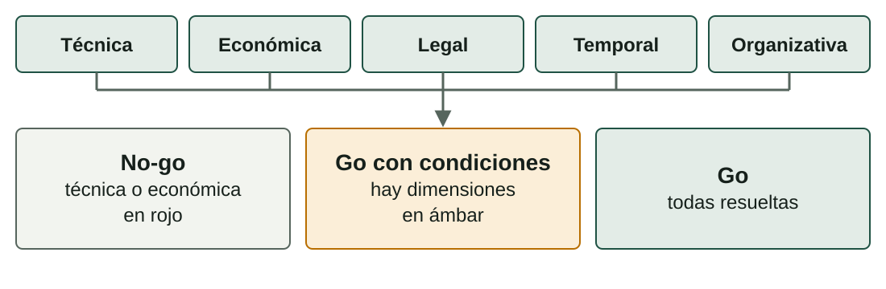

## Qué aprenderás

:::pasos
- Decidir si un proyecto **puede** y **debe** hacerse: la **viabilidad**
- Anotar los **riesgos iniciales**
- Prever los **recursos humanos y materiales**
- Construir un **presupuesto**: costes, contingencia, margen e IVA
:::

---

## Dos preguntas antes de gastar

:::pasos
- ¿**Puede** hacerse con lo que tenemos?
- ¿**Merece la pena**?
- Se contestan **con argumentos**, no con intuición
:::

---

## Cinco dimensiones de viabilidad

| Dimensión | Pregunta clave | Ejemplo (copias) |
|---|---|---|
| **Técnica** | ¿Sabemos y podemos hacerlo con los medios disponibles? | Sí: software de copias conocido y conexión suficiente |
| **Económica** | ¿Su coste es asumible y compensa? | Cuesta menos que recuperar datos tras una pérdida |
| **Legal** | ¿Cumple las normas sobre datos y licencias? | Copias cifradas y contrato de encargado de tratamiento |
| **Temporal** | ¿Cabe en el plazo? | Ocho semanas para cinco pymes |
| **Organizativa** | ¿Tenemos personas y coordinación? | Un técnico de campo y una persona de contacto por pyme |

---

## La viabilidad técnica compara alternativas

| Alternativa | Ventajas | Inconvenientes |
|---|---|---|
| **A.** Almacenamiento local con copia programada y copia externa cifrada | Restauración rápida; datos a salvo si falla el local | Más piezas que mantener |
| **B.** Solo copia en la nube | Menos hardware | Restauración lenta con mucho volumen; cuota permanente |

Se elige una y se **explica por qué**. Las descartadas **quedan en la memoria**.

---

## El resultado es una decisión

---

## Un no-go bien argumentado es un buen resultado

:::pasos
- Te ahorra trabajar en un proyecto **que no se sostiene**
- Si lo obtienes, vuelve a tu **matriz de ideas**
- Elige **la siguiente**
- **Go con condiciones**: anota qué hay que resolver y quién lo hará
:::

---

## Un riesgo es algo que puede ocurrir

:::pasos
- **Riesgo**: algo que puede ocurrir y, si ocurre, perjudica al proyecto
- En esta unidad, solo los **dos o tres más importantes**
- La gestión detallada llega en la **Unidad 3**
- **Probabilidad** (1, 2 o 3) × **impacto** (1, 2 o 3) = **puntuación** de 1 a 9
- Cada riesgo lleva una **respuesta**
:::

---

## Ejemplo de riesgos iniciales

| Riesgo | Prob. × impacto | Puntuación | Respuesta |
|---|---|---:|---|
| Una pyme no tiene conexión estable para la copia externa | 2 × 3 | **6** | Comprobarlo en el inventario; si falta, ampliar la copia local |
| Retraso en la entrega de los equipos | 2 × 2 | **4** | Pedirlos al empezar; tener un proveedor alternativo |
| Una restauración de prueba falla | 1 × 3 | **3** | Probar en el taller antes de instalar en el cliente |

---

## Prever los recursos

:::pasos
- ¿**Quién** hace falta?
- ¿**Cuántas horas**?
- ¿**Con qué**?
:::

---

## Recursos humanos: perfil, horas y coste por hora

:::pasos
- Por **perfil**, no por nombre
- Las **horas** salen de la EDT
- El coste por hora es lo que cuesta a la empresa **cada hora útil**, no el sueldo que ve la persona
:::

> **Coste por hora ≈ coste anual del puesto ÷ horas útiles al año**

---

## Ejemplo de coste por hora

:::pasos
- Técnico: 28.000 € ÷ 1.500 h ≈ **19 €/h**
- Responsable técnico: 36.000 € ÷ 1.500 h = **24 €/h**
- Auxiliar a media jornada: 12.000 € ÷ 750 h = **16 €/h**
:::

Cifras inventadas de la empresa ficticia de la Unidad 1.

---

## Recursos materiales

| Tipo | Qué incluye | Cómo se cuenta |
|---|---|---|
| **Equipos** | Ordenadores, almacenamiento, red, herramientas | Por unidad; si se reutilizan, solo la parte que se gasta (**amortización**) |
| **Licencias y servicios** | Software, suscripciones, nube | Por periodo de uso |
| **Subcontrataciones** | Trabajos con terceros | Por presupuesto del tercero |

Precios de **catálogos, tarifas o presupuestos reales**, con su fecha.

---

## Del coste al precio (1/2)

:::pasos
1. **Costes directos**: personas + equipos + licencias + subcontrataciones
2. **Costes indirectos**: lo que sostiene el proyecto sin cargarse a una tarea; un **porcentaje** de los directos (por ejemplo, 10 %)
3. **Contingencia**: reserva para imprevistos (por ejemplo, 5 %); se usa **solo si ocurre algo**
4. **Margen comercial**: lo que la empresa quiere ganar; en un proyecto de aula puede ser 0 %
:::

---

## Del coste al precio (2/2)

:::pasos
5. **Base imponible** = costes + margen
6. **IVA**: se añade a la base imponible
7. **Total** = base imponible + IVA
:::

Siempre el mismo camino: de los **costes** al **precio**.

---

## Ejemplo resuelto: personas

| Concepto | Cantidad | Precio unitario | Importe |
|---|---:|---:|---:|
| Técnico/a de campo | 40 h | 19 € | 760,00 € |
| Responsable técnico | 12 h | 24 € | 288,00 € |
| Administración | 6 h | 16 € | 96,00 € |

Proyecto de copias para cinco pymes de la empresa ficticia. **58 horas**, como en la EDT.

---

## Ejemplo resuelto: equipos y servicios

| Concepto | Cantidad | Precio unitario | Importe |
|---|---:|---:|---:|
| Almacenamiento en red de 2 bahías (sin discos) | 5 | 220 € | 1.100,00 € |
| Disco de 4 TB | 10 | 95 € | 950,00 € |
| Copia externa cifrada, un año | 5 | 96 € | 480,00 € |

Con las personas, los **costes directos** suman **3.674,00 €**.

---

## Ejemplo resuelto: hasta el total con IVA

---

## Lee el resultado y comprueba

:::pasos
- Por pyme: 5.904,79 ÷ 5 ≈ **1.180,96 €** con IVA
- Horas de personas: 40 + 12 + 6 = **58**
- Deben **coincidir con las de la EDT**
- Si no, el presupuesto y el plan **se contradicen**
:::

---

## Margen sobre el coste o sobre el precio

:::pasos
- **15 % sobre el coste** (4.243,47 €): margen de 636,52 €
- **15 % sobre el precio**: precio = 4.243,47 ÷ 0,85 ≈ **4.992,32 €**, margen de 748,85 €
- No es lo mismo: indica **siempre sobre qué base** lo calculas
:::

---

## El IVA bien tratado

:::pasos
- Se calcula sobre la **base imponible**, nunca sobre el coste con IVA
- Tipo general en España: **21 %**; consulta el vigente en la Agencia Tributaria
- Para quien puede deducirlo, el IVA de sus compras **no es un coste**: anota los precios **sin IVA**
- Catálogo con IVA incluido: **divide entre 1,21** (121 € → 100 €)
- En el presupuesto, una línea **aparte**
:::

---

## Errores frecuentes con el IVA

:::caution[Errores frecuentes]
Cuatro formas de equivocarse con el IVA y el margen.
:::

:::pasos
- Sumar el IVA a los costes **antes de aplicar el margen**
- Aplicar el 21 % **dos veces**
- Mezclar precios **con IVA y sin IVA** en la misma tabla
- Olvidar que una subcontrata **también lleva su IVA**
:::

---

## ¿Compensa?

:::pasos
- Compara el coste con lo que el proyecto **evita o genera**
- Pregunta cuánto cuesta **una pérdida de datos** a una pyme: días sin trabajar, recuperación, clientes perdidos
- Si **una sola incidencia grave** cuesta más que varios años de servicio, el proyecto tiene sentido
- Indica siempre qué datos son **estimaciones**
:::

---

## Pruébalo: viabilidad

::laboratorio[Viabilidad]{src="disenador-proyecto" pestana="viabilidad"}

---

## Pruébalo: presupuesto

::laboratorio[Presupuesto]{src="disenador-proyecto" pestana="presupuesto"}

---

## Resumen

- **Cinco dimensiones** de viabilidad; decisión **go, go con condiciones o no-go**
- Riesgos iniciales: **probabilidad × impacto**, con su respuesta
- Coste por hora = coste anual del puesto ÷ **horas útiles**
- Presupuesto: **directos → indirectos → contingencia → margen → base → IVA → total**
- Las horas del presupuesto **cuadran con la EDT**

[Actividades de la unidad →](/docencia/smr/proyecto-intermodular/ud02-diseno-proyecto/actividades/)
