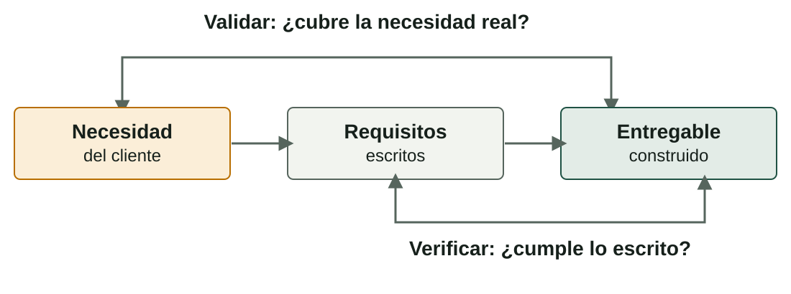

## Qué aprenderás

:::pasos
- Qué significa **calidad** en un proyecto
- Definir **criterios de aceptación** y de **verificación**
- Qué **normas y buenas prácticas** sirven de referencia
- Reunir todo en una **memoria de diseño** clara
- Revisarla antes de **entregar**
:::

---

## Calidad es cumplir lo acordado

:::pasos
- Lo que entregas **cumple lo que se acordó**…
- …y **sirve para lo que se necesitaba**
- No quiere decir «lujoso» ni «complicado»
- Unas copias de calidad **restauran los datos** cuando hace falta, no tienen más botones
:::

---

## Cuatro ideas para gestionarla

| Idea | Pregunta | Ejemplo (copias) |
|---|---|---|
| **Requisito** | ¿Qué se prometió? | La restauración tarda menos de 2 horas |
| **Criterio de aceptación** | ¿Cómo sabremos que se cumple? | Una restauración de prueba termina en menos de 2 horas |
| **Verificación** | ¿Hemos construido lo que dijimos? | Se ejecuta la prueba y se anota el tiempo |
| **Validación** | ¿Sirve para lo que el cliente necesita? | La persona de contacto recupera por sí misma un archivo |

---

## Verificar y validar no son lo mismo

Se puede verificar bien algo que no sirve.

---

## Cinco métodos de verificación

| Método | Qué es | Cuándo se usa |
|---|---|---|
| **Prueba** | Ejecutar y medir | Funciones y rendimiento |
| **Inspección** | Mirar el resultado con una lista | Instalaciones, etiquetado, cableado |
| **Revisión** | Que otra persona lea y critique | Documentos y configuraciones |
| **Demostración** | Mostrar que funciona ante el cliente | Entrega |
| **Medición** | Registrar un valor con un instrumento | Tiempos, temperatura, consumo |

---

## El plan de calidad: una fila por entregable

:::pasos
- Una tabla con **una fila por entregable**
- Cada fila: **criterio de aceptación**, **cómo se verifica** y **responsable**
- Si un entregable **no tiene criterio**, nadie podrá decir si está bien hecho
:::

---

## Ejemplo de plan de calidad

| Entregable | Criterio de aceptación | Verificación | Responsable |
|---|---|---|---|
| **Copias diarias** | Las 5 pymes, copia completa cada noche una semana | Registro de copias | Técnico/a de campo |
| **Restauración** | Copia de prueba restaurada en menos de 2 horas | Prueba y medición | Responsable técnico |
| **Manual** | Una persona sin conocimientos restaura un archivo con él | Demostración | Técnico/a de campo |
| **Acta de entrega** | Firmada por la persona de contacto de cada pyme | Revisión | Administración |

---

## Normas y marcos de referencia

:::caution[Cítalas con prudencia]
Las descripciones son orientativas. Antes de afirmar qué exige una norma, consulta su texto oficial o a tu profesor.
:::

:::pasos
- Sirven para saber **cómo se hace bien**
- En un pequeño proyecto **no se aplican enteras**
- Cita la que **inspira una decisión**
:::

---

## Referencias de calidad y datos

| Referencia | De qué trata | En tu proyecto |
|---|---|---|
| **ISO 9001** | Gestión de la calidad | Procedimientos, registrar fallos, mejorar |
| **ISO/IEC 27001** | Seguridad de la información | Confidencialidad, integridad y disponibilidad de los datos |
| **ITIL** | Gestión de servicios de TI | Registrar incidencias, acordar niveles de servicio |
| **RGPD** y su ley española | Tratamiento de datos personales | Cifrar copias, limitar accesos, contrato con quien trata los datos |

---

## Referencias de accesibilidad, personas y residuos

| Referencia | De qué trata | En tu proyecto |
|---|---|---|
| **Accesibilidad web (WCAG)** | Contenidos web usables por todas las personas | Una web o un manual digital |
| **Prevención de riesgos laborales** | Seguridad de quienes trabajan | Instalar con seguridad (Unidad 3) |
| **RAEE** | Gestión de equipos al final de su vida | Qué haces con el equipo que sustituyes |

---

## La lista de comprobación del laboratorio

:::pasos
- **Datos personales**
- **Seguridad de la información**
- **Accesibilidad**
- **Medio ambiente**
- **Licencias de software**
:::

Contesta **sí, no o no aplica**, con una nota: los «no» son **tareas pendientes**.

---

## La memoria de diseño

:::pasos
- Permite a **otra persona** entender, valorar y construir tu proyecto **sin hablar contigo**
- Es la **versión 1** del diseño
- En las unidades siguientes la completarás con **planificación, seguimiento y resultados**
:::

---

## Índice recomendado (1/3)

| Apartado | Qué incluye |
|---|---|
| **1. Resumen** | Una página: necesidad, solución, coste y plazo |
| **2. Antecedentes y necesidad** | Registro de necesidades y evidencias, empresa y contexto |
| **3. Objetivos y alcance** | Objetivos SMART; dentro y fuera del alcance |
| **4. Solución elegida** | Matriz de ideas, estado del arte, aspecto innovador y alternativas descartadas |

---

## Índice recomendado (2/3)

| Apartado | Qué incluye |
|---|---|
| **5. Diseño técnico** | Esquemas y descripción de cómo funciona |
| **6. Requisitos y partes** | Requisitos con prioridad, partes interesadas y EDT |
| **7. Recursos y presupuesto** | Personas, equipos y servicios; cálculo hasta el total con IVA |
| **8. Viabilidad y riesgos** | Dimensiones, decisión go/no-go, riesgos principales |

---

## Índice recomendado (3/3)

| Apartado | Qué incluye |
|---|---|
| **9. Calidad** | Plan de calidad y lista de comprobación |
| **10. Conclusiones y siguientes pasos** | Qué se ha decidido y qué viene |
| **Anexos** | Acta de ideas, fichas comparativas, fuentes |

Un índice fijo ayuda a **no olvidar nada** y a que se encuentre cada apartado rápido.

---

## Esquemas y diagramas

:::pasos
- **Esquema de la solución**: equipos y servicios, y cómo se conectan
- **Esquema de red**, si hay red: dispositivos, segmentos y direccionamiento
- **Diagrama de flujo** del procedimiento clave: «copia diaria → verificación → aviso»
:::

Un buen esquema vale más que dos páginas de texto.

---

## Reglas de un buen esquema

:::pasos
- Un **título**
- Una **leyenda** si hay símbolos
- Texto **legible al imprimir en blanco y negro**
- **Una frase** antes o después que explique qué se ve
:::

---

## Escribir para que se entienda

:::pasos
- **Frases cortas** y precisas; una idea por párrafo; cifras con unidad y fuente
- **Revisa la ortografía**: los errores restan credibilidad
- **Cita las fuentes** y no copies textos ajenos
- Si usaste IA, **declara** cuál, para qué y qué comprobaste
- **Numera las versiones**: `memoria-diseno-v1.pdf`, no `definitivo-final2.docx`
:::

---

## Documentos de la unidad (1/2)

| Documento | Pestaña del laboratorio |
|---|---|
| Registro de necesidades | Necesidades |
| Acta de ideas y matriz de decisión | Ideas |
| Ficha comparativa de soluciones | Ideas |
| Informe de viabilidad | Viabilidad |
| Propuesta, objetivos, alcance y EDT | Requisitos, Alcance y EDT |

---

## Documentos de la unidad (2/2)

| Documento | Pestaña del laboratorio |
|---|---|
| Recursos y presupuesto | Presupuesto |
| Memoria de diseño v1 | Memoria |
| Plan de calidad | Calidad |
| Guion y diapositivas de la presentación | Memoria |

---

## Lista de revisión antes de entregar (1/2)

:::pasos
1. ¿Cada necesidad tiene **evidencia y fuente**?
2. ¿Hay acta con **al menos seis ideas** y una decisión razonada?
3. ¿Los objetivos son **SMART** y el alcance dice también lo que **no** entra?
4. ¿Los requisitos **Must** son menos del 60 % y cada uno tiene a alguien detrás?
:::

---

## Lista de revisión antes de entregar (2/2)

:::pasos
5. ¿Las **horas de la EDT** coinciden con las del presupuesto?
6. ¿Los precios llevan **fuente y fecha**, y el IVA está bien separado?
7. ¿Cada entregable tiene **criterio de aceptación**?
8. ¿Se ha revisado la **ortografía** y se han citado las fuentes?
:::

---

## Pruébalo: calidad

::laboratorio[Calidad]{src="disenador-proyecto" pestana="calidad"}

---

## Pruébalo: la memoria

::laboratorio[Memoria y autoevaluación]{src="disenador-proyecto" pestana="practica"}

---

## Resumen

- **Calidad** = cumplir lo acordado y servir para lo que se necesitaba
- **Verificar** (cumple lo escrito) y **validar** (cubre la necesidad real)
- El **plan de calidad** da a cada entregable su criterio, su verificación y su responsable
- La **memoria de diseño** sigue un índice fijo, con esquemas, fuentes y versiones numeradas
- Antes de entregar: **revisa la lista**

[Actividades de la unidad →](/docencia/smr/proyecto-intermodular/ud02-diseno-proyecto/actividades/)
