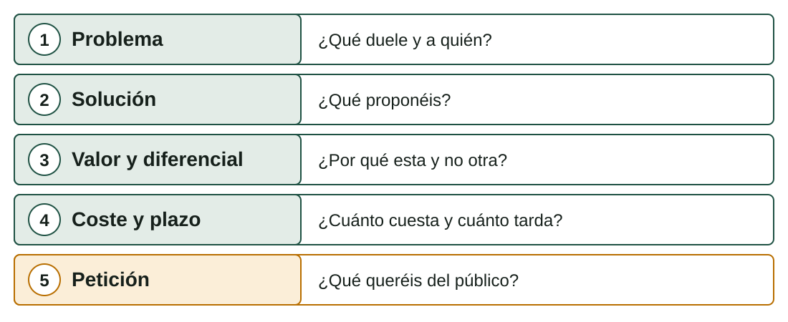

## Qué aprenderás

:::pasos
- Qué se espera de una **presentación breve**
- Estructurar el **guion** y calcular el **tiempo**
- Preparar **diapositivas** con una sola idea
- **Ensayar** y responder a las **preguntas** del público
- **Valorar** las exposiciones de los demás
:::

---

## Si nadie lo entiende en cinco minutos…

:::pasos
- Presentar tu idea en público te obliga a quedarte con **lo esencial**
- Te obliga a **defender tus decisiones**
- Y te deja **escuchar objeciones** antes de gastar más tiempo
- Tu público: **tus compañeros**
:::

---

## Cinco preguntas que debe contestar

---

## Las cinco partes con el proyecto de copias

| Parte | Ejemplo |
|---|---|
| **Problema** | «3 de 25 pymes con contrato perdieron archivos el año pasado» (dato inventado) |
| **Solución** | «Copia diaria automática y una restauración de prueba cada mes» |
| **Valor y diferencial** | «Además de copiar, comprueba que se puede recuperar» |
| **Coste y plazo** | «5.904,79 € con IVA para cinco pymes; ocho semanas» |
| **Petición** | «Que nos digáis si veis algún riesgo que no hayamos visto» |

---

## Tres a cinco minutos no dan para contarlo todo

:::pasos
- Una exposición de **tres a cinco minutos** (propuesta; tu profesor puede cambiarlo)
- No sirve para contarlo todo
- Sirve para que el público conteste **cinco preguntas** sobre tu proyecto
:::

---

## Calcular el tiempo

| Tiempo | Palabras aproximadas |
|---|---:|
| 3 minutos | 390 |
| 4 minutos | 520 |
| 5 minutos | 650 |

Hablando con claridad, unas **130 palabras por minuto** (cifra orientativa). Un guion de 800 palabras **no cabe**: recorta.

---

## Las diapositivas acompañan, no sustituyen

:::pasos
- Acompañan lo que dices
- **Cinco a siete** bastan
- No leas la diapositiva: **la completas con la voz**
:::

---

## Un guion de siete diapositivas

:::pasos
1. **Título**, equipo y necesidad
2. **Problema** con un dato
3. **Solución** (esquema sencillo)
4. Lo que **aporta**: innovación y diferencial
5. **Coste y plazo**
6. **Riesgos** principales y calidad
7. **Cierre y petición**
:::

---

## Reglas de una buena diapositiva

:::pasos
- **Una idea** por diapositiva: si necesitas «y además», son dos
- **Pocas palabras**: frases cortas o cifras grandes
- **Letra grande** y buen contraste, sin fondos recargados
- Un **esquema** vale más que cinco líneas de texto
- Cada diapositiva tiene **un tiempo asignado**; la suma encaja en el total
- Si usas imágenes o cifras de otros, **cita la fuente** en la diapositiva
:::

---

## Ensayar y repartir

:::pasos
- **Reparad el discurso**: que hablen todos los miembros
- Quien presenta una parte **conoce también las demás**: le preguntarán
- Ensaya **con cronómetro** y en voz alta, al menos **dos veces**
- Si te pasas, **se corta**: respetar el tiempo es parte de una buena presentación
:::

---

## Empezar con gancho, terminar con la petición

:::pasos
- Empieza con una frase que enganche: una **cifra** o una **pregunta**
- Termina con **la petición**, no con «ya está, gracias»
- Prepara una **versión de reserva** por si falla el proyector
- Unas hojas impresas o la presentación en **dos sitios distintos**
:::

---

## Cinco tipos de pregunta del público

| Categoría | Ejemplo | Cómo responder |
|---|---|---|
| **Técnica** | «¿Y si se cae Internet?» | Con el diseño: alternativa o copia local |
| **Coste** | «¿Por qué cuesta eso?» | Con el desglose del presupuesto |
| **Riesgo** | «¿Qué pasa si una pyme se niega?» | Con el riesgo anotado y su respuesta |
| **Calidad** | «¿Cómo sabéis que funciona?» | Con el criterio de aceptación |
| **Sostenibilidad** | «¿Qué hacéis con los discos viejos?» | Con la gestión de residuos |

---

## Cómo responder

:::pasos
- **Escucha** la pregunta entera
- **Repítela** con tus palabras si dudas
- Contesta en **pocas frases**
- Si no lo sabes, dilo: «no lo hemos estudiado; **lo comprobaremos** y lo añadiremos a la memoria»
- Es mejor que **inventar**
:::

---

## Valorar a los demás es aprender de ellos

:::pasos
- Una **rúbrica de coevaluación** de 1 a 4
- **Seis criterios**: claridad, estructura, argumentos, tiempo, recursos y respuestas
- Es **una ayuda** para aprender de los otros equipos
:::

---

## Rúbrica: claridad, estructura y argumentos

| Criterio | Nivel 1 | Nivel 4 |
|---|---|---|
| **Claridad** | No se entiende el problema ni la solución | Se entiende todo a la primera |
| **Estructura** | Desordenada | Sigue las cinco partes con transiciones claras |
| **Argumentos** | Afirmaciones sin datos | Datos con fuente y decisiones justificadas |

---

## Rúbrica: tiempo, recursos y respuestas

| Criterio | Nivel 1 | Nivel 4 |
|---|---|---|
| **Tiempo** | Se pasa o se queda muy corto | Ajustado al tiempo marcado |
| **Recursos** | Diapositivas ilegibles o cargadas | Limpias, con una idea cada una |
| **Respuestas** | No responde o improvisa | Responde con base en el proyecto |

---

## Cada valoración termina igual

:::pasos
- **Una cosa que ha funcionado**
- **Una mejora concreta**
- Escritas **con respeto**
- Se critica **la exposición, no a las personas**
:::

---

## Pruébalo

::laboratorio[Memoria y autoevaluación]{src="disenador-proyecto" pestana="practica"}

---

## Resumen

- Una exposición breve contesta **cinco preguntas**: problema, solución, valor, coste y plazo, petición
- Unas **130 palabras por minuto**: el guion cabe en el tiempo
- **Una idea** por diapositiva y letra grande
- **Ensaya** con cronómetro y prepara respuestas a **cinco tipos de pregunta**
- Valora a los demás con **respeto**: algo que funcionó y una mejora

[Actividades de la unidad →](/docencia/smr/proyecto-intermodular/ud02-diseno-proyecto/actividades/)
