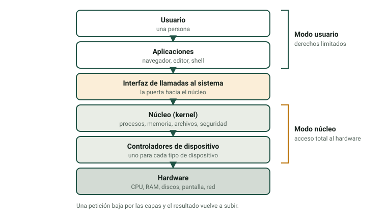
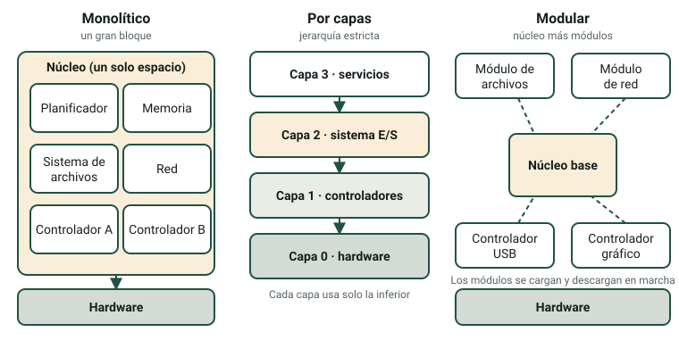

Todos los programas que usas, desde un navegador hasta un juego, dependen del sistema operativo. Es el software que permite que muchos programas y muchos usuarios compartan una máquina sin estropearla. En esta página aprenderás qué hace un sistema operativo, cómo se puede organizar su núcleo, cómo clasificamos los sistemas operativos y cómo elegir uno.

:::tip[Cómo usar esta página]
1. Lee los apartados 1 a 6 (unos 50 minutos).
2. Practica con el laboratorio [Explorador del sistema](/docencia/smr/som/ud01-introduccion/laboratorios/explorador-del-sistema/?lang=es#layers): las pestañas **Las capas del SO**, **Arquitecturas del núcleo** y **Clasificador de SO** corresponden a los apartados 1 a 5.
3. Responde a las preguntas del final y haz las [actividades 4 y 7](/docencia/smr/som/ud01-introduccion/actividades/es/).
:::

## 1. ¿Qué es un sistema operativo?

Un **sistema operativo** (SO) es la pieza principal del software de sistema de un ordenador. Gestiona el hardware y coordina todos los demás programas. Da tiempo de CPU y memoria a cada programa, controla los dispositivos, organiza los archivos y protege el sistema. Sin un SO, cada aplicación tendría que saber por sí sola cómo hablar con cada disco, pantalla e impresora.

Puedes imaginar el SO como una capa entre las aplicaciones y el hardware:

La parte más importante del SO es el **núcleo** (*kernel*). Está siempre en memoria y tiene acceso total al hardware. El SO incluye también programas del sistema y bibliotecas alrededor del núcleo, como el intérprete de órdenes (*shell*) y el gestor de archivos.

La mayoría de los procesadores tiene al menos dos **niveles de privilegio**:

- **Modo usuario.** Aquí se ejecutan las aplicaciones, con derechos limitados. No pueden acceder directamente al hardware.
- **Modo núcleo.** Aquí se ejecuta el núcleo, con acceso total al hardware.

Esta separación protege el sistema: una aplicación defectuosa o maliciosa no puede tomar el control de toda la máquina. Cuando una aplicación necesita un servicio (abrir un archivo, enviar datos por la red, crear otro proceso), hace una **llamada al sistema**. La CPU pasa a modo núcleo, el núcleo hace el trabajo y devuelve el resultado a la aplicación.

:::note[¿Por qué «monopuesto» en el nombre del módulo?]
El nombre del módulo, *Sistemas Operativos Monopuesto*, se refiere a los sistemas operativos que se usan en un único puesto de trabajo: Windows, macOS y Linux en un PC. Los sistemas de escritorio modernos pueden tener varias cuentas, pero normalmente una sola persona se sienta ante el ordenador. Lo verás en los criterios de clasificación de más abajo.
:::

## 2. Funciones de un sistema operativo

| Función | Qué hace el SO | Ejemplo |
|---|---|---|
| **Gestión de procesos** | Crea y termina procesos; decide qué proceso usa la CPU y durante cuánto tiempo (*planificación*); cambia de uno a otro (*cambio de contexto*). | Escuchas música mientras escribes un documento |
| **Gestión de memoria** | Da memoria a cada proceso, aísla los procesos entre sí y usa espacio de disco cuando se llena la RAM (*memoria virtual*). | Un juego que falla no borra tu archivo de texto |
| **Gestión de archivos** | Organiza los datos en archivos y carpetas en el almacenamiento; controla nombres, tamaños, fechas y permisos. | Guardar, copiar o borrar un documento |
| **Gestión de dispositivos** | Controla los dispositivos mediante controladores; atiende interrupciones y colas de peticiones. | Imprimir tres documentos por orden |
| **Seguridad y protección** | Comprueba quién eres (*autenticación*) y qué puedes hacer (*autorización*); guarda registros e instala actualizaciones. | Un usuario estándar no puede instalar controladores |
| **Interfaz de usuario** | Permite usar el sistema: una interfaz gráfica (GUI) o una línea de órdenes (CLI). | El escritorio de Windows, un terminal con Bash o PowerShell |

Un **proceso** es un programa en ejecución, con su propio espacio de memoria y sus propios recursos. Un mismo programa puede estar ejecutándose como varios procesos.

### 2.1 ¿Qué pasa cuando guardas un archivo?

Sigue la petición a través de las capas del dibujo de arriba:

1. Pulsas **Guardar**. La aplicación pide al SO que escriba los datos en un archivo (**llamada al sistema**).
2. La CPU pasa a modo núcleo. El **núcleo** comprueba tus permisos, busca espacio libre en el sistema de archivos y guarda los datos en un búfer de memoria.
3. El **controlador** del SSD traduce la petición a órdenes para ese SSD concreto.
4. El **SSD** guarda los bits y lanza una *interrupción* para avisar de que ha terminado.
5. El núcleo vuelve a la aplicación, que muestra «Guardado».

La pestaña **Las capas del SO** del laboratorio te deja seguir esta petición paso a paso, con la interfaz gráfica y con la línea de órdenes.

## 3. Estructura del sistema operativo

La **estructura** de un SO es la manera en que está organizado su núcleo. La estructura afecta a la velocidad, la estabilidad, la seguridad y la facilidad para ampliarlo. Los núcleos reales suelen mezclar ideas, pero hay tres diseños clásicos:

| | Monolítico | Por capas | Modular |
|---|---|---|---|
| **Idea** | Todos los servicios básicos (planificador, memoria, sistemas de archivos, controladores, red) se ejecutan juntos en modo núcleo en **un único espacio de direcciones**. | El SO se divide en **capas ordenadas**. Una capa usa solo los servicios de la capa inmediatamente inferior. | Un **núcleo pequeño** más **módulos** (controladores, sistemas de archivos) que se pueden cargar y descargar con el sistema en marcha. |
| **Ventajas** | Muy rápido: las partes se llaman directamente. | Interfaces claras; fácil de probar y de localizar errores. | Flexible: se añade un controlador sin recompilar el núcleo; poco consumo de memoria. |
| **Inconvenientes** | Un error en una parte (por ejemplo un controlador) puede hacer caer todo el sistema; grande y difícil de mantener. | Sobrecarga porque las peticiones atraviesan varias capas; no toda función encaja en una jerarquía estricta. | Los módulos se ejecutan con todos los privilegios, así que un módulo defectuoso sigue siendo peligroso; la interfaz entre el núcleo y los módulos debe mantenerse estable. |
| **Ejemplos** | Los UNIX tradicionales y los primeros BSD | El sistema de libro de texto llamado THE; ideas de capas en Windows NT | Linux (un núcleo monolítico con módulos cargables), macOS, Solaris |

:::caution[Los núcleos reales son híbridos]
La mayoría de los núcleos modernos son híbridos. De Linux se dice que es monolítico *y* modular. El núcleo de Windows (NT) y el de macOS (XNU) suelen llamarse *núcleos híbridos*, porque combinan ideas de varios diseños. Un cuarto diseño, el **microkernel**, deja en modo núcleo solo un núcleo diminuto y ejecuta los controladores y servicios como programas normales; es muy estable, pero necesita más comunicación entre las partes. No te preocupes por la etiqueta exacta: aprende los compromisos entre velocidad, seguridad y flexibilidad.
:::

## 4. Sistemas operativos actuales

| SO | Fabricante | Dispositivos típicos | Núcleo | Tipo de licencia | Uso principal |
|---|---|---|---|---|---|
| **Windows** | Microsoft | PC, portátiles, servidores, tabletas | Windows NT (híbrido) | Propietaria | Oficinas, juegos, empresas |
| **macOS** | Apple | Ordenadores de Apple | XNU (híbrido, basado en Darwin) | Propietaria (el núcleo Darwin es de código abierto) | Trabajo creativo, desarrollo |
| **Linux** (muchas distribuciones: Ubuntu, Debian, Fedora…) | Comunidad y empresas | Servidores, PC, dispositivos empotrados, superordenadores | Linux | Código abierto | Servidores, nube, desarrollo, educación |
| **Android** | Google | Móviles, tabletas, televisores, relojes | Núcleo Linux | Base de código abierto (AOSP) más partes propietarias | Dispositivos móviles |
| **iOS / iPadOS** | Apple | iPhone y iPad | XNU (Darwin) | Propietaria | Dispositivos móviles |
| **ChromeOS** | Google | Chromebooks | Núcleo Linux | Mixta: base abierta (ChromiumOS) y partes propietarias | Educación, trabajo en la web |

Notas:

- «Linux» es, estrictamente, el núcleo. Una **distribución** añade software, un gestor de paquetes y un entorno de escritorio para formar un SO completo.
- La proporción de cada SO cambia según el tipo de dispositivo y el país. Para datos actualizados consulta una fuente independiente como StatCounter Global Stats. No memorices porcentajes: cambian cada mes.

## 5. Criterios para clasificar los sistemas operativos

Un mismo SO puede pertenecer a varias categorías a la vez. Cada criterio mira una propiedad distinta:

| Criterio | Categorías | Significado y ejemplos |
|---|---|---|
| **Por estructura** | Monolítico, por capas, modular | Cómo está organizado el núcleo (apartado 3). |
| **Por usuarios** | Monousuario, multiusuario, de red, distribuido | *Monousuario:* un usuario a la vez, poca separación (MS-DOS). *Multiusuario:* muchas cuentas con permisos (Linux, Windows). *De red:* centrado en compartir recursos en una LAN (Windows Server, Linux con Samba). *Distribuido:* muchas máquinas que parecen una sola (sobre todo sistemas de investigación). |
| **Por multitarea** | Monotarea, multitarea (tiempo compartido), tiempo real | *Monotarea:* un programa a la vez (MS-DOS). *Multitarea:* muchos programas se reparten el tiempo de CPU (todos los SO de escritorio actuales). *Tiempo real:* garantiza tiempos máximos de respuesta: **estricto** (*hard*; si se pierde un plazo, el sistema falla: airbags, marcapasos) o **flexible** (*soft*; se tolera un retraso: reproducción de vídeo). |
| **Por licencia** | Propietario, de código abierto, gratuito (freeware) | Quién es el dueño del código y qué puedes hacer con él (véase la [página 4](/docencia/smr/som/ud01-introduccion/04-software-licences/es/)). *Comercial* y *código abierto* no son opuestos: una empresa puede vender soporte para un SO de código abierto. |
| **Por número de CPU** | Monoprocesador, multiprocesador (SMP) | *SMP* (multiprocesamiento simétrico): varias CPU o núcleos comparten la misma memoria bajo el control de un solo SO. Hoy todos los PC y móviles tienen un procesador multinúcleo. |

**Ejemplo.** Ubuntu Desktop es *modular* (núcleo Linux con módulos cargables), *multiusuario*, *multitarea*, de *código abierto* y *multiprocesador*. Un SO de tiempo real como FreeRTOS es de *tiempo real*, normalmente *monousuario* y de código abierto.

## 6. Idoneidad del hardware y elección del sistema operativo

Antes de instalar un SO debes comprobar que el ordenador puede ejecutarlo (**idoneidad del hardware**) y que el SO es adecuado para el trabajo.

### 6.1 Comprobar el hardware

Cada SO publica sus **requisitos**:

- **Requisitos mínimos:** el SO arranca y funciona, aunque quizá despacio.
- **Requisitos recomendados:** el SO funciona con comodidad.

Compáralos con tu ordenador: tipo y número de núcleos de la CPU (32 o 64 bits), cantidad de RAM, espacio libre en disco, gráficos, firmware (UEFI, chip TPM) y controladores para tus dispositivos. No olvides las aplicaciones que también necesitas: tienen sus propios requisitos.

:::note[No te fíes de cifras antiguas]
Los requisitos cambian con cada versión. Por ejemplo, en el momento de escribir esto Windows 11 pide un procesador de 64 bits con al menos dos núcleos, 4 GB de RAM, 64 GB de almacenamiento, UEFI con arranque seguro (Secure Boot) y un chip TPM 2.0. Lee siempre la página actual del fabricante antes de decidir.
:::

### 6.2 Elegir el sistema operativo

Usa estas preguntas, en este orden:

1. **¿Para qué?** ¿Ofimática, diseño, programación, un servidor, un quiosco, un dispositivo móvil?
2. **¿Qué software debe funcionar?** Algunas aplicaciones existen solo para un SO.
3. **¿Qué hardware tengo?** Un ordenador antiguo con 4 GB de RAM puede necesitar un sistema ligero.
4. **¿Cuánto cuesta?** Precio de la licencia, soporte, formación y actualizaciones (no solo el precio de compra).
5. **¿Quién lo administrará?** Conocimientos del equipo, gestión remota, soporte disponible.
6. **¿Qué seguridad ofrece y durante cuánto tiempo recibe soporte?** Mira la política de actualizaciones y la fecha de fin de soporte.

*Ejemplo.* Un centro educativo tiene 20 PC antiguos con 4 GB de RAM y 2 núcleos. El alumnado solo necesita un navegador, una suite ofimática y herramientas de programación. Una distribución ligera de Linux es una buena opción: no tiene coste de licencia, funciona bien en hardware antiguo e incluye las herramientas. Si el centro dependiera de un programa solo para Windows, la respuesta sería otra.

## Comprueba lo aprendido

1. Nombra las seis funciones de un sistema operativo y da un ejemplo de cada una.

   

   
Respuesta

   Gestión de procesos (decidir qué programa usa la CPU), gestión de memoria (memoria virtual), gestión de archivos (guardar y borrar archivos), gestión de dispositivos (imprimir mediante un controlador), seguridad y protección (cuentas de usuario y permisos) e interfaz de usuario (GUI y línea de órdenes).

   

2. ¿Qué es una llamada al sistema y por qué la necesitan las aplicaciones?

   

   
Respuesta

   Es una petición de una aplicación al núcleo para hacer algo que la aplicación no puede hacer por sí sola, como escribir en un disco. Las aplicaciones se ejecutan en modo usuario y no pueden acceder al hardware, así que se lo piden al núcleo, que se ejecuta en modo núcleo.

   

3. Un controlador tiene un error. ¿Qué pasa en un núcleo monolítico y en uno modular?

   

   
Respuesta

   En un núcleo monolítico el controlador se ejecuta dentro del único espacio de direcciones del núcleo, así que el error puede hacer caer todo el sistema. En un núcleo modular el controlador es un módulo que también se ejecuta en modo núcleo, por lo que el sistema también puede caer; la ventaja del diseño modular es que puedes corregir, sustituir, cargar o descargar el módulo sin recompilar el núcleo.

   

4. Clasifica Windows 11 por usuarios, multitarea, licencia y número de CPU.

   

   
Respuesta

   Multiusuario (varias cuentas con permisos), multitarea (tiempo compartido), propietario y multiprocesador (admite CPU multinúcleo).

   

5. Un PC tiene 4 GB de RAM, una CPU de 64 bits con dos núcleos, un disco de 250 GB y firmware BIOS antiguo (sin UEFI). Nombra dos cosas que debes comprobar antes de elegir un SO para él.

   

   
Respuesta

   Los requisitos mínimos y recomendados de cada SO (RAM, CPU, espacio en disco) y los requisitos de firmware (algunos SO necesitan UEFI o un chip TPM). También si hay controladores para sus dispositivos y si las aplicaciones que necesitas funcionan en ese SO.

   

## Glosario

| English | Castellano |
|---|---|
| operating system (OS) | sistema operativo (SO) |
| kernel | núcleo |
| user mode / kernel mode | modo usuario / modo núcleo (modo kernel) |
| system call | llamada al sistema |
| process | proceso |
| scheduling | planificación |
| virtual memory | memoria virtual |
| file system | sistema de archivos |
| device driver | controlador de dispositivo |
| interrupt | interrupción |
| authentication / authorisation | autenticación / autorización |
| GUI / CLI | interfaz gráfica / línea de órdenes |
| monolithic / layered / modular | monolítico / por capas / modular |
| microkernel | microkernel, micronúcleo |
| multitasking | multitarea |
| real-time | tiempo real |
| requirements | requisitos |

:::note[Créditos]
Esta página adapta los apuntes del curso de SOM de Moisés Mas Rocamora, Daniel Álvarez Santamaría y Jana Taboada León, con licencia CC BY-NC-SA 4.0. Esta página se comparte con la misma licencia.
:::
