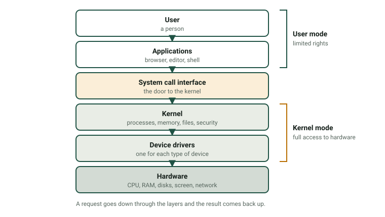
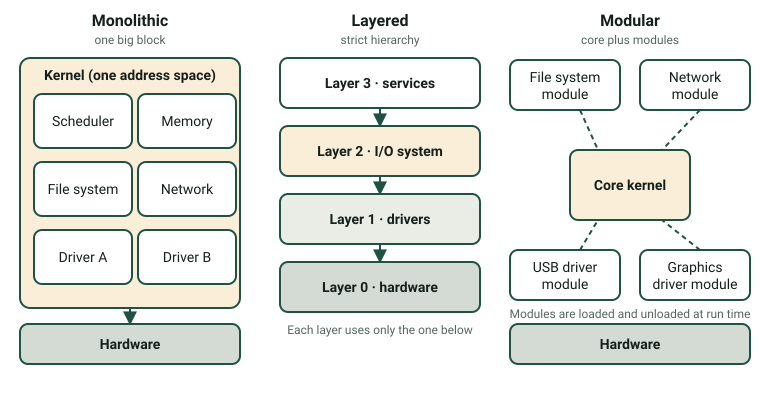

Every program you use, from a browser to a game, depends on the operating system. It is the software that lets many programs and many users share one machine without breaking it. In this page you will learn what an operating system does, how its kernel can be organised, how we classify operating systems and how to choose one.

:::tip[How to use this page]
1. Read sections 1 to 6 (about 50 minutes).
2. Practise with the [Computer System Explorer](/docencia/smr/som/ud01-introduccion/laboratorios/explorador-del-sistema/#layers) lab: the tabs **The OS layer cake**, **Kernel architectures** and **OS classifier** match sections 1 to 5.
3. Answer the questions at the end and do [Activity 4 and 7](/docencia/smr/som/ud01-introduccion/actividades/).
:::

## 1. What is an operating system?

An **operating system** (OS) is the main piece of system software of a computer. It manages the hardware and coordinates all the other programs. It gives CPU time and memory to each program, controls the devices, organises the files and protects the system. Without an OS, every application would have to know how to talk to every disk, screen and printer by itself.

You can imagine the OS as a layer between the applications and the hardware:

The most important part of the OS is the **kernel**. It is always in memory and it has full access to the hardware. The OS also includes system programs and libraries around the kernel, such as the shell and the file manager.

Most processors have at least two **privilege levels**:

- **User mode.** Applications run here with limited rights. They cannot access the hardware directly.
- **Kernel mode.** The kernel runs here with full access to the hardware.

This separation protects the system: a faulty or malicious application cannot take control of the whole machine. When an application needs a service (open a file, send data over the network, create another process), it makes a **system call**. The CPU switches to kernel mode, the kernel does the job and returns the result to the application.

:::note[Why "single-user" in the name of the module?]
The module name *Sistemas Operativos Monopuesto* refers to operating systems used on one single workstation: Windows, macOS and Linux on a PC. Modern desktop systems can have several accounts, but normally one person sits at the computer. You will see this in the classification criteria below.
:::

## 2. Functions of an operating system

| Function | What the OS does | Example |
|---|---|---|
| **Process management** | Creates and ends processes; decides which process uses the CPU and for how long (*scheduling*); switches between them (*context switch*). | You listen to music while you write a document |
| **Memory management** | Gives memory to every process, isolates processes from each other and uses disk space when RAM is full (*virtual memory*). | A crashing game does not delete your text file |
| **File management** | Organises data in files and folders on the storage; controls names, sizes, dates and permissions. | Saving, copying or deleting a document |
| **Device management** | Controls the devices through drivers; handles interrupts and queues of requests. | Printing three documents in order |
| **Security and protection** | Checks who you are (*authentication*) and what you may do (*authorisation*); keeps logs and installs updates. | A standard user cannot install drivers |
| **User interface** | Lets people use the system: a graphical interface (GUI) or a command line (CLI). | Windows desktop, a Bash or PowerShell terminal |

A **process** is a program that is running, with its own memory space and resources. The same program can be running as several processes.

### 2.1 What happens when you save a file?

Follow the request through the layers of the picture above:

1. You click **Save**. The application asks the OS to write the data to a file (**system call**).
2. The CPU switches to kernel mode. The **kernel** checks your permissions, finds free space in the file system and keeps the data in a memory buffer.
3. The **driver** of the SSD translates the request into commands for that specific SSD.
4. The **SSD** stores the bits and raises an *interrupt* to say "finished".
5. The kernel returns to the application, which shows "Saved".

The tab **The OS layer cake** of the lab lets you follow this request step by step, in the GUI and in the command line.

## 3. Structure of the operating system

The **structure** of an OS means how its kernel is organised. The structure affects speed, stability, security and how easy it is to extend. Real kernels often mix ideas, but there are three classic designs:

| | Monolithic | Layered | Modular |
|---|---|---|---|
| **Idea** | All core services (scheduler, memory, file systems, drivers, networking) run together in kernel mode in **one address space**. | The OS is divided into **ordered layers**. A layer uses only the services of the layer directly below. | A **small core** plus **modules** (drivers, file systems) that can be loaded and unloaded while the system is running. |
| **Advantages** | Very fast: parts call each other directly. | Clear interfaces; easy to test and to find errors. | Flexible: add a driver without rebuilding the kernel; small memory use. |
| **Disadvantages** | A bug in one part (for example a driver) can crash the whole system; large and hard to maintain. | Overhead because requests cross several layers; not every feature fits a strict hierarchy. | Modules run with full privileges, so a bad module is still dangerous; the interface between kernel and modules must stay stable. |
| **Examples** | Traditional UNIX and early BSD systems | The textbook system called THE; ideas of layers in Windows NT | Linux (a monolithic kernel with loadable modules), macOS, Solaris |

:::caution[Real kernels are hybrids]
Most modern kernels are hybrids. Linux is described as monolithic *and* modular. The kernel of Windows (NT) and the kernel of macOS (XNU) are usually called *hybrid kernels*, because they combine ideas from several designs. A fourth design, the **microkernel**, keeps only a tiny core in kernel mode and runs drivers and services as normal programs; it is very stable but needs more communication between parts. Do not worry about the exact label: learn the trade-offs between speed, safety and flexibility.
:::

## 4. Current operating systems

| OS | Made by | Typical devices | Kernel | Licence type | Main use |
|---|---|---|---|---|---|
| **Windows** | Microsoft | PCs, laptops, servers, tablets | Windows NT (hybrid) | Proprietary | Offices, gaming, companies |
| **macOS** | Apple | Apple computers | XNU (hybrid, based on Darwin) | Proprietary (the Darwin core is open source) | Creative work, development |
| **Linux** (many distributions: Ubuntu, Debian, Fedora…) | Community and companies | Servers, PCs, embedded devices, supercomputers | Linux | Open source | Servers, cloud, development, education |
| **Android** | Google | Phones, tablets, TVs, wearables | Linux kernel | Open source base (AOSP) plus proprietary parts | Mobile devices |
| **iOS / iPadOS** | Apple | iPhone and iPad | XNU (Darwin) | Proprietary | Mobile devices |
| **ChromeOS** | Google | Chromebooks | Linux kernel | Mixed: open base (ChromiumOS) and proprietary parts | Education, web-based work |

Notes:

- "Linux" is strictly the kernel. A **distribution** adds software, a package manager and a desktop environment to make a complete OS.
- The proportion of each OS changes with the type of device and the country. For up-to-date data look at an independent source such as StatCounter Global Stats. Do not memorise percentages: they change every month.

## 5. Criteria to classify operating systems

The same OS can belong to several categories at once. Each criterion looks at a different property:

| Criterion | Categories | Meaning and examples |
|---|---|---|
| **By structure** | Monolithic, layered, modular | How the kernel is organised (section 3). |
| **By users** | Single-user, multi-user, network, distributed | *Single-user:* one user at a time, little separation (MS-DOS). *Multi-user:* many accounts with permissions (Linux, Windows). *Network:* focused on sharing resources in a LAN (Windows Server, Linux with Samba). *Distributed:* many machines that look like one (mostly research systems). |
| **By multitasking** | Single-tasking, multitasking (time-sharing), real-time | *Single-tasking:* one program at a time (MS-DOS). *Multitasking:* many programs share the CPU time (all current desktop OSes). *Real-time:* guarantees maximum response times: **hard** real-time (a missed deadline is a failure: car airbags, pacemakers) or **soft** real-time (a delay is tolerated: video playback). |
| **By licence** | Proprietary, open source, freeware | Who owns the code and what you may do with it (see [page 4](/docencia/smr/som/ud01-introduccion/04-software-licences/)). *Commercial* and *open source* are not opposites: a company can sell support for an open-source OS. |
| **By number of CPUs** | Single-processor, multiprocessor (SMP) | *SMP* (symmetric multiprocessing): several CPUs or cores share the same memory under the control of one OS. Today every PC and phone has a multi-core processor. |

**Example.** Ubuntu Desktop is *modular* (Linux kernel with loadable modules), *multi-user*, *multitasking*, *open source* and *multiprocessor*. A real-time OS such as FreeRTOS is *real-time*, usually *single-user* and open source.

## 6. Hardware suitability and choosing an operating system

Before you install an OS you must check that the computer can run it (**hardware suitability**) and that the OS is right for the job.

### 6.1 Check the hardware

Every OS publishes its **requirements**:

- **Minimum requirements:** the OS starts and works, but possibly slowly.
- **Recommended requirements:** the OS works comfortably.

Compare them with your computer: type and number of cores of the CPU (32-bit or 64-bit), amount of RAM, free disk space, graphics, firmware (UEFI, TPM chip) and drivers for your devices. Do not forget the applications you also need: they have their own requirements.

:::note[Do not trust old numbers]
Requirements change with every version. For example, at the time of writing Windows 11 asks for a 64-bit processor with at least two cores, 4 GB of RAM, 64 GB of storage, UEFI with Secure Boot and a TPM 2.0 chip. Always read the current page of the vendor before you decide.
:::

### 6.2 Choose the operating system

Use these questions, in this order:

1. **What for?** Office work, design, programming, a server, a kiosk, a mobile device?
2. **Which software must run?** Some applications exist only for one OS.
3. **Which hardware do I have?** An old computer with 4 GB of RAM may need a light system.
4. **How much does it cost?** Licence price, support, training and updates (not only the purchase price).
5. **Who will manage it?** Skills of the team, remote management, available support.
6. **How secure and how long supported?** Look at the update policy and the end-of-support date.

*Example.* A school has 20 old PCs with 4 GB of RAM and 2 cores. Pupils only need a browser, an office suite and programming tools. A light Linux distribution is a good option: it has no licence cost, runs well on old hardware and includes the tools. If the school depended on a Windows-only program, the answer would be different.

## Check what you have learned

1. Name the six functions of an operating system and give one example for each.

   

   
Answer

   Process management (deciding which program uses the CPU), memory management (virtual memory), file management (saving and deleting files), device management (printing through a driver), security and protection (user accounts and permissions) and user interface (GUI and command line).

   

2. What is a system call and why do applications need it?

   

   
Answer

   It is a request from an application to the kernel to do something the application is not allowed to do alone, such as writing to a disk. Applications run in user mode and cannot access the hardware, so they ask the kernel, which runs in kernel mode.

   

3. A driver has a bug. What happens in a monolithic kernel and in a modular kernel?

   

   
Answer

   In a monolithic kernel the driver runs inside the single kernel address space, so the bug can crash the whole system. In a modular kernel the driver is a module that also runs in kernel mode, so the system can also crash; the advantage of the modular design is that you can fix, replace, load or unload the module without rebuilding the kernel.

   

4. Classify Windows 11 by users, multitasking, licence and number of CPUs.

   

   
Answer

   Multi-user (several accounts with permissions), multitasking (time-sharing), proprietary and multiprocessor (it supports multi-core CPUs).

   

5. A PC has 4 GB of RAM, a 64-bit CPU with two cores, a 250 GB disk and old BIOS firmware (no UEFI). Name two things you should check before choosing an OS for it.

   

   
Answer

   The minimum and recommended requirements of each OS (RAM, CPU, disk space) and the firmware requirements (some OSes need UEFI or a TPM chip). Also whether there are drivers for its devices and whether the applications you need run on that OS.

   

## Glossary

| English | Castellano |
|---|---|
| operating system (OS) | sistema operativo (SO) |
| kernel | núcleo |
| user mode / kernel mode | modo usuario / modo núcleo (modo kernel) |
| system call | llamada al sistema |
| process | proceso |
| scheduling | planificación |
| virtual memory | memoria virtual |
| file system | sistema de archivos |
| device driver | controlador de dispositivo |
| interrupt | interrupción |
| authentication / authorisation | autenticación / autorización |
| GUI / CLI | interfaz gráfica / línea de órdenes |
| monolithic / layered / modular | monolítico / por capas / modular |
| microkernel | microkernel, micronúcleo |
| multitasking | multitarea |
| real-time | tiempo real |
| requirements | requisitos |

:::note[Credits]
This page adapts the SOM course notes by Moisés Mas Rocamora, Daniel Álvarez Santamaría and Jana Taboada León, licensed under CC BY-NC-SA 4.0. This page is shared under the same licence.
:::
