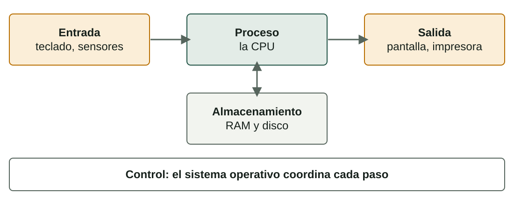
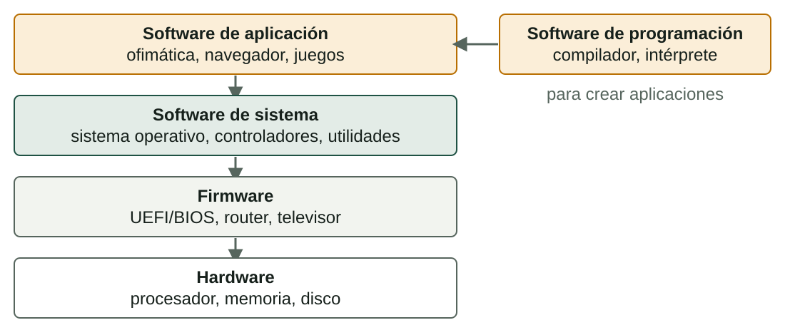

## Qué aprenderás

:::pasos
- Los **cuatro elementos** de un sistema informático
- Las **cinco funciones básicas** de cualquier ordenador
- Los principales **componentes de hardware** y los **periféricos**
- Los **tipos de software**, incluido el **firmware**
- Los **tipos de ordenadores** y para qué sirve cada uno
:::

---

## Un sistema es un conjunto de partes que colaboran

:::pasos
- Un **sistema**: partes relacionadas que trabajan con un fin
- Un **sistema informático** convierte **datos** en bruto en **información** útil
- Si falla una parte, sufre **todo el servicio**
:::

Una bicicleta es un sistema, y el cuerpo humano también.

---

## Los cuatro elementos

| Elemento | Qué es | Ejemplos |
|---|---|---|
| **Hardware** | Partes físicas que puedes tocar | Procesador, disco |
| **Software** | Programas e instrucciones | SO, navegador |
| **Datos** | Símbolos; información con contexto | Fotos, documentos |
| **Usuarios** | Personas que lo usan y mantienen | Estudiante, técnico |

Muchos autores añaden un quinto elemento: los **procedimientos** (copias de seguridad, accesos y actualizaciones).

---

## Cinco funciones básicas

---

## Ejemplo: enviar una foto a un amigo

:::pasos
- El sensor de la cámara captura la imagen: **entrada**
- El móvil la comprime: **proceso**
- La foto se guarda en la memoria: **almacenamiento**
- Vista previa en pantalla y envío por red: **salida**
- El **sistema operativo** lo coordina todo
:::

---

## Hardware de un PC (1/2)

| Componente | Qué hace |
|---|---|
| **Caja** | Sujeta y protege las piezas, dirige el aire |
| **Placa base** | Conecta todas las piezas; decide qué puedes instalar |
| **CPU** | Ejecuta las instrucciones; se mide en núcleos y GHz |
| **Disipador y ventilador** | Alejan el calor de la CPU |
| **RAM** | Guarda los programas y datos en uso ahora |

---

## Hardware de un PC (2/2)

| Componente | Qué hace |
|---|---|
| **Almacenamiento** (SSD o HDD) | Guarda el sistema, los programas y los archivos |
| **Tarjeta gráfica** (GPU) | Crea la imagen de la pantalla |
| **Fuente de alimentación** | Convierte la corriente de la red en tensiones bajas |
| **Tarjetas de expansión** | Añaden red, sonido, captura… (muchas vienen integradas) |

---

## La RAM es la mesa de trabajo; el almacenamiento, el archivo

:::pasos
- **RAM**: rápida, temporal, **volátil**
- **Almacenamiento**: más lento, permanente, **no volátil**
- Abrir un programa lo **copia** del almacenamiento a la RAM
:::

---

## ¿SSD o HDD?

| | SSD | HDD |
|---|---|---|
| Guarda los datos en | Chips flash, sin piezas móviles | Platos magnéticos que giran |
| Velocidad | Más rápido y silencioso | Más lento |
| Capacidad por precio | Menos | Más |

---

## Periféricos: según la dirección de los datos

| Tipo | Función | Ejemplos |
|---|---|---|
| **Entrada** | Envían datos | Teclado, ratón, escáner |
| **Salida** | Muestran información | Monitor, impresora, altavoces |
| **Entrada y salida** | Hacen las dos cosas | Pantalla táctil, auriculares con micro |
| **Almacenamiento** | Guardan datos | Disco externo, memoria USB |
| **Comunicación** | Conectan dispositivos | Tarjeta de red, adaptador Wi-Fi |

---

## La mayoría de los periféricos necesita un controlador

:::pasos
- Un **controlador** (*driver*) es un programa pequeño
- Explica al SO **cómo hablar** con un dispositivo concreto
- Sin el controlador adecuado, el dispositivo puede **no funcionar**
:::

---

## El software no son datos

:::pasos
- **Software**: programas e instrucciones que dicen al hardware qué hacer
- **Datos**: aquello **con** lo que trabajan los programas
- Sin software, el hardware es **inútil**
- Sin hardware adecuado, el software **no puede ejecutarse**
:::

---

## Cuatro tipos de software

---

## Tipos de software: qué hace cada uno

| Tipo | Qué es | Ejemplos |
|---|---|---|
| **De sistema** | Lo que el ordenador necesita | SO, controladores |
| **De aplicación** | Programas para tareas del usuario | Ofimática, juegos |
| **De programación** | Herramientas para crear programas | Compilador, editor |
| **Firmware** | Software dentro de un dispositivo | UEFI/BIOS, router |

Las aplicaciones **no pueden ejecutarse** sin software de sistema.

---

## Firmware: software dentro del hardware

:::pasos
- Vive en un **chip**, normalmente de memoria flash
- Es el **primer software** que se ejecuta al encender un PC
- La **UEFI** comprueba el hardware y arranca el sistema operativo
- Impresoras, memorias USB y televisores inteligentes también tienen firmware
- Se puede actualizar, pero **pocas veces**
:::

---

## Lenguajes de programación

:::pasos
- Un procesador solo entiende el **lenguaje máquina**
- **Bajo nivel**: cerca del hardware (máquina, **ensamblador**)
- **Alto nivel**: más cerca del lenguaje humano; sin procesador concreto
- Ejemplos: **Python, Java, C, JavaScript**
:::

**Alto nivel → traducir → lenguaje máquina**

---

## ¿Compilador o intérprete?

| | Compilador | Intérprete |
|---|---|---|
| Cómo funciona | Traduce **todo** el programa antes | Ejecuta **una instrucción** cada vez |
| Errores | Se encuentran antes de empezar | Se encuentran cuando el programa llega a ellos |
| Velocidad | El ejecutable suele ser rápido | Suele ser más lento |
| Ejemplos | C, C++ | Python, JavaScript |

---

## Ordenadores según su uso

:::pasos
- **Propósito general**: ejecuta muchos programas distintos (un **PC**)
- **Propósito específico**: hecho para una tarea o pocas (un **robot industrial**)
- Después, por **características**: seis tipos principales
:::

---

## Por características (1/2)

| Tipo | Uso típico | Características clave |
|---|---|---|
| **Superordenador** | Meteorología, simulación, entrenar IA | Millones de núcleos en paralelo; casi todos usan Linux |
| **Mainframe** | Bancos, seguros: muchas transacciones | Fiabilidad y flujo de datos; muy caro |
| **Servidor** | Webs, bases de datos, virtualización | Atiende a clientes 24/7; redundancia; a menudo en rack |

---

## Por características (2/2)

| Tipo | Uso típico | Características clave |
|---|---|---|
| **Ordenador personal** | Estudio, ofimática, multimedia | Propósito general y bajo coste; sobremesa, portátiles, tabletas |
| **Estación de trabajo** | CAD, 3D, edición de vídeo | Muchos núcleos, mucha RAM (a menudo ECC), gráfica profesional |
| **Sistema empotrado** | Coches, electrodomésticos, routers | Ordenador pequeño dentro de un producto; tarea fija; pocos recursos |

---

## ¿Superordenador o mainframe?

| | Superordenador | Mainframe |
|---|---|---|
| Optimizado para | **Cálculos muy complejos** | Un enorme volumen de **operaciones simples** |
| Hardware | Miles de procesadores en paralelo | Menos procesadores; hecho para mover datos |
| Valor clave | Potencia de cálculo | **No para nunca**: fiabilidad y seguridad |
| Uso típico | Ciencia, ingeniería | Pagos, reservas |

---

## Las categorías no son rígidas

:::caution[Las categorías no son rígidas]
La computación en la nube y la virtualización difuminan las fronteras: un «servidor» puede ser una **máquina virtual**, y tu móvil es un PC con otra forma.

Usa las categorías para entender los **requisitos**, no como cajas estrictas.
:::

---

## Pruébalo (1/2)

::laboratorio[Partes del sistema]{src="explorador-del-sistema" pestana="parts"}

::laboratorio[Dentro de la caja]{src="explorador-del-sistema" pestana="inside"}

---

## Pruébalo (2/2)

::laboratorio[Tipos de software]{src="explorador-del-sistema" pestana="software"}

::laboratorio[El ordenador adecuado]{src="explorador-del-sistema" pestana="computers"}

---

## Resumen

- Un sistema informático: **hardware, software, datos y usuarios**
- Cinco funciones: **entrada, proceso, almacenamiento, salida, control**
- La **RAM** es volátil y rápida; el **almacenamiento** es permanente
- Software: **de sistema, de aplicación, de programación, firmware**
- Clasifica los ordenadores por sus **requisitos**, no por cajas estrictas

[Actividades de la unidad →](/docencia/smr/som/ud01-introduccion/actividades/es/)

---

## Créditos

Estas diapositivas resumen los apuntes del curso de SOM de Moisés Mas Rocamora, Daniel Álvarez Santamaría y Jana Taboada León, con licencia **CC BY-NC-SA 4.0**. Se comparten con la misma licencia.
