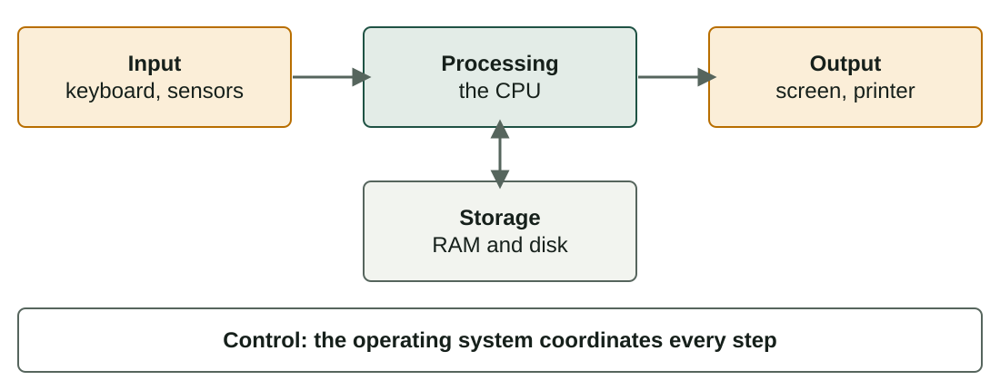
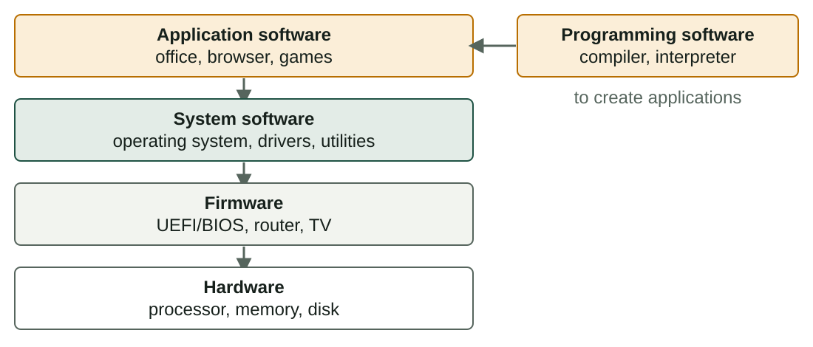

## What you will learn

:::pasos
- The **four elements** of a computer system
- The **five basic functions** of any computer
- The main **hardware components** and **peripherals**
- The **types of software**, including **firmware**
- The **types of computers** and what each one is for
:::

---

## A system is parts working together

:::pasos
- A **system**: interrelated parts that work for a purpose
- A **computer system** turns raw **data** into useful **information**
- If one part fails, the **whole service** suffers
:::

A bicycle is a system, and so is the human body.

---

## The four elements

| Element | What it is | Examples |
|---|---|---|
| **Hardware** | Physical parts you can touch | Processor, disk |
| **Software** | Programs and instructions | OS, browser |
| **Data** | Symbols; information with context | Photos, documents |
| **Users** | People who use and maintain it | Student, technician |

Many authors add a fifth element: **procedures** (backup, access and update rules).

---

## Five basic functions

---

## Example: send a photo to a friend

:::pasos
- The camera sensor captures the image: **input**
- The phone compresses it: **processing**
- The photo is kept in the memory: **storage**
- Preview on screen, sent by network: **output**
- The **operating system** coordinates everything
:::

---

## Hardware inside a PC (1/2)

| Component | What it does |
|---|---|
| **Case** | Holds and protects the parts, directs the air |
| **Motherboard** | Connects all the parts; decides what you can install |
| **CPU** | Executes the instructions; measured in cores and GHz |
| **Heat sink and fan** | Take the heat away from the CPU |
| **RAM** | Stores the programs and data in use now |

---

## Hardware inside a PC (2/2)

| Component | What it does |
|---|---|
| **Storage** (SSD or HDD) | Keeps the system, programs and files |
| **Graphics card** (GPU) | Creates the image on the screen |
| **Power supply** (PSU) | Converts mains electricity into low voltages |
| **Expansion cards** | Add network, sound, capture… (many are integrated) |

---

## RAM is the work table, storage is the archive

:::pasos
- **RAM**: fast, temporary, **volatile**
- **Storage**: slower, permanent, **non-volatile**
- Opening a program **copies** it from storage to RAM
:::

---

## SSD or HDD?

| | SSD | HDD |
|---|---|---|
| Stores data in | Flash chips, no moving parts | Spinning magnetic platters |
| Speed | Faster and silent | Slower |
| Capacity for the price | Less | More |

---

## Peripherals: classified by the direction of the data

| Type | Function | Examples |
|---|---|---|
| **Input** | Send data in | Keyboard, mouse, scanner |
| **Output** | Show information | Monitor, printer, speakers |
| **Input and output** | Do both | Touchscreen, headset |
| **Storage** | Save data | External disk, USB drive |
| **Communication** | Connect devices | Network card, Wi-Fi adapter |

---

## Most peripherals need a driver

:::pasos
- A **driver** is a small program
- It explains to the OS **how to talk** to one device
- Without the right driver, the device may **not work**
:::

---

## Software is not data

:::pasos
- **Software**: the programs and instructions that tell hardware what to do
- **Data**: what programs work **with**
- Without software, the hardware is **useless**
- Without suitable hardware, the software **cannot run**
:::

---

## Four types of software

---

## Types of software: what each one does

| Type | What it is | Examples |
|---|---|---|
| **System** | What the computer needs | OS, drivers |
| **Application** | Programs for the user's tasks | Office, games |
| **Programming** | Tools to create programs | Compiler, editor |
| **Firmware** | Software inside a device | UEFI/BIOS, router |

Applications **cannot run** without system software.

---

## Firmware: software inside hardware

:::pasos
- Lives in a **chip**, usually flash memory
- It is the **first software** that runs when you switch on a PC
- **UEFI** checks the hardware, then starts the operating system
- Printers, USB drives and smart TVs have firmware too
- You can update it, but only **rarely**
:::

---

## Programming languages

:::pasos
- A processor only understands **machine language**
- **Low level**: close to the hardware (machine, **assembly**)
- **High level**: closer to human language; no specific processor
- Examples: **Python, Java, C, JavaScript**
:::

**High level → translate → machine language**

---

## Compiler or interpreter?

| | Compiler | Interpreter |
|---|---|---|
| How it works | Translates the **whole** program first | Executes **one instruction** at a time |
| Errors | Found before it starts | Found when the program reaches them |
| Speed | The executable usually runs fast | Usually slower |
| Examples | C, C++ | Python, JavaScript |

---

## Computers by use

:::pasos
- **General purpose**: runs many different programs (a **PC**)
- **Specific purpose**: built for one task or a few (an **industrial robot**)
- Then, by **features**: six main types
:::

---

## By features (1/2)

| Type | Typical use | Key features |
|---|---|---|
| **Supercomputer** | Weather, simulation, AI training | Millions of cores in parallel; almost all run Linux |
| **Mainframe** | Banks, insurance: many transactions | Reliability and data flow; very expensive |
| **Server** | Websites, databases, virtualisation | Serves clients 24/7; redundancy; often in a rack |

---

## By features (2/2)

| Type | Typical use | Key features |
|---|---|---|
| **Personal computer** | Study, office work, media | General purpose, low cost; desktops, laptops, tablets |
| **Workstation** | CAD, 3D, video editing | Many cores, a lot of RAM (often ECC), professional graphics |
| **Embedded system** | Cars, appliances, routers | Small computer inside a product; fixed task; limited resources |

---

## Supercomputer or mainframe?

| | Supercomputer | Mainframe |
|---|---|---|
| Optimised for | **Very complex calculations** | A huge volume of **simple operations** |
| Hardware | Thousands of processors in parallel | Fewer processors; built to move data |
| Key value | Raw computing power | **Never stops**: reliability, security |
| Typical use | Science, engineering | Payments, bookings |

---

## The categories are not rigid

:::caution[The categories are not rigid]
Cloud computing and virtualisation blur the borders: a "server" can be a **virtual machine**, and your phone is a PC with a different shape.

Use the categories to understand **requirements**, not as strict boxes.
:::

---

## Try it yourself (1/2)

::laboratorio[System parts]{src="explorador-del-sistema" pestana="parts"}

::laboratorio[Inside the box]{src="explorador-del-sistema" pestana="inside"}

---

## Try it yourself (2/2)

::laboratorio[Software types]{src="explorador-del-sistema" pestana="software"}

::laboratorio[Right computer for the job]{src="explorador-del-sistema" pestana="computers"}

---

## Summary

- A computer system: **hardware, software, data and users**
- Five functions: **input, processing, storage, output, control**
- **RAM** is volatile and fast; **storage** is permanent
- Software: **system, application, programming, firmware**
- Classify computers by their **requirements**, not strict boxes

[Activities of the unit →](/docencia/smr/som/ud01-introduccion/actividades/)

---

## Credits

These slides summarise the SOM course notes by Moisés Mas Rocamora, Daniel Álvarez Santamaría and Jana Taboada León, licensed under **CC BY-NC-SA 4.0**. They are shared under the same licence.
