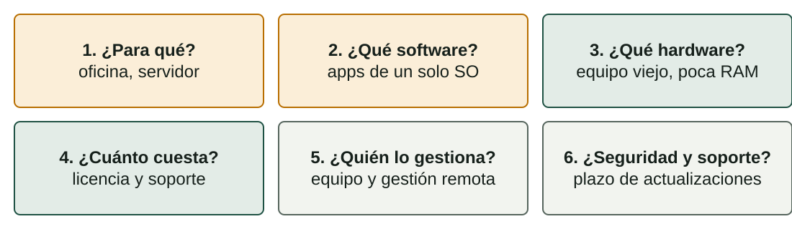

## Qué aprenderás

:::pasos
- Qué hace un **sistema operativo** y sus **seis funciones**
- El **modo usuario**, el **modo núcleo** y las **llamadas al sistema**
- Tres **diseños de núcleo**: monolítico, por capas, modular
- Los **sistemas operativos actuales** y cómo **clasificarlos**
- Cómo **comprobar el hardware** y **elegir** un sistema operativo
:::

---

## El sistema operativo gestiona la máquina

:::pasos
- La pieza principal del **software de sistema** de un ordenador
- **Gestiona el hardware** y coordina todos los demás programas
- Da **tiempo de CPU y memoria** a cada programa
- Controla los **dispositivos**, organiza los **archivos** y **protege** el sistema
:::

Sin SO, cada aplicación tendría que hablar con cada disco, pantalla e impresora.

---

## Una capa entre las aplicaciones y el hardware

---

## El núcleo es el corazón del SO

:::pasos
- Siempre **en memoria**, con **acceso total** al hardware
- A su alrededor: **programas del sistema y bibliotecas**
- Ejemplos: el **intérprete de órdenes** (*shell*) y el **gestor de archivos**
:::

---

## Dos niveles de privilegio

:::pasos
- **Modo usuario**: las aplicaciones, con **derechos limitados**; sin acceso directo al hardware
- **Modo núcleo**: el núcleo, con **acceso total** al hardware
- Una aplicación defectuosa o maliciosa **no puede tomar el control** de la máquina
:::

---

## Una llamada al sistema pide un servicio al núcleo

:::pasos
1. La aplicación necesita un servicio: **abrir un archivo**, **enviar datos**, **crear un proceso**
2. Hace una **llamada al sistema**
3. La CPU pasa a **modo núcleo** y el núcleo hace el trabajo
4. El núcleo **devuelve el resultado** a la aplicación
:::

---

## ¿Por qué «monopuesto» en el nombre del módulo?

:::note[¿Por qué «monopuesto» en el nombre del módulo?]
**Sistemas Operativos Monopuesto** son los sistemas operativos para **un único puesto de trabajo**: Windows, macOS y Linux en un PC.

Los escritorios modernos pueden tener varias cuentas, pero normalmente se sienta **una persona** ante el ordenador.
:::

---

## Seis funciones de un sistema operativo (1/2)

| Función | Qué hace el SO | Ejemplo |
|---|---|---|
| **Gestión de procesos** | Decide qué proceso usa la CPU y cuánto tiempo | Música mientras escribes |
| **Gestión de memoria** | Da memoria a cada proceso y los aísla | Un juego que falla no borra tu texto |
| **Gestión de archivos** | Organiza archivos y carpetas; controla permisos | Guardar o copiar un documento |

---

## Seis funciones de un sistema operativo (2/2)

| Función | Qué hace el SO | Ejemplo |
|---|---|---|
| **Gestión de dispositivos** | Controla los dispositivos con controladores y colas | Imprimir tres documentos en orden |
| **Seguridad y protección** | Comprueba quién eres y qué puedes hacer | Un usuario estándar no instala controladores |
| **Interfaz de usuario** | Permite usar el sistema: **GUI** o **CLI** | Escritorio de Windows, un terminal |

---

## Un proceso es un programa en ejecución

:::pasos
- Un **proceso**: un programa que se está **ejecutando**
- Tiene su propio **espacio de memoria** y sus recursos
- El mismo programa puede ejecutarse como **varios procesos**
:::

---

## ¿Qué ocurre al guardar un archivo?

---

## ¿Cómo se organiza el núcleo?

:::pasos
- La **estructura** de un SO es cómo se organiza su **núcleo**
- Afecta a la **velocidad, estabilidad, seguridad** y a lo fácil que es ampliarlo
- Los núcleos reales suelen **mezclar ideas**
- Tres diseños clásicos
:::

---

## Tres diseños clásicos de núcleo

---

## Núcleo monolítico

:::pasos
- **Idea**: todos los servicios básicos juntos en **un único espacio de direcciones**
- **Ventaja**: muy **rápido**; las partes se llaman directamente
- **Inconveniente**: un fallo en un controlador puede **tumbarlo todo**
- **Ejemplos**: **UNIX** tradicional, primeros **BSD**
:::

---

## Núcleo por capas

:::pasos
- **Idea**: **capas ordenadas**; cada una usa solo la capa **inferior**
- **Ventaja**: interfaces claras; **fácil de probar**
- **Inconveniente**: las peticiones cruzan capas, y hay **sobrecarga**
- **Ejemplos**: el sistema didáctico **THE**; capas en **Windows NT**
:::

---

## Núcleo modular

:::pasos
- **Idea**: un **núcleo pequeño** más **módulos** que se cargan en marcha
- **Ventaja**: añadir un controlador **sin recompilar** el núcleo
- **Inconveniente**: un módulo defectuoso **sigue siendo peligroso**
- **Ejemplos**: **Linux**, macOS, Solaris
:::

---

## Los núcleos reales son híbridos

:::caution[Los núcleos reales son híbridos]
Linux es monolítico **y** modular. El núcleo de Windows NT y el de macOS (XNU) suelen llamarse **híbridos**.

Un **microkernel** deja en modo núcleo solo un núcleo mínimo y ejecuta los servicios como programas normales: muy estable, pero con más comunicación.

No te preocupes por la etiqueta: aprende los **equilibrios**.
:::

---

## Sistemas operativos actuales (1/2)

| SO | Fabricante | Núcleo | Licencia |
|---|---|---|---|
| **Windows** | Microsoft | Windows NT (híbrido) | Propietaria |
| **macOS** | Apple | XNU (híbrido, Darwin) | Propietaria (Darwin es abierto) |
| **Linux** (Ubuntu, Debian, Fedora…) | Comunidad y empresas | Linux | Código abierto |

---

## Sistemas operativos actuales (2/2)

| SO | Fabricante | Núcleo | Licencia |
|---|---|---|---|
| **Android** | Google | Núcleo Linux | Base abierta (AOSP) y partes propietarias |
| **iOS / iPadOS** | Apple | XNU (Darwin) | Propietaria |
| **ChromeOS** | Google | Núcleo Linux | Base abierta y partes propietarias |

---

## Linux es un núcleo; una distribución es un SO

:::pasos
- **«Linux»** es, estrictamente, el **núcleo**
- Una **distribución** añade software, un gestor de paquetes y un escritorio
- Las cuotas de mercado cambian **cada mes**: no memorices porcentajes
- Usa una fuente independiente para datos actualizados
:::

---

## Cinco criterios para clasificar sistemas operativos

| Criterio | Categorías |
|---|---|
| **Por estructura** | Monolítico, por capas, modular |
| **Por usuarios** | Monousuario, multiusuario, de red, distribuido |
| **Por multitarea** | Monotarea, multitarea, tiempo real |
| **Por licencia** | Propietario, código abierto, gratuito |
| **Por número de CPU** | Monoprocesador, multiprocesador (SMP) |

Un mismo SO pertenece a **varias categorías** a la vez.

---

## Por usuarios

:::pasos
- **Monousuario**: un usuario a la vez, poca separación (MS-DOS)
- **Multiusuario**: muchas cuentas con permisos (Linux, Windows)
- **De red**: pensado para compartir recursos en una LAN (Windows Server)
- **Distribuido**: muchas máquinas que parecen una
:::

---

## Por multitarea

:::pasos
- **Monotarea**: un programa a la vez (MS-DOS)
- **Multitarea**: los programas se reparten el tiempo de CPU (todos los escritorios actuales)
- **Tiempo real estricto**: perder un plazo es un fallo (airbags, marcapasos)
- **Tiempo real flexible**: se tolera un retraso (reproducir vídeo)
:::

---

## Por licencia y por número de CPU

:::pasos
- **Licencia**: propietario, código abierto, gratuito
- **Comercial** y **código abierto** no son opuestos
- **SMP**: varias CPU o núcleos comparten la misma memoria
- Hoy todo PC y móvil tiene un procesador **multinúcleo**
:::

---

## Ejemplo: clasificar Ubuntu Desktop

:::pasos
- **Modular**: núcleo Linux con módulos cargables
- **Multiusuario** y **multitarea**
- **Código abierto**
- **Multiprocesador**
:::

Un SO de tiempo real como FreeRTOS es de *tiempo real*, normalmente *monousuario* y de código abierto.

---

## ¿Es adecuado el equipo?

:::pasos
- Cada SO publica sus **requisitos**
- **Mínimos**: arranca y funciona, quizá despacio
- **Recomendados**: funciona con comodidad
- Compara **CPU, RAM, espacio libre, gráfica, firmware** (UEFI, TPM) y **controladores**
- No olvides las **aplicaciones**: también tienen requisitos
:::

---

## No te fíes de cifras antiguas

:::note[No te fíes de cifras antiguas]
Los requisitos **cambian con cada versión**.

Lee siempre la **página actual del fabricante** antes de decidir.
:::

---

## Seis preguntas para elegir un SO

---

## Ejemplo: 20 PC viejos en un centro

:::pasos
- 4 GB de RAM y 2 núcleos; el alumnado necesita **navegador, ofimática, herramientas de programación**
- Encaja una **distribución Linux ligera**: sin coste de licencia, va bien en equipos viejos
- Con un **programa solo para Windows**, la respuesta sería otra
:::

---

## Pruébalo (1/2)

::laboratorio[Las capas del SO]{src="explorador-del-sistema" pestana="layers"}

::laboratorio[Arquitecturas del núcleo]{src="explorador-del-sistema" pestana="kernels"}

---

## Pruébalo (2/2)

::laboratorio[Clasificador de SO]{src="explorador-del-sistema" pestana="classifier"}

---

## Resumen

- El SO **gestiona recursos**: procesos, memoria, archivos, dispositivos, seguridad
- El **modo usuario** protege el sistema; las **llamadas al sistema** piden al núcleo
- Núcleos: **monolítico, por capas, modular**, y muchos híbridos
- Clasifica por **estructura, usuarios, multitarea, licencia, CPU**
- Elige por **finalidad, software, hardware, coste, conocimientos, soporte**

[Actividades de la unidad →](/docencia/smr/som/ud01-introduccion/actividades/es/)

---

## Créditos

Estas diapositivas resumen los apuntes del curso de SOM de Moisés Mas Rocamora, Daniel Álvarez Santamaría y Jana Taboada León, con licencia **CC BY-NC-SA 4.0**. Se comparten con la misma licencia.
