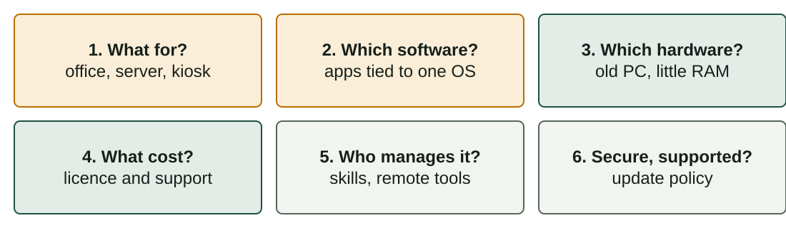

## What you will learn

:::pasos
- What an **operating system** does and its **six functions**
- **User mode**, **kernel mode** and **system calls**
- Three **kernel designs**: monolithic, layered, modular
- The **current operating systems** and how to **classify** them
- How to **check the hardware** and **choose** an operating system
:::

---

## The operating system manages the machine

:::pasos
- The main piece of **system software** of a computer
- It **manages the hardware** and coordinates all other programs
- It gives **CPU time and memory** to each program
- It controls **devices**, organises **files** and **protects** the system
:::

Without an OS, every application would have to talk to every disk, screen and printer.

---

## A layer between applications and hardware

---

## The kernel is the heart of the OS

:::pasos
- Always **in memory**, with **full access** to the hardware
- Around it: **system programs and libraries**
- Examples: the **shell** and the **file manager**
:::

---

## Two privilege levels

:::pasos
- **User mode**: applications, with **limited rights**; no direct access to hardware
- **Kernel mode**: the kernel, with **full access** to the hardware
- A faulty or malicious application **cannot take control** of the machine
:::

---

## A system call asks the kernel for a service

:::pasos
1. The application needs a service: **open a file**, **send data**, **create a process**
2. It makes a **system call**
3. The CPU switches to **kernel mode** and the kernel does the job
4. The kernel **returns the result** to the application
:::

---

## Why "single-user" in the module name?

:::note[Why "single-user" in the module name?]
**Sistemas Operativos Monopuesto** means operating systems for **one workstation**: Windows, macOS and Linux on a PC.

Modern desktops can have several accounts, but normally **one person** sits at the computer.
:::

---

## Six functions of an operating system (1/2)

| Function | What the OS does | Example |
|---|---|---|
| **Process management** | Decides which process uses the CPU and for how long | Music while you write |
| **Memory management** | Gives each process memory and isolates them | A crashing game keeps your text safe |
| **File management** | Organises files and folders; controls permissions | Saving or copying a document |

---

## Six functions of an operating system (2/2)

| Function | What the OS does | Example |
|---|---|---|
| **Device management** | Controls devices through drivers and queues | Printing three documents in order |
| **Security and protection** | Checks who you are and what you may do | A standard user cannot install drivers |
| **User interface** | Lets people use the system: **GUI** or **CLI** | Windows desktop, a terminal |

---

## A process is a running program

:::pasos
- A **process**: a program that is **running**
- It has its own **memory space** and resources
- The same program can run as **several processes**
:::

---

## What happens when you save a file?

---

## How is the kernel organised?

:::pasos
- The **structure** of an OS is how its **kernel** is organised
- It affects **speed, stability, security** and how easy it is to extend
- Real kernels often **mix ideas**
- Three classic designs
:::

---

## Three classic kernel designs

---

## Monolithic kernel

:::pasos
- **Idea**: all core services run together in **one address space**
- **Advantage**: very **fast**; parts call each other directly
- **Disadvantage**: a bug in a driver can **crash everything**
- **Examples**: traditional **UNIX**, early **BSD**
:::

---

## Layered kernel

:::pasos
- **Idea**: **ordered layers**; each one uses only the layer **below**
- **Advantage**: clear interfaces; **easy to test**
- **Disadvantage**: requests cross layers, so **overhead**
- **Examples**: the textbook system **THE**; layers in **Windows NT**
:::

---

## Modular kernel

:::pasos
- **Idea**: a **small core** plus **modules** loaded while running
- **Advantage**: add a driver **without rebuilding** the kernel
- **Disadvantage**: a bad module is **still dangerous**
- **Examples**: **Linux**, macOS, Solaris
:::

---

## Real kernels are hybrids

:::caution[Real kernels are hybrids]
Linux is monolithic **and** modular. Windows NT and the macOS kernel (XNU) are usually called **hybrid**.

A **microkernel** keeps only a tiny core in kernel mode and runs services as normal programs: very stable, but more communication.

Do not worry about the label: learn the **trade-offs**.
:::

---

## Current operating systems (1/2)

| OS | Made by | Kernel | Licence |
|---|---|---|---|
| **Windows** | Microsoft | Windows NT (hybrid) | Proprietary |
| **macOS** | Apple | XNU (hybrid, Darwin) | Proprietary (Darwin is open) |
| **Linux** (Ubuntu, Debian, Fedora…) | Community and companies | Linux | Open source |

---

## Current operating systems (2/2)

| OS | Made by | Kernel | Licence |
|---|---|---|---|
| **Android** | Google | Linux kernel | Open base (AOSP) plus proprietary parts |
| **iOS / iPadOS** | Apple | XNU (Darwin) | Proprietary |
| **ChromeOS** | Google | Linux kernel | Open base plus proprietary parts |

---

## Linux is a kernel, a distribution is an OS

:::pasos
- **"Linux"** is strictly the **kernel**
- A **distribution** adds software, a package manager and a desktop
- Market shares change **every month**: do not memorise percentages
- Use an independent source for up-to-date data
:::

---

## Five criteria to classify operating systems

| Criterion | Categories |
|---|---|
| **By structure** | Monolithic, layered, modular |
| **By users** | Single-user, multi-user, network, distributed |
| **By multitasking** | Single-tasking, multitasking, real-time |
| **By licence** | Proprietary, open source, freeware |
| **By number of CPUs** | Single-processor, multiprocessor (SMP) |

The same OS belongs to **several categories** at once.

---

## By users

:::pasos
- **Single-user**: one user at a time, little separation (MS-DOS)
- **Multi-user**: many accounts with permissions (Linux, Windows)
- **Network**: focused on sharing resources in a LAN (Windows Server)
- **Distributed**: many machines that look like one
:::

---

## By multitasking

:::pasos
- **Single-tasking**: one program at a time (MS-DOS)
- **Multitasking**: programs share the CPU time (all current desktops)
- **Hard real-time**: a missed deadline is a failure (airbags, pacemakers)
- **Soft real-time**: a delay is tolerated (video playback)
:::

---

## By licence and by number of CPUs

:::pasos
- **Licence**: proprietary, open source, freeware
- **Commercial** and **open source** are not opposites
- **SMP**: several CPUs or cores share the same memory
- Today every PC and phone has a **multi-core** processor
:::

---

## Example: classify Ubuntu Desktop

:::pasos
- **Modular**: Linux kernel with loadable modules
- **Multi-user** and **multitasking**
- **Open source**
- **Multiprocessor**
:::

A real-time OS such as FreeRTOS is *real-time*, usually *single-user* and open source.

---

## Is the computer suitable?

:::pasos
- Every OS publishes its **requirements**
- **Minimum**: it starts and works, possibly slowly
- **Recommended**: it works comfortably
- Compare **CPU, RAM, free disk space, graphics, firmware** (UEFI, TPM) and **drivers**
- Do not forget the **applications**: they have requirements too
:::

---

## Do not trust old numbers

:::note[Do not trust old numbers]
Requirements **change with every version**.

Always read the **current page of the vendor** before you decide.
:::

---

## Six questions to choose an OS

---

## Example: 20 old PCs in a school

:::pasos
- 4 GB of RAM and 2 cores; pupils need a **browser, office suite, programming tools**
- A **light Linux distribution** fits: no licence cost, runs well on old hardware
- With a **Windows-only program**, the answer would be different
:::

---

## Try it yourself (1/2)

::laboratorio[The OS layer cake]{src="explorador-del-sistema" pestana="layers"}

::laboratorio[Kernel architectures]{src="explorador-del-sistema" pestana="kernels"}

---

## Try it yourself (2/2)

::laboratorio[OS classifier]{src="explorador-del-sistema" pestana="classifier"}

---

## Summary

- The OS **manages resources**: processes, memory, files, devices, security
- **User mode** protects the system; **system calls** ask the kernel
- Kernels: **monolithic, layered, modular**, and many hybrids
- Classify by **structure, users, multitasking, licence, CPUs**
- Choose by **purpose, software, hardware, cost, skills, support**

[Activities of the unit →](/docencia/smr/som/ud01-introduccion/actividades/)

---

## Credits

These slides summarise the SOM course notes by Moisés Mas Rocamora, Daniel Álvarez Santamaría and Jana Taboada León, licensed under **CC BY-NC-SA 4.0**. They are shared under the same licence.
