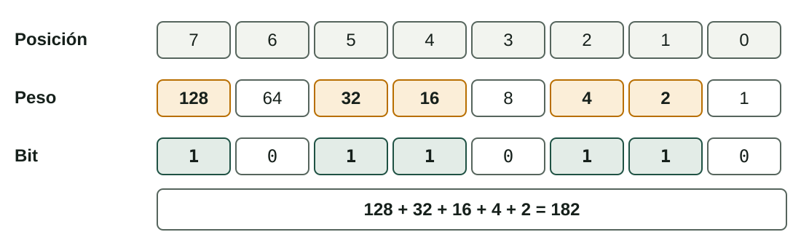
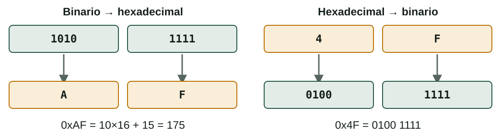
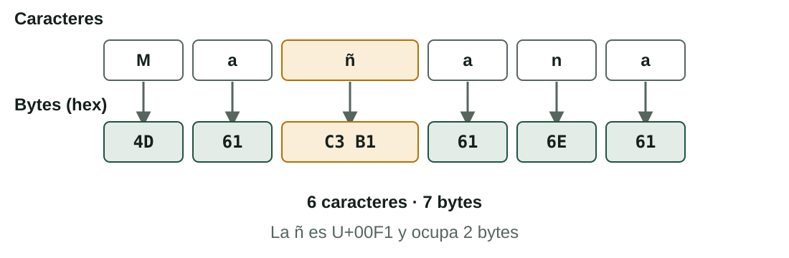
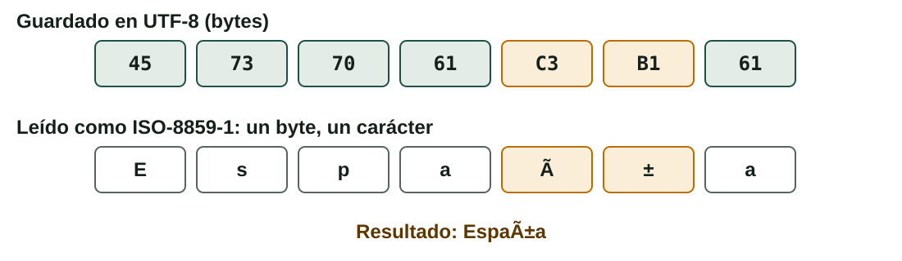
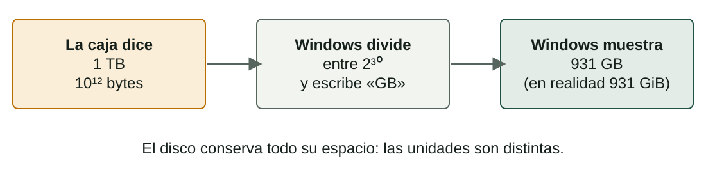

## Qué aprenderás

:::pasos
- Cómo guarda un ordenador números y texto con **bits**
- **Binario** y **hexadecimal**: leer y convertir
- **ASCII**, **Unicode** y **UTF-8**
- Por qué un archivo muestra caracteres raros (**mojibake**)
- Unidades **SI** e **IEC**: por qué un disco de 1 TB muestra menos
:::

---

## Bits, bytes y palabras

:::pasos
- **Bit**: la unidad mínima de información, `0` o `1`
- **Cuarteto** (*nibble*): 4 bits
- **Byte**: 8 bits; memorias y archivos se cuentan en bytes
- **Palabra**: los bits que un procesador maneja a la vez (32 o 64)
:::

---

## Con n bits se obtienen 2ⁿ valores

| Bits | Valores distintos |
|---|---|
| 1 bit | 2 |
| 4 bits | 16 |
| 8 bits (un byte) | 256, del 0 al 255 |

---

## ¿Número o carácter?

:::note[¿Número o carácter?]
Una **base de numeración** (binario, decimal, hexadecimal) es una forma de **escribir un número**.

Una **codificación de caracteres** (ASCII, Unicode) es una tabla: **qué número representa a qué carácter**. Ese número se guarda después como uno o más bytes.
:::

---

## Binario: cada posición tiene un peso



---

## De binario a decimal

Suma los pesos de las posiciones que contienen un `1`.

```text
0100 0001  =  64 + 1                  =  65
1011 0110  =  128 + 32 + 16 + 4 + 2   =  182
```

---

## De decimal a binario: dividir entre 2

```text
13 ÷ 2 = 6  resto 1
 6 ÷ 2 = 3  resto 0
 3 ÷ 2 = 1  resto 1
 1 ÷ 2 = 0  resto 1
```

Lee los restos **del último al primero**: 13 = **1101**.

---

## De decimal a binario: restar pesos

Ejemplo: **150**

:::pasos
1. Toma **128**: 150 − 128 = 22
2. Toma **16**: 22 − 16 = 6
3. Toma **4**: 6 − 4 = 2
4. Toma **2**: no queda nada
5. Bits: `1001 0110`
:::

---

## Comprobación rápida

:::tip[Comprobación rápida]
Un número binario que acaba en `0` es **par**; si acaba en `1`, **impar**.

Añadir un cero al final **duplica** el valor: `101` es 5 y `1010` es 10.
:::

---

## Hexadecimal: 16 dígitos

:::pasos
- Los dígitos `0–9` y después `A–F`
- **Un dígito hex = un cuarteto** (4 bits)
- **Dos dígitos hex = un byte**
- Prefijo `0x` o sufijo `h`: `0x4F`
:::

---

## Binario y hexadecimal, en los dos sentidos



---

## Dónde encuentras el hexadecimal

:::pasos
- **Direcciones de memoria**
- **Direcciones MAC**: `3C:52:82:1A:F0:9B`
- **Colores web**: `#FF8800` es rojo 255, verde 136, azul 0
- **Volcados de archivos**
:::

---

## ASCII: 128 caracteres en 7 bits

| Carácter | Decimal | Hex | Binario |
|---|---|---|---|
| `0` (dígito) | 48 | 0x30 | 0011 0000 |
| espacio | 32 | 0x20 | 0010 0000 |
| `A` | 65 | 0x41 | 0100 0001 |
| `Z` | 90 | 0x5A | 0101 1010 |
| `a` | 97 | 0x61 | 0110 0001 |

---

## ASCII: detalles que recordar

:::pasos
- Códigos de control, dígitos, **letras inglesas** y puntuación
- Minúscula = mayúscula **+ 32**
- `Hi` se guarda como los bytes `48 69` (hex)
- No hay `ñ`, `é` ni `ç`
- **ASCII extendido** (ISO-8859-1, Windows-1252): **significado distinto** por encima de 127
:::

---

## Unicode: un catálogo universal

:::pasos
- Un número único, el **punto de código**, para cada carácter
- Casi todos los sistemas de escritura, símbolos y **emoji**
- Se escribe `U+` seguido de dígitos hexadecimales
- Unicode da el número, **no los bytes**
:::

---

## Algunos puntos de código

| Carácter | Punto de código |
|---|---|
| `A` | U+0041 |
| `ñ` | U+00F1 |
| `€` | U+20AC |
| `漢` | U+6F22 |
| 😀 | U+1F600 |

---

## Las codificaciones UTF guardan los puntos de código como bytes

| Codificación | Bytes por carácter | Notas |
|---|---|---|
| **UTF-8** | 1 a 4 | Los primeros 128 = ASCII; estándar en la web |
| **UTF-16** | 2 o 4 | Lo usan Windows y Java |
| **UTF-32** | 4 | Sencilla, desperdicia espacio |

---

## UTF-8 en la práctica

| Carácter | Punto de código | Bytes en UTF-8 |
|---|---|---|
| `A` | U+0041 | `41` (1 byte) |
| `ñ` | U+00F1 | `C3 B1` (2 bytes) |
| `€` | U+20AC | `E2 82 AC` (3 bytes) |
| 😀 | U+1F600 | `F0 9F 98 80` (4 bytes) |

---

## «Mañana»: 6 caracteres, 7 bytes



---

## Ver los bytes con xxd

```bash
printf 'Mañana' | xxd
# 00000000: 4d61 c3b1 616e 61      Ma..ana
```

Funciona en **Linux** y **macOS**.

---

## Mojibake: la codificación es errónea



---

## El caso contrario y la solución

:::pasos
- Una `ñ` en ISO-8859-1 es el único byte `F1`
- Es **inválida como UTF-8**: el programa muestra `�`
- Solución: abre el archivo con la **codificación correcta**
- O **conviértelo**: un editor de texto o la herramienta `iconv`
:::

---

## Cómo interviene el sistema operativo (1/2)

:::pasos
- El sistema de archivos guarda **bytes**, no «texto» ni «foto»
- Los **nombres de archivo** usan Unicode: `canción.txt`
- Dentro de un archivo, la codificación la **elige el programa**, no la extensión
- El **terminal** y el programa deben usar la misma codificación
- La **fuente** necesita un *glifo* por carácter; los que faltan salen como cuadrados
:::

---

## Cómo interviene el sistema operativo (2/2)

:::pasos
- **Configuración regional**: idioma, formatos de fecha y número, orden, codificación por defecto
- **Fin de línea**: Linux y macOS usan LF; Windows usa **CR LF**
- Un script escrito en Windows puede fallar en Linux por el CR sobrante
- **BOM**: inútil en UTF-8 y puede romper scripts; prefiere UTF-8 **sin** BOM
:::

---

## Unidades de información: SI o IEC

| SI (decimal) | Valor | IEC (binario) | Valor |
|---|---|---|---|
| kilo (kB) | 1.000 B | kibi (KiB) | 1.024 B |
| mega (MB) | 10⁶ B | mebi (MiB) | 1.048.576 B |
| giga (GB) | 10⁹ B | gibi (GiB) | 1.073.741.824 B |
| tera (TB) | 10¹² B | tebi (TiB) | 2⁴⁰ B |

`b` es un **bit**; `B` es un **byte**. La diferencia crece: 2,4 % en kilo, **10 %** en tera.

---

## ¿Quién usa cuáles?

:::pasos
- **Fabricantes de discos** y **velocidades de red**: SI (decimal)
- **RAM**: binario (un módulo de 8 GB son en realidad 8 GiB)
- **Windows**: divide entre 1.024 pero escribe «GB»
- **macOS**: unidades decimales
- **Linux**: depende de la herramienta (`df -h` usa 1.024; `df -H`, 1.000)
:::

---

## ¿Por qué mi disco de 1 TB muestra menos?



---

## Las velocidades de red van en bits por segundo

:::pasos
- Divide entre **8** para obtener bytes por segundo
- **100 Mb/s** son, como mucho, **12,5 MB/s**
- Una descarga de **1 GB** tarda al menos **80 segundos**
:::

---

## Pruébalo (1/2)

::laboratorio[Bases]{src="numeracion" pestana="bases"}

::laboratorio[Conversiones]{src="numeracion" pestana="conv"}

---

## Pruébalo (2/2)

::laboratorio[Unidades]{src="numeracion" pestana="unid"}

::laboratorio[KB vs KiB]{src="numeracion" pestana="kib"}

---

## Resumen

- Un **bit** es `0` o `1`; **8 bits** forman un byte; **n bits** dan **2ⁿ** valores
- **Hexadecimal**: un dígito por cuarteto, dos por byte
- **Unicode** da los números; **UTF-8** los guarda en 1 a 4 bytes
- Una codificación errónea produce **mojibake**: abre con la correcta
- Las unidades **SI** son decimales; las **IEC**, binarias

[Actividades de la unidad →](/docencia/smr/som/ud01-introduccion/actividades/es/)

---

## Créditos

Estas diapositivas resumen los apuntes del curso de SOM de Moisés Mas Rocamora, Daniel Álvarez Santamaría y Jana Taboada León, con licencia **CC BY-NC-SA 4.0**. Se comparten con la misma licencia.
