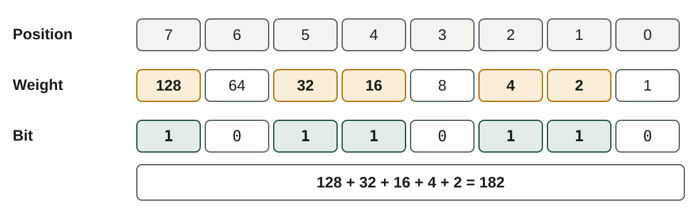
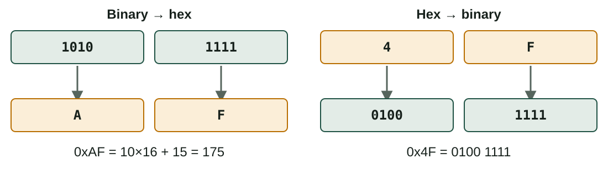
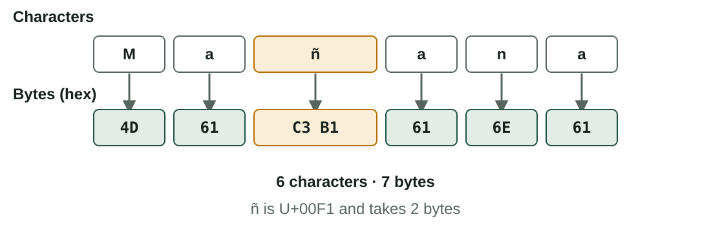
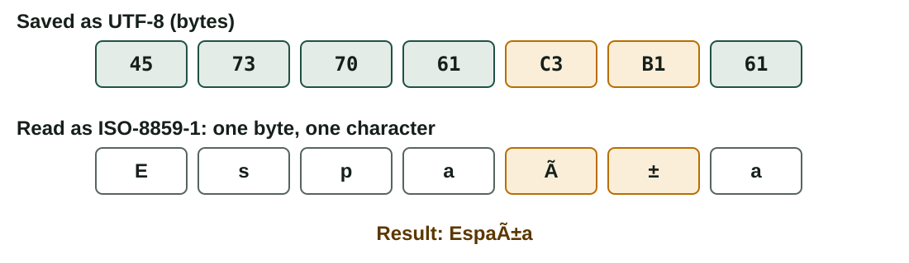
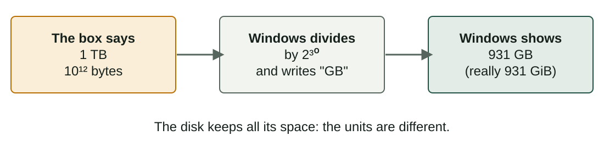

## What you will learn

:::pasos
- How a computer stores numbers and text with **bits**
- **Binary** and **hexadecimal**: read and convert
- **ASCII**, **Unicode** and **UTF-8**
- Why a file shows strange characters (**mojibake**)
- **SI** and **IEC** units: why a 1 TB disk shows less
:::

---

## Bits, bytes and words

:::pasos
- **Bit**: the smallest unit of information, `0` or `1`
- **Nibble**: 4 bits
- **Byte**: 8 bits; memories and files are counted in bytes
- **Word**: the bits a processor handles at once (32 or 64)
:::

---

## With n bits you get 2ⁿ values

| Bits | Different values |
|---|---|
| 1 bit | 2 |
| 4 bits | 16 |
| 8 bits (a byte) | 256, from 0 to 255 |

---

## Number or character?

:::note[Number or character?]
A **number base** (binary, decimal, hexadecimal) is a way to **write a number**.

A **character encoding** (ASCII, Unicode) is a table: **which number stands for which character**. That number is then stored as one or more bytes.
:::

---

## Binary: each position has a weight



---

## Binary to decimal

Add the weights of the positions that contain a `1`.

```text
0100 0001  =  64 + 1                  =  65
1011 0110  =  128 + 32 + 16 + 4 + 2   =  182
```

---

## Decimal to binary: divide by 2

```text
13 ÷ 2 = 6  remainder 1
 6 ÷ 2 = 3  remainder 0
 3 ÷ 2 = 1  remainder 1
 1 ÷ 2 = 0  remainder 1
```

Read the remainders **from the last to the first**: 13 = **1101**.

---

## Decimal to binary: subtract weights

Example: **150**

:::pasos
1. Take **128**: 150 − 128 = 22
2. Take **16**: 22 − 16 = 6
3. Take **4**: 6 − 4 = 2
4. Take **2**: nothing left
5. Bits: `1001 0110`
:::

---

## Quick check

:::tip[Quick check]
A binary number ending in `0` is **even**; ending in `1`, **odd**.

Adding a zero at the end **doubles** the value: `101` is 5 and `1010` is 10.
:::

---

## Hexadecimal: 16 digits

:::pasos
- Digits `0–9` and then `A–F`
- **One hex digit = one nibble** (4 bits)
- **Two hex digits = one byte**
- Prefix `0x` or suffix `h`: `0x4F`
:::

---

## Binary and hexadecimal, both ways



---

## Where you meet hexadecimal

:::pasos
- **Memory addresses**
- **MAC addresses**: `3C:52:82:1A:F0:9B`
- **Web colours**: `#FF8800` is red 255, green 136, blue 0
- **File dumps**
:::

---

## ASCII: 128 characters in 7 bits

| Character | Decimal | Hex | Binary |
|---|---|---|---|
| `0` (digit) | 48 | 0x30 | 0011 0000 |
| space | 32 | 0x20 | 0010 0000 |
| `A` | 65 | 0x41 | 0100 0001 |
| `Z` | 90 | 0x5A | 0101 1010 |
| `a` | 97 | 0x61 | 0110 0001 |

---

## ASCII: details to remember

:::pasos
- Control codes, digits, **English letters** and punctuation
- Lowercase = uppercase **+ 32**
- `Hi` is stored as the bytes `48 69` (hex)
- No `ñ`, `é` or `ç`
- **Extended ASCII** (ISO-8859-1, Windows-1252): a **different meaning** above 127
:::

---

## Unicode: a universal catalogue

:::pasos
- A unique number, the **code point**, for each character
- Almost all writing systems, symbols and **emoji**
- Written `U+` followed by hexadecimal digits
- Unicode gives the number, **not the bytes**
:::

---

## Some code points

| Character | Code point |
|---|---|
| `A` | U+0041 |
| `ñ` | U+00F1 |
| `€` | U+20AC |
| `漢` | U+6F22 |
| 😀 | U+1F600 |

---

## UTF encodings store code points as bytes

| Encoding | Bytes per character | Notes |
|---|---|---|
| **UTF-8** | 1 to 4 | First 128 = ASCII; the web standard |
| **UTF-16** | 2 or 4 | Used by Windows and Java |
| **UTF-32** | 4 | Simple, wastes space |

---

## UTF-8 in practice

| Character | Code point | UTF-8 bytes |
|---|---|---|
| `A` | U+0041 | `41` (1 byte) |
| `ñ` | U+00F1 | `C3 B1` (2 bytes) |
| `€` | U+20AC | `E2 82 AC` (3 bytes) |
| 😀 | U+1F600 | `F0 9F 98 80` (4 bytes) |

---

## "Mañana": 6 characters, 7 bytes



---

## See the bytes with xxd

```bash
printf 'Mañana' | xxd
# 00000000: 4d61 c3b1 616e 61      Ma..ana
```

Works on **Linux** and **macOS**.

---

## Mojibake: the encoding is wrong



---

## The opposite case, and the fix

:::pasos
- An ISO-8859-1 `ñ` is the single byte `F1`
- It is **invalid as UTF-8**: the program shows `�`
- Fix: open the file with the **correct encoding**
- Or **convert** it: a text editor or the `iconv` tool
:::

---

## How the OS is involved (1/2)

:::pasos
- The file system stores **bytes**, not "text" or "photo"
- **File names** use Unicode: `canción.txt`
- Inside a file, the encoding is the **program's choice**, not the extension
- The **terminal** and the program must use the same encoding
- The **font** needs a *glyph* for each character; missing ones show as squares
:::

---

## How the OS is involved (2/2)

:::pasos
- **Locale**: language, date and number formats, sorting, default encoding
- **Line endings**: Linux and macOS use LF; Windows uses **CR LF**
- A script written in Windows can fail in Linux because of the extra CR
- **BOM**: useless in UTF-8 and can break scripts; prefer UTF-8 **without** BOM
:::

---

## Units of information: SI or IEC

| SI (decimal) | Value | IEC (binary) | Value |
|---|---|---|---|
| kilo (kB) | 1,000 B | kibi (KiB) | 1,024 B |
| mega (MB) | 10⁶ B | mebi (MiB) | 1,048,576 B |
| giga (GB) | 10⁹ B | gibi (GiB) | 1,073,741,824 B |
| tera (TB) | 10¹² B | tebi (TiB) | 2⁴⁰ B |

`b` is a **bit**; `B` is a **byte**. The gap grows: 2.4 % for kilo, **10 %** for tera.

---

## Who uses which?

:::pasos
- **Disk makers** and **network speeds**: SI (decimal)
- **RAM**: binary (an 8 GB module is really 8 GiB)
- **Windows**: divides by 1,024 but writes "GB"
- **macOS**: decimal units
- **Linux**: depends on the tool (`df -h` is 1,024; `df -H` is 1,000)
:::

---

## Why does my 1 TB disk show less?



---

## Network speeds are in bits per second

:::pasos
- Divide by **8** to get bytes per second
- **100 Mb/s** is at best **12.5 MB/s**
- A **1 GB** download takes at least **80 seconds**
:::

---

## Try it yourself (1/2)

::laboratorio[Number bases]{src="numeracion" pestana="bases"}

::laboratorio[Conversions]{src="numeracion" pestana="conv"}

---

## Try it yourself (2/2)

::laboratorio[Units]{src="numeracion" pestana="unid"}

::laboratorio[KB vs KiB]{src="numeracion" pestana="kib"}

---

## Summary

- A **bit** is `0` or `1`; **8 bits** make a byte; **n bits** give **2ⁿ** values
- **Hexadecimal**: one digit per nibble, two per byte
- **Unicode** gives numbers; **UTF-8** stores them as 1 to 4 bytes
- Wrong encoding means **mojibake**: open with the right one
- **SI** units are decimal, **IEC** units are binary

[Activities of the unit →](/docencia/smr/som/ud01-introduccion/actividades/)

---

## Credits

These slides summarise the SOM course notes by Moisés Mas Rocamora, Daniel Álvarez Santamaría and Jana Taboada León, licensed under **CC BY-NC-SA 4.0**. They are shared under the same licence.
