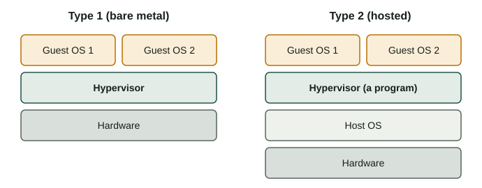

The hypervisor is the piece that makes virtualization possible. If you know which types exist and how the processor helps them, you can choose the right product for each situation and fix the most common error when you create a VM: the missing 64-bit option.

:::tip[How to work with this page]
**Estimated time:** about 45 minutes of reading and 30 of practice.

1. Read sections 1 and 2, then build the stacks in the lab tab [Hypervisor stack builder](/docencia/smr/som/ud02-virtualizacion/laboratorios/virtualizacion/#stack).
2. Read section 3 and follow the steps in the tab [VT-x on/off](/docencia/smr/som/ud02-virtualizacion/laboratorios/virtualizacion/#vtx).
3. Do Activity 2, where you compare real products.
:::

## 1. What a hypervisor does

A **hypervisor** (also called a *virtual machine monitor*, VMM) is the software that creates virtual machines and runs them. It has three main jobs:

1. **Share the CPU.** It decides which guest uses each processor core and for how long.
2. **Share the memory.** It gives each guest its own memory area and keeps the guests apart, so that one cannot read the memory of another.
3. **Present virtual devices.** It shows each guest a virtual disk, a virtual network card, a virtual graphics card... and turns every request of the guest into an operation on the real hardware.

From the point of view of the guest, nothing special happens: it starts, finds a "computer" and runs.

## 2. Type 1 and Type 2

There are two families of hypervisors. The difference is **what is under the hypervisor**.

### Type 1: bare metal

A **Type 1** (or *bare-metal*) hypervisor starts directly on the hardware, just after the firmware (UEFI/BIOS). There is no normal operating system under it. It is a small, specialised system whose only job is to run virtual machines.

```text
Applications    Applications
Guest OS        Guest OS
------------------------------
Hypervisor (Type 1)
------------------------------
Hardware
```

Because there are fewer layers, it is faster, more stable and has less attack surface. It is the normal choice in data centres and in the cloud. It usually offers advanced features: moving a running VM between servers (*live migration*), restarting VMs automatically if a server fails (*high availability*), and managing hundreds of VMs from one console.

### Type 2: hosted

A **Type 2** (or *hosted*) hypervisor is a normal program that you install on your usual operating system, like a browser or a text editor. The VMs it creates are windows on your desktop. When a guest writes to its disk, the hypervisor asks the host operating system to write a file.

```text
Applications    Applications
Guest OS        Guest OS
------------------------------
Hypervisor (Type 2, a program)
------------------------------
Host OS (Windows, Linux, macOS)
------------------------------
Hardware
```

It is easy to install and you can keep working with your normal computer, so it is ideal for learning, testing and development. The price is a little more overhead, and one more layer to keep updated and secure. **VirtualBox is a Type 2 hypervisor.**



### Comparison

| Feature | Type 1 (bare metal) | Type 2 (hosted) |
|---|---|---|
| Runs on | The hardware | A host operating system |
| Performance | Closer to native | A bit lower, especially for disk and network |
| Installation | Dedicated machine, more planning | Like any program |
| Typical use | Servers, data centres, cloud | Laptops, classrooms, testing |
| Management | Many hosts and VMs, central tools | One computer, simple tools |
| Security surface | Smaller | Larger (host OS + hypervisor + guests) |
| Examples | VMware ESXi, Microsoft Hyper-V, KVM, Xen | VirtualBox, VMware Workstation, Parallels Desktop |

### Real products

| Product | Type | Licence | Where you find it |
|---|---|---|---|
| **VMware ESXi** | 1 | Commercial (proprietary) | Company servers |
| **Microsoft Hyper-V** | 1 | Included with some editions of Windows (Pro, Enterprise, Education) and Windows Server | Windows servers and PCs |
| **KVM** | 1 | Free and open source (part of the Linux kernel) | Linux servers, cloud, and platforms such as Proxmox VE |
| **Xen** | 1 | Free and open source | Servers and some cloud providers |
| **Oracle VirtualBox** | 2 | Free and open source (some extras have a different licence) | Windows, Linux, macOS (Intel) |
| **VMware Workstation** | 2 | Proprietary (check the current terms of the owner) | Windows and Linux PCs |
| **Parallels Desktop** | 2 | Commercial (proprietary) | macOS |

:::note[Why is KVM Type 1 if I use it from Linux?]
You manage KVM from a normal Linux system, but KVM is a module of the Linux kernel itself: the kernel *becomes* the hypervisor. Hyper-V is similar: when it is enabled, Windows itself runs as a special guest on top of the hypervisor. For this reason both are considered Type 1.
:::

:::caution[Licences change]
Companies change the names, prices and conditions of their products often. Before you choose a product for work, read the current licence on the official website.
:::

## 3. Help from the processor: VT-x and AMD-V

### The problem

Operating systems are written to run on real hardware. A normal OS kernel expects to run in the most privileged mode of the CPU and to control everything. But if a guest kernel could do that, it would take control of the whole computer and the hypervisor would lose its authority. The hypervisor must intercept the "dangerous" instructions of the guest.

There are three ways to solve this:

| Method | How it works | Speed |
|---|---|---|
| **Software virtualization** | The hypervisor reads the guest code and rewrites or emulates the dangerous instructions before they run (*binary translation*). | Slowest, complex |
| **Hardware-assisted virtualization** | The processor has a special mode for guests. The guest kernel runs almost directly on the CPU, and the CPU hands control to the hypervisor only when a dangerous operation happens. | Fast |
| **Paravirtualization** | The guest knows that it is virtual and uses special drivers to talk to the hypervisor (for example, *virtio* network and disk drivers). | Fast for disk and network |

### VT-x, AMD-V, EPT and NPT

Modern processors have the instructions for hardware-assisted virtualization:

- **Intel VT-x** on Intel processors.
- **AMD-V** on AMD processors.
- **EPT** (Intel) and **NPT** (AMD) help to translate the memory addresses of the guest to real addresses without the hypervisor doing it by software. This makes memory access much faster.

Current versions of VirtualBox need hardware virtualization to work. In practice you will use a mix of the three methods: VT-x or AMD-V for the CPU, and paravirtualized (or very simple emulated) devices for network and disk.

:::tip[Paravirtualization in VirtualBox]
In the settings of a VM, **System → Acceleration → Paravirtualization Interface** lets you choose how the guest talks to the hypervisor. The *Default* option is a good choice for almost every guest.
:::

### Check and enable it

These features are often disabled in the firmware by default, mostly on laptops. The classic symptom is that VirtualBox only offers **32-bit** versions in the list of guest systems, or says that VT-x is not available.

To check it, in Linux:

```bash
lscpu | grep -i virtualization
grep -Ec '(vmx|svm)' /proc/cpuinfo
```

The first command shows `VT-x` (Intel) or `AMD-V`. The second counts the processor entries that have the `vmx` flag (Intel) or `svm` flag (AMD). If the number is `0`, the feature is absent or hidden. Remember that the output of these commands inside a guest may be different, because they show what the hypervisor lets the guest see.

In Windows you can open the **Task Manager**, tab **Performance → CPU**, and look for *Virtualization: Enabled*.

If it is disabled, restart the computer, enter the UEFI/BIOS setup and look for an option with a name like:

- *Intel Virtualization Technology* (Intel).
- *SVM Mode* (AMD).

Enable it, save and restart. The exact name and place change with every manufacturer.

:::caution[Another hypervisor in the way]
On Windows, features such as Hyper-V, Windows Sandbox or some security options use the hardware virtualization of the processor. VirtualBox can work together with them, but the VMs are often slower. If your VMs are very slow, ask your teacher before you change those features.
:::

## 4. Choosing a hypervisor

| Situation | Reasonable choice |
|---|---|
| Learning on a school or home PC | VirtualBox (Type 2, free) |
| You already have Windows Pro and need a simple option | Hyper-V |
| A company runs many critical servers | A Type 1: ESXi, Hyper-V on Windows Server, or KVM with a management platform |
| You use macOS and need good integration | Parallels Desktop or another Mac-specific product |
| You want to build a free virtualization server | KVM with a platform such as Proxmox VE |

:::note[Containers are not VMs]
You may hear about *Docker* and *containers*. A container shares the kernel of the host instead of running a full guest operating system. It starts faster and uses less memory, but it is less isolated than a VM. It is a different tool, and you will meet it in other modules.
:::

## Check what you have learned

1. What is the main difference between a Type 1 and a Type 2 hypervisor?

   <details>
   <summary>Answer</summary>

   A Type 1 hypervisor runs directly on the hardware. A Type 2 hypervisor is a program that runs on top of a host operating system.

   </details>

2. Classify these products as Type 1 or Type 2: VirtualBox, KVM, ESXi, Parallels Desktop.

   <details>
   <summary>Answer</summary>

   Type 2: VirtualBox and Parallels Desktop. Type 1: KVM and ESXi.

   </details>

3. You open VirtualBox and you can only create 32-bit guests. What is the most likely cause and the solution?

   <details>
   <summary>Answer</summary>

   Hardware virtualization (Intel VT-x or AMD-V) is disabled in the UEFI/BIOS setup. Restart, enter the setup, enable *Intel Virtualization Technology* or *SVM Mode*, save and restart.

   </details>

4. Why do Type 1 hypervisors usually have better performance than Type 2?

   <details>
   <summary>Answer</summary>

   Because there is no host operating system between the hypervisor and the hardware. There are fewer layers, so less overhead and fewer things that can fail.

   </details>

5. What is paravirtualization?

   <details>
   <summary>Answer</summary>

   A method where the guest knows it is virtual and uses special drivers (for example, virtio) to communicate with the hypervisor directly. It avoids emulating real hardware and it is faster for disk and network.

   </details>

## Glossary

| English | Castellano |
|---|---|
| hypervisor | hipervisor |
| Type 1 / bare metal | tipo 1 / sin sistema operativo anfitrión |
| Type 2 / hosted | tipo 2 / alojado |
| hardware-assisted virtualization | virtualización asistida por hardware |
| paravirtualization | paravirtualización |
| binary translation | traducción binaria |
| live migration | migración en vivo |
| high availability | alta disponibilidad |
| kernel | núcleo (del sistema operativo) |
| container | contenedor |
| firmware | firmware |

:::note[Credits]
This page adapts the SOM course notes by Moisés Mas Rocamora, Daniel Álvarez Santamaría and Jana Taboada León, licensed under CC BY-NC-SA 4.0. This page is shared under the same licence.
:::
