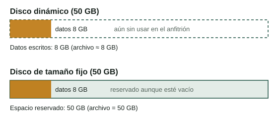
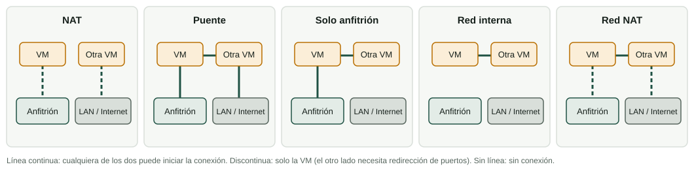

Crear una VM es como elegir las piezas de un ordenador: decides cuántos núcleos, cuánta memoria y qué tamaño de disco tiene. La diferencia es que puedes cambiar de idea en segundos. Esta página te enseña el proceso en VirtualBox y las razones de cada elección.

:::tip[Cómo trabajar esta página]
**Tiempo orientativo:** unos 60 minutos de lectura y 60 de práctica.

1. Lee las secciones 1 y 2. Después prueba la pestaña del laboratorio [Asistente de nueva VM](/docencia/smr/som/ud02-virtualizacion/laboratorios/virtualizacion/?lang=es#wizard).
2. Lee las secciones 3 y 4 y juega con las pestañas [Reparto de recursos](/docencia/smr/som/ud02-virtualizacion/laboratorios/virtualizacion/?lang=es#resources) y [Modos de red](/docencia/smr/som/ud02-virtualizacion/laboratorios/virtualizacion/?lang=es#network).
3. Haz las actividades 2 y 3 con el programa real.
:::

## 1. VirtualBox

**Oracle VirtualBox** es un hipervisor de tipo 2 que funciona en Windows, Linux y macOS con procesador Intel. El programa es gratuito y de código abierto, y tiene una interfaz gráfica (el *VirtualBox Manager*) y una herramienta de línea de órdenes (`VBoxManage`).

:::note[Mac con chip Apple]
Los Mac con chips de Apple usan un procesador Arm, así que los invitados también deben ser sistemas Arm. Si usas uno en casa, consulta la documentación actual de VirtualBox o usa otro producto hecho para esos Mac.
:::

### Instalarlo

| Anfitrión | Cómo |
|---|---|
| Windows | Descarga el instalador de la web oficial de VirtualBox, ejecútalo y acepta las opciones por defecto. Windows puede pedirte que instales controladores de red: acepta. |
| Ubuntu / Debian / LliureX | `sudo apt install virtualbox`, o añade el repositorio de Oracle para obtener la versión más nueva. |
| macOS (Intel) | Descarga la imagen de disco de la web oficial y ejecuta el instalador. Puede que tengas que permitir el software en los ajustes de seguridad del sistema. |

Puedes comprobar que funciona con:

```bash
VBoxManage --version
```

En la web oficial también encontrarás el **Extension Pack**, un complemento aparte con funciones extra (por ejemplo, compatibilidad con USB 2.0 y 3.0). Tiene una licencia distinta de la de VirtualBox: es gratuito para uso personal, educativo y de evaluación, pero las empresas tienen que pagarlo. No lo instales si no lo necesitas.

:::note[Una alternativa propietaria]
VirtualBox no es la única opción de escritorio. **VMware Workstation** (Windows y Linux) y **Hyper-V** (incluido en algunas ediciones de Windows) son productos propietarios para el mismo trabajo. Las ideas de esta unidad son las mismas; solo cambian los menús.
:::

### El Manager

Cuando abres VirtualBox, la ventana muestra a la izquierda la lista de tus VM y a la derecha los detalles y los botones. Los botones más importantes son **New**, **Settings**, **Start** y, cuando hay una VM seleccionada, la herramienta **Snapshots**.

## 2. Crear una VM

Necesitas tres cosas: el nombre y el tipo del sistema operativo, la cantidad de hardware y una fuente de instalación (normalmente una **imagen ISO**, un archivo que contiene el contenido de un disco de instalación).

Pasos del asistente *New* (VirtualBox 7; los textos pueden cambiar un poco en otras versiones):

1. **Nombre y sistema operativo.** Escribe un nombre descriptivo, como `SOM-U2-Ubuntu`. Elige el archivo ISO, o elige tú el **Type** y la **Version**. Esta elección es importante: VirtualBox la usa para seleccionar ajustes por defecto seguros. Si eliges *Ubuntu (64-bit)* y luego instalas Windows, puede funcionar mal.
2. **Hardware.** Elige la **memoria (RAM)** y el número de **procesadores** (vCPU). Mira los requisitos del invitado (tabla de abajo). La opción *Enable EFI* hace que la VM arranque con UEFI en lugar de la BIOS antigua.
3. **Disco duro virtual.** Elige el tamaño del disco y si el espacio se reserva ahora o más tarde (véase la sección 3).
4. **Resumen.** Comprueba todo y termina.

Verás la nueva VM en la lista. Si no elegiste una ISO en el primer paso, abre **Settings → Storage**, haz clic en la unidad óptica vacía y selecciona el archivo ISO. Después pulsa **Start**.

:::caution[Instalación desatendida]
La versión 7 de VirtualBox puede instalar automáticamente algunos sistemas operativos cuando le das una ISO (pide usuario y contraseña en el asistente). Es cómodo, pero en esta unidad debes hacer la instalación tú mismo al menos una vez, para ver el instalador. Si no la quieres, marca **Skip Unattended Installation**.
:::

### ¿Cuánto hardware necesita el invitado?

Lee siempre los requisitos del sistema invitado y comprueba que tu anfitrión puede darlos. Estos son valores mínimos típicos de la documentación oficial de cada sistema:

| Invitado | vCPU | RAM | Disco | Otros |
|---|---|---|---|---|
| Ubuntu 24.04 Desktop | 2 | 4 GB | 25 GB | |
| Windows 11 | 2 | 4 GB | 64 GB | UEFI con Secure Boot y TPM 2.0 |

Para Windows 11, VirtualBox 7 puede proporcionar un TPM virtual y EFI. Cuando eliges el tipo *Windows 11 (64-bit)*, comprueba en **Settings → System** que EFI y el TPM están activados.

### Una VM comparada con un ordenador físico

| En un ordenador físico eliges... | En VirtualBox eliges... |
|---|---|
| El procesador y los núcleos | **System → Processor:** número de vCPU |
| Los módulos de memoria | **System → Motherboard:** memoria base |
| El disco | **Storage:** un archivo de disco virtual |
| El firmware | **System → Motherboard:** EFI activado o no |
| La tarjeta gráfica | **Display:** memoria de vídeo |
| La tarjeta de red | **Network:** adaptador y modo |
| La unidad de DVD | **Storage:** un archivo ISO o la unidad del anfitrión |
| El orden de arranque | **System → Motherboard:** orden de arranque |

### No asignes de más

El anfitrión sigue funcionando mientras las VM se ejecutan, así que debes dejarle recursos.

- **Memoria:** da al invitado lo que necesita, no más. Como regla, deja al menos 2-3 GB para el anfitrión y no permitas que el total de las VM en marcha se coma la memoria del anfitrión. VirtualBox muestra una zona verde y una zona roja en el deslizador de memoria: quédate en la verde.
- **vCPU:** no des a una VM más procesadores virtuales que núcleos tiene tu anfitrión. En la mayoría de los laboratorios bastan 1 o 2 vCPU. Más vCPU no siempre hacen más rápida una VM; incluso pueden hacerla más lenta.
- **Disco:** el disco virtual vivirá en el disco del anfitrión, así que comprueba el espacio libre.

## 3. Discos virtuales

El disco de una VM es un **archivo** del anfitrión. VirtualBox admite varios formatos:

| Formato | Origen | Comentario |
|---|---|---|
| **VDI** | VirtualBox | El formato por defecto |
| **VMDK** | VMware | También se usa en los paquetes OVA |
| **VHD** | Microsoft | Lo usan Hyper-V y Windows |

El formato no es la decisión más importante; la **reserva de espacio** sí:

| | Reserva dinámica | Tamaño fijo |
|---|---|---|
| Espacio usado en el anfitrión | Empieza pequeño y crece a medida que el invitado escribe datos | Todo el espacio se reserva al crearlo |
| Creación | Instantánea | Tarda un tiempo |
| Velocidad | Normalmente algo menor, sobre todo mientras crece | Más predecible |
| Riesgo | El anfitrión puede quedarse sin espacio si todos los discos crecen | Ninguno, el espacio ya es tuyo |
| Uso típico | Aula y pruebas | Servidores, pruebas de rendimiento |

Un disco dinámico de 50 GB que contiene 8 GB de datos ocupa unos 8 GB en el anfitrión. Pero el archivo **no se encoge solo** cuando el invitado borra archivos. Para recuperar el espacio hay que compactar el disco con una herramienta especial.



## 4. Redes

Cada VM tiene hasta cuatro adaptadores de red virtuales. Cada uno funciona en un **modo**, que decide con quién puede hablar la VM. Probablemente es el ajuste que da más problemas, así que apréndelo bien.

| Modo | Qué hace | Uso típico |
|---|---|---|
| **NAT** | La VM comparte la dirección IP del anfitrión. Puede salir a Internet, pero nadie de fuera puede iniciar una conexión con ella (salvo que añadas *redirección de puertos*). Cada VM está sola en su propia red privada. | Por defecto. Navegar y actualizar |
| **Bridged adapter** (adaptador puente) | La VM se conecta a la red real a través de la tarjeta de red del anfitrión y recibe su propia dirección, como si fuera otro ordenador físico. | Un servidor al que deben llegar otros ordenadores |
| **Host-only adapter** (solo anfitrión) | Una red privada que solo incluye al anfitrión y a las VM. Sin Internet. | Un laboratorio seguro donde el anfitrión se conecta a las VM |
| **Internal network** (red interna) | Una red privada que solo incluye a las VM con el mismo nombre de red. Ni siquiera el anfitrión está dentro. | Laboratorios totalmente aislados |
| **NAT Network** (red NAT) | Como NAT, pero varias VM comparten una red privada y pueden hablar entre ellas y con Internet. | VM que deben verse entre sí y salir también |

Quién puede hablar con quién:

| Modo | VM → Internet | VM → anfitrión | Anfitrión → VM | VM ↔ VM | Resto de la LAN → VM |
|---|---|---|---|---|---|
| NAT | Sí | Sí | Redirección de puertos | No | Redirección de puertos |
| Puente | Sí | Sí | Sí | Sí | Sí |
| Solo anfitrión | No | Sí | Sí | Sí | No |
| Red interna | No | No | No | Sí | No |
| Red NAT | Sí | Sí | Redirección de puertos | Sí | Redirección de puertos |



:::caution[Modo puente en centros educativos y Wi-Fi]
El modo puente necesita que la red dé una dirección nueva a la VM. Muchas redes de centros educativos y públicas no lo permiten, y algunos adaptadores Wi-Fi no funcionan bien en este modo. Si el modo puente no funciona, usa NAT u otra red.
:::

### La dirección MAC

Cada tarjeta de red tiene una **dirección MAC** que debe ser única en la red local. Cuando se clona una VM o se importa desde una aplicación virtual, puede conservar la misma MAC que el original. Dos máquinas con la misma MAC en la misma red causan problemas de conexión extraños. VirtualBox te permite **generar nuevas direcciones MAC** al clonar o importar. Úsalo siempre en un aula.

## 5. La VM y el anfitrión

Una VM no está «dentro» del anfitrión de forma mágica. Es un conjunto de archivos y un proceso:

- El archivo de configuración (`.vbox`) describe el hardware virtual.
- Los archivos de disco (`.vdi`, ...) contienen los datos.
- Cuando la VM se ejecuta, VirtualBox es un proceso del anfitrión que usa una parte de su CPU y de su memoria.
- Si cierras la ventana con la VM en marcha, puedes elegir **guardar el estado**, **enviar la señal de apagado** o **apagar**. Apagar sin más es como tirar del cable: puede dañar el sistema de archivos del invitado.

Puedes controlar una VM desde el terminal con `VBoxManage`:

```bash
VBoxManage list vms                           # todas las VM registradas
VBoxManage list runningvms                    # las VM que se están ejecutando
VBoxManage showvminfo "SOM-U2-Ubuntu"         # configuración completa
VBoxManage modifyvm "SOM-U2-Ubuntu" --memory 2048 --cpus 2
VBoxManage startvm "SOM-U2-Ubuntu"
```

La VM debe estar apagada para cambiar la memoria o el número de procesadores.

## Comprueba lo aprendido

1. Un compañero crea una VM de Windows 11 con 2 GB de RAM y un disco de 20 GB y no se instala. ¿Por qué?

   <details>
   <summary>Respuesta</summary>

   No cumple los requisitos mínimos de Windows 11 (4 GB de RAM, 64 GB de disco, UEFI y TPM 2.0). La VM necesita más memoria y disco y tener EFI y TPM activados.

   </details>

2. ¿Qué diferencia hay entre un disco de reserva dinámica y uno de tamaño fijo? ¿Cuál necesita más espacio en el anfitrión al principio?

   <details>
   <summary>Respuesta</summary>

   Un disco dinámico crece a medida que el invitado escribe datos; uno de tamaño fijo reserva todo su espacio al crearlo. El de tamaño fijo necesita más espacio al principio.

   </details>

3. Quieres que dos VM hablen entre sí, pero no quieres que el anfitrión ni Internet lleguen a ellas. ¿Qué modo de red usas?

   <details>
   <summary>Respuesta</summary>

   **Red interna**, con el mismo nombre de red en las dos VM.

   </details>

4. Tu VM debe ser visible para otros ordenadores de la LAN con su propia dirección IP. ¿Qué modo eliges y qué puede salir mal?

   <details>
   <summary>Respuesta</summary>

   **Adaptador puente.** Puede no funcionar en redes de centros educativos o públicas que no dan direcciones a dispositivos desconocidos, o con algunas tarjetas Wi-Fi.

   </details>

5. ¿Por qué debes reinicializar la dirección MAC cuando importas una aplicación virtual?

   <details>
   <summary>Respuesta</summary>

   Porque muchos alumnos importan el mismo archivo, y direcciones MAC idénticas en la misma red causan conflictos. Una MAC nueva hace única a cada VM.

   </details>

## Glosario

| English | Castellano |
|---|---|
| VirtualBox Manager | administrador de VirtualBox |
| ISO image | imagen ISO |
| virtual disk | disco virtual |
| dynamically allocated | de tamaño dinámico (reserva dinámica) |
| fixed size | de tamaño fijo |
| NAT | traducción de direcciones de red (NAT) |
| bridged adapter | adaptador puente |
| host-only adapter | adaptador solo anfitrión |
| internal network | red interna |
| MAC address | dirección MAC |
| port forwarding | redirección de puertos |
| vCPU | procesador virtual |
| power off | apagado forzado |

:::note[Créditos]
Esta página adapta los apuntes del curso de SOM de Moisés Mas Rocamora, Daniel Álvarez Santamaría y Jana Taboada León, con licencia CC BY-NC-SA 4.0. Esta página se comparte con la misma licencia.
:::
