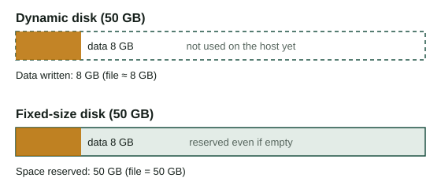
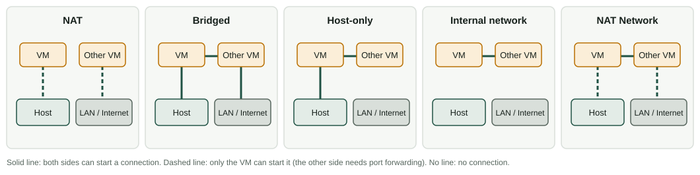

Creating a VM is like choosing the parts of a computer: you decide how many cores, how much memory and how big a disk it has. The difference is that you can change your mind in seconds. This page shows you the process in VirtualBox and the reasons behind each choice.

:::tip[How to work with this page]
**Estimated time:** about 60 minutes of reading and 60 of practice.

1. Read sections 1 and 2. Then try the lab tab [New VM wizard](/docencia/smr/som/ud02-virtualizacion/laboratorios/virtualizacion/#wizard).
2. Read sections 3 and 4 and play with the tabs [Resource allocator](/docencia/smr/som/ud02-virtualizacion/laboratorios/virtualizacion/#resources) and [Network modes](/docencia/smr/som/ud02-virtualizacion/laboratorios/virtualizacion/#network).
3. Do Activities 2 and 3 with the real program.
:::

## 1. VirtualBox

**Oracle VirtualBox** is a Type 2 hypervisor that runs on Windows, Linux and macOS with an Intel processor. The program is free and open source, and it has a graphical interface (the *VirtualBox Manager*) and a command-line tool (`VBoxManage`).

:::note[Apple Silicon Macs]
Macs with Apple chips use an Arm processor, so the guests must also be Arm systems. If you use one at home, check the current VirtualBox documentation or use another product made for those Macs.
:::

### Installing it

| Host | How |
|---|---|
| Windows | Download the installer from the official VirtualBox website, run it and accept the default options. Windows may ask you to install network drivers: accept. |
| Ubuntu / Debian / LliureX | `sudo apt install virtualbox`, or add the repository of Oracle to get the newest version. |
| macOS (Intel) | Download the disk image from the official website and run the installer. You may have to allow the software in the system security settings. |

You can check that it works with:

```bash
VBoxManage --version
```

On the official website you will also find the **Extension Pack**, a separate add-on with extra features (for example USB 2.0 and 3.0 support). It has a different licence from VirtualBox: it is free for personal, educational and evaluation use, but companies need to pay for it. Do not install it unless you need it.

:::note[A proprietary alternative]
VirtualBox is not the only desktop option. **VMware Workstation** (Windows and Linux) and **Hyper-V** (included in some editions of Windows) are proprietary products for the same job. The ideas in this unit are the same; only the menus change.
:::

### The Manager

When you open VirtualBox, the window shows a list of your VMs on the left and the details and buttons on the right. The most important buttons are **New**, **Settings**, **Start** and, when a VM is selected, the **Snapshots** tool.

## 2. Creating a VM

You need three things: the name and type of the operating system, the amount of hardware, and an installation source (usually an **ISO image**, a file that contains the content of an installation disc).

Steps in the *New* wizard (VirtualBox 7; the texts can change a little in other versions):

1. **Name and operating system.** Write a descriptive name, such as `SOM-U2-Ubuntu`. Choose the ISO file, or choose the **Type** and **Version** yourself. This choice is important: VirtualBox uses it to select safe default settings. If you choose *Ubuntu (64-bit)* and then install Windows, it may work badly.
2. **Hardware.** Choose the **memory (RAM)** and the number of **processors** (vCPU). Look at the requirements of the guest (table below). The *Enable EFI* option makes the VM start with UEFI instead of the old BIOS.
3. **Virtual hard disk.** Choose the size of the disk and whether the space is reserved now or later (see section 3).
4. **Summary.** Check everything and finish.

You will see the new VM in the list. If you did not choose an ISO in the first step, open **Settings → Storage**, click the empty optical drive and select the ISO file. Then press **Start**.

:::caution[Unattended installation]
Version 7 of VirtualBox can install some operating systems automatically when you give it an ISO (it asks for user and password in the wizard). It is handy, but in this unit you should do the installation yourself at least once, to see the installer. If you do not want it, tick **Skip Unattended Installation**.
:::

### How much hardware does the guest need?

Always read the requirements of the guest system, then check that your host can give them. These are typical minimum values of the official documentation of each system:

| Guest | vCPU | RAM | Disk | Other |
|---|---|---|---|---|
| Ubuntu 24.04 Desktop | 2 | 4 GB | 25 GB | |
| Windows 11 | 2 | 4 GB | 64 GB | UEFI with Secure Boot and TPM 2.0 |

For Windows 11, VirtualBox 7 can provide a virtual TPM and EFI. When you choose the type *Windows 11 (64-bit)*, check in **Settings → System** that EFI and the TPM are enabled.

### A VM compared with a physical computer

| In a physical computer you choose... | In VirtualBox you choose... |
|---|---|
| The processor and cores | **System → Processor:** number of vCPUs |
| The memory modules | **System → Motherboard:** base memory |
| The disk | **Storage:** a virtual disk file |
| The firmware | **System → Motherboard:** EFI on or off |
| The graphics card | **Display:** video memory |
| The network card | **Network:** adapter and mode |
| The DVD drive | **Storage:** an ISO file or the host drive |
| The boot order | **System → Motherboard:** boot order |

### Do not over-assign

The host keeps working while the VMs run, so you must leave resources for it.

- **Memory:** give the guest what it needs, not more. As a rule, leave at least 2-3 GB for the host and never let the total of the running VMs eat the memory of the host. VirtualBox shows a green zone and a red zone on the memory slider: stay in the green.
- **vCPU:** do not give a VM more virtual processors than your host has cores. In most labs 1 or 2 vCPUs are enough. More vCPUs do not always make a VM faster; they can even make it slower.
- **Disk:** the virtual disk will live on the host disk, so check the free space.

## 3. Virtual disks

The disk of a VM is a **file** on the host. VirtualBox supports several formats:

| Format | Origin | Comment |
|---|---|---|
| **VDI** | VirtualBox | The default format |
| **VMDK** | VMware | Also used in OVA packages |
| **VHD** | Microsoft | Used by Hyper-V and Windows |

The format is not the most important decision; the **allocation** is:

| | Dynamically allocated | Fixed size |
|---|---|---|
| Space used on the host | Starts small and grows as the guest writes data | All the space is reserved at creation |
| Creation | Instant | It takes some time |
| Speed | Usually a bit lower, mostly while it grows | More predictable |
| Risk | The host can run out of space if all disks grow | None, the space is already yours |
| Typical use | Classroom and tests | Servers, benchmarks |

A dynamic disk of 50 GB that contains 8 GB of data uses about 8 GB on the host. But the file **does not shrink by itself** when the guest deletes files. To recover the space you have to compact the disk with a special tool.



## 4. Networking

Each VM has up to four virtual network adapters. Each one works in a **mode**, which decides who the VM can talk to. This is probably the setting that gives most problems, so learn it well.

| Mode | What it does | Typical use |
|---|---|---|
| **NAT** | The VM shares the IP address of the host. It can go out to the Internet, but nobody from outside can start a connection to it (unless you add *port forwarding*). Each VM is alone in its own private network. | Default. Browsing and updates |
| **Bridged adapter** | The VM connects to the real network through the network card of the host and gets its own address, as if it were another physical computer. | A server that other computers must reach |
| **Host-only adapter** | A private network that only includes the host and the VMs. No Internet. | A safe lab where the host connects to the VMs |
| **Internal network** | A private network that only includes the VMs with the same network name. Even the host is outside. | Fully isolated labs |
| **NAT Network** | Like NAT, but several VMs share one private network and can talk to each other and to the Internet. | VMs that must see each other and also go out |

Who can talk to whom:

| Mode | VM → Internet | VM → host | Host → VM | VM ↔ VM | Rest of LAN → VM |
|---|---|---|---|---|---|
| NAT | Yes | Yes | Port forwarding | No | Port forwarding |
| Bridged | Yes | Yes | Yes | Yes | Yes |
| Host-only | No | Yes | Yes | Yes | No |
| Internal | No | No | No | Yes | No |
| NAT Network | Yes | Yes | Port forwarding | Yes | Port forwarding |



:::caution[Bridged mode in schools and Wi-Fi]
Bridged mode needs the network to give a new address to the VM. Many school and public networks do not allow it, and some Wi-Fi adapters do not work well in this mode. If bridged does not work, use NAT or a different network.
:::

### The MAC address

Every network card has a **MAC address** that must be unique in the local network. When a VM is cloned or imported from an appliance, it may keep the same MAC as the original. Two machines with the same MAC in the same network cause strange connection problems. VirtualBox lets you **generate new MAC addresses** when you clone or import. Always use it in a classroom.

## 5. The VM and the host

A VM is not "inside" the host in a magical way. It is a set of files and a process:

- The configuration file (`.vbox`) describes the virtual hardware.
- The disk files (`.vdi`, ...) contain the data.
- When the VM runs, VirtualBox is a process on the host that uses a part of its CPU and memory.
- If you close the window with the VM running, you can choose to **save the state**, **send the shutdown signal** or **power off**. Powering off is like pulling the plug: it can damage the guest file system.

You can control a VM from the terminal with `VBoxManage`:

```bash
VBoxManage list vms                           # all registered VMs
VBoxManage list runningvms                    # VMs that are running
VBoxManage showvminfo "SOM-U2-Ubuntu"         # full configuration
VBoxManage modifyvm "SOM-U2-Ubuntu" --memory 2048 --cpus 2
VBoxManage startvm "SOM-U2-Ubuntu"
```

The VM must be powered off to change the memory or the number of processors.

## Check what you have learned

1. A classmate creates a Windows 11 VM with 2 GB of RAM and a 20 GB disk and it does not install. Why?

   <details>
   <summary>Answer</summary>

   It does not meet the minimum requirements of Windows 11 (4 GB of RAM, 64 GB of disk, UEFI and TPM 2.0). The VM needs more memory and disk and EFI and TPM enabled.

   </details>

2. What is the difference between a dynamically allocated disk and a fixed-size disk? Which one needs more space on the host at the beginning?

   <details>
   <summary>Answer</summary>

   A dynamic disk grows as the guest writes data; a fixed-size disk reserves all its space at creation. The fixed-size disk needs more space at the beginning.

   </details>

3. You want two VMs to talk to each other, but you do not want the host or the Internet to reach them. Which network mode do you use?

   <details>
   <summary>Answer</summary>

   **Internal network**, with the same network name in both VMs.

   </details>

4. Your VM must be visible to other computers of the LAN with its own IP address. Which mode do you choose, and what can go wrong?

   <details>
   <summary>Answer</summary>

   **Bridged adapter.** It may not work on school or public networks that do not give addresses to unknown devices, or with some Wi-Fi cards.

   </details>

5. Why should you reinitialize the MAC address when you import an appliance?

   <details>
   <summary>Answer</summary>

   Because many students import the same file, and identical MAC addresses in the same network cause conflicts. A new MAC makes each VM unique.

   </details>

## Glossary

| English | Castellano |
|---|---|
| VirtualBox Manager | administrador de VirtualBox |
| ISO image | imagen ISO |
| virtual disk | disco virtual |
| dynamically allocated | de tamaño dinámico (reserva dinámica) |
| fixed size | de tamaño fijo |
| NAT | traducción de direcciones de red (NAT) |
| bridged adapter | adaptador puente |
| host-only adapter | adaptador solo anfitrión |
| internal network | red interna |
| MAC address | dirección MAC |
| port forwarding | redirección de puertos |
| vCPU | procesador virtual |
| power off | apagado forzado |

:::note[Credits]
This page adapts the SOM course notes by Moisés Mas Rocamora, Daniel Álvarez Santamaría and Jana Taboada León, licensed under CC BY-NC-SA 4.0. This page is shared under the same licence.
:::
