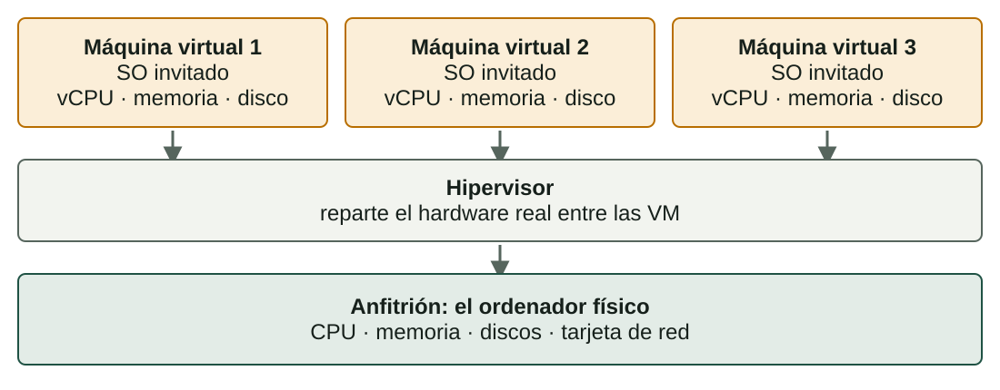

## Qué aprenderás

:::pasos
- Qué es una **máquina virtual**
- **Anfitrión**, **invitado** e **hipervisor**
- **¿Físico o virtual?** Ventajas e inconvenientes
- Dónde se usa la **virtualización** en la vida real
:::

---

## La virtualización reparte un ordenador

La **virtualización** crea *versiones en software* de recursos informáticos.

:::pasos
- Un **ordenador** completo, un **disco**, una **red**
- Varios **sistemas aislados** comparten el mismo hardware físico
:::

---

## Una máquina virtual es un ordenador hecho de software

:::pasos
- Un procesador virtual (**vCPU**) y **memoria** virtual
- **Discos** virtuales y una **tarjeta de red** virtual
- Instalas un **sistema operativo** y lo usas como siempre
- Ese sistema **no sabe** que su hardware no es real
:::

---

## Anfitrión, invitado e hipervisor

:::pasos
- El **anfitrión** es el ordenador físico, con su hardware real
- El **invitado** es el sistema operativo dentro de una VM
- El **hipervisor** crea las VM y reparte el hardware
:::

Cada invitado cree que tiene un ordenador; el hipervisor decide lo que recibe de verdad.

---

## Un anfitrión, varios invitados

---

## Una VM son solo archivos

:::pasos
- Un **archivo de configuración** describe el hardware virtual
- Uno o más archivos hacen de **discos virtuales**
- Copia, mueve, guarda o borra una VM como **cualquier archivo**
:::

---

## ¿Ordenador físico o máquina virtual?

| | Ordenador físico | Máquina virtual |
|---|---|---|
| Rendimiento | Máximo: sin capa adicional | Algo menor (disco, red) |
| Tiempo de creación | Horas o días | Minutos |
| Llevarlo a otro sitio | Difícil: depende de su hardware | Copiar los archivos (o exportar un OVA) |
| Recuperación | Lenta: reinstalar o restaurar | Rápida: instantánea o copia |
| Coste por carga de trabajo | Mayor: una máquina por tarea | Menor: muchas VM en una máquina |

---

## Ninguno es mejor

:::note[Ninguno es mejor]
Una VM es la herramienta adecuada para **aprender**, **probar** y ejecutar **muchos servicios pequeños**.

Un equipo físico es mejor para la **máxima velocidad** o el **hardware especial**.
:::

---

## Consolidación: aprovechar el tiempo libre

:::pasos
- Un servidor con un servicio está **parado casi siempre**
- Un uso típico es del **10-20 %**
- Varias VM en un anfitrión aprovechan ese tiempo libre
- Menos máquinas: menos **hardware, electricidad y espacio**
:::

---

## Ventajas de la virtualización

:::pasos
- **Portabilidad**: una VM es un conjunto de archivos
- **Escalabilidad**: más CPU, memoria o disco; o clonar desde una plantilla
- **Recuperación sencilla**: una **instantánea** antes de un cambio arriesgado
- **Aislamiento**: un bloqueo o un virus se queda en una VM
- **Flexibilidad**: Windows y Linux a la vez
:::

---

## Inconvenientes de la virtualización

:::pasos
- **Sobrecarga**: la capa necesita algo de CPU y memoria
- **Cuellos de botella**: las VM compiten por CPU, memoria, disco y red
- **Complejidad**: anfitrión, hipervisor y cada invitado que actualizar
- **Licencias**: un sistema de pago en una VM sigue necesitando licencia
- **Seguridad**: si un atacante toma el hipervisor, todas las VM corren riesgo
- **Límites del hardware**: un invitado nunca supera al anfitrión
:::

---

## Una instantánea no es una copia de seguridad

:::caution[Una instantánea no es una copia de seguridad]
Una instantánea está en el **mismo disco** que la VM. Si ese disco falla, pierdes las dos cosas.

Para una copia real, **copia o exporta** la VM a otro lugar.
:::

---

## Aprender y probar

| Escenario | ¿Por qué virtualizar? |
|---|---|
| **Aula de informática** | El mismo sistema limpio para todos; un error no daña el ordenador real |
| **Pruebas de software** | Windows 10, Windows 11 y Ubuntu en un portátil |
| **Archivo sospechoso** | Si es malware, solo afecta a una VM que luego se borra |
| **Programa antiguo** | Una VM con el sistema operativo antiguo |

---

## Empresas y nube

| Escenario | ¿Por qué virtualizar? |
|---|---|
| **Pequeña empresa** | Los servidores de correo, web y archivos comparten un anfitrión potente |
| **Servicios en la nube** | Un «servidor» alquilado suele ser una VM que crece en minutos |
| **Recuperación ante desastres** | Se restaura la VM en otro anfitrión en minutos |

---

## VirtualBox en este módulo

:::pasos
- **Oracle VirtualBox**: un programa gratuito que crea VM
- Windows, Linux, la línea de órdenes… todo dentro de **VM**
- Si algo sale mal, vuelves a una **instantánea**
- El ordenador real **nunca corre peligro**
:::

---

## Pruébalo

::laboratorio[Físico frente a virtual]{src="virtualizacion" pestana="physical"}

::laboratorio[Pros y contras]{src="virtualizacion" pestana="proscons"}

---

## Resumen

- Una **VM** es un ordenador hecho de software: un conjunto de archivos
- El **hipervisor** reparte el hardware del **anfitrión** entre los **invitados**
- Ganas: **eficiencia, portabilidad, recuperación, aislamiento**
- Pagas: **sobrecarga, cuellos de botella, complejidad, licencias**
- Una **instantánea no es una copia de seguridad**

[Actividades de la unidad →](/docencia/smr/som/ud02-virtualizacion/actividades/es/)

---

## Créditos

Estas diapositivas resumen los apuntes del curso de SOM de Moisés Mas Rocamora, Daniel Álvarez Santamaría y Jana Taboada León, con licencia **CC BY-NC-SA 4.0**. Se comparten con la misma licencia.
