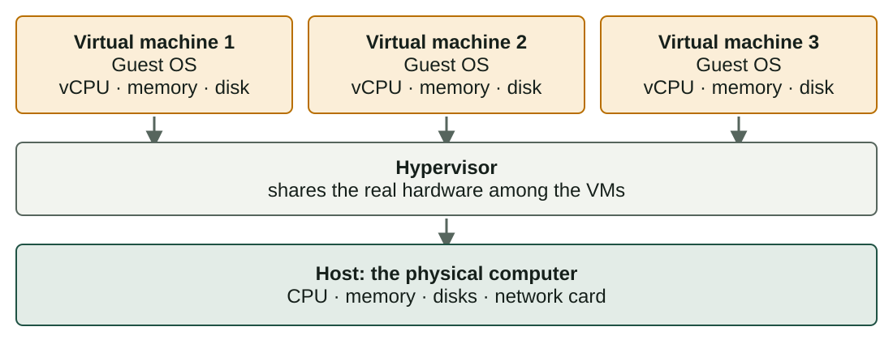

## What you will learn

:::pasos
- What a **virtual machine** is
- **Host**, **guest** and **hypervisor**
- **Physical or virtual?** Advantages and disadvantages
- Where **virtualization** is used in real life
:::

---

## Virtualization shares one computer

**Virtualization** creates *software versions* of computer resources.

:::pasos
- A whole **computer**, a **disk**, a **network**
- Several **isolated systems** share the same physical hardware
:::

---

## A virtual machine is a computer made of software

:::pasos
- A virtual processor (**vCPU**), virtual **memory**
- Virtual **disks** and a virtual **network card**
- You install an **operating system** and use it as usual
- That system **does not know** its hardware is not real
:::

---

## Host, guest and hypervisor

:::pasos
- The **host** is the physical computer, with its real hardware
- The **guest** is the operating system inside a VM
- The **hypervisor** creates the VMs and shares the hardware
:::

Every guest believes it owns a computer; the hypervisor decides what it really gets.

---

## One host, several guests

---

## A VM is just files

:::pasos
- A **configuration file** describes the virtual hardware
- One or more files act as **virtual disks**
- Copy, move, back up or delete a VM like **any file**
:::

---

## Physical computer or virtual machine?

| | Physical computer | Virtual machine |
|---|---|---|
| Performance | Maximum: no extra layer | Slightly lower (disk, network) |
| Creation time | Hours or days | Minutes |
| Moving it | Hard: tied to its hardware | Copy the files (or export an OVA) |
| Recovery | Slow: reinstall or restore | Fast: snapshot or copy |
| Cost per workload | Higher: one machine per job | Lower: many VMs on one machine |

---

## Neither is better

:::note[Neither is better]
A VM is the right tool for **learning**, **testing** and running **many small services**.

A physical machine is better for the **highest speed** or **special hardware**.
:::

---

## Consolidation: use the idle time

:::pasos
- A server with one service is **idle most of the time**
- A typical use is **10-20 %**
- Several VMs on one host use that idle time
- Fewer machines: less **hardware, electricity and space**
:::

---

## Advantages of virtualization

:::pasos
- **Portability**: a VM is a set of files
- **Scalability**: more CPU, memory or disk; or clone from a template
- **Easy recovery**: take a **snapshot** before a risky change
- **Isolation**: a crash or virus stays in one VM
- **Flexibility**: Windows and Linux at the same time
:::

---

## Disadvantages of virtualization

:::pasos
- **Overhead**: the layer needs some CPU and memory
- **Bottlenecks**: VMs compete for CPU, memory, disk and network
- **Complexity**: host, hypervisor and every guest to update
- **Licensing**: a paid system in a VM still needs a licence
- **Security**: if an attacker takes the hypervisor, all VMs are at risk
- **Hardware limits**: a guest is never stronger than the host
:::

---

## A snapshot is not a backup

:::caution[A snapshot is not a backup]
A snapshot lives on the **same disk** as the VM. If that disk fails, you lose both.

For a real backup, **copy or export** the VM to another place.
:::

---

## Learning and testing

| Scenario | Why virtualize? |
|---|---|
| **Computer classroom** | Same clean system for everyone; a mistake does not harm the real computer |
| **Software testing** | Windows 10, Windows 11 and Ubuntu on one laptop |
| **Suspicious file** | If it is malware, it only affects a VM you delete |
| **Old program** | A VM with the old operating system |

---

## Companies and the cloud

| Scenario | Why virtualize? |
|---|---|
| **Small company** | Mail, web and file servers share one strong host |
| **Cloud services** | A rented "server" is usually a VM that grows in minutes |
| **Disaster recovery** | Restore the VM on another host in minutes |

---

## VirtualBox in this module

:::pasos
- **Oracle VirtualBox**: a free program that creates VMs
- Windows, Linux, the command line… all inside **VMs**
- If something goes wrong, go back to a **snapshot**
- The real computer is **never at risk**
:::

---

## Try it yourself

::laboratorio[Physical vs virtual]{src="virtualizacion" pestana="physical"}

::laboratorio[Pros & cons]{src="virtualizacion" pestana="proscons"}

---

## Summary

- A **VM** is a computer made of software: a set of files
- The **hypervisor** shares the **host** hardware among the **guests**
- Gains: **efficiency, portability, recovery, isolation**
- Costs: **overhead, bottlenecks, complexity, licences**
- A **snapshot is not a backup**

[Activities of the unit →](/docencia/smr/som/ud02-virtualizacion/actividades/)

---

## Credits

These slides summarise the SOM course notes by Moisés Mas Rocamora, Daniel Álvarez Santamaría and Jana Taboada León, licensed under **CC BY-NC-SA 4.0**. They are shared under the same licence.
