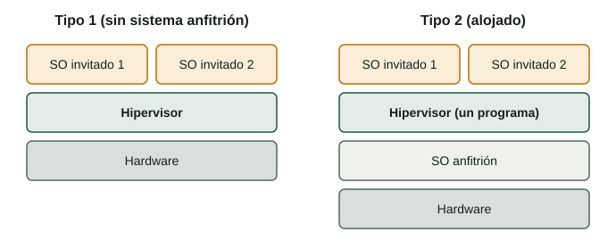

## Qué aprenderás

:::pasos
- Qué hace un **hipervisor**
- Hipervisores de **tipo 1** y de **tipo 2**
- Cómo ayuda el procesador: **VT-x** y **AMD-V**
- Cómo **elegir** un hipervisor
:::

---

## Un hipervisor crea y ejecuta las VM

También se llama *monitor de máquinas virtuales* (**VMM**). Tres tareas:

:::pasos
- **Repartir la CPU**: qué invitado usa cada núcleo, y cuánto tiempo
- **Repartir la memoria**: cada invitado en su propia zona
- **Presentar dispositivos virtuales**: disco, tarjeta de red, gráfica…
:::

Para el invitado no ocurre nada especial: encuentra un «ordenador» y funciona.

---

## Dos familias

La diferencia es **qué hay debajo del hipervisor**.



---

## Tipo 1: sobre el hardware

::::columnas
```text
SO invitado     SO invitado
---------------------------
Hipervisor (tipo 1)
---------------------------
Hardware
```

:::pasos
- Arranca **directamente sobre el hardware**, tras la UEFI/BIOS
- Menos capas: **más rápido y estable**
- Centros de datos y la **nube**
- Migración en caliente, alta disponibilidad
:::
::::

---

## Tipo 2: alojado

::::columnas
```text
SO invitado     SO invitado
---------------------------
Hipervisor (un programa)
---------------------------
SO anfitrión
---------------------------
Hardware
```

:::pasos
- Un **programa normal** en tu sistema operativo habitual
- Cada VM es una **ventana** en tu escritorio
- Ideal para **aprender, probar y desarrollar**
- **VirtualBox es de tipo 2**
:::
::::

---

## Tipo 1 frente a tipo 2

| | Tipo 1 (sobre el hardware) | Tipo 2 (alojado) |
|---|---|---|
| Se ejecuta sobre | El hardware | Un sistema operativo anfitrión |
| Rendimiento | Más cercano al nativo | Algo menor (disco, red) |
| Uso típico | Servidores, centros de datos, nube | Portátiles, aulas, pruebas |
| Ejemplos | ESXi, Hyper-V, KVM, Xen | VirtualBox, VMware Workstation |

---

## Productos reales

| Producto | Tipo | Licencia |
|---|---|---|
| **VMware ESXi** | 1 | Comercial |
| **Microsoft Hyper-V** | 1 | Algunas ediciones de Windows y Windows Server |
| **KVM** | 1 | Libre y de código abierto (núcleo de Linux) |
| **Oracle VirtualBox** | 2 | Libre y de código abierto |
| **VMware Workstation** | 2 | Propietaria |

:::caution[Las licencias cambian]
Consulta la web oficial antes de elegir.
:::

---

## ¿Por qué KVM es de tipo 1?

:::pasos
- Administras KVM desde un sistema Linux normal…
- …pero KVM es un **módulo del núcleo de Linux**
- El núcleo **se convierte** en el hipervisor
- Hyper-V es parecido: Windows funciona como un **invitado especial**
:::

---

## El problema

:::pasos
- El núcleo de un SO espera el **modo más privilegiado** de la CPU
- Un núcleo invitado con ese poder **lo controlaría todo**
- El hipervisor debe **interceptar** las instrucciones «peligrosas»
:::

---

## Tres formas de resolverlo


---

## VT-x, AMD-V, EPT y NPT

:::pasos
- **Intel VT-x** y **AMD-V**: virtualización asistida por hardware
- **EPT** (Intel) y **NPT** (AMD): acceso a memoria mucho más rápido
- El **VirtualBox actual la necesita** para funcionar
- En la práctica, una **mezcla**: VT-x/AMD-V + dispositivos paravirtualizados
:::

---

## Comprobarla y activarla

::::columnas
```bash
lscpu | grep -i virtualization
grep -Ec '(vmx|svm)' /proc/cpuinfo
```

:::pasos
- Síntoma: VirtualBox solo ofrece invitados de **32 bits**
- Windows: **Administrador de tareas → Rendimiento → CPU**
- Actívala en la **UEFI/BIOS**: *Intel Virtualization Technology* o *SVM Mode*
- Guarda y reinicia
:::
::::

---

## Pruébalo

::laboratorio[Constructor de pilas]{src="virtualizacion" pestana="stack"}

::laboratorio[VT-x activado y desactivado]{src="virtualizacion" pestana="vtx"}

---

## Resumen

- Un hipervisor reparte **CPU, memoria y dispositivos** entre las VM
- **Tipo 1** sobre el hardware · **tipo 2** sobre un SO anfitrión
- **VT-x / AMD-V** hacen rápidas las VM; se activan en el firmware
- Para aprender → **VirtualBox** · muchos servidores → un **tipo 1**

[Actividades de la unidad →](/docencia/smr/som/ud02-virtualizacion/actividades/es/)
