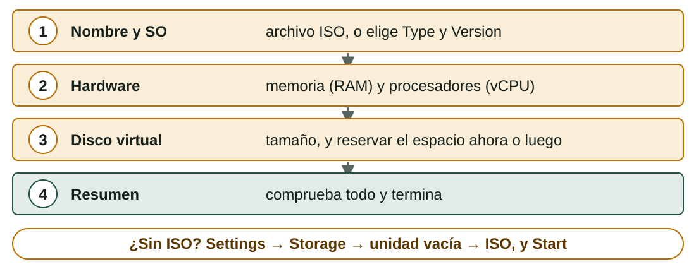
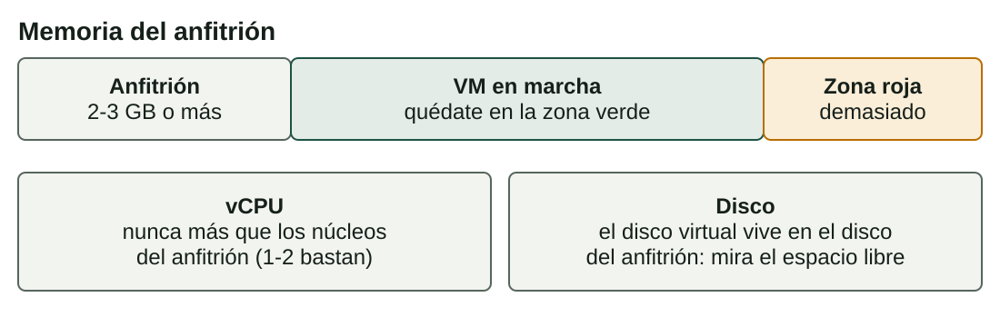

## Qué aprenderás

:::pasos
- Cómo **instalar VirtualBox** y crear una **VM** paso a paso
- Cómo elegir su **CPU, memoria y disco**
- Los formatos de **disco virtual** y su **reserva de espacio**
- Los **modos de red** y quién puede hablar con quién
- Cómo se relaciona una VM con el **anfitrión**
:::

---

## VirtualBox: un hipervisor de tipo 2 gratuito

:::pasos
- Funciona en **Windows, Linux y macOS** (Intel)
- **Gratuito y de código abierto**
- **VirtualBox Manager** (gráfico) y `VBoxManage` (línea de órdenes)
- Botones principales: **New**, **Settings**, **Start**, **Snapshots**
- Los Mac con chip de Apple usan Arm: los **invitados también deben ser Arm**
- Alternativas: **VMware Workstation**, **Hyper-V**; solo cambian los menús
:::

---

## Instalarlo

| Anfitrión | Cómo |
|---|---|
| Windows | Instalador oficial, opciones por defecto |
| Ubuntu / Debian / LliureX | `sudo apt install virtualbox` |
| macOS (Intel) | Imagen de disco oficial e instalador |

Comprueba que funciona:

```bash
VBoxManage --version
```

---

## El Extension Pack no es VirtualBox

:::pasos
- Un **complemento** aparte con funciones extra, como USB 2.0 y 3.0
- Tiene una **licencia distinta**
- Gratuito para uso **personal, educativo y de evaluación**
- Las **empresas** tienen que pagarlo
- No lo instales **si no lo necesitas**
:::

---

## Crear una VM: cuatro pasos del asistente

Necesitas el nombre y tipo del SO, el hardware y una fuente de instalación: una **imagen ISO**.



---

## Elige Type y Version con cuidado

:::pasos
- VirtualBox los usa para elegir **ajustes por defecto seguros**
- *Ubuntu (64-bit)* y luego instalar Windows: puede funcionar **mal**
- **Enable EFI**: la VM arranca con **UEFI**, no con la BIOS antigua
:::

:::caution[Instalación desatendida]
VirtualBox 7 puede instalar algunos sistemas por sí mismo. Haz la instalación **tú mismo al menos una vez** para ver el instalador: marca **Skip Unattended Installation**.
:::

---

## ¿Cuánto hardware necesita el invitado?

Valores mínimos típicos de la documentación oficial de cada sistema:

| Invitado | vCPU | RAM | Disco |
|---|---|---|---|
| Ubuntu 24.04 Desktop | 2 | 4 GB | 25 GB |
| Windows 11 | 2 | 4 GB | 64 GB |

:::pasos
- Windows 11 necesita además **UEFI con Secure Boot** y **TPM 2.0**
- VirtualBox 7 puede darlos: comprueba **Settings → System**
:::

---

## Las mismas decisiones que en un ordenador físico

| En un ordenador físico eliges… | En VirtualBox eliges… |
|---|---|
| El procesador y los núcleos | **System → Processor**: número de vCPU |
| Los módulos de memoria | **System → Motherboard**: memoria base |
| El disco | **Storage**: un archivo de disco virtual |
| La tarjeta de red | **Network**: adaptador y modo |
| La unidad de DVD | **Storage**: un archivo ISO o la unidad del anfitrión |

---

## No asignes de más

El anfitrión sigue funcionando mientras las VM se ejecutan, así que déjale recursos.



---

## Un disco virtual es un archivo del anfitrión

:::pasos
- **VDI**: el formato de VirtualBox, el de por defecto
- **VMDK**: de VMware; también se usa en los paquetes OVA
- **VHD**: de Microsoft; lo usan Hyper-V y Windows
- El formato importa menos que la **reserva de espacio**
:::

---

## ¿Reserva dinámica o tamaño fijo?

| | Reserva dinámica | Tamaño fijo |
|---|---|---|
| Espacio en el anfitrión | Empieza pequeño y crece cuando el invitado escribe | Todo reservado al crearlo |
| Creación | Instantánea | Tarda un tiempo |
| Velocidad | Normalmente algo menor mientras crece | Más predecible |
| Riesgo | El anfitrión puede quedarse sin espacio | Ninguno: el espacio ya es tuyo |
| Uso típico | Aula y pruebas | Servidores, pruebas de rendimiento |

---

## Un disco dinámico no se encoge solo

::::columnas


:::pasos
- Un disco dinámico de 50 GB con 8 GB de datos ocupa **unos 8 GB**
- Cuando el invitado borra archivos, el archivo **no cambia de tamaño**
- Para recuperar el espacio, **compacta** el disco con una herramienta especial
:::
::::

---

## Cinco modos de red

Hasta cuatro adaptadores por VM; cada uno funciona en un **modo**.

| Modo | Qué hace | Uso típico |
|---|---|---|
| **NAT** | Comparte la IP del anfitrión: la VM sale, nadie entra | Por defecto: navegar, actualizar |
| **Bridged adapter** (puente) | Dirección propia en la red real | Un servidor al que otros deben llegar |
| **Host-only adapter** (solo anfitrión) | Red privada de anfitrión y VM; sin Internet | Un laboratorio seguro |
| **Internal network** (red interna) | Red privada solo de VM; ni el anfitrión | Laboratorios aislados |
| **NAT Network** (red NAT) | Como NAT, pero las VM se ven entre sí | VM que se ven y salen |

---

## ¿Quién puede hablar con quién?


---

## Dos trampas del aula

:::caution[Modo puente en centros educativos y Wi-Fi]
Muchas redes de centros educativos y públicas no dan dirección a la VM, y algunos adaptadores Wi-Fi fallan. Si no funciona, usa **NAT** u otra red.
:::

:::pasos
- Cada tarjeta de red tiene una **dirección MAC**, única en la red
- Una VM clonada o importada puede conservar la **misma MAC** que el original
- **Genera siempre nuevas direcciones MAC** en un aula
:::

---

## Una VM es un conjunto de archivos y un proceso

:::pasos
- El archivo **`.vbox`** describe el hardware virtual
- Los archivos de disco (**`.vdi`**…) contienen los datos
- En marcha, VirtualBox es un **proceso** del anfitrión que usa su CPU y memoria
- Al cerrar la ventana: **guardar el estado**, **enviar la señal de apagado** o **apagar**
- **Apagar** es como tirar del cable: puede dañar el sistema de archivos del invitado
:::

---

## Controlar una VM desde el terminal

```bash
VBoxManage list vms                      # todas las VM registradas
VBoxManage list runningvms               # las VM que se están ejecutando
VBoxManage showvminfo "SOM-U2-Ubuntu"    # configuración completa
VBoxManage modifyvm "SOM-U2-Ubuntu" --memory 2048 --cpus 2
VBoxManage startvm "SOM-U2-Ubuntu"
```

La VM debe estar **apagada** para cambiar la memoria o los procesadores.

---

## Pruébalo

::laboratorio[Asistente de nueva VM]{src="virtualizacion" pestana="wizard"}

::laboratorio[Modos de red]{src="virtualizacion" pestana="network"}

---

## Resumen

- **VirtualBox** es un hipervisor gratuito de **tipo 2**; el asistente **New** crea una VM
- Da al invitado **lo que necesita** y deja recursos al **anfitrión**
- Un disco **dinámico** crece; uno **fijo** se reserva al crearlo
- **NAT** es el modo por defecto; puente, solo anfitrión, red interna y red NAT
- Genera **nuevas direcciones MAC** al clonar o importar

[Actividades de la unidad →](/docencia/smr/som/ud02-virtualizacion/actividades/es/)

---

## Créditos

Estas diapositivas resumen los apuntes del curso de SOM de Moisés Mas Rocamora, Daniel Álvarez Santamaría y Jana Taboada León, con licencia **CC BY-NC-SA 4.0**. Se comparten con la misma licencia.
